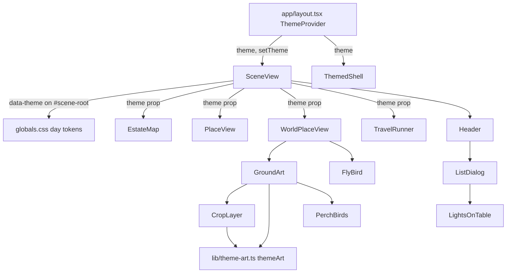

# Design Document

## Overview

Lights On becomes a daytime theme of the same scene. A `Theme` (`"night" | "day"`) lives in React state, is written to `#scene-root` as `data-theme`, and drives three things: CSS tokens (`[data-theme="day"]` in `app/globals.css`), art paths (a pure map in `lib/theme-art.ts`), and a few components (birds, lantern cursor, fog). The paper-register early return in `SceneView` is removed. The register table moves into a "View as list" modal opened from the Header and its mobile Menu.

Pilot scope: only Hallowed Ground (the `ground` world rendered by `WorldPlaceView` > `GroundArt`) has day art. The gate, estate map, crypt and sky keep night art and receive day tokens.

### Files on disk (verified)

`public/art/day/`: `bird-fly.webp`, `bird-perch.webp`, `fg-frame.webp`, `mausoleum.webp`, `mg-fence-tile.webp`, `mg-fence.webp`, `place-ground.webp`, `tomb-arch-fresh.webp`. All eight are present. The matching night files live in `public/art/`. Day art is never edited.

### Findings from the source that shape the design

- `SceneView.tsx` owns `lightsOn` (`useState(false)`) and, when true, early-returns a `<div data-lights-on="true">` with a control bar plus `LightsOnTable`. The normal root is `<div id="scene-root" data-testid="scene-view" data-lights-on="false">`.
- `Header.tsx` takes `lightsOn` / `onLightsOnChange`, renders `<Toggle label="Lights on" hint="Lights on shows a bright, plain list…">`, and already has a badge dialog with an opener-ref focus-return pattern (`badgeOpenerRef`, `badgeButtonRef`, `badgeMenuItemRef`, compact re-point effect). The mobile Menu is inline in `Header` (`menuOpen`, `menuButtonRef`); there is no separate Menu file.
- `LanternCursor` takes `{ lightsOn, reducedMotion }` and returns `null` when `lightsOn`. `EstateMap`, `GatePlaceView` (exported as `PlaceView`) and `WorldPlaceView` take `lightsOn` and pass it on.
- `CropLayer` builds `src = /art/${plate}.webp`, so every `PlateId` crop (`place-ground`, `fg-frame`) goes through one line. `GroundArt` hardcodes `url(/art/mg-fence-tile.webp)`, `url(/art/mg-fence.webp)` and `url(/art/mausoleum.webp)`. `Creature.tsx` builds `/art/${basename}.webp` where `creatureImage()` returns `tomb-arch-fresh` for tombstones.
- Ravens for the ground world are drawn in code by `WorldCreatures.tsx` (`ravenNames`, `data-part="raven"`, effect id `ravens` in `lib/world-effects.ts`), not baked into `mg-fence`. "Hide ravens" therefore means skipping that span in day.
- Fog: `Fog` (`dense`/`thin`) is used by `EstateMap` and `GatePlaceView`; `ThemedShell` renders `ShellFog`. `EnvMist` is environmental mist, not data fog, and stays in day.
- `PLATE_SIZE` in `lib/world-art.ts` already lists the night sizes, which equal the day sizes (Requirement 3.8), so no new size or crop table is needed.
- Loading is `app/g/[username]/loading.tsx` → `GraveyardLoading` → `ThemedShell`, which sits outside `SceneView`. The opening/transition surface inside the scene is `TravelRunner` in `TravelTransition.tsx`.

## Architecture



### Theme state

`components/scene/ThemeProvider.tsx` (client) holds `useState<Theme>("night")` and exposes `useTheme(): { theme, setTheme }`. It is mounted in `app/layout.tsx`. Reasons for a provider rather than `useState` in `SceneView`:

- `loading.tsx` and `ThemedShell` render outside `SceneView` and must read the theme (Requirement 6.1).
- The state is React-only, so a reload resets to `night` (2.8) and nothing touches storage (2.9). No `localStorage`, cookie or URL param.

`SceneView` replaces `const [lightsOn, setLightsOn]` with `const { theme, setTheme } = useTheme()` and derives `const lightsOn = theme === "day"` for the Header toggle. It sets `data-theme={theme}` on the existing `#scene-root` element and removes the `if (lightsOn) { return … }` branch and its control bar. Because the same element tree renders in both themes, `view`, `plotIndex`, `activeFilter`, `selected` and scroll are untouched (2.6, 2.7).

`ThemedShell` sets `data-theme={theme}` on its own root so day tokens apply during loading.

`type Theme = "night" | "day"` is exported from `lib/theme-art.ts` (pure, no React).

### Day tokens (`app/globals.css`)

A `[data-theme="day"]` block scoped to the scene root and shell root. It overrides existing semantic tokens in place and adds a few day-only ones, so existing components pick them up without hex values:

| Token | Night (existing) | Day |
|---|---|---|
| `--color-night-sky` (CropLayer backdrop, vignettes) | `#05060a` | warm haze (new token `--color-day-haze`) |
| `--color-scene-fg`, `-muted`, `-faint` | moon text | warm ink (`--color-ink-900` / `--color-ink-600` family) |
| `--color-day-haze`, `--color-day-light` | n/a | new, defined in `@theme` |
| `--art-filter-ground` | n/a | `none` (night keeps the `brightness(0.55)` values from `WORLD_ART`) |
| `--art-filter-fence` | n/a | `none` (night `brightness(0.5)`) |
| `--day-wash` | n/a | soft warm gradient over the stage, `pointer-events: none` |
| `--motion-bird-fly`, `--motion-bird-cross` | n/a | new motion tokens in `@theme` |

Contrast for text on the day backdrops is checked at the `/a11y-review` step; if a token fails AA, the token changes, not the component. Components never contain hex.

Under day, `LanternCursor` gets `theme` and returns `null` (the same early return, keyed on theme). Fog darkness: `Fog` and `ShellFog` return `null` when `theme === "day"`; `EnvMist` stays.

### `lib/theme-art.ts` (pure)

```ts
export type Theme = "night" | "day";

/** Night asset path -> day asset path. Only files that exist in public/art/day/. */
export const DAY_ART: Readonly<Record<string, string>> = {
  "/art/place-ground.webp":   "/art/day/place-ground.webp",
  "/art/mg-fence.webp":       "/art/day/mg-fence.webp",
  "/art/mg-fence-tile.webp":  "/art/day/mg-fence-tile.webp",
  "/art/mausoleum.webp":      "/art/day/mausoleum.webp",
  "/art/tomb-arch-fresh.webp":"/art/day/tomb-arch-fresh.webp",
  "/art/fg-frame.webp":       "/art/day/fg-frame.webp",
};

export function themeArt(theme: Theme, nightPath: string): string {
  if (theme === "night") return nightPath;
  return DAY_ART[nightPath] ?? nightPath;   // night fallback
}

/** Static CSS filter for a layer: day replaces the night brightness with a token. */
export function themeFilter(theme: Theme, nightFilter: string, dayToken: string): string

export const PERCH_BIRDS: readonly { side: "left" | "right"; x: number; y: number; mirror: boolean }[] = [
  { side: "left",  x: 0.285, y: 0.18, mirror: false },
  { side: "right", x: 0.713, y: 0.18, mirror: true  },
];
export const BIRD_PERCH_NATIVE = { w: 160, h: 160 };
export const BIRD_FLY_FRAME = { w: 96, h: 64, frames: 4 };   // sheet 384x64
export function perchBirdBox(gate: { w: number; h: number }):
  { side: "left" | "right"; left: number; top: number; size: number; mirror: boolean }[]
```

`themeArt` takes the theme and the night path and does no I/O. World, place and asset sets are not special-cased: a path with no entry (gate, crypt, sky, creatures, fog) falls back to night (3.4, 3.5). `lib/world-art.ts` is unchanged.

Wiring (3.6, 3.8):

- `CropLayer` gains `theme?: Theme` (default `"night"`) and computes `src = themeArt(theme, \`/art/${plate}.webp\`)`. `PLATE_SIZE`, `computeCrop` and every crop spec stay as is, because the day files match the night sizes.
- `GroundArt` gains `theme?: Theme` and wraps its three hardcoded URLs: `themeArt(theme, "/art/mg-fence-tile.webp")`, `"/art/mg-fence.webp"`, `"/art/mausoleum.webp"`. It passes `theme` to its `CropLayer`s (`place-ground`, `fg-frame`) and swaps `filter: "brightness(0.5)"` on the fence wrapper and the stratum filters from `WORLD_ART` for `themeFilter(...)`.
- `Creature.tsx` builds `themeArt(theme, \`/art/${basename}.webp\`)` for the `Image` `src` so `tomb-arch-fresh` becomes the day file in every place that renders it, and falls back to night art for every other creature. The theme comes from `useTheme()` inside `Creature` (a client component) so the prop chain through `Tombstone` etc. is unchanged.
- `WorldPlaceView`, `EstateMap` and `PlaceView` replace `lightsOn?: boolean` with `theme?: Theme` (default `"night"`). `WorldPlaceView` forwards `theme` to `GroundArt`.
- `WorldCreatures` skips the `data-part="raven"` span when `theme === "day"`.

### Birds (`components/world/DayBirds.tsx`)

Two components, both `aria-hidden="true"`, `pointer-events: none`, no `tabIndex`, rendered only when `theme === "day"` and `place === "ground"` (4.1, 4.9, 4.10).

**`PerchBirds`** renders inside the `data-testid="ground-fence-gate"` div in `GroundArt`. That div is already the gate box (`gateW` × `fenceH`, `position: absolute`), so the placement is a percentage of it:

```
left = x * 100%   top = y * 100%   (x,y from PERCH_BIRDS; measured from the gate's top-left)
width = height = perchSize = round(fenceH * BIRD_PERCH_HEIGHT_RATIO)   // config constant in theme-art.ts
background: url(/art/day/bird-perch.webp) / 100% 100%
right bird: transform: scaleX(-1); transform-origin: center
```

The point `(x, y)` is the bird box's top-left corner. Mirroring around the box centre leaves the box where the formula puts it. `bird-perch.webp` faces left, so the unmirrored left bird faces left and the mirrored right bird faces right (4.5). `perchBirdBox(gate)` returns the same numbers in px for tests.

**`FlyBird`** renders in the `z-40` pointer-events-none band of `WorldPlaceView` (the div that holds `<Atmosphere />`). Structure:

- Outer wrapper: `position: absolute; top: var(--bird-fly-top)`; animation `bird-cross var(--motion-bird-cross) linear infinite`. The keyframes move it from `-10vw` to `110vw` during the first ~25% of the cycle and hold it off-screen for the rest, which gives "at intervals" with one element and no JS timer.
- Inner sprite: `width: 96px * s; height: 64px * s; background: url(/art/day/bird-fly.webp); background-size: 400% 100%; animation: bird-flap var(--motion-bird-fly) steps(4) infinite`. Keyframes shift `background-position-x` from `0` to `-100%` of the sheet width, so frames play 1-2-3-4 (4.7).

Reduced motion (4.8): the component takes `reducedMotion` (already threaded through `WorldPlaceView`), returns `null` for `FlyBird`, and renders `PerchBirds` with no animation class. A `@media (prefers-reduced-motion: reduce)` block also sets `animation: none` on `.bird-fly`, `.bird-fly-cross` so CSS and DOM agree.

### View as list dialog

- New `components/scene/ListDialog.tsx`: `{ open, onClose, rows, username }`. It renders a modal with `role="dialog"`, `aria-modal="true"`, `aria-labelledby` pointing at a heading ("Every project, accounted for."), a visible close button, and `<LightsOnTable rows={rows} username={username} />`. Focus trap and Escape follow the existing `components/badge/BadgeDialog.tsx` implementation; the design reuses its trap helper if it is exported, otherwise copies its pattern. The warm paper tokens (`--color-paper-*`) stay for the dialog body, which keeps the register looking finished.
- `Header.tsx` owns the dialog, mirroring the badge dialog: `listOpen` state, `listOpenerRef`, `listButtonRef` (desktop) and `listMenuItemRef` (inside the `menuOpen` panel, shown when `compact`). The existing compact re-point effect is extended to cover `listOpen`. On close, focus returns to `listOpenerRef.current` (5.7).
- The link is a `<button type="button">` with the same `focus-visible` ring classes as neighbouring controls. It renders only when `rows` is provided (the Header already accepts `rows`).
- `SceneView` stays mounted behind the dialog; nothing in scene state changes (5.4, 5.8). The old control bar and `Toggle`s that existed only for the register view are deleted.

Header prop changes: `lightsOn` / `onLightsOnChange` keep their names (the toggle still means "lights on"); no new required prop is needed because the dialog is internal. The toggle `hint` becomes "Lights on shows the same world in daylight. Lights off brings the night back." (7.1, 7.3). Toggle already exposes `pressed`.

### Themed loading and opening (6.x)

- `ThemedShell` reads `useTheme()` and sets `data-theme`; `ShellBackdrop` takes `image` and passes it through `themeArt(theme, ...)` for `place-ground` (day file) and falls back to night for `place-gate`. `ShellFog` returns `null` in day. `GraveyardLoading` keeps its copy in the component and picks a day variant from `useTheme()`; day strings are warm ("Counting the graves…" becomes "Walking the grounds…"), and the night string is unchanged.
- `TravelRunner` and `TravelFog` in `TravelTransition.tsx` take `theme`. In day the veil and fog use `--day-wash` / `--color-day-haze` instead of the dark wash and `fog-wisps.webp`. Toggling during a transition only changes `theme`; the runner's timers and `travel` state in `SceneView` are not keyed on it, so nothing restarts (6.3).

### Asset check script (`scripts/check-day-art.mjs`)

Reads each of the eight files with `sharp` (verify it resolves from `node_modules`; Next 16 normally installs it, otherwise add it as a devDependency). It prints width, height and `hasAlpha`, compares to the expected sizes, checks that `place-ground` is fully opaque (alpha channel minimum 255 or no alpha) and that `fg-frame`'s centre region is transparent, and exits non-zero naming each mismatched file. It opens files read-only. A pure `compareDayArt(report): string[]` export is what the unit test calls. Package script: `"check:day-art": "node scripts/check-day-art.mjs"`. Wiring tasks start only after it exits 0.

### Steering edits (Requirement 8)

- `.kiro/steering/design.md`: replace "### Lights-on must be beautiful too" with a "Lights on is the daytime world" section (same world in warm light, Hallowed Ground has painted day art, other worlds use night art under day tokens, copy stays kind and warm). Delete "### The copy turns sinister" and its table. Rewrite the 0.0 s and 1.0 s rows of the lights-out opening table and the "Lights on (header button) plays it in reverse" bullet so they no longer describe a plain paper register. Replace the `## "Lights on" mode` paragraph with the daytime description and a "View as list" accessibility note. Update "always in lights-on mode" label text accordingly.
- `.kiro/steering/product.md` and the explorable-worlds notes: wherever Lights on is described as a plain table, change to "daytime version of the same world"; describe the Register_Table as the "View as list" accessibility view.
- `design-review.md` line "lights-on mode" stays valid and gains "day theme".

## Components and interfaces

| File | Change |
|---|---|
| `lib/theme-art.ts` (new) | `Theme`, `DAY_ART`, `themeArt`, `themeFilter`, `PERCH_BIRDS`, `perchBirdBox`, bird constants |
| `components/scene/ThemeProvider.tsx` (new) | `ThemeProvider`, `useTheme` |
| `app/layout.tsx` | wrap children in `ThemeProvider` |
| `components/scene/SceneView.tsx` | use `useTheme`; `data-theme` on `#scene-root`; delete lights-on early return; pass `theme` down |
| `components/ui/Header.tsx` | "View as list" link (desktop + compact Menu), owns `ListDialog`, new toggle hint |
| `components/scene/ListDialog.tsx` (new) | modal wrapping `LightsOnTable` |
| `components/scene/LanternCursor.tsx` | prop `lightsOn: boolean` → `theme: Theme`; `null` in day |
| `components/scene/EstateMap.tsx`, `GatePlaceView.tsx`, `components/world/WorldPlaceView.tsx` | `lightsOn?` → `theme?` |
| `components/scene/Fog.tsx`, `ShellFog.tsx` | return `null` in day |
| `components/world/CropLayer.tsx` | `theme?` prop, `themeArt` for `src` |
| `components/world/GroundArt.tsx` | `theme?` prop, themed URLs and filters, `PerchBirds` |
| `components/world/WorldCreatures.tsx` | skip raven in day |
| `components/creatures/Creature.tsx` | `themeArt` for `Image src` |
| `components/world/DayBirds.tsx` (new) | `PerchBirds`, `FlyBird` |
| `components/scene/ThemedShell.tsx`, `ShellBackdrop.tsx`, `GraveyardLoading.tsx`, `TravelTransition.tsx` | themed loading and opening |
| `app/globals.css` | day tokens, bird keyframes, reduced-motion rules |
| `components/dev/ReviewHarness.tsx` | `lightsOn={false}` → `theme="night"` |
| `scripts/check-day-art.mjs` (new) | asset check |

## Data models

No persisted data. `Theme` is in-memory only. `DAY_ART` and `PERCH_BIRDS` are constants in `lib/theme-art.ts`. No new env vars, routes or storage keys.

## Error handling

- Missing day file at runtime: `DAY_ART` only lists files verified on disk by the asset check, and unmapped paths fall back to night. A 404 on a mapped file is guarded at build time by the asset check and a unit test that every `DAY_ART` value exists under `public/`.
- `matchMedia` missing (tests): reduced motion defaults to `true` in `SceneView`, so birds render without animation.
- Dialog opener removed (layout flips compact/desktop while open): re-point to the surviving control, falling back to the Menu button, as the badge dialog does.

## Correctness Properties

*A property is a characteristic or behavior that should hold true across all valid executions of a system-essentially, a formal statement about what the system should do. Properties serve as the bridge between human-readable specifications and machine-verifiable correctness guarantees.*

Reflection: properties on "day path for mapped assets", "night fallback" and "night is identity" overlap with the "every path resolves under `/art/`" requirement (9.6), so they are combined into two properties plus the placement property. The remaining criteria (data-theme attribute, dialog, birds in DOM, copy, steering) are example tests.

### Property 1: Night theme is the identity

For any asset path string, `themeArt("night", path)` returns `path` unchanged.

**Validates: Requirements 3.3**

### Property 2: Day theme maps known assets and falls back to night for the rest

For any night path in `DAY_ART`, `themeArt("day", path)` returns its day path under `/art/day/`. For any path not in `DAY_ART` (including gate, crypt, sky, creature and unknown paths), `themeArt("day", path)` returns `path` unchanged.

**Validates: Requirements 3.1, 3.2, 3.4, 3.5**

### Property 3: Resolved art paths stay under `/art/` and are deterministic

For any theme and any night path that starts with `/art/` and ends in `.webp`, `themeArt` returns a non-empty path that starts with `/art/`, and calling it twice with the same arguments returns the same value.

**Validates: Requirements 3.7, 9.6**

### Property 4: Perch bird placement follows the gate box

For any gate box with positive width and height, `perchBirdBox(gate)` returns exactly two birds: left at `(0.285 * w, 0.18 * h)` unmirrored, right at `(0.713 * w, 0.18 * h)` mirrored, with both positions inside the gate box.

**Validates: Requirements 4.2, 4.3, 4.4, 4.5**

## Testing Strategy

Vitest for everything; fast-check at 100+ runs per property. Property tests go in `tests/property/theme-art.property.test.ts`, each tagged `Feature: daytime-lights-on, Property N: …`. Per task, run only the affected test files.

Property tests: Properties 1–4 above, generated over arbitrary strings (including unicode and `..`), paths under `/art/`, and gate sizes from `fc.integer({ min: 1, max: 4000 })`.

Unit and DOM tests (examples):

- `tests/unit/theme-art.test.ts`: every `DAY_ART` value exists under `public/`; `DAY_ART` keys match the six night assets; `compareDayArt` flags a wrong size, a missing file and wrong alpha.
- `tests/dom/SceneView.theme.test.tsx`: toggling Lights On sets `data-theme="day"` on `#scene-root` and back; `view`, plot, filter, selected repo and scroll are the same before and after; the scene root element is the same node (stays mounted); no `localStorage` writes; a fresh mount starts as `night`.
- `tests/dom/DayBirds.test.tsx`: day + ground renders two perch birds and one fly bird; night renders none; birds are `aria-hidden` with `pointer-events: none`; under `reducedMotion` there is no fly bird and no animation class on perch birds; fly sprite uses `steps(4)`.
- `tests/dom/ListDialog.test.tsx` and `Header` tests: activating "View as list" (desktop and in the Menu) opens `role="dialog"` with an accessible name containing the register table; focus stays inside; Escape and Close close it; focus returns to the opener link.
- Updates to existing tests that pass `lightsOn`: `tests/dom/Chrome.test.tsx`, `tests/dom/HeaderBadge.test.tsx`, `tests/dom/HeaderMenu.test.tsx` (new toggle hint and the extra link) and `tests/dom/LanternCursor.test.tsx` (`lightsOn` → `theme`; null in day).
- Source-scan test: `GroundArt.tsx` and `CropLayer.tsx` contain no hardcoded `/art/*.webp` strings outside `themeArt` calls; components contain no hex colors (matching the existing token scan).
- Steering text check: `.kiro/steering/design.md` no longer contains "paper register" or "copy turns sinister" and mentions "View as list".

Final task runs the full suite, `tsc` and lint. No `next build`. `public/art/day/` is never written.
