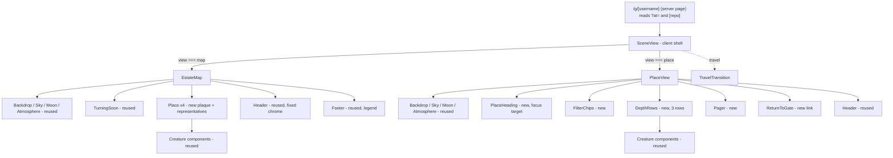
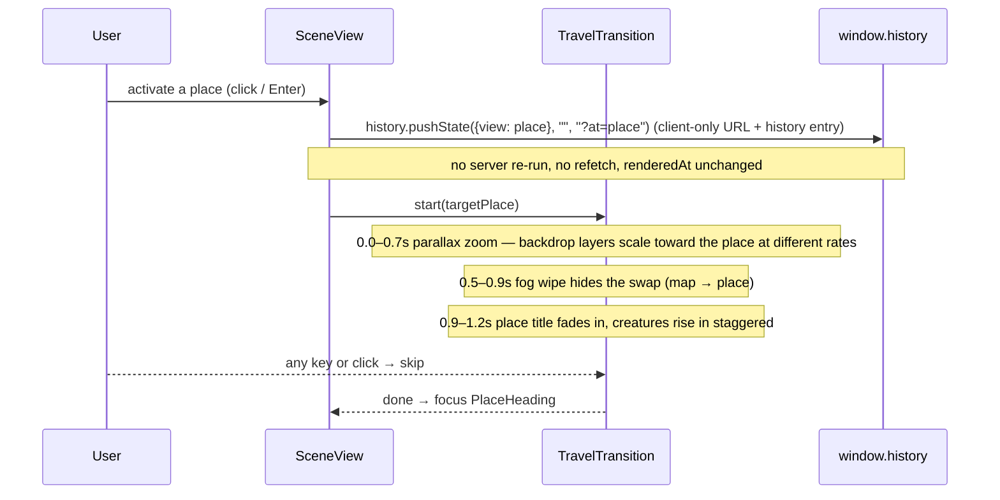

# Design Document: Estate Map & Places

## Overview

Today the graveyard renders every classified repository as a creature in a single full-bleed scene (`SceneView` → `Scene` → five `Zone`s). This feature restructures that single scene into a two-level navigation model that matches the painted mockups in `docs/design-canvas/`:

1. **The estate map** (the default view at `/g/[username]` and `/estate`) keeps the painted backdrop, moon, atmosphere, and turning-soon notice, but instead of showing every creature it shows **four places** — each a focusable link with a glowing plaque and 2–3 representative creatures.
2. **A place** (reached by a `?at=` query param) shows one group of creatures laid out in depth rows across paginated "plots", with decay-word filter chips, a pager, and a "Return to the gate" button.

Travelling from the map into a place plays a short, skippable parallax-zoom-plus-fog transition (`Travel.dc.html`); reduced-motion users get a 300 ms crossfade. Arrival moves focus to the place heading for screen-reader users.

The hard architectural constraint is that **lifecycle classification is frozen**: `lib/lifecycle.ts` is the single source of truth and this feature touches none of it. Everything new is a pure view-model mapping on top of the already-classified `GraveyardRow`s, plus presentational components. Four new pure, property-tested functions — `placeOf`, `paginate`, `orderForPlace`, `plaqueCopy` — carry all the new domain logic, and the existing pure functions (`creatureScale`, `creatureImage`, `orderZombies`, `creatureAccessibleName`, `pickTurningSoon`, `moonTreatment`, `fogDensity`, `summaryCounts`, …) and existing components (`components/scene/*`, `components/creatures/*`) are reused wherever possible.

This design covers both a high-level view (architecture, routing, components, data/view-models) and a low-level view (pure-function signatures, algorithms, and correctness properties).

---

## Architecture

### Place model

The five lifecycle states collapse onto four places. This is the one new domain decision and it is total and exhaustive:

| Place id | Place name        | Lifecycle state(s)   | Plaque accent |
| -------- | ----------------- | -------------------- | ------------- |
| `sky`    | The Restless Sky  | `ghost`              | gold          |
| `gate`   | Beyond the Gate   | `zombie` + `risen`   | crimson       |
| `ground` | Hallowed Ground   | `tombstone`          | gold          |
| `crypt`  | The Crypt         | `coffin`             | gold          |

`placeOf(row)` maps every row to exactly one place id. `gate` is the only place that aggregates two states: zombies are the primary population and the risen are shown "at the gate" alongside them (mirroring `PlaceBeyondGate.dc.html` and the existing scene, where risen climb out near the gate).

### Component tree



### Data flow and the React/I-O seam

The existing seam is preserved exactly: the **server page** does all request-time work (await params, `await connection()`, a **single `renderedAt` clock read**, `loadGraveyard`), and the **client `SceneView`** owns all interactive state and all clock-dependent derivations, calling only pure functions that take `now`/`renderedAt` as an explicit argument. No new module reads the clock, performs I/O, or imports `server-only`.

**`renderedAt` is read exactly once, by the server page, and never changes thereafter.** All navigation between the map and places happens entirely on the client (see Routing below): entering or leaving a place, paging, filtering, and travel never re-run the server page, never refetch the graveyard, never capture a new `renderedAt`, and never reset `SceneView`'s state. The server page's `?at=` is consumed **only for the initial render**; after hydration the view is pure client state.

`SceneView` gains a `view` state value (`"map" | PlaceId`), initialized once from the server-provided `?at=`/deep-link and thereafter driven by client interactions and the browser back/forward `popstate` listener:

```mermaid
sequenceDiagram
    participant Page as Server Page
    participant SV as SceneView (client)
    participant Hist as window.history / popstate
    participant Pure as lib/estate-view.ts (pure)
    participant UI as EstateMap / PlaceView

    Page->>SV: rows, repos, renderedAt (read ONCE), username, mode, at?, initialRepo?
    SV->>Pure: parsePlaceId(at), placeOf(matchedRow) for deep-link resolution
    Pure-->>SV: initial view = (at ?? placeOfDeepLink ?? "map")
    Note over SV: renderedAt is now frozen for the lifetime of the client

    alt view === "map"
        SV->>UI: render EstateMap(places, representatives, turningSoon)
        UI->>SV: onEnterPlace(place)
        SV->>Hist: history.pushState({view: place}, "", "?at=place")
        Note over SV,Hist: client-only URL change — NO server re-run, NO refetch, renderedAt unchanged
        SV->>SV: setView(place) (+ run travel)
    else view === a place
        SV->>Pure: orderForPlace(place, rows), paginate(ordered, 12), plaqueCopy(...)
        Pure-->>SV: ordered rows, plots, copy
        SV->>UI: render PlaceView(plot, filters, selected)
        UI->>SV: onReturn()
        SV->>Hist: history.pushState({view: "map"}, "", pathname) (client-only)
        SV->>SV: setView("map")
    end

    Hist-->>SV: popstate (back/forward)
    SV->>SV: setView(event.state?.view ?? parsePlaceId(location.search) ?? "map")
    Note over SV: still no server re-run; renderedAt and rows stay frozen
```

### Where the new logic lives

All four new pure functions live in a new pure module **`lib/estate-view.ts`** (a sibling of `lib/scene-view.ts` and `lib/graveyard-view.ts`). It imports the shared domain types from `lib/lifecycle.ts` and the `GraveyardRow` type from `lib/graveyard-view.ts`, reuses constants/helpers from `lib/scene-view.ts` (e.g. `creatureScale`, `orderZombies`'s decay-ordering idea), and performs no I/O and reads no clock. Keeping it in its own module keeps `scene-view.ts`'s property-test surface stable; the alternative (appending to `scene-view.ts`) is acceptable but mixes two concerns, so a dedicated module is preferred.

---

## Routing

### The `?at=` query parameter

Both scene routes stay as-is; the place is selected by a query parameter rather than a new path segment, so a place is shareable and the browser back/forward buttons work without extra history wiring.

- `/g/[username]` → estate map
- `/g/[username]?at=sky|gate|ground|crypt` → that place
- `/estate` and `/estate?at=...` → same, for the bundled sample estate

The server page reads `searchParams` (a `Promise` in Next 16, awaited alongside `params`) and forwards the raw `at` string to `SceneView` as an optional `at?: string` prop **for the initial render only**. `SceneView` validates it through a pure `parsePlaceId(at)` helper that returns a `PlaceId | null`; an unknown or absent value resolves to the map.

**Navigation is client-only — it never re-runs the server page.** Entering or leaving a place updates the URL with the browser History API directly rather than the Next router:

- **Enter a place**: `window.history.pushState({ view: place }, "", `${pathname}?at=${place}`)`, then `setView(place)` (and kick off travel). `pushState` adds a history entry so each place is shareable and back works, but it does **not** trigger a Next navigation/render — so there is no refetch, no new `renderedAt`, and no state reset.
- **Return to the map**: `window.history.pushState({ view: "map" }, "", pathname)` (query stripped), then `setView("map")`.
- **Replace vs push**: the initial client-side normalization of the URL (if ever needed) uses `history.replaceState` so it does not add a spurious entry; user-initiated place changes use `pushState`.

Because `pushState`/`replaceState` mutate the same URL object that Next's `useSearchParams` reads, the displayed URL and any `useSearchParams`-derived values stay in sync with `view` without a server round-trip.

**Back/forward** is handled by a `popstate` listener registered by `SceneView` on mount: on `popstate` it sets the view from the event's history state, falling back to parsing the current `location.search`:

```
view ← parsePlaceId(event.state?.view) ?? parsePlaceId(new URLSearchParams(location.search).get("at")) ?? "map"
```

This resolves back/forward purely in the client — again with no server re-run, no refetch, and `renderedAt`/`rows` left frozen. The listener is removed on unmount.

### Deep-link `/g/[username]/[repo]` resolution

The existing deep-link route keeps forwarding the `[repo]` segment as `initialRepo`. Its behavior is extended: when `initialRepo` matches a row (case-insensitive, via the existing `selectInitialCreature`), `SceneView` resolves the **place that contains that row** with `placeOf(matchedRow)` and opens that place with the creature pre-selected. Precedence for the initial view:

1. explicit `?at=` (if valid) wins;
2. else the place containing the deep-linked `[repo]` (if it matches a row);
3. else the map.

A `[repo]` that matches no row leaves the view on the map with nothing selected (unchanged from today).

### Turning-soon "Go to it"

The `TurningSoon` notice on the map carries a **"Go to it"** action that jumps straight to the turning-soon ghost inside its place. `pickTurningSoon` already names the ghost (always a `ghost`, so its place is `sky`). On activation `SceneView`:

1. computes the ordered sky rows `ordered = orderForPlace("sky", skyRows)` (sky rows are `rows.filter(r => placeOf(r) === "sky")`);
2. paginates them `plots = paginate(ordered, PLOT_SIZE)` and finds the **plot index that contains the selected name**: `plotIndex = plots.findIndex(plot => plot.some(r => r.name === name))` (guaranteed ≥ 0 because the ghost is a sky row);
3. sets `view = "sky"`, `selected = name`, `plotIndex = thatIndex`, clears any active filter to `"all"` so the ghost is not filtered out, and performs the same client-only `history.pushState({ view: "sky" }, "", "?at=sky")` and travel as a normal place entry.

So the user lands in The Restless Sky on exactly the plot holding the turning-soon ghost, with that creature pre-selected.

---

## Components and Interfaces

### Reused as-is (no changes)

`Backdrop`, `Sky`, `Moon`, `Atmosphere`, `Fog`, `Lightning`, `TurningSoon`, `Whisper`, the five `creatures/*` components, `Toggle`. `Scene`'s layout bands and parallax wiring are reused by both `EstateMap` and `PlaceView` (shared backdrop stack).

### Reused with small fixes

- **`Header`** — fix the chrome to match the boards: blackletter wordmark (already `font-wordmark`), the **username rendered in a Cinzel badge** (today it is a plain muted span — change to a bordered Cinzel pill like the mock's `be4glebot` badge), the summary line in letter-spaced Cinzel, and styled toggles consistent with `.btn` in the mocks.
- **`SummaryLine`** — switch each segment to correct singular/plural via `plaqueCopy`-style pluralization (today labels are always plural: "1 ghosts" is wrong; it must read "1 ghost").
- **`Footer`** — ensure the legend matches this design's place/state vocabulary.
- **`LightsOnTable`** — add a sortable **Place** column (`PLACES[placeOf(row)].name`) alongside the existing Repository / State / Quiet-for / Decay columns, so the register reads clearly across all four places. Still fed the full `rows` and still presentational/server-renderable; see the Lights-on Register section.

### New components

#### `EstateMap`

**Purpose**: the default map view. Composites the reused backdrop stack, moon, atmosphere, and turning-soon notice, then renders four `Place` links positioned per `EstateMap.dc.html`.

```typescript
interface EstateMapProps {
  rows: GraveyardRow[];
  username: string;
  mode: "live" | "estate";
  turningSoon: TurningSoonResult | null;
  onEnterPlace: (place: PlaceId) => void; // triggers travel + client-only history.pushState
  reducedMotion: boolean;
  // reused chrome state
  lightsOn: boolean; onLightsOnChange: (b: boolean) => void;
  soundOn: boolean; onSoundChange: (b: boolean) => void;
}
```

#### `Place` (plaque + representatives)

**Purpose**: one focusable link on the map with a glowing plaque and 2–3 representative creatures.

```typescript
interface PlaceProps {
  place: PlaceId;
  rows: GraveyardRow[];        // rows belonging to this place (via placeOf)
  onEnter: (place: PlaceId) => void;
}
```

**Responsibilities**:

- Pick representatives by calling `orderForPlace(place, rows)` and taking the first 2–3. This falls directly out of each place's ordering rule: `sky` yields the **most-decayed/urgent ghosts first** (so danger is visible), `gate` yields **risen first then the freshest zombies**, and `ground`/`crypt` yield the **newest at rest first**. No separate representative-picking logic is needed.
- Render the plaque: Cinzel name, IM Fell italic count line via `plaqueCopy(place, count)` — for the gate, `plaqueCopy("gate", zombieCount, risenCount)` so the risen are mentioned separately — and a call-to-action ("Rise to them →", "Open the gate →", etc.).
- Empty places stay visible but quieter (reduced opacity, no representatives, plaque reads the empty copy).
- The whole place is a single focusable link/button (keyboard-activatable) that calls `onEnter(place)`.

#### `PlaceView`

**Purpose**: the in-place view. Reuses the backdrop stack and renders the place heading, filter chips, depth rows, pager, and return link per `PlaceBeyondGate.dc.html`.

```typescript
interface PlaceViewProps {
  place: PlaceId;
  rows: GraveyardRow[];              // all rows for this place (already placeOf-filtered)
  activeFilter: DecayWord | "risen" | "all"; // "risen" only meaningful for the gate
  plotIndex: number;                 // 0-based
  selectedName: string | null;
  onFilterChange: (f: DecayWord | "risen" | "all") => void;
  onPlotChange: (index: number) => void;
  onSelect: (name: string) => void;
  onReturn: () => void;
  reducedMotion: boolean;
}
```

**Responsibilities**:

- Apply the active filter (decay word, or the gate's "Risen" chip), then `orderForPlace(place, rows)`, then `paginate(ordered, PLOT_SIZE)`.
- Render the current plot across up to three depth rows (front row largest/brightest, back rows smaller/dimmer) using `creatureScale` for per-row scale and a per-row brightness factor.
- Render `FilterChips` with counts, `Pager` with "Plot X of Y", and the `ReturnToGate` link.
- On mount/arrival, move focus to `PlaceHeading`.

#### `PlaceHeading`, `FilterChips`, `DepthRows`, `Pager`, `ReturnToGate`

Small presentational components; `PlaceHeading` holds a `tabIndex={-1}` ref that `PlaceView` focuses on arrival. `FilterChips` renders one chip per decay word with its count for `sky`, and for `gate` the five zombie decay words **plus a `Risen` chip** (its own count) — selecting `Risen` filters to risen rows, a decay word filters to zombies at that band, `all` clears the filter. Chips with a zero count are dimmed/disabled.

#### `TravelTransition`

**Purpose**: the ~1.2 s parallax-zoom + fog-wipe transition overlay, skippable, with a reduced-motion crossfade fallback. Detailed in the Travel section below.

---

## Data Models

No new persisted data. All models are view-models derived from `GraveyardRow[]`.

### `PlaceId` and place metadata

```typescript
export type PlaceId = "sky" | "gate" | "ground" | "crypt";

export interface PlaceMeta {
  id: PlaceId;
  name: string;                 // Cinzel display name, e.g. "The Restless Sky"
  states: LifecycleState[];     // which lifecycle states live here
  accent: "gold" | "crimson";
  cta: string;                  // call to action, e.g. "Open the gate →"
}

export const PLACES: Record<PlaceId, PlaceMeta>; // single source of truth, display order sky,gate,ground,crypt
```

### Decay words (filter chips)

Decay vocabulary is **derived from the existing `decayLevel`** (never recomputed). Ghosts have a 0–3 band, zombies a 0–4 band (from `LIFECYCLE_CONFIG.ghostDecayBounds` / `zombieDecayBounds`), so the chip label map is:

```typescript
// ghost decayLevel 0..3
const GHOST_DECAY_WORDS = ["healthy", "fading", "flickering", "about to turn"] as const;
// zombie decayLevel 0..4
const ZOMBIE_DECAY_WORDS = ["fresh", "rotting", "decayed", "skeletal", "ancient"] as const;
```

Only `sky` and `gate` show decay chips (the states with a decay band). `ground`/`crypt` show no decay filter.

**Gate "Risen" chip.** Because `gate` aggregates two states, its filter chips are the five zombie decay words (`fresh`, `rotting`, `decayed`, `skeletal`, `ancient`) **plus a dedicated `Risen` chip** with its own count. Selecting `Risen` filters the place to the risen rows; selecting a decay word filters to zombies at that band; `all` shows both. The filter type for the gate is therefore `DecayWord | "risen" | "all"`:

```typescript
// gate: zombie decay words plus a risen chip
type GateFilter = (typeof ZOMBIE_DECAY_WORDS)[number] | "risen" | "all";
```

Each chip shows its count; the `Risen` chip's count is the number of risen rows in the gate, and the empty-count chips are disabled/dimmed (consistent with `sky`).

### Constants

```typescript
export const PLOT_SIZE = 12;        // creatures per plot (replaces ZONE_CAP's "+N more")
export const DEPTH_ROWS = 3;        // max depth rows per plot
export const TRAVEL_MS = 1200;      // total travel duration
export const TRAVEL_CROSSFADE_MS = 300; // reduced-motion fallback
```

`PLOT_SIZE` replaces the zone cap / "+N more" approach inside a place; `creatureScale` is still reused for per-row sizing.

---

## The Four New Pure Functions

All four live in `lib/estate-view.ts`, are **total** (no input throws or yields `NaN`), **deterministic** (same inputs → same output), and read no clock. They never mutate their inputs.

### `placeOf`

```typescript
/** Maps a row's lifecycle state to exactly one place. Exhaustive over all 5 states. */
export function placeOf(row: Pick<GraveyardRow, "state">): PlaceId;
```

**Algorithm** — a total switch over the five states:

```pascal
FUNCTION placeOf(row)
  CASE row.state OF
    "ghost"     -> RETURN "sky"
    "zombie"    -> RETURN "gate"
    "risen"     -> RETURN "gate"
    "tombstone" -> RETURN "ground"
    "coffin"    -> RETURN "crypt"
  END CASE
END
```

### `orderForPlace`

```typescript
/** Stable, place-specific ordering of the rows in a place. */
export function orderForPlace(place: PlaceId, rows: GraveyardRow[]): GraveyardRow[];
```

Each place has its own ordering rule rather than one shared "freshest-first" rule, because the four places tell different stories. `place` is now a parameter so the order matches each place's narrative:

| Place    | Ordering rule                                                                                          | Why |
| -------- | ------------------------------------------------------------------------------------------------------ | --- |
| `sky`    | most **URGENT** first: `decayLevel` **descending**, then `daysQuiet` **descending**                    | ghosts about to turn (highest decay, longest quiet) stand in front so danger is visible |
| `gate`   | **risen first**, then zombies by `decayLevel` **ascending** (freshest / most savable first)            | the newly risen are literally at the gate; the freshest zombies are the ones still worth reviving |
| `ground` | `daysQuiet` **ascending** (newest at rest first)                                                        | the most recently finished works read first |
| `crypt`  | `daysQuiet` **ascending** (newest first)                                                                | the most recently sealed away read first |

All four orderings are **stable** (ties keep input order, which is pushed-at descending from the loader) and **never mutate** the input array (copy first). All are **total**: a null/NaN `decayLevel` is treated as `0` and a null/NaN `daysQuiet` as `0` for comparison.

```pascal
FUNCTION orderForPlace(place, rows)
  rows' := copyOf(rows)                 // never mutate the caller's array
  decay(row)  := IF row.decayLevel is a finite number THEN row.decayLevel ELSE 0
  quiet(row)  := IF row.daysQuiet  is a finite number THEN row.daysQuiet  ELSE 0

  CASE place OF
    "sky":
      // most urgent first
      RETURN stableSort(rows', BY decay(row) DESC, THEN quiet(row) DESC)

    "gate":
      // risen always precede zombies; within zombies, freshest (lowest decay) first
      rank(row) := IF row.state = "risen" THEN 0 ELSE 1
      RETURN stableSort(rows', BY rank(row) ASC, THEN
                               (IF row.state = "risen" THEN 0 ELSE decay(row)) ASC)

    "ground", "crypt":
      // newest at rest first
      RETURN stableSort(rows', BY quiet(row) ASC)
  END CASE
END
```

Because `Array.prototype.sort` is stable in modern engines, equal keys preserve input order. For `gate`, the primary key `rank` guarantees every risen row sorts ahead of every zombie row regardless of decay; the secondary key orders only the zombie block (risen all share key `0`, so stability keeps them in input order).

### `paginate`

```typescript
/** Splits rows into fixed-size plots that partition the input in order. */
export function paginate<T>(rows: T[], size: number): T[][];
```

**Algorithm**:

```pascal
FUNCTION paginate(rows, size)
  n := max(1, trunc(size))          // defensive: size <= 0 collapses to 1
  IF rows is empty THEN RETURN [ [] ]  // one empty plot so "Plot 1 of 1" renders
  plots := []
  FOR i FROM 0 TO length(rows) STEP n
    plots.push(rows[i .. i+n])
  RETURN plots
END
```

Every non-final plot has exactly `size` items; the final plot has 1..`size`. Concatenating the plots in order reproduces the input exactly. The empty-input case returns a single empty plot so the pager always has a "Plot 1 of 1" to show.

### `plaqueCopy`

```typescript
/**
 * Count line for a place's plaque / summary, singular/plural correct for 0, 1, many.
 * The optional `risenCount` is honored only for the `gate`, where the zombie
 * `count` and the risen population are reported separately; it is ignored for
 * the other three places. Defaults to 0 so the signature stays backward-compatible.
 */
export function plaqueCopy(place: PlaceId, count: number, risenCount?: number): string;
```

The `gate` is the only place that aggregates two states, so its plaque counts the **zombies** in `count` and appends a separate **risen clause** when `risenCount > 0` (e.g. `"48 undead shamble here, waiting for a verdict · 1 has risen"`). The other places ignore `risenCount`. Per-place templates with correct grammar at 0, 1, and n:

```pascal
FUNCTION plaqueCopy(place, count, risenCount DEFAULT 0)
  c := max(0, trunc(count))        // defensive normalize
  r := max(0, trunc(risenCount))   // defensive normalize, gate only
  CASE place OF
    "sky":    IF c = 0 THEN "No ghosts linger"
              ELSE c + " ghost" + plural(c) + " still " + verb(c, "wanders","wander")

    "gate":   // base clause describes the zombies (the "undead" at the gate)
              base := IF c = 0 THEN "The gate stands empty"
                      ELSE c + " undead " + verb(c,"shambles","shamble")
                             + " here, waiting for a verdict"
              // separate risen clause, only when any risen are present
              IF r = 0 THEN RETURN base
              risenClause := r + " " + verb(r, "has", "have") + " risen"
              IF c = 0 THEN RETURN risenClause        // only risen present
              ELSE RETURN base + " · " + risenClause  // both present

    "ground": IF c = 0 THEN "No finished works at rest"
              ELSE c + " finished work" + plural(c) + " at rest"
    "crypt":  IF c = 0 THEN "No one sealed away yet"
              ELSE c + " sealed away"
  END CASE
END
```

`plural(c)` yields `""` for 1 and `"s"` otherwise; `verb(c, singular, plural)` picks the subject-verb-agreement form (so the risen clause reads `"1 has risen"` / `"n have risen"`). The same pluralization helper backs the `SummaryLine` fix. The function stays **total and deterministic**: negative/fractional `count` and `risenCount` normalize to non-negative integers, and every branch returns a non-empty string.

`PlaceView`/`Place` call `plaqueCopy("gate", zombieCount, risenCount)` for the gate and `plaqueCopy(place, count)` for the other three (where `risenCount` defaults to 0 and is ignored).

### Reused pure functions (no duplication)

| Need | Reuse |
| ---- | ----- |
| per-row display scale in depth rows | `creatureScale` |
| state+decay → art basename | `creatureImage` |
| accessible name text | `creatureAccessibleName` |
| decay-ascending order of the zombie block within gate | `orderZombies` (the same idea, specialized per place in `orderForPlace`) |
| moon treatment on map/place | `moonTreatment` |
| fog density on map/place | `fogDensity`, `ancientZombieCount` |
| per-state counts & souls total | `summaryCounts` |
| turning-soon ghost on the map | `pickTurningSoon` |
| deep-link name match | `selectInitialCreature` |

---

## Correctness Properties

These are the property-based test targets for `lib/estate-view.ts`. Each holds for **all** inputs (arbitrary `GraveyardRow[]`, arbitrary non-negative counts/sizes).

### Property 1: placeOf is exhaustive and total (state to place mapping)

**Validates: Requirements 3.1, 3.2, 3.3, 3.4, 3.5, 3.6, 3.7**

For every lifecycle state `s`, `placeOf({state: s})` returns a defined `PlaceId`, and the mapping is exactly:
`ghost→sky`, `zombie→gate`, `risen→gate`, `tombstone→ground`, `coffin→crypt`. No state yields `undefined`/throws. Partition corollary: grouping any `rows` by `placeOf` puts every row in exactly one of the four places and loses none.

```
∀ row ∈ rows: placeOf(row) ∈ {sky, gate, ground, crypt}
Σ |placeGroup(p)| for p in 4 places  =  |rows|
```

### Property 2: orderForPlace is a stable, per-place-correct permutation

**Validates: Requirements 6.1, 6.2, 6.3, 6.4, 6.5, 6.6, 6.7, 6.8, 6.9**

For any `place ∈ {sky, gate, ground, crypt}` and any `rows`, `orderForPlace(place, rows)` is a **permutation** of `rows` (same multiset), **never mutates** `rows`, and its ordering is **monotonic in that place's key**, with ties keeping input order (stability). Concretely, for `result = orderForPlace(place, rows)`:

- **sky** — key is urgency: `(decayLevel, daysQuiet)` compared **descending**. For all `i < j`: `decay(result[i]) ≥ decay(result[j])`, and on equal decay `daysQuiet(result[i]) ≥ daysQuiet(result[j])`.
- **gate** — **every risen row precedes every zombie row**: there is no `i < j` with `result[i].state = "zombie"` and `result[j].state = "risen"`. Within the zombie block, `decayLevel` is **monotonic non-decreasing** (freshest first).
- **ground / crypt** — `daysQuiet` is **monotonic non-decreasing** (newest at rest first).
- **stability** (all places): rows that compare equal on the place's key retain their input order.
- **totality / no-mutation** (all places): never throws on null/NaN keys, and `rows` is unchanged after the call.

```
∀ place: multiset(orderForPlace(place, rows)) = multiset(rows)
∀ place: rows is unchanged after the call
sky:    ∀ i<j: (decay[i],quiet[i]) ≥ (decay[j],quiet[j])   (lexicographic, descending)
gate:   ¬∃ i<j: result[i].state="zombie" ∧ result[j].state="risen"
        ∧ within zombies: ∀ i<j: decay[i] ≤ decay[j]
ground, crypt: ∀ i<j: quiet[i] ≤ quiet[j]
all:    equal-key rows retain input order
```

### Property 3: paginate partitions the rows

**Validates: Requirements 7.1, 7.2, 7.3, 7.4, 7.5**

For any `rows` and any `size ≥ 1`:

- **Concatenation**: flattening the plots in order equals `rows` exactly (order and multiplicity preserved).
- **No empty plot except the whole-empty case**: every plot is non-empty, **except** when `rows` is empty, where the result is exactly one empty plot (`[[]]`).
- **Full non-final plots**: every plot except possibly the last has length exactly `min(size, |rows|)`; the last has length in `1..size` (for non-empty input).
- **Count**: number of plots = `ceil(|rows| / size)` for non-empty input, `1` for empty input.

```
flatten(paginate(rows, size)) = rows
rows = [] ⇒ paginate(rows, size) = [[]]
rows ≠ [] ⇒ every plot non-empty ∧ |plot| ≤ size ∧ (non-last ⇒ |plot| = size)
```

### Property 4: plaqueCopy singular/plural correctness for 0, 1, many (incl. the gate's separate risen clause)

**Validates: Requirements 4.1, 4.2, 4.3, 4.4, 4.5, 4.6, 4.7, 4.8, 4.9**

For every `place` and the primary `count`:

- `count = 0` → the place's empty-copy string (no number, reads naturally, e.g. "No one sealed away yet").
- `count = 1` → singular noun and singular verb ("1 ghost still wanders"), never "1 ghosts"/"1 … wander".
- `count ≥ 2` → plural noun and plural verb ("48 undead shamble here, waiting for a verdict").
- Total: any finite `count`/`risenCount` (including negative, fractional) yields a non-empty string and never throws; negatives/fractions normalize to a non-negative integer first.

For the **gate** specifically, with `risenCount = r` (ignored for all other places):

- `r = 0` → the risen clause is **omitted** entirely (result is exactly the zombie base clause).
- `r = 1` → the clause reads **"1 has risen"** (singular verb), appended after `" · "` when zombies are also present, or standalone when `count = 0`.
- `r ≥ 2` → the clause reads **"n have risen"** (plural verb).
- The zombie base clause still follows the singular/plural rule above independently of `r`.

```
∀ p: plaqueCopy(p, 0) = emptyCopy(p)            (gate with r=0)
∀ p: plaqueCopy(p, 1) is grammatically singular
∀ p, n ≥ 2: plaqueCopy(p, n) is grammatically plural
gate, r = 0: result contains no "risen" clause
gate, r = 1: result ends with "1 has risen"
gate, r ≥ 2: result ends with "n have risen"
∀ finite n, r: plaqueCopy is a non-empty string (never throws)
```

**Property test library**: `fast-check` (the existing choice in this repo's property tests), driving arbitrary arrays of `GraveyardRow` and arbitrary integer counts/sizes.

---

## Travel Transition

Travel plays when the user enters a place from the map (`onEnterPlace`). It follows `Travel.dc.html`'s four beats and is owned by `TravelTransition`, an overlay rendered by `SceneView` during the transition window.

### Timeline (motion allowed), total ≈ 1200 ms, skippable



- **Parallax zoom (0–0.7 s)**: the shared backdrop plates scale toward the chosen place's map position at different rates, reusing the existing `--px/--py`-style custom-property approach (here `--zoom`/origin driven by a rAF-free CSS transition). The zoom origin is the place's plaque position on the map.
- **Fog wipe (0.5–0.9 s)**: a radial fog layer rises to opaque to hide the content swap from map to place.
- **Arrive (0.9–1.2 s)**: the place title fades in and creatures rise into their rows one by one, staggered by the existing `animationDelay(name)` so no two start together.
- **Skippable**: a `keydown`/`pointerdown` listener (attached only during the window) jumps straight to the done state.
- **URL**: the client-side `history.pushState` to `?at=place` happens at the start so back/forward and sharing resolve to the place even if the user reloads mid-transition. Because it is `pushState` (not a router navigation), the transition is never interrupted by a server re-render, and `renderedAt`/client state survive the whole travel.

### Reduced motion

When `reducedMotion` is true, `TravelTransition` does no zoom/fog/stagger; it performs a single **300 ms crossfade** from map to place (`TRAVEL_CROSSFADE_MS`). `animationDelay`-based staggering and parallax are skipped entirely (consistent with `Scene`'s existing reduced-motion discipline and the global `prefers-reduced-motion` CSS rule).

### Accessibility — focus on arrival

On `done` (both motion and reduced-motion paths), focus moves to the `PlaceHeading` element (a `tabIndex={-1}` heading), so screen-reader and keyboard users land on the place's name and can read the plot. Returning to the map moves focus back to the originating place link (or the map heading as a fallback). The transition overlay is `aria-hidden` and does not trap focus.

---

## Lights-on Register (from map and place)

The Lights-on toggle works from **both** the map and inside any place. Turning the lights on replaces whatever scene is showing with the existing warm-paper `LightsOnTable` listing **every repository across all four places** (the full `rows`, not just the current place's rows), so the reader always gets the complete, sortable register. Turning the lights off returns the reader to the **exact same view they left**: the same map, or the same place with its `plotIndex`, `activeFilter`, and `selected` creature preserved.

### Preserving and restoring the pre-lights view

`SceneView` already owns `lightsOn` plus the new place state (`view`, `plotIndex`, `activeFilter`, `selected`). Because those state values are **not cleared** when `lightsOn` flips, restoration is automatic: the lights-on branch simply renders `LightsOnTable` instead of the map/place while leaving all view state untouched, and flipping `lightsOn` back to `false` re-renders the same `view`/`plotIndex`/`activeFilter`/`selected`. No snapshot/restore bookkeeping is needed beyond keeping those fields independent of `lightsOn`. The lights-on control bar carries the same Lights-on `Toggle` (to turn them back off) plus the display-only Sound toggle, exactly as today.

Travel does not run on the lights-off → view transition: returning from the register is an instant swap back to the preserved view (no parallax/fog), since the user never left the place conceptually.

### `LightsOnTable` — add a Place column

The register gains one column, **Place**, so the full cross-place listing is legible. Each row's place label comes from `placeOf(row)` mapped to the place display name (`PLACES[placeOf(row)].name`): sky → "The Restless Sky", gate → "Beyond the Gate", ground → "Hallowed Ground", crypt → "The Crypt". The column sits alongside the existing Repository / State / Quiet-for / Decay columns and is sortable like the others. Because `placeOf` is total over the five states, every row gets exactly one place label. No other `LightsOnTable` behavior changes; it stays presentational and server-renderable, fed the same `rows` as before.

---

## Header / Summary / Footer Fixes

### Header

Match the mock chrome:

- Blackletter wordmark (already present via `font-wordmark`).
- **Username in a Cinzel badge**: replace today's plain muted span with a bordered Cinzel pill (uppercase, letter-spaced), like the mock's `be4glebot` tag.
- Summary line in letter-spaced Cinzel (apply the `.cz` treatment to `SummaryLine`).
- Styled toggles consistent with the mock's `.btn` (bordered, dark fill, Lights-on / ♪).

### Summary line singular/plural

`SummaryLine` currently always pluralizes ("1 ghosts"). Fix each segment to use the shared pluralization helper so counts of 1 read singular: "1 ghost", "1 zombie", "1 soul", etc. "risen", "at rest", "sealed" are already count-invariant phrases and stay as-is, but the leading "soul(s)" and per-creature nouns pluralize correctly.

### Footer legend

Ensure the footer legend vocabulary matches this design: the five lifecycle states grouped under their four places, so the legend and the map tell the same story.

---

## Error Handling

- **Invalid `?at=` value**: `parsePlaceId` returns `null` → render the map. No error surface; an unknown place silently resolves to the map.
- **Deep-link `[repo]` with no match**: unchanged — map view, nothing selected.
- **Empty place**: not an error. The place renders with a single empty plot (`paginate` returns `[[]]`), "Plot 1 of 1", the empty `plaqueCopy`, and no creatures. On the map the place stays visible but quieter.
- **Load failures** (rate-limited, not-found, network): unchanged — the server page renders `SceneErrorState` inside the darkened frame before any map/place view is chosen.
- **Pager out of range**: `plotIndex` is clamped into `0..plots.length-1` before render so a stale/hand-edited index can never index past the plots.

---

## Testing Strategy

### Property-based testing (primary)

`lib/estate-view.ts` is the property-test target, mirroring how `lib/scene-view.ts` and `lib/graveyard-view.ts` are tested. Properties 1–4 above are each encoded with `fast-check` over arbitrary `GraveyardRow[]` and arbitrary integer counts/sizes:

- `placeOf`: exhaustiveness over the five states + partition over arbitrary rows.
- `orderForPlace`: permutation + per-place monotonic key (sky descending urgency, gate risen-before-zombies then zombie decay ascending, ground/crypt daysQuiet ascending) + stability + no-mutation.
- `paginate`: concatenation + no-empty-plot (except whole-empty) + full-non-final-plot + plot count.
- `plaqueCopy`: 0/1/many grammar per place + the gate's separate risen clause (0 omitted, 1 "has risen", n "have risen") + totality on arbitrary finite counts.

### Unit testing

- `parsePlaceId` for each valid id, unknown strings, empty/undefined.
- Deep-link precedence resolution (`?at=` wins over `[repo]` place over map).
- Decay-word label maps for ghost (0–3) and zombie (0–4) bands, plus the gate's `Risen` chip and its count.
- `plaqueCopy` exact-string snapshots for the mock copy ("48 undead shamble here, waiting for a verdict · 1 has risen", "48 undead shamble here, waiting for a verdict" with 0 risen, "1 ghost still wanders", "No one sealed away yet").

### Component / integration testing

- `EstateMap` renders four places, each a focusable link with the right plaque copy and representative count; empty place stays visible and quieter.
- `PlaceView` paginates to 12 per plot, renders ≤3 depth rows, filter chips change the visible set and counts, pager shows "Plot X of Y" and clamps.
- Travel: focus lands on `PlaceHeading` after arrival; reduced-motion path crossfades without stagger; any key/click skips.
- Routing: `?at=` drives the view and updates history; back button returns to the map.

### Not covered automatically

Pixel-accurate matching to the `.dc.html` mocks and full assistive-technology validation (screen-reader announcement quality, WCAG conformance) are left to the design-review loop and manual testing, consistent with the existing scene spec.

---

## Performance Considerations

- The four pure functions are O(n) or O(n log n) (`orderForPlace`'s stable sort) over at most `LIFECYCLE_CONFIG.maxRepos` (300) rows — trivial.
- A place renders at most `PLOT_SIZE` (12) creatures at once; the map renders at most ~3 representatives × 4 places. This is a strict reduction from today's "every creature at once", so the filter-hero budget and expensive-filter reuse (`pickFilterHeroes`) comfortably covers the on-screen set.
- Travel uses CSS transitions on the backdrop plates (GPU-compositable transforms/opacity), not per-frame React state, so it adds no re-render pressure.

## Security Considerations

- No new network calls, no new persisted data, no new secrets. The `?at=` param is validated to a closed `PlaceId` set before use; the `[repo]`/username segments keep their existing encoding/validation. No user input is interpolated into HTML or shell.

## Dependencies

- No new runtime dependencies. Reuses Next.js App Router (`searchParams`/`router`), React, and the existing `fast-check` dev dependency for property tests.
- Internal: `lib/lifecycle.ts` (types only, **not modified**), `lib/graveyard-view.ts` (`GraveyardRow`, `buildRows`, `groupByState`), `lib/scene-view.ts` (reused pure helpers), and the existing `components/scene/*` and `components/creatures/*`.
