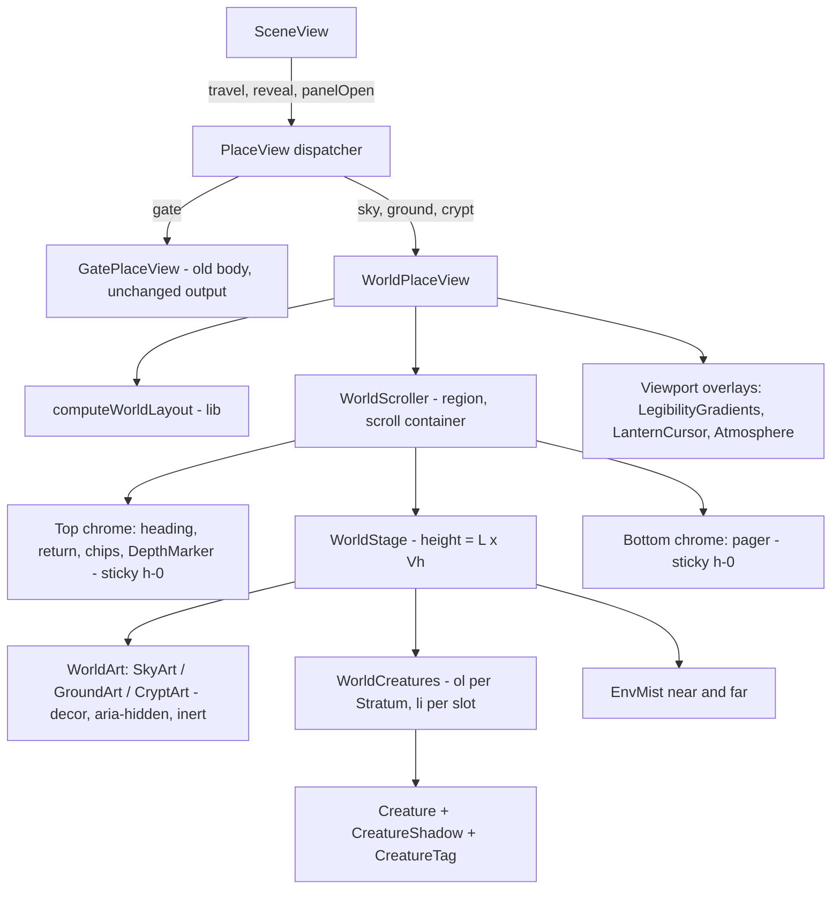
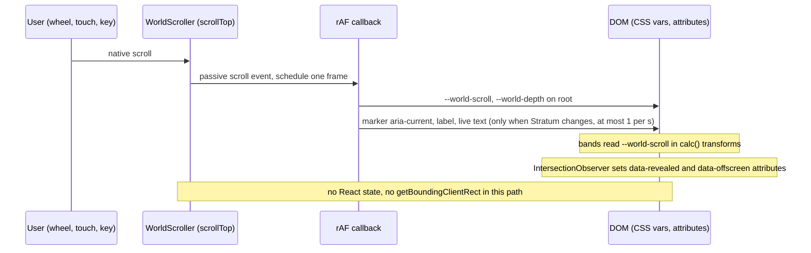

# Design Document: Explorable Worlds

## Overview

Explorable Worlds turns three of the four place scenes (the Restless Sky, Hallowed Ground, the Crypt) from single-screen stages into bounded, scrollable worlds. The Hub, Beyond the Gate, the travel transition, deep links, the detail panel, hover cards and overrides stay as they are. Beyond the Gate keeps its layout and gains only the shared control treatment and a gentle camera drift. Every world is composed from the existing art in `public/art/` by layered crops, gradient blend zones and CSS-built objects. No new dependency and no new image file is added.

### Key decisions

| # | Decision | Why |
|---|---|---|
| D1 | `PlaceView` becomes a thin dispatcher. The current body moves unchanged into `GatePlaceView`. Sky, ground and crypt render a new `WorldPlaceView`. | Hooks cannot be branched, and the gate must keep identical output (Req 1.8, 17.3). |
| D2 | All layout is one pure function, `computeWorldLayout`, in `lib/world-layout.ts`. It returns World_Length, slots, Strata, features and blend zones. | Req 17.8 and 17.9. Everything in Req 6 becomes property-testable without a DOM. |
| D3 | The chrome (heading, return, chips, depth marker, pager) lives **inside** the World_Scroller as zero-height `position: sticky` wrappers. Lantern, atmosphere and legibility gradients are viewport-sized siblings. | A vertical swipe on the chip row then scrolls natively (Req 13.3). The tab order follows the DOM (Req 12.6). The scroller has `z-index: auto`, so it creates no stacking context and the sticky chrome (z 50) still paints above the lantern (z 35). |
| D4 | Scroll-linked parallax uses a **stratum-local offset**: `offset = (scrollTop − stratumAnchor) × (1 − rate)`. Rates are close to 1 (0.88, 0.94, 1, 1.06, 1.12). | A global offset (`scrollTop × (1 − rate)`) over a 3-screen world needs art 2x taller than the viewport, which breaks the 1.75x upscale limit (Req 19.2). A local offset needs Bleed of about 0.12 Vh. |
| D5 | The scroll path is imperative. One passive scroll listener, one `requestAnimationFrame`, and writes to CSS variables and a few DOM attributes. React never sees scroll state. | Req 5.3, 5.4, 14.6. The depth marker updates `aria-current` and its label through refs, not state. |
| D6 | A creature's label becomes a **tag mounted inside the creature button** (`CreatureTag`) in worlds. `Creature` gains optional `size`, `tag` and `shadow` props. | Req 18.11. An absolutely positioned child does not change the button's border box, so hover-card anchoring stays identical (Req 10.3). |
| D7 | Environmental_Mist is a new component, `EnvMist`. It never tiles an art plate. Data_Fog is untouched and is not rendered in worlds. | Req 15.9, 19.4. |
| D8 | An `Effects_Table` registry in `lib/world-effects.ts`, a markdown table in `docs/EFFECTS_TABLE.md`, and `data-effect` attributes in components are kept in sync by a source-scan test. | Req 15.6, 18.9. |
| D9 | Visual review uses a dev-only harness route (`/dev/review`) and a dependency-free Node script that drives Chrome or Edge over the DevTools Protocol. | No Playwright is installed (Req 20.1), and the review cases (3 ghosts, 12 tombstones, empty) need controlled data. |

### Findings from the code that shape the design

- `PlaceView` roots carry `min-h-dvh overflow-x-hidden overflow-y-auto`, and `LayoutRobustness` pins `overflow-y-auto` + `min-h-dvh` + no `overflow-hidden` on the root of the **gate** render. A world root cannot keep those classes (it needs `h-dvh` and no overflow). The tests that render sky, ground or crypt roots are updated in the step that changes them (Req 17.5).
- `DepthScatter` positions creatures with `left/top` as **percent of the scene box** and puts plaques in a separate z-30 layer, with `data-testid` values `depth-scatter`, `scatter-creature`, `scatter-plaque`. Several DOM tests (`PlaceView`, `CompactPlaceView`, `SceneLayoutClickability`, `LayoutRobustness`) key on them. Worlds keep `depth-scatter` (the creature layer), `scatter-creature` (the `<li>`, with `data-name`) and `scatter-plaque` (the mounted tag). Position becomes `left: %` and `top: px`, so `SceneLayoutClickability` changes its geometry stub.
- `scatterLayout` assigns depth bands by **index** (front-first). Req 7.3 needs the band to come from the name hash only, so worlds compute their own band. `xmur3` and `mulberry32` are private in `lib/estate-view.ts`; they get exported, with no behaviour change, along with the brightness step (`SCATTER_BRIGHTNESS_STEP`, 0.18).
- `HoverCardLayer` already listens for `scroll` in the capture phase and repositions in `requestAnimationFrame`, closing when the anchor is off screen. Scrolling the World_Scroller therefore needs no change there (Req 10.4). A test locks it in.
- `useParallax` writes `--px/--py` on the root, gated on reduced motion and fine pointers. It is reused unchanged. Worlds read `--px/--py` only on decorative bands, so the creature band gets 0 px of pointer offset (Req 5.6). `PlaceView` today applies 16 px of pointer parallax to creatures, so this is a deliberate change for worlds.
- `PlaceBackground` already has a `coverRect` + `PAINTED_MOON` moon lock and a `-3%` bleed (10.8 px at 360 px). Adding drift on the gate needs 8 px pointer + 6 px drift = 14 px, so the gate bleed becomes `-4%` (14.4 px at 360 px). `Fog` is a 200% double-width tiled strip, so it cannot serve as Environmental_Mist.
- `TravelTransition` already exports `TRAVEL_FULL_MS = 2200`, `TRAVEL_CUT_MS = 1150` and `TRAVEL_REDUCED_CUT_MS = 150`. `lib/estate-view.ts` still has the older `TRAVEL_MS = 1200`; it is not used by the transition and is left alone.
- `compactColumns` uses a 160 px minimum column and a floor of 2. Req 13.4 asks for `min(count, floor(availableWidth / 140))`. The world layout uses its own 140 px constant. Pagination keeps `compactPlotSize` so `SceneView` and the pager stay consistent.
- Existing material tokens (`--color-iron-*`, `--color-plaque-*`, `--color-chip-*`) and the `.btn2`, `.chip2`, `.plq` classes are the base of the Fixture language. Worlds add stone and brass tokens and `fixture-*` classes beside them.
- Art was inspected directly: `place-sky` is dark with cloud walls left and right, the moon at (75%, 14%), and a mist band with a castle hill at (35%, 86%). `place-ground` has trees and candles in the top 45%, a stone path from (28%, 45%) to (55%, 33%), and plain grass below 55%. `place-crypt` has a vaulted hall, symmetric candle shelves and chains, a far archway at (47%, 35%–55%), a red banner at (63%, 38%) and a stone floor below 58%.
- Platform behaviour relied on: sticky positioning inside a scroll container ([MDN](https://developer.mozilla.org/en-US/docs/Web/CSS/position)), `scroll-padding` and `scroll-margin` honoured by focus and `scrollIntoView` ([MDN](https://developer.mozilla.org/en-US/docs/Web/CSS/scroll-padding)), `overscroll-behavior` ([MDN](https://developer.mozilla.org/en-US/docs/Web/CSS/overscroll-behavior)), and the Chrome DevTools Protocol ([docs](https://chromedevtools.github.io/devtools-protocol/)).

## Architecture

### Component tree



### DOM skeleton of a world

```
div[data-testid=place-view][data-place][data-world]   relative h-dvh w-full   (no overflow utility)
  div[data-testid=world-scroller][role=region][aria-label="<Place name>"][tabindex=0]
      absolute inset-0 overflow-y-auto overflow-x-clip overscroll-contain touch-pan-y   (z-index auto)
    div.world-chrome-top      sticky top-0 z-50 h-0     heading block, return, chips, DepthMarker
    div[data-testid=world-stage]  relative, height = L x Vh px, no overflow
      div[data-decor-clip] .. art layers (background, mid-ground, far mist, foreground)   each overflow-clip, aria-hidden, inert
      div.world-creatures  absolute inset-0 z-20 isolate     <ol aria-label=Stratum> x N  ->  <li data-testid=scatter-creature>
      div[data-decor-clip] .. near mist
    div.world-chrome-bottom   sticky bottom-0 z-50 h-0     pager
  div.pointer-events-none  legibility gradients (z-30), LanternCursor (z-35), Atmosphere (z-40)   viewport-sized siblings
```

Clipping wrappers (`overflow-clip`, marked `data-decor-clip`) are siblings of the creature layer and never ancestors of a Creature or control (Req 3.4). The World_Scroller is the only `overflow-auto` element in the world.

### Z-order (all in the root stacking context)

| z | Layer | Band rate | Notes |
|---|---|---|---|
| 0 | Sky / background Crops | 0.88 | one clipped wrapper per Stratum |
| 5 | Mid-ground (fence, path, mausoleum, torches) | 0.94 | |
| 10 | Far Environmental_Mist | 0.94 | `place-mist-far` |
| 15 | Foreground art (edge pieces, steps, ground-level objects) | 1.12 | kept to frame edges, darker than mid-ground |
| 20 | Creatures with mounted tags | 1.00 | isolate; `li` z-index = rank by `cy` so nearer tags paint over farther bodies |
| 25 | Near Environmental_Mist | 1.06 | `place-mist-near` |
| 30 | Legibility gradients | viewport-fixed | top and bottom, each 18 vh (above the 15 percent minimum) |
| 35 | `LanternCursor` | viewport-fixed | unchanged component |
| 40 | `Atmosphere` | viewport-fixed | vignette, grain, bats, cobwebs, each with an Effects_Table row |
| 50 | Chrome | none | sticky inside the scroller; above the lantern |

### Scroll data flow



### File map

New files:

| File | Purpose |
|---|---|
| `lib/world-layout.ts` | `computeWorldLayout`, `worldLength`, `WORLD_CONFIG`, types |
| `lib/world-motion.ts` | `depthPosition`, `stratumAt`, `bandOffset`, `ambientBrightness`, `scrollTargetFor`, `classifyGesture`, `BAND_RATES` |
| `lib/world-art.ts` | `computeCrop`, `plateToStage`, `bleedPx`, `WORLD_ART` table (plates, focal points, flips) |
| `lib/world-light.ts` | `LIGHT_SOURCES`, `shadowFor`, `rimFor` (pure; token names only) |
| `lib/world-effects.ts` | `WORLD_EFFECTS` registry, `freshEarth`, `ghostLanternLevel` |
| `lib/contrast.ts` | `parseHex`, `contrastRatio` |
| `lib/place-pipeline.ts` | `applyFilter` and `placePlots(place, rows, filter, pageSize)` moved out of `PlaceView` so both place views share them |
| `lib/review-cases.ts` | deterministic rows for the Review_Cases |
| `components/scene/GatePlaceView.tsx` | the current `PlaceView` body, moved |
| `components/world/WorldPlaceView.tsx`, `WorldScroller.tsx`, `WorldStage.tsx`, `WorldCreatures.tsx` | world shell |
| `components/world/SkyArt.tsx`, `GroundArt.tsx`, `CryptArt.tsx`, `CropLayer.tsx`, `EnvMist.tsx` | art composition |
| `components/world/DepthMarker.tsx`, `CreatureTag.tsx`, `CreatureShadow.tsx`, `EmptyScene.tsx` | fixtures, tags, empty states |
| `components/world/useWorldScroll.ts`, `useScrollGuard.ts`, `useDiscovery.ts`, `useScrollForward.ts` | imperative scroll, tap guard, IntersectionObserver, chip-row forwarding |
| `app/dev/review/page.tsx`, `components/dev/ReviewHarness.tsx` | dev-only harness (404 in production) |
| `docs/EFFECTS_TABLE.md` | documented Effects_Table |
| `docs/design-review/tools/capture.mjs`, `cdp.mjs`, `page-probes.mjs`, `TEMPLATE-review.md` | capture tooling and review template |
| `tests/property/world-layout.property.test.ts`, `world-motion.property.test.ts`, `world-art.property.test.ts`, `contrast.property.test.ts` | fast-check properties |
| `tests/dom/WorldScroller.test.tsx`, `WorldPlaceView.test.tsx`, `WorldNoNavigation.test.tsx`, `WorldReducedMotion.test.tsx`, `WorldPointerEvents.test.tsx` | DOM tests |
| `tests/unit/world-source-scan.test.ts` | source-scan tests (tokens, hex, effects sync, overflow classes, package.json) |

Modified files:

| File | Change |
|---|---|
| `components/scene/PlaceView.tsx` | becomes the dispatcher; same props |
| `components/creatures/Creature.tsx` | optional `size`, `tag`, `shadow`; mirror applied to the art only; no change when the props are absent |
| `components/scene/PlaceBackground.tsx` | gate bleed `-4%`, drift wrapper; sky keeps its use for the Hub only |
| `components/scene/Place.tsx`, `EstateMap.tsx` | hover and focus cues, empty-state treatment, drift wrapper |
| `components/scene/SceneView.tsx` | passes `panelOpen` and `revealRequest` to `PlaceView`; sets `revealRequest` in the two non-pointer open paths |
| `components/scene/FilterChips.tsx`, `Pager.tsx`, `ReturnToGate.tsx` | class names only (`fixture-*`); testids, semantics and handlers unchanged |
| `lib/estate-view.ts` | export `xmur3`, `mulberry32`, `SCATTER_BRIGHTNESS_STEP`; no behaviour change |
| `app/globals.css` | tokens, `fixture-*`, `camera-drift`, `world-*` classes, reveal and pause rules, reduced-motion block |
| `tests/dom/LayoutRobustness.test.tsx`, `PointerEvents.test.tsx` | extended (Req 3.11, 17.6, 17.7) |
| `tests/dom/PlaceView.test.tsx`, `CompactPlaceView.test.tsx`, `SceneLayoutClickability.test.tsx`, `SceneLayoutPreservation.test.tsx`, `EstateMap.test.tsx` | only assertions that contradict the feature, each recorded in its task |

Unchanged by design: `DepthScatter`, `Fog`, `Lightning`, `Whisper`, `TravelTransition`, `useParallax`, `HoverCardLayer`, `HoverCardProvider`, `HoverCard`.

## Components and Interfaces

### `lib/world-layout.ts` (pure)

```ts
export type WorldPlace = "sky" | "ground" | "crypt";

export interface WorldInput {
  place: WorldPlace;
  /** Names of the current Plot, already in orderForPlace order (urgency first). */
  names: readonly string[];
  viewportW: number;            // scroller client width, px
  viewportH: number;            // scroller client height; <= 0 or non-finite -> window height -> 812
}

export interface Rect { left: number; top: number; right: number; bottom: number; cx: number; cy: number }

export interface WorldSlot {
  index: number;                // index into input names (urgency order)
  cx: number; cy: number;       // body-box centre in stage px
  size: number;                 // rendered creature box side, px (CREATURE_BASE_SIZE * scale)
  scale: number; band: 0 | 1 | 2;   // band from name hash only (0 back, 2 front)
  brightness: number;           // DEPTH_ROWS brightness for the band
  mirrored: boolean; tilt: number;  // sky only mirrors; ground tilt in [-6, 6] deg
  body: Rect; plaque: Rect;     // plaque below the feet, PLAQUE_W x PLAQUE_H times scale
  stratum: number;              // index into strata
  side: -1 | 0 | 1;             // ground: -1 left of path, +1 right, 0 centred
}

export type FeatureKind = "moon" | "cloud-bank" | "entry-gate" | "mausoleum" | "crypt-entry" | "stairs" | "far-wall";
export interface WorldFeature { kind: FeatureKind; y: number; stratum: number }

export interface Stratum {
  id: string; label: string;    // "Altitude: high", "Chamber 2 of 3"
  top: number; bottom: number;  // contiguous, partition [0, heightPx]
  focal: { fx: number; fy: number };   // rule-of-thirds target in the stratum's screen frame
}

export interface BlendZone { y: number; height: number; kind: "gradient" | "haze" | "crossfade" | "stairs" | "arch" }

export interface WorldLayout {
  place: WorldPlace; compact: boolean;
  lengthVh: number; heightPx: number; viewportH: number;   // viewportH after the 812 fallback
  columns: number;
  slots: WorldSlot[];           // index-aligned with input names
  domOrder: number[];           // slot indices sorted by (cy, cx): visual order for DOM and tab sequence
  strata: Stratum[]; features: WorldFeature[]; blendZones: BlendZone[];
  path?: { x: number; y: number }[];   // ground only: centreline samples
  chambers?: number[][];               // crypt only: slot indices per chamber
}

export function computeWorldLayout(input: WorldInput): WorldLayout;
export function worldLength(place: WorldPlace, count: number, viewportW: number, viewportH: number): number;
```

`compact` is `viewportW < MOBILE_BREAKPOINT` (768). The function reads no clock, DOM, storage or randomness other than the seeded hash of each name (`mulberry32(xmur3("world|" + place + "|" + name))`).

#### World_Length rules (Req 6)

`Vh_eff = max(viewportH, LAYOUT_MIN_VH = 700)`. Heights in px are `lengthVh × Vh_eff`. For a real viewport shorter than 700 px the reported ratio can exceed the ranges below; the properties are quantified for `Vh >= 700` (see Error Handling).

| Case | World_Length |
|---|---|
| count 0 or 1 | exactly 1 (every place, every width) |
| sky, ground: 2–3. crypt: 2–4 | `SMALL_LENGTH = 1.5` |
| sky, ground: 4–12 | `min(cap, max(1.5, ceil20(contentPx / Vh_eff)))` |
| crypt: 5–12 (k = ceil(count / 4) chambers, k ≥ 2) | `min(cap, max(1.5 + 0.7 (k − 1), ceil20(contentPx / Vh_eff)))` |

`contentPx = TOP_CLEAR + B + (rows − 1) × pitch + B + BOTTOM_CLEAR` with `B = CREATURE_BASE_SIZE (140)`. `cap` is 3 on desktop and 4 on compact. `ceil20(x) = ceil(x × 20) / 20`, which keeps the value stable across tiny float differences. `rows = ceil(count / columns)`, and `columns` is non-decreasing in `count` up to its cap, so `rows` and therefore `worldLength` are non-decreasing in `count` (Req 6.1).

Columns: desktop `min(ceil(count / 2), 4, floor(availW / 200))`; compact `min(count, floor(availW / 140))` with `availW = viewportW − 2 × 16`, minimum 1 (Req 13.4).

#### Constants (`WORLD_CONFIG`; start values, tunable inside the bounds the properties check)

| Constant | Desktop | Compact | Note |
|---|---|---|---|
| `TOP_CLEAR` | 280 (112 header + 150 title block + 18) | 284 (64 + 44 + 120 + 56) | equals the `--world-pad-top` token minus 8 px; a source-scan test keeps CSS and TS equal |
| `BOTTOM_CLEAR` | 120 | 80 | pager band, mirrors `--world-pad-bottom` |
| `SLOT_EDGE` | `B` (140) | `B` | slot centre at least `B` from each chrome edge (Req 6.9) |
| `ROW_PITCH` | 240 | 200 (140 when x-separation ≥ 184) | |
| `COL_MIN` | 200 | 140 | |
| `JITTER_X` | `(cell − PLAQUE_W × 1.15) / 2 − 4` | same | same derivation as the scatter grid, so same-row plaques never touch |
| `JITTER_Y` | ±24 | ±24 | far below half of `ROW_PITCH` |
| `SIDE_MARGIN` | 16 | 16 | plaques stay inside `[16, W − 16]` |

#### Slot generation per place

1. **Band and look.** `u = hash(name)`; `band = floor(u1 × 3)`. Scale falls in the band's sub-range of `[0.7, 1.15]` and brightness is `1 − 0.18 × (2 − band)`, the same values `DEPTH_ROWS` uses. Sky mirrors a creature when `u2 < 1/3`; ground and crypt never mirror; ground tilt is `(u3 × 2 − 1) × 6`. A name's look never depends on the other names (Req 7.3, 6.12).
2. **Small counts (2–3, crypt 2–4).** Slot `i` of `c` gets `cy = lerp(yA, yB, i / (c − 1))` with `yA = max(TOP_CLEAR + B, 0.5 Vh)` and `yB = clamp(1.06 Vh, Vh + 1, H − BOTTOM_CLEAR − B)`. So slot 0 is inside the first screen, the last slot is below the first screen boundary, and with `H = 1.5 Vh` the window for `yB` is non-empty for every `Vh >= 700`. Columns alternate. The ghost with the fewest days until it turns (input index 0) takes slot 0 (Req 7.2, 7.10).
3. **Larger counts.** Grid of `columns × rows`; row `r` sits at `cy = y0 + r × pitch + jitterY` with `y0 = TOP_CLEAR + B`. Odd columns are offset by half a pitch (zigzag), so a one-row grid still spreads vertically. Input order fills the grid row by row, then `domOrder` re-sorts by `(cy, cx)`.
4. **Ground path.** One column. `cy_i` strictly increases from `yA` to `yB_last`. `x_i = centreline(cy_i) + side_i × s`, with `side_i` alternating and `centreline(y) = W/2 + A sin(2π y / λ)` (`A = min(0.12 W, 120)`, `λ = 1.2 Vh`). `s` is the largest offset that keeps the plaque inside the side margins; the pitch is 140 when `2s ≥ PLAQUE_W × 1.15 + 8` and 200 otherwise. One tombstone is centred at `W/2` (Req 8.11, 16.8). `path` carries the centreline samples every 90 px.
5. **Crypt chambers.** Chamber `j` holds the next 4 slots in Plot order (`chambers`). Layout is 2 x 2 per chamber on desktop and 1 x 4 or 2 x 2 on compact by the column rule. The entry stratum is 0.5 Vh with stairs; chamber 1 is 0.9 Vh and later chambers 0.7 Vh each, with a stairs or arch Blend_Zone between them.
6. **Single creature.** `cx = W/2`, `cy = clamp(0.5 Vh, TOP_CLEAR + B, Vh − BOTTOM_CLEAR − B)`, which sits inside the middle 60 percent of the first screen for `Vh >= 700`.
7. **Plaque and body rectangles.** Body is the `size × size` square centred on the slot. The plaque is centred `plaqueLiftPx`-below the feet (reusing `plaqueLiftPx` from `lib/estate-view.ts`), `PLAQUE_W × scale` wide. Every slot is clamped so body and plaque stay inside `[SIDE_MARGIN, W − SIDE_MARGIN]` (Req 16.12).

#### Strata

| Place | Strata (top to bottom) | Count rule |
|---|---|---|
| sky | `high-air`, then `mid-sky` (3-strata worlds only), then `cloud-bank` | 1 stratum when `L = 1`; otherwise `k = ceil(L)`, `max(2, k)` (so each Stratum is at most 1.0 Vh tall). With 4 or more creatures the ordered list is split evenly across strata, each with at least one creature (Req 7.1). |
| ground | `gate-path`, `mid-path` x n, `mausoleum-approach` | same `k = ceil(L)` rule; the entry gate is a feature of the first and the mausoleum a feature of the last |
| crypt | `entry` (stairs), then `chamber-1 … chamber-k` | `1 + k` strata |

Strata partition `[0, heightPx]` exactly. Adjacent strata share a Blend_Zone of at least `0.12 Vh` (the layout uses `0.15 Vh`, centred on the join). Each stratum's `focal` is chosen on a rule-of-thirds intersection of its screen frame, within 10 percent (Req 18.1): sky focal is the highest-urgency ghost in its stratum, or the moon; ground is the first tombstone of the segment, or the mausoleum; crypt is the stairs, a coffin, or the far wall.

#### Features

`moon` (sky, inside the first screen, at the painted moon), `cloud-bank` (sky, last stratum), `entry-gate` (ground, first stratum), `mausoleum` (ground, `H − 0.35 Vh`), `crypt-entry` and `stairs` (crypt, at each chamber join), `far-wall` (crypt, last stratum). Req 6.5 lists "the path continuing to the mausoleum, the stair descent, the cloud bank". This design reads the list as examples and also counts the moon, the entry gate and the crypt entry as landmark features, because at viewport heights near 700 px the first creature cannot sit closer than `TOP_CLEAR + B` and the 0.6 Vh gap rule would otherwise fail. This is an interpretation that needs the owner's confirmation (see Error Handling, open points).

### `lib/world-motion.ts` (pure)

```ts
export const BAND_RATES = { background: 0.88, midground: 0.94, creature: 1, nearMist: 1.06, foreground: 1.12 } as const;
export const GESTURE_TAP_MAX_PX = 8;

export function depthPosition(scrollTop: number, scrollHeight: number, clientHeight: number): number; // [0,1], never NaN
export function stratumAt(layout: Pick<WorldLayout, "strata">, scrollTop: number, viewportH: number): number;
/** px offset of a decorative band: pointer + scroll, additive. Creature band pointer = 0. */
export function bandOffset(band: keyof typeof BAND_RATES, input: { px: number; py: number; scroll: number; anchor: number; reduced: boolean }): { x: number; y: number };
export function ambientBrightness(depth: number): number;       // 1 at 0, non-increasing, >= 0.8 at 1
export function scrollTargetFor(slot: Pick<WorldSlot, "cy">, heightPx: number, viewportH: number): number;
export function classifyGesture(dxPx: number, dyPx: number): "tap" | "scroll";   // hypot <= 8 -> tap
```

`depthPosition` returns 0 when `scrollHeight − clientHeight <= 0`, when `clientHeight <= 0`, or for any non-finite input, and clamps the ratio to `[0, 1]` (Req 5.10, 6.14, 17.9). `bandOffset` returns `scroll × (1 − rate) − anchor × (1 − rate)` for decorative bands, adds `px × maxPointer` and `py × maxPointer` (`PARALLAX_MAX_BG` 8, 16 for mid, 26 for near mist; the foreground uses 26), and returns `{0, 0}` for every band when `reduced` (Req 5.8). `scrollTargetFor` is `clamp(cy − viewportH / 2, 0, heightPx − viewportH)`.

### `WorldScroller`

- Renders the region element from the DOM skeleton. `aria-label` is the place name from `PLACES`. The focus ring is 2 px `--color-candle-400`. Key handling is left to the browser; Tab and Escape are never intercepted (Req 12.1, 12.2).
- `useWorldScroll(scrollerRef, rootRef, layout)` attaches one passive `scroll` listener and one `ResizeObserver`. A scroll event stores `scrollTop` and schedules one `requestAnimationFrame` if none is pending. The frame callback reads `scrollTop`, `scrollHeight`, `clientHeight` (no `getBoundingClientRect`), computes `depthPosition` and `stratumAt`, and writes `--world-scroll` (unitless px) and `--world-depth` on the root through `style.setProperty`. If the Stratum changed it updates the marker's `aria-current`, the visible label and the live region through refs; the live region is written at most once per second (Req 11.6, 12.9). It writes finite values when `clientHeight` or the scroll range is 0.
- A travel transition pauses writes (`travel.active`) and resumes from the current offset on the next frame; the band offsets are a pure function of scroll, so there is no jump (Req 5.9).
- Bands apply `transform: translate3d(calc(var(--px,0) * Mpx + (var(--world-scroll,0) - A) * K * 1px), calc(var(--py,0) * Mpx + (var(--world-scroll,0) - A) * K * 1px), 0)` with `K = 1 − rate` (a literal per band) and `A` the stratum anchor in px set as an inline custom property. Only `transform` and `opacity` animate. In reduced motion the band classes drop the transform and rates become 1, and each Crop falls back to the 8 px minimum overscan.
- **Reset and restore.** When the filter or plot changes, the stage height changes in the same commit and a `useLayoutEffect` keyed on `[place, activeFilter, clampedPlotIndex]` sets `scrollTop = 0` (Req 6.13, 16.6). On arrival `scrollTop` starts at 0. With `panelOpen` rising, the scroller records `scrollTop`; with it falling, it restores within 1 px if the value changed (Req 3.9).
- **Tap and scroll guard (`useScrollGuard`).** Passive `pointerdown`, `pointermove`, `pointerup` listeners record the start point and set `moved = true` once `classifyGesture` returns `scroll` (movement over 8 px). A capture-phase `click` listener on the scroller swallows pointer-origin clicks (`event.detail > 0`) when `moved` is set or when a scroll event fired in the last 120 ms (momentum, Req 4.9). Keyboard clicks (`detail === 0`) are never swallowed. No wheel or touch listener is registered, passive or not (Req 4.7). No handler calls `onEnterPlace`, `onReturn` or `onSelect` (Req 4.1, 4.2).
- **Chip-row forwarding (`useScrollForward`).** The compact chip row uses `touch-action: pan-x`. A pointer drag on it that classifies as vertical calls `scroller.scrollBy({ top: -dy })`, so a vertical swipe from the chips scrolls the world (Req 13.3).
- **Focus scrolling.** Browsers scroll a focused Creature into view and honour `scroll-padding-top/bottom` (set from the `--world-pad-top` and `--world-pad-bottom` tokens) and the Creature's `scroll-margin` token, so nothing is scripted or measured (Req 12.3, 12.4). If a focused Creature scrolls away by wheel, nothing moves it back (Req 12.10).
- **Programmatic scrolls** (depth marker, deep link, go-to-it) use `scrollTo` or `scrollIntoView({ block: "start" })` with `behavior: reduced ? "auto" : "smooth"` (Req 11.10, 12.8).

### `DepthMarker`

A `nav` holding an `ol` of native `<button>`s, one per Stratum, on the right edge inside the top chrome wrapper. It renders nothing when `lengthVh === 1` (Req 11.9). Each button's accessible name contains the label (`Chamber 2 of 3`). The current step has `aria-current="true"`. Activation calls `anchorEl.scrollIntoView({ block: "start" })`, where each Stratum has an anchor element at its `top`, so the join lands below the scroll padding without measuring (Req 11.8). A visible text label and an `aria-live="polite"` region show the current Stratum.

### Per-place composition

Each stratum is a **frame** of one screen. The table shows the composition of a typical frame (background / mid-ground / foreground tiers, Req 18.2).

**Restless Sky** (Light_Source: moon, upper right)

| Stratum | Background | Mid-ground | Foreground | Leading line and focal point |
|---|---|---|---|---|
| `high-air` | `place-sky` Crop around the painted moon, stars (CSS radial-gradient dots) | thin cloud wisps (`EnvMist`, sky token) | none | cloud walls lead toward the moon; focal = moon at about (0.75, 0.22) of the frame |
| `mid-sky` | flipped `place-sky` Crop, dark centre | cloud drift | dark edge gradients | focal = highest-urgency ghost in the stratum at a thirds point |
| `cloud-bank` | `place-sky` bottom Crop with mist and the castle hill | denser `EnvMist` | dark bottom gradient | mist bank rises toward the castle silhouette; focal = castle hill at (0.35, 0.66) |

The data `Moon` is positioned by `plateToStage(crop, PAINTED_MOON.fx, PAINTED_MOON.fy)` from the same Crop geometry that places the painted moon, inside the same band wrapper, so the two stay within 2 px at every Depth_Position (Req 7.6). The empty scene is one screen of `high-air` with moon, stars, cloud banks and an empty lantern hook, with the copy on a carved plaque hanging from the hook.

**Hallowed Ground** (Light_Source: lantern from the left, moonlight as fill)

| Stratum | Background | Mid-ground | Foreground |
|---|---|---|---|
| `gate-path` | `place-ground` top Crop (trees, candles, path start) | `mg-fence` gate centerpiece with `mg-fence-tile` runs on both sides, CSS path ribbon starting where the painted path ends | dark root/thorn edge pieces from a `fg-frame` Crop at the left and right edges |
| `mid-path` | `place-ground` grass Crop, flipped (grass only, no candles) | CSS path ribbon (radial-gradient stones along `path`), path-side lanterns | ground-level grass tufts as gradients |
| `mausoleum-approach` | `place-ground` Crop at a different offset | `mausoleum.webp`, rendered once at `H − 0.35 Vh`, fully visible at depth 1; fog-wisps Crop as mist | dark foreground edge |

The path ribbon is `ceil(H / 90)` elliptical `radial-gradient` layers placed at the `path` samples, so the path, the slots and the mausoleum all come from the same layout. The painted path leads the eye from the entry toward the first tombstone; the ribbon leads it on to the mausoleum. The empty scene shows the entry gate, fence, path, mausoleum, two lit path lanterns, and one unmarked plot (a mound and a wooden stake) that carries the copy on a carved plaque.

**The Crypt** (Light_Source: torch, from the left wall, high)

| Stratum | Background | Mid-ground | Foreground |
|---|---|---|---|
| `entry` | `place-crypt` top Crop (vault and far archway) | arch silhouette gradient, stair steps (`repeating-linear-gradient`, each step darker) | dark rail edge pieces |
| `chamber-1` | `place-crypt` full Crop, warm tint | torch glow at the wall candle positions | chain-shadow gradient |
| `chamber-2` | flipped Crop (crypt candles are symmetric), cooler tint, brightness 0.85 | arch Blend_Zone to the next chamber | |
| `chamber-3` | Crop offset by at least 25 percent, brightness 0.7 | | |

Ambient brightness is a dark overlay whose opacity is `1 − ambientBrightness(depth)`, written from `--world-depth` (opacity 0 to 0.2). Chambers differ in tint and darkness through CSS `filter` on each Crop. The empty scene shows the vault, wall niches, torch light, a sealed door (an iron-banded CSS arch placed over the painted archway) carrying the copy as a plate, steps leading down, and drifting dust.

### Art-extension technique

All extension is **layered crops**. A `CropLayer` is a clipped wrapper (`data-decor-clip`) containing one element that shows a plate through CSS `background-image`, `background-size` and `background-position`, scaled uniformly.

```ts
export interface CropInput {
  plate: { w: number; h: number };
  element: { w: number; h: number };       // the layer box incl. Bleed, px
  focal: { fx: number; fy: number };       // point of the plate to keep
  anchor: { ax: number; ay: number };      // where in the element the focal point lands (0..1)
  flip: { h: boolean; v: boolean };
}
export interface CropResult {
  scale: number;                            // one value for both axes
  rect: { x: number; y: number; w: number; h: number };   // source rectangle in plate px
  upscale: number;                          // scale at a 1920 px wide viewport relative to native
}
export function computeCrop(input: CropInput): CropResult;
export function bleedPx(args: { viewportH: number; stratumH: number; blendH: number; rate: number; maxPointer: number; drift: number; reduced: boolean }): { x: number; y: number };
export function plateToStage(crop: CropResult, element: { w: number; h: number }, fx: number, fy: number): { x: number; y: number };
```

- `scale = max(element.w / plate.w, element.h / plate.h)` (cover). The rect is centred on the focal point, then clamped inside the plate. So `rect.w / rect.h` equals the element aspect, horizontal and vertical scale are equal, and the rect is always inside the plate.
- The element box is `stratumH + blendH + 2 × bleed` tall and `viewportW + 2 × bleed.x` wide. A wrapper edge mask (`mask-image` gradient, 6 percent) softens each outer edge so no plate edge is ever shown.
- **Bleed math.** The largest visible stratum-local offset is `|scroll − anchor| ≤ (Vh + Hs + blend) / 2`, so `bleed.y = (1 − rate) × (Vh + Hs + blend) / 2 + pointer + drift`, and `bleed.x = pointer + drift`. Worked numbers at 1920 x 1080 for the largest stratum (3-stratum world, `Hs = 1.0 Vh`, `blend = 0.15 Vh`):
  - background (`rate 0.88`): `0.12 × 1.075 × 1080 + 8 + 12 ≈ 159` px, so the element is `1080 + 162 + 318 ≈ 1560` px tall, which gives a scale of `max(1960 / 1536, 1560 / 1024) = 1.52`.
  - mid-ground (`0.94`): about 100 px of bleed, scale 1.30.
  - 2-stratum sky at 1.5 Vh (`Hs = 0.75 Vh`): element about 1100 px, scale 1.28.
  - All stay under the 1.75 limit. A property test asserts it for every stratum of every layout.
- **Reduced motion.** Rates become 1 and the bleed shrinks to the 8 px overscan, so the stratum Crops are laid out at stage coordinates and cover the whole World_Length (Req 5.8).
- **Seams.** Adjacent Crops overlap by the Blend_Zone (`0.15 Vh`). The upper Crop fades out under a `linear-gradient` mask while the lower fades in, and a `haze` band in the destination's darkest colour is laid across the join. Crops that join are chosen so the join rows come from dark, low-detail plate regions (dark centre of the sky, grass in the ground, floor in the crypt), which keeps the luminance difference under the 10 percent seam check.
- **Repeats.** Only `mg-fence-tile` repeats, horizontally. Landmarks (`moon`, `mausoleum`, gate, sealed door) render once per world. Where a plate is cropped more than once, each extra Crop differs by a flip or by an offset of at least 25 percent of the Crop size.
- **Light safety of flips.** Ground flips only Crops of the grass region (below 48 percent of plate height), which contains no candles, so the ground's single lantern direction holds. Crypt flips are safe because the plate's candles are symmetric.

#### Plate and Crop table

Focal points are plate fractions; anchors are element fractions. `bright` is the existing per-place brightness (`PLACE_PAINTING`): sky 0.8, ground 0.55, crypt 0.7.

| Place | Stratum | Plate | Focal (fx, fy) | Anchor (ax, ay) | Flip | Filter | Role |
|---|---|---|---|---|---|---|---|
| sky | `high-air` | `place-sky` | 0.75, 0.14 | 0.75, 0.22 | none | brightness 0.8 | moon in the first screen |
| sky | `mid-sky` | `place-sky` | 0.30, 0.50 | 0.50, 0.50 | h | brightness 0.75 | dark centre, cloud walls |
| sky | `cloud-bank` | `place-sky` | 0.35, 0.86 | 0.35, 0.66 | none | brightness 0.8 | mist and castle hill |
| ground | `gate-path` | `place-ground` | 0.40, 0.38 | 0.40, 0.45 | none | brightness 0.55 | trees, candles, painted path start |
| ground | `mid-path` | `place-ground` | 0.50, 0.78 | 0.50, 0.50 | h | brightness 0.55 | grass, no candles |
| ground | `mausoleum-approach` | `place-ground` | 0.62, 0.55 | 0.60, 0.55 | none, offset 30 percent | brightness 0.55 | path end, mausoleum overlay |
| ground | mid-ground | `mg-fence`, `mg-fence-tile` | n/a | n/a | none | brightness 0.5 | gate centerpiece once, tile repeated horizontally |
| ground | mid-ground | `mausoleum` | n/a | bottom centre-right | none | none | once, `H − 0.35 Vh` |
| ground | mist | `fog-wisps` | bottom 40 percent band | n/a | none | opacity token | `EnvMist`, one uniform crop, no tiling |
| ground | foreground | `fg-frame` | 0.05, 0.5 and 0.95, 0.5 (edge pieces) | left and right edges | h for the right | brightness 0.35 | thorns and roots kept to the frame edges |
| crypt | `entry` | `place-crypt` | 0.47, 0.42 | 0.5, 0.55 | none | brightness 0.7 | far archway as focal |
| crypt | `chamber-1` | `place-crypt` | 0.50, 0.60 | 0.5, 0.55 | none | warm tint | red banner and left shelf |
| crypt | `chamber-2` | `place-crypt` | 0.50, 0.60 | 0.5, 0.55 | h | cool tint, brightness 0.85 | |
| crypt | `chamber-3` | `place-crypt` | 0.30, 0.62 | 0.4, 0.55 | none, offset 25 percent | brightness 0.7 | |
| crypt | mid-ground | `coffin` | n/a | slot positions | none | none | creature art, unchanged |

Tints and brightness come from `filter` on the Crop element (static, so no per-frame cost). No new image file is created; the optional derived crop under Req 19.9 is not used.

### Lighting model

`lib/world-light.ts` defines one `LIGHT_SOURCES` entry per place and `globals.css` carries the matching tokens:

| Place | Source | Key direction (light travels) | Colour temperature tokens |
|---|---|---|---|
| sky | moon, upper right | down-left | `--light-sky-rim` (cool, moon-pale), `--light-sky-glow` |
| ground | lantern, from the left, with moonlight as fill | right | `--light-ground-rim` (candle-300, warm), `--light-ground-shadow` |
| crypt | torch, from the left wall | right and slightly down | `--light-crypt-rim` (candle-400), `--light-crypt-shadow` |

Each also has `--light-<place>-sx` and `--light-<place>-sy` (unit shadow offset). `shadowFor(place, band)` returns the offset, blur and opacity of a Contact_Shadow: offset is `(sx, sy) × 0.35 × size`, opacity follows the band brightness (back creatures have fainter shadows). `rimFor(place, row)` returns the `drop-shadow` colour and offset for a ghost: the offset follows the key direction and the **glow alpha follows recency** (`daysQuiet`), so glows are not identical across creatures (Req 18.12).

- Standing creatures (zombie, risen, tombstone, coffin) get `CreatureShadow` (`data-testid="creature-shadow"`), an elliptical `radial-gradient` span under the feet inside the `<li>`, `aria-hidden`.
- Ghosts get no ground shadow. They get a rim light and a soft glow in the place's colour temperature, added to the `filter` already on the creature wrapper (`brightness()`), so no extra filter element is created.
- No second light direction exists in a place. A test reads the token set and asserts every place has exactly one `(sx, sy)` pair and that all shadow and rim styles in `WorldCreatures` come from `world-light`.

### Mounted tags and Fixtures

`CreatureTag` renders inside the creature button (absolute, anchored at the feet, `data-testid="scatter-plaque"`, `aria-hidden`, full name in `title`). Variants: grave-marker tag (tombstone, stone plate with a peg), hanging tag (coffin, two chain links from the lid), lantern tag (ghost; the lantern's brightness steps with `ghostLanternLevel(decayLevel)`), stake tag (zombie and risen, iron plate on a stake). Mirroring applies to the art only, never to the tag. Text is at least 12 px, in Cinzel for the name and the mono role for the sub-line, on a surface of iron, stone or brass tokens. Because the tag is a descendant of the button, a click on it activates the Creature and a hover on it opens the same hover card.

The chrome Fixtures are `fixture-rail` (chips, iron rail), `fixture-ledge` (pager, stone ledge), `fixture-sign` (return control and heading, carved post) and `fixture-marker` (depth marker, iron rail with brass steps). They are class changes on the existing native buttons and use the iron, stone and brass tokens only: no pills, no soft shadows, no cards, no progress bars, no tabs (Req 11.11, 18.4). The heading sits on a legibility surface built from the same stone tokens.

### Environmental_Mist vs Data_Fog

| | Data_Fog (`Fog.tsx`) | Environmental_Mist (`EnvMist.tsx`) |
|---|---|---|
| Meaning | zombie count | none (depth and blending) |
| Where | Hub and Beyond the Gate only | sky, ground, crypt |
| Density | `fogDensity(zombieCount)` | fixed token: `--world-mist-sky 0.18`, `--world-mist-ground 0.2`, `--world-mist-crypt 0.15` (all ≤ 0.25; crypt ≤ 0.2) |
| Art | `fog-wisps` tiled on a 200 percent strip | one uniform non-tiled crop of `fog-wisps`, wider than the viewport plus drift, edge-masked |
| Motion | `translateX` loop | slow ±16 px sway (`transform`), static in reduced motion |
| Test ids | `scene-fog`, `scene-fog-near` | `place-mist-far`, `place-mist-near` |
| CSS | `.fog-wisps`, `.fog-wisps-thin` | `.env-mist`, `.env-mist-near` |

A test asserts that worlds render no element with `scene-fog` or `scene-fog-near`, that mist opacity does not change when the zombie count changes (it cannot: `WorldPlaceView` does not read zombie counts), and that the token values are within the caps. In the crypt, dust and torch haze are the same `EnvMist` at the crypt token.

### Effects_Table

`lib/world-effects.ts` exports `WORLD_EFFECTS`, a list of `{ id, places, kind: "data" | "story" | "blend", field?, ambient: boolean, description }`. `docs/EFFECTS_TABLE.md` holds the same rows as a markdown table. Components tag effect elements with `data-effect="<id>"` (or the `effectProps(id)` helper). One test checks the three-way match: every id in the registry has a table row and a component use, every `data-effect` in the source exists in the registry, and every table row exists in the registry (Req 18.9). Another counts `ambient: true` entries per place and requires 4 or fewer (Req 14.11, 18.8).

| Id | Places | Kind | Field or purpose | Ambient |
|---|---|---|---|---|
| `creature-motion` | all | data | `state`, `decayLevel` (existing creature loops) | no (excluded by Req 18.8) |
| `moon-glow` | sky | data | overall health (`moonTreatment`) | no |
| `ghost-rim-glow` | sky | data | `daysQuiet` (recency) | no |
| `ghost-lantern` | sky | data | `decayLevel` | no |
| `tombstone-moss` | ground | data | `daysQuiet` (existing Tombstone treatment, unchanged) | no |
| `fresh-earth` | ground | data | `daysQuiet` below the active threshold in `LIFECYCLE_CONFIG` | no |
| `contact-shadow` | ground, crypt (+ sky for risen) | blend | grounds standing creatures; direction from Light_Source | no |
| `star-twinkle` | sky | story | stars in thin air | yes |
| `cloud-drift` | sky | blend | `EnvMist` sway | yes |
| `bats` | sky | story | existing Atmosphere bats | yes |
| `ground-mist` | ground | blend | `EnvMist` | yes |
| `path-lantern-flicker` | ground | story | path-side lanterns | yes |
| `ravens` | ground | story | at most two, placed by name hash, perched, static | no |
| `candle-glow-reveal` | ground | story | one-shot on first view, 800 ms or less | no (one-shot) |
| `torch-flicker` | crypt | story | wall torches | yes |
| `crypt-dust` | crypt | blend | `EnvMist` at the crypt token | yes |
| `chain-reveal` | crypt | story | one-shot, 600 ms or less | no (one-shot) |
| `chamber-darkness` | crypt | blend | `ambientBrightness(depth)` overlay | no (scroll-linked) |
| `scroll-parallax` | all | blend | band offsets from scroll | no |
| `vignette`, `grain` | all | blend | existing Atmosphere layers, static | no |
| `cobwebs` | all | story | existing Atmosphere corners, static | no |
| `legibility-gradient` | all | blend | top and bottom gradients | no |

Counts of ambient effects: sky 3 (`star-twinkle`, `cloud-drift`, `bats`), ground 2 (`ground-mist`, `path-lantern-flicker`), crypt 2 (`torch-flicker`, `crypt-dust`). Any visual without a row is not rendered (Req 15.8).

### Hover card, deep link and go-to-it

- **Hover card.** The anchor stays the creature `button`, whose border box is unchanged by the absolutely positioned tag, so the card appears within 4 px of where it did before for the same on-screen position (Req 10.3). Scrolling fires the capture-phase `scroll` listener in `HoverCardLayer`, which repositions on the next frame (about 16 ms) or closes when the anchor leaves the viewport (Req 10.4). `WorldScroller` adds no listener that would re-measure.
- **Reveal.** `SceneView` keeps one `revealRequest: { name, id } | null`. It sets it in the two paths that open a repo without a pointer or key activation on a Creature: `onGoToTurningSoon` (which already selects the ghost, clears the filter and enters the sky) and the `?repo=` open in `useRepoDeepLink` (initial load and `popstate`). `WorldPlaceView` handles a request in two layout effects. First it makes sure the target is visible: if the name is not in the filtered set it calls `onFilterChange("all")`, and if it is on another page it calls `onPlotChange(plotIndexOf)` (Req 10.7). Second, once the Creature is in the DOM, it sets `scrollTop = scrollTargetFor(slot, H, Vh)` with `behavior: "auto"`, then reports the request as handled. The panel opens in the same commit, after the scroll offset is set, so the target is in the central 60 percent when the panel opens (Req 10.5, 10.6). A name with no match leaves `scrollTop` alone and does nothing else (Req 10.8). The request is cleared by `id`, so a second request for the same name works.
- **Focus return.** When `panelOpen` falls, focus returns to the Creature button with the previous `selectedName` if it is in the current Plot, otherwise to the `PlaceHeading` (Req 12.11). On arrival, focus moves to `PlaceHeading` once (Req 12.7); this is the existing effect, kept.
- **Drag-to-override, the override menu, lights-on (the daytime version of the same world, with the register table kept as the "View as list" accessibility view), séance.** These run through `SceneView` and the Creature button exactly as before. The world only changes where the button sits, so all of them stay reachable at every Depth_Position (Req 10.9). At most 12 creatures render per Plot (`PLOT_SIZE`), so at most 12 animate; off-screen creatures pause (Req 10.10, 14.4).

### Performance mechanics

- `useDiscovery` creates one `IntersectionObserver` with the scroller as root. For each `[data-reveal]` element it sets `data-revealed="true"` on first intersection and unobserves it (the reveal never replays). CSS runs the reveal as `transform` and `opacity` transitions. Under reduced motion the attribute is set at mount and the transition is `none`.
- The same observer toggles `data-offscreen` on each `<li>`; CSS pauses `animation-play-state` for `[data-offscreen="true"]` and everything under it, and resumes it on the next intersection callback, which runs at the next frame (Req 14.4, 14.5).
- `feTurbulence` and `feDisplacementMap` stay gated by `filterHeroes` (`pickFilterHeroes`, at most 4) plus the hovered creature, as today (Req 14.2, 14.3). Worlds add no SVG filter.
- Contact shadows, rims and tags use gradients and `filter` on the existing wrapper only.

### Hub and Beyond the Gate

- **Hub (Req 2).** `Place.tsx` gets per-place cue classes (`place-cue-sky`, `-ground`, `-gate`, `-crypt`) applied to a decorative cue element. They use `transform`, `opacity` and `filter` only, run from CSS `:hover` inside `@media (hover: hover) and (pointer: fine)` and from `:focus-visible` always, so no pointer listener exists and coarse pointers get the cue on focus only (Req 2.8). The cue appears within 200 ms and ends within 400 ms. Under reduced motion the cue is a static glow with `transition: none` (Req 2.5). An empty Landmark drops the `opacity: 0.45`: it stays at opacity 1, desaturates its art with `filter: saturate(0.4)` and shows an unlit lantern, and its plaque text keeps its colour (Req 2.6). Hub background layers get a `camera-drift` wrapper of 8 px peak; the drift pauses while `travel.active` (Req 2.4).
- **Gate (Req 1.8).** The gate keeps `GatePlaceView` as is, with `fixture-*` classes on its chips, pager and return control, a `camera-drift` wrapper on its background (6 px peak) and the `-4%` bleed. It renders no World_Scroller.
- `EstateMap` keeps `data-testid="estate-place-<id>"`, the DOM order, and the travel behaviour.

### Resolutions for overflow, parallax and accessibility

| Topic | Resolution |
|---|---|
| `overflow-x: clip` computes to `hidden` with `overflow-y: auto` (Req 3.3) | Content never exceeds the scroller width. Art layers sit inside `overflow-clip` wrappers that are the same width as the stage. `useWorldScroll` asserts `scrollLeft === 0` in a dev check, and a DOM test checks that no child has a width above the scroller. Focus and `scrollIntoView` use `inline: "nearest"`. |
| Clipping rules (Req 3.2, 3.4, 17.6) | `overflow-hidden` only on fog strips (unchanged). `overflow-clip` / `overflow-x-clip` only on the World_Scroller and on `data-decor-clip` wrappers that hold no focusable element and are not ancestors of a Creature or control. `LayoutRobustness` is extended to assert both. |
| Parallax moves only art (Req 5.2) | Creatures, tags, chrome and hit areas are in the creature band (rate 1, pointer offset 0). Decorative layers are `pointer-events-none`, `aria-hidden`, `inert`. |
| Pointer and scroll compose (Req 5.6) | `bandOffset` returns the sum. The CSS expression is the same sum. A property test checks the pure function and a DOM test reads the inline style. |
| Reduced motion (Req 5.8) | Bands lose their transform, Camera_Drift is off, reveal attributes are preset, scroll behaviour is `auto`. Native scrolling still reaches every offset. |
| Landmark focus and tab order (Req 12.6) | DOM order is heading, return, chips, depth marker, Creatures (`domOrder`), pager. No `tabindex` greater than 0 is used. |
| Decoration hidden (Req 12.12) | Every Crop, mist, vignette, shadow and ambient layer has `aria-hidden="true"`, and `inert` when it contains nothing interactive. |
| Controls readable (Req 11.2, 11.3, 18.5) | `lib/contrast.ts` checks every text and surface token pair. For text over art the Fixture's own surface is the reference, so a surface is always opaque. The screenshot review samples the brightest region behind the heading. |
| Art fails to load (Req 8.13, 16.7) | Every Crop wrapper sits on `--color-night-sky`; a failed image hides only the image, never the wrapper, so tags, creatures and controls stay. |
| Type scale (Req 18.5) | Tokens `--text-tag 0.75rem`, `--text-label 0.8125rem`, `--text-body 1rem`; nothing under 12 px. |

### Visual verification workflow

- **Harness.** `app/dev/review/page.tsx` calls `notFound()` when `process.env.NODE_ENV === "production"`. Otherwise it reads `?place=&case=&reduced=` and renders `ReviewHarness`, a client component that renders `PlaceView` (with the hover card provider and the theme shell) over rows from `buildReviewRows(case)` in `lib/review-cases.ts` (`ghosts-3`, `ghosts-12`, `tombstones-3`, `tombstones-12`, `coffins-3`, `coffins-12`, `empty`). Names and `daysQuiet` are deterministic and span the decay levels. The Hub, the gate and the travel frames use the real `/estate` route.
- **Capture script.** `docs/design-review/tools/capture.mjs` runs on Node 24 with built-ins only (`child_process`, `fs`, global `WebSocket` and `fetch`). It finds Chrome or Edge from `CHROME_PATH` or the standard Windows install paths, launches it headless with `--remote-debugging-port=0` and a temporary profile, reads the `ws://` URL from stderr, and talks to it through `cdp.mjs` (a small command and event client). It targets a dev server the user starts with `npm run dev`; it never starts one.
  1. Per viewport, `Emulation.setDeviceMetricsOverride` (1440x900, 1920x1080, 390x844, 360x740; mobile flag for the last two) and, for reduced-motion runs, `Emulation.setEmulatedMedia` with `prefers-reduced-motion: reduce`.
  2. `Page.navigate` to the case URL, wait for `load` and one settled frame.
  3. For depth `d` in {0, 0.5, 1}: `Runtime.evaluate` sets `scrollTop = d × (scrollHeight − clientHeight)`, waits two frames, then `Page.captureScreenshot` writes `YYYY-MM-DD-<step>-<place>-<case>-<w>x<h>-d<d>.png`. Baseline names use `-baseline-` and scroll position 0.
  4. Travel frames: click `[data-testid=estate-place-<id>]` on `/estate` and capture at about 0, 1150 and 2200 ms from the click with wall-clock timers; the tolerance is recorded in the review.
  5. Probes (`page-probes.mjs`, run through `Runtime.evaluate`): the seam probe draws each screenshot to a canvas, averages the luminance of the 4 rows above and below each `[data-blend-zone]` join and reports the difference as a share of full scale (limit 10 percent), and checks the outer rows and columns for the solid `--color-night-sky` fallback; the geometry probe lists tag, chrome and creature rectangles for the gap and overlap checks.
- **If the script cannot run** (no Chrome or Edge, or the debugging port is blocked), the implementation asks the user to capture the matrix by hand at the Review_Viewports and records the confirmation (Req 20.1).
- **Review.** `TEMPLATE-review.md` has: header (step, date, viewports, cases), the statement that the judgement was made by the agent from the stored screenshots and does not rest on automated tests alone (Req 20.7), a side-by-side table of baseline and new images per case, a pass/fail table with a one-line justification for Req 18.1–18.12 and 19.1–19.11 and for the extra checks of Req 20.5, the seam table (join, depth, difference), the gap table for the 3-Creature case, the reduced-motion and travel-frame notes, an iteration log, and the verdict. Any fail, or any "not better than the original", sends the step back to implementation (Req 20.6).

## Data Models

```ts
// Inputs already in the codebase
GraveyardRow { name: string; url: string; state: LifecycleState; daysQuiet: number; decayLevel: number | null }

// Pipeline shared by both place views (lib/place-pipeline.ts)
placePlots(place, rows, filter, pageSize): GraveyardRow[][]      // applyFilter -> orderForPlace -> paginate

// Layout (lib/world-layout.ts): WorldInput, WorldSlot, Stratum, WorldFeature, BlendZone, WorldLayout (see Components)

// Motion (lib/world-motion.ts): BAND_RATES, GestureClass = "tap" | "scroll"

// Art (lib/world-art.ts)
PlateId = "place-sky" | "place-ground" | "place-crypt" | "mg-fence" | "mg-fence-tile" | "mausoleum" | "fog-wisps" | "fg-frame" | "coffin"
PLATE_SIZE: Record<PlateId, { w: number; h: number }>            // 1536x1024, 1536x595, 266x595, 440x600, ...
WorldCropSpec { stratumId: string; plate: PlateId; focal; anchor; flip; filter: string; tint?: string }
WORLD_ART: Record<WorldPlace, WorldCropSpec[]>                    // the Plate and Crop table

// Light (lib/world-light.ts)
LightSource { place: WorldPlace; sx: number; sy: number; rimToken: string; shadowToken: string }

// Effects (lib/world-effects.ts)
WorldEffect { id: string; places: WorldPlace[] | "all"; kind: "data" | "story" | "blend"; field?: keyof GraveyardRow; ambient: boolean; description: string }

// Reveal (SceneView -> PlaceView)
RevealRequest { name: string; id: number } | null

// Review (lib/review-cases.ts)
ReviewCase = "ghosts-3" | "ghosts-12" | "tombstones-3" | "tombstones-12" | "coffins-3" | "coffins-12" | "empty"
```

CSS tokens added to `app/globals.css` under `@theme` (no hex in components): `--world-pad-top`, `--world-pad-bottom`, `--world-fixture-top`, `--world-mist-sky`, `--world-mist-ground`, `--world-mist-crypt`, `--light-<place>-sx|sy|rim|glow|shadow`, stone and brass families (`--color-stone-tag-bg|edge|fg`, `--color-brass-lit|dim|fg`), `--text-tag|label|body`, `--world-creature-scroll-margin`, `--world-reveal-ms 600ms`, `--world-ambient-floor 0.8`. Existing iron, plaque and chip tokens are reused.

## Correctness Properties

Each correctness item below is a characteristic that should hold true across all valid executions of the system: a formal statement of what the system should do. These statements are the bridge between the human-readable requirements and machine-verifiable guarantees.

Testing by generated inputs fits the pure modules (`world-layout`, `world-motion`, `world-art`, `contrast`, `world-effects`). It does not fit the DOM wiring, the CSS, the art composition or the screenshot review; those use example, source-scan and visual checks (see Testing Strategy).

**Reflection.** The prework produced 40+ testable criteria. Several collapse into one statement: the L=1 cases (Req 3.10, 6.2, 6.3, 8.10, 9.11) are one property; the small-count ranges and the 12-creature caps (Req 6.4, 6.7, 6.8, 7.2, 8.12, 9.3) are one; the first-screen and single-creature placement rules (Req 6.6, 7.11, 8.11, 9.3, 16.8) are one; the bounds, edge-margin and missing-data rules (Req 3.3, 6.9, 13.6, 16.9–16.12) are one; the scroll-rate ordering and pointer-plus-scroll sum (Req 5.1, 5.6, 5.8, 7.5, 8.4) are one. Generators draw widths from 200 to 2600 (so out-of-range widths are covered), heights from 0 to 1800 including 0, NaN and negative, and names from arbitrary strings including the empty string and duplicates-free lists of 0 to 12. Properties that quantify the "supported" claims use `Vh >= 700` and `360 <= W <= 1920` as the stated domain.

### Property 1: World_Length never decreases as the Plot grows

*For any* place, any viewport width in 360–1920 and any viewport height of at least 700, and any two name lists where the second extends the first, `worldLength` of the longer list is greater than or equal to `worldLength` of the shorter, for counts 0 to 12.

**Validates: Requirements 6.1, 17.9**

### Property 2: Zero or one Creature gives exactly one screen

*For any* place, viewport size and name list of length 0 or 1, `lengthVh` is exactly 1, `heightPx` equals the viewport height, the layout has no Stratum beyond the first, and the slot list has the same length as the name list.

**Validates: Requirements 3.10, 6.2, 6.3, 8.10, 9.11, 16.1**

### Property 3: Small counts stay in 1.25–1.5 and large counts stay under the cap

*For any* viewport with `360 <= W <= 1920` and `Vh >= 700`, `lengthVh` is in `[1.25, 1.5]` for 2–3 Creatures in the sky and on the ground and for 2–4 coffins in the crypt, and `lengthVh <= 3` for 12 Creatures when `W >= 768` and `<= 4` for 12 Creatures when `W < 768`.

**Validates: Requirements 6.4, 6.7, 6.8, 7.2, 8.12, 9.3**

### Property 4: No long blank stretches

*For any* place and name list with `lengthVh > 1`, take the sorted list of 0 (viewport top), every slot centre, every feature position and `heightPx`. The difference between consecutive items is at most `0.6 × Vh`.

**Validates: Requirements 6.5**

### Property 5: Placement covers the first screen and the rest of the world

*For any* place and viewport and any list of 2–12 names with `lengthVh > 1`, at least one slot centre is at or above `Vh`, and at least one slot centre or feature is below `Vh`. For a list of 2–3 sky ghosts or 2–4 coffins a **slot** (not only a feature) is below `Vh`. For a list of exactly one name, `cx` is within 5 percent of `W/2` and `cy` is within `[0.2 Vh, 0.8 Vh]`.

**Validates: Requirements 6.6, 7.2, 7.11, 8.11, 9.3, 16.8**

### Property 6: Everything stays inside the world and clear of the chrome

*For any* place, any list of names (including the empty string and very long strings), and any width from 200 to 2600 and height from 0 to 1800 (including NaN and negative), the layout returns one slot per name; every body and plaque rectangle has finite coordinates and lies inside `[SIDE_MARGIN, W − SIDE_MARGIN]` horizontally and inside `[0, heightPx]` vertically; no slot, rectangle or `lengthVh` is NaN; and for `W` in 360–1920 and `Vh >= 700`, every slot centre is at least `B = 140` px from the top-chrome and bottom-chrome edges.

**Validates: Requirements 3.3, 6.9, 11.4, 13.6, 16.9, 16.10, 16.11, 16.12**

### Property 7: Plaque rectangles never overlap

*For any* place, any distinct names (0 to 12) and any width from 360 to 1920 with `Vh >= 700`, no two plaque rectangles of the layout intersect.

**Validates: Requirements 6.10**

### Property 8: Layout is deterministic and each Creature's look depends only on its name

*For any* input, calling `computeWorldLayout` twice gives deeply equal results. *For any* name, its depth band, scale, brightness, mirrored flag and tilt are the same whichever other names are in the list and whatever order they are in; sky bands order scale and brightness as front ≥ middle ≥ back; ground and crypt never mirror; ground tilt lies in `[−6, 6]`.

**Validates: Requirements 6.11, 6.12, 7.3, 7.4, 16.9**

### Property 9: Strata and chambers partition the world correctly

*For any* place and name list, the Strata are contiguous, start at 0 and end at `heightPx`, and each is at most `1.0 Vh_eff` tall; adjacent Strata share a Blend_Zone of at least `0.12 × Vh`; each Stratum's `focal` is within 10 percent of a rule-of-thirds intersection of its frame. In the sky with more than 4 names there are at least 2 Strata, each holding at least one name. In the crypt with `n` names (1–12) there are `ceil(n/4)` chambers in Plot order, every chamber except the last holds exactly 4, and every chamber holds at least one.

**Validates: Requirements 7.1, 9.1, 9.12, 18.1, 19.6**

### Property 10: Depth position is total and clamped

*For any* `scrollTop`, `scrollHeight` and `clientHeight` (including negative, larger than the maximum, zero, NaN and infinite values), `depthPosition` returns a finite number in `[0, 1]`, and returns 0 whenever `scrollHeight − clientHeight <= 0` or `clientHeight <= 0`.

**Validates: Requirements 5.10, 6.14, 17.9**

### Property 11: Band offsets are ordered, additive and zero under reduced motion

*For any* finite scroll, anchor, `px` and `py` in `[−1, 1]`, and `reduced = false`: the creature band offset is exactly the scroll term (pointer contribution 0, rate 1); `BAND_RATES` satisfy `0 < background < midground < 1 < nearMist < foreground`; every decorative band offset equals its pointer term plus its scroll term; all offsets are finite. With `reduced = true` every band offset is `{0, 0}`.

**Validates: Requirements 5.1, 5.6, 5.8, 7.5, 8.4, 8.5**

### Property 12: DOM order is visual order, urgency fills the first screen, the path descends

*For any* layout, `domOrder` is a permutation of the slot indices sorted by `(cy, cx)`. *For any* sky or crypt layout with `lengthVh > 1`, the input index 0 (most urgent) has the smallest `cy` among slots, so it is within the first `Vh`. *For any* ground layout with 2 or more tombstones, `cy` strictly increases with input index, `side` alternates between −1 and +1, and the `path` samples have strictly increasing `y`.

**Validates: Requirements 3.7, 7.10, 8.1, 8.2, 10.10, 12.6**

### Property 13: A gesture is a tap exactly when it moves 8 px or less

*For any* movement `(dx, dy)`, `classifyGesture` returns `"tap"` if `hypot(dx, dy) <= 8` and `"scroll"` otherwise, and is symmetric under sign changes of `dx` and `dy`.

**Validates: Requirements 4.3, 4.4, 13.8, 13.9**

### Property 14: Contrast ratio is a well-formed measure, and the design tokens meet it

*For any* two opaque colours, `contrastRatio(a, b)` is in `[1, 21]`, equals `contrastRatio(b, a)`, and equals 1 when `a = b`. *For every* text and surface token pair declared in the Fixture and tag token table (read from `globals.css`), the ratio is at least 4.5.

**Validates: Requirements 2.6, 9.5, 11.2, 11.3, 16.5, 18.5**

### Property 15: Crop geometry is uniform, inside the plate, within the upscale limit, and covered by the bleed

*For any* plate size, element size, focal point, anchor and flip, `computeCrop` returns a source rectangle that lies inside the plate, whose aspect equals the element aspect (equal horizontal and vertical scale), and, for elements built by `WORLD_ART` at a 1920 px viewport, an upscale of at most 1.75. *For any* viewport, stratum height and `rate` in `BAND_RATES`, `bleedPx` is at least the largest stratum-local offset `|scroll − anchor| × (1 − rate)` plus the pointer and drift maxima, and is exactly the 8 px overscan when `reduced` is true. `plateToStage` maps the focal point to the anchor position, which also holds for the painted moon.

**Validates: Requirements 7.6, 19.1, 19.2, 19.3, 19.10**

### Property 16: Crypt ambient brightness never rises and never drops below 80 percent

*For any* `d1 <= d2` in `[0, 1]`, `ambientBrightness(d1) >= ambientBrightness(d2)`; `ambientBrightness(0) = 1`; `ambientBrightness(1) >= 0.8`. Out-of-range or non-finite input is treated as clamped.

**Validates: Requirements 9.4**

### Property 17: Scrolling to a Creature puts it in the central 60 percent

*For any* place, any list of 1–12 names and any viewport with `360 <= W <= 1920` and `700 <= Vh <= 1600`, and *for any* slot, `target = scrollTargetFor(slot, heightPx, Vh)` lies in `[0, heightPx − Vh]` and the slot centre's on-screen position `cy − target` lies in `[0.2 Vh, 0.8 Vh]`.

**Validates: Requirements 10.5, 10.6**

### Property 18: Data-derived details are deterministic functions of real fields

*For any* `daysQuiet` (finite or not), `freshEarth` returns a boolean, is monotone (true for `d1`, `d1 >= d2 >= 0` implies true for `d2`), is false for NaN and infinite input, and uses only the active threshold from `LIFECYCLE_CONFIG`. `ghostLanternLevel(decayLevel)` returns an integer in 0–3 that never rises as `decayLevel` rises, and returns the dimmest level for null or out-of-range input.

**Validates: Requirements 18.10**

### Property 19: Compact column count follows the width rule

*For any* width below 768 and any count from 1 to 12, `layout.columns = max(1, min(count, floor((W − 32) / 140)))`; it is at least 2 when `count >= 2` and `W − 32 >= 280`; exactly 1 when `count = 1`; and never greater than `count`. Slots in the same column are at least one plaque height apart.

**Validates: Requirements 13.4**

## Error Handling

| Situation | Behaviour |
|---|---|
| Scroller `clientHeight` is 0 (first paint, hidden tab) | `viewportH` falls back to `window.innerHeight`, then 812 (Req 6.15, 16.10). `depthPosition` returns 0 and CSS variables stay finite. |
| `viewportH < 700` (short landscape phones) | The layout is computed with `Vh_eff = 700`, so slots keep their spacing and the world grows taller than `L × Vh`. The length ranges of Property 3 are not claimed below 700. All slots still lie inside the world and nothing overlaps (Property 6, 7). |
| `viewportW` below 360 or above 1920 | Slot and plaque rectangles clamp into the side margins; nothing scrolls horizontally (Req 16.12). |
| Row data missing (`daysQuiet`, `decayLevel` null or non-finite) | The layout uses names only. Data encodings fall back as the creature components already do (`decayLevel` null renders decay 0). `freshEarth` is false. |
| Empty repository name | Hashes the empty string; a valid slot is returned. |
| Painted image fails to load | The Crop wrapper stays on `--color-night-sky`; only the image is hidden (`onError`). Creatures, tags and controls remain visible and operable (Req 8.13, 16.7). |
| `revealRequest` target missing in the Plot | Handled as in Components: switch filter to "all", switch Plot, then scroll; no match leaves the scroll alone. |
| Resize during a gesture or a panel | Layout recomputes in the next frame; depth is re-clamped; the scroll offset is kept unless the new maximum is smaller. |
| `IntersectionObserver` or `ResizeObserver` missing (older browsers, jsdom) | Reveal attributes are set at mount and creatures are never paused; the layout uses the fallback size. |
| Pointer is coarse or reduced motion is on | No pointer listener (`useParallax` gates this); reveal attributes preset; scroll is native and instant for programmatic scrolls. |
| Capture script cannot start Chrome or Edge | It prints the checked paths and exits non-zero; the agent asks the user to capture the matrix manually and records the confirmation. |
| Dev harness in production | `/dev/review` calls `notFound()` when `NODE_ENV === "production"`. |

**Open points for the owner** (the design makes a choice; each needs confirmation):

1. Req 6.5 lists the landmark features "the path continuing to the mausoleum, the stair descent, the cloud bank". The design also counts the moon, the entry gate and the crypt entry, because near `Vh = 700` the first creature cannot sit closer than `TOP_CLEAR + B` to the top.
2. Req 17.1 says baselines are captured "before changing any code". The baseline needs the `/dev/review` harness for controlled data, so Step 0 adds the harness and the capture tools (no feature change) before the baselines are taken.
3. Req 13.4 uses a 140 px column while pagination still uses `compactPlotSize` (160 px columns). The two agree at the common widths 360–420 and 700; between them (about 450–560 px) the world may use more columns than the page size implies, which is harmless.
4. Sticky chrome inside the scroller means the heading, chips and pager are DOM descendants of the `role="region"` element. Screen readers announce them as part of that region.

## Testing Strategy

### Dual approach

Property tests cover the pure modules. Example tests cover DOM wiring and source rules. Screenshot reviews cover what neither can: composition, seams, readability, and whether the result looks better than the baseline. Passing tests do not establish visual quality (Req 20.7).

**Property tests** use `fast-check` (`^4.10.2`, already installed) with `vitest` (`^5.1.0`). They run in the `unit` project (`tests/**/*.test.ts`, Node environment). Each property is one test, runs at least 100 cases (`{ numRuns: 100 }` or more), and carries the tag comment `Feature: explorable-worlds, Property N: <title>`. No property test is written from scratch outside `fast-check`.

| File | Properties |
|---|---|
| `tests/property/world-layout.property.test.ts` | 1–9, 12, 19 |
| `tests/property/world-motion.property.test.ts` | 10, 11, 13, 16, 17 |
| `tests/property/world-art.property.test.ts` | 15 |
| `tests/property/contrast.property.test.ts` | 14 |
| `tests/property/world-effects.property.test.ts` | 18 |

Shared generators: `arbPlace`, `arbNames(0..12)` (unique strings, including the empty string and long and unicode strings), `arbViewport` (`W` 360–1920 and out-of-range variants; `H` ≥ 700 and degenerate variants), and `arbDesktopOrCompact`.

**DOM tests** (`jsdom`, `@testing-library/react`, `tests/**/*.test.tsx`). `jsdom` does no layout, so geometry checks use the stub style the existing tests use (a stubbed `getBoundingClientRect` and `clientHeight`) or inspect style strings and class names.

| File | What it checks |
|---|---|
| `WorldScroller.test.tsx` | one scroller in sky/ground/crypt and none in gate; role, name, `tabindex`; classes (`overflow-y-auto overflow-x-clip overscroll-contain touch-pan-y`, no `overflow-hidden`); `scrollTop` 0 on entry; restore after panel close; reset on filter or Plot change; one write per frame with a fake `requestAnimationFrame`; zero React renders per scroll (render counter); passive listeners only (spy on `addEventListener`); one `getBoundingClientRect` call per frame at most |
| `WorldNoNavigation.test.tsx` | `wheel`, `touchmove`, `scroll` and Escape fire zero calls to `onEnterPlace`, `onReturn`, `onSelect`; a 9 px pointer drag then click does not activate; an 8 px tap activates once; a click inside 120 ms of a scroll is swallowed; keyboard Enter and Space activate once (Req 17.10) |
| `WorldPlaceView.test.tsx` | `ol`/`li` per Stratum with existing `data-testid`, button and name; tab order heading → return → chips → marker → Creatures → pager; DepthMarker hidden at `L = 1`, `aria-current` and label on scroll; mounted tag is a descendant of the button and its name is not announced twice; `creature-shadow` for standing Creatures; no `scene-fog` and no `scene-fog-near` in worlds; decoration is `aria-hidden` and `inert`; 3-ghost sky has 2 Strata; crypt chamber count; deep link and go-to-it scroll (`scrollTop` set before the panel prop flips) and Plot change; heading focus once on entry; focus return after the panel |
| `WorldReducedMotion.test.tsx` | all band transforms absent, reveal attributes preset, no ambient animation classes, programmatic scroll uses `behavior: "auto"` |
| `WorldPointerEvents.test.tsx` | every full-cover layer is `pointer-events-none`; a click at a Creature's centre reaches its button (extends `PointerEvents`, Req 17.7) |
| `HoverCardWorld.test.tsx` | after the scroller scrolls, the card repositions to the anchor on the next frame or closes when the anchor leaves the viewport; the card position equals the anchor-relative position for a tag-bearing button (the tag does not change the button rect) |

**Source-scan tests** (`tests/unit/world-source-scan.test.ts`, Node, read files as text):

- `package.json` and the lockfile contain no new entries (compare the dependency lists to a pinned snapshot of names) (Req 14.7, 17.9).
- No file under `public/art/` is newer than the base commit and over 150 KB (Req 14.8, 19.9): list files, check the set of names equals the pinned list and every size is under the limit.
- New component files contain no `#hex`, `rgb(`, `hsl(` literals, and only `next/font` fonts (Req 15.7).
- `overflow-hidden` appears only in fog strips; `overflow-clip` and `overflow-x-clip` appear only in `WorldScroller` and `data-decor-clip` wrappers (Req 17.6).
- `background-repeat` / `bg-repeat-x` only with `mg-fence-tile` (Req 19.4).
- Animated properties in new keyframes are only `transform` and `opacity` (Req 5.5).
- `--world-pad-top`, `--world-pad-bottom`, `--world-mist-*` values equal the TS constants and stay within the caps (0.25 / 0.2).
- Effects sync: `WORLD_EFFECTS` ids = rows of `docs/EFFECTS_TABLE.md` = `data-effect` values in the sources; ambient count per place ≤ 4 (Req 15.6, 18.9).
- `lib/world-layout.ts`, `world-motion.ts`, `world-art.ts`, `world-light.ts`, `world-effects.ts`, `contrast.ts` import nothing from `react`, `next`, `server-only` and do not reference `window`, `document`, `localStorage`, `Date` or `Math.random` (Req 17.8).
- Every `WORLD_ART` entry has either a different flip or an offset ≥ 25 percent from every other entry using the same plate in the same place; ground flips only crops whose focal `fy` is ≥ 0.48 (Req 19.5).
- Fixture classes contain no `rounded-full`, `shadow-`, `bg-white`, `progress` or tab roles (Req 11.11, 18.4).

### Existing tests

The thirteen files of Req 17.4 must pass with no skipped tests at the end of every step. Known contact points (all other assertions stay as they are):

| File | Contact | Planned change |
|---|---|---|
| `LayoutRobustness.test.tsx` | root classes (gate only today); `scatter-creature` cap of 12 for sky; overflow-hidden scan | add the sibling-only clip rules (Req 3.11); the sky cap test counts `li` elements |
| `PointerEvents.test.tsx` | only the gate `PlaceView` | add worlds (Req 17.7) |
| `PlaceView.test.tsx` | sky/ground/crypt queries `depth-scatter` + `scatter-creature`; title block and chip row testids | kept by contract; assertions that read percent `top` change to pixel `top` |
| `CompactPlaceView.test.tsx` | sky, 20 rows, `scatter-plaque`, compact layout stubs | geometry assertions move to the world layout (`columns`, rectangles inside the width); chrome testids kept |
| `SceneLayoutClickability.test.tsx` | derives the creature rect from `%` `left/top` and an inner `scale()` | the rect helper reads `left %`, `top px`, `size` from the world `li` |
| `CompactGeometry.test.tsx` | `compactStackLayout` for all four places | unchanged: the function stays for the gate; a world compact test is added |
| `DepthScatter.test.tsx`, `Parallax.test.tsx`, `ReducedMotion.test.tsx`, `HoverCardPosition.test.tsx` | `DepthScatter`, `useParallax` constants, landing and shell components, `computeCardPosition` | unchanged (these files test code the feature does not modify); `Parallax` constants stay pinned |
| `EstateMap.test.tsx`, `TravelTransition.test.tsx`, `TravelFade.test.tsx` | Landmark opacity 0.45 (EstateMap) | the empty-opacity assertion changes to `opacity 1` with a `saturate` filter (Req 17.5); travel constants unchanged |

Each changed assertion is recorded in the matching task with the reason.

### Visual verification

Each place step ends with screenshots (matrix of Req 20.3 and 20.4), a Visual_Review at `docs/design-review/YYYY-MM-DD-<place>-review.md`, and an iteration loop until every row passes. The final step re-runs the full matrix for every place and the Hub, re-runs the DOM and property suites, writes `YYYY-MM-DD-final-review.md`, and asks the user for sign-off. The feature is not marked complete until the user confirms in the conversation (Req 20.8, 20.9).

## Incremental Delivery

Every step is independently revertible: it adds files and makes small additive edits, and the build and the Req 17.4 tests pass at the end. A step that fails its tests or its Visual_Review is not finished and the next step does not start (Req 17.12).

| Step | Delivers | Exit gate |
|---|---|---|
| 0. Baseline | `/dev/review` harness, `lib/review-cases.ts`, capture script and CDP client, review template, `docs/EFFECTS_TABLE.md` skeleton; baseline screenshots of the Hub, gate, sky, ground and crypt at the four viewports (scroll position 0, Review_Cases that exist) | baselines stored with dated names; no feature code changed; existing tests pass |
| 1. Foundation | `lib/world-layout.ts`, `world-motion.ts`, `world-art.ts`, `world-light.ts`, `world-effects.ts`, `contrast.ts`, `place-pipeline.ts`; exports in `estate-view.ts`; `PlaceView` dispatcher with `GatePlaceView`; `WorldScroller`, `WorldStage`, `WorldCreatures`, `CropLayer`, `EnvMist`, `DepthMarker`, `CreatureTag`, `CreatureShadow`, `useWorldScroll`, `useScrollGuard`, `useDiscovery`, `useScrollForward`; `Creature` props; tokens and `fixture-*` classes; Hub cues and drift; gate drift and bleed `-4%`; all property tests; DOM and source-scan tests. Worlds exist but each place still renders its old stage until its own step. | all properties green at 100+ runs; Req 17.4 tests green; Hub and gate Visual_Review pass |
| 2. Sky | `SkyArt`, stars, cloud drift, moon lock, empty scene, reveal; switch `sky` to `WorldPlaceView`; sky test updates | sky screenshots (3 ghosts, empty, 12 ghosts; reduced motion; travel frames), review passes |
| 3. Ground | `GroundArt`, path ribbon, gate, fence, mausoleum, lanterns, fresh earth, ravens, empty scene; switch `ground` | same matrix for tombstones (empty, 3, 12) |
| 4. Crypt | `CryptArt`, stairs and arches, chambers, torches, dust, ambient brightness, sealed door; switch `crypt` | same matrix for coffins (empty, 3, 12) |
| 5. Final | full matrix for all places and the Hub; all suites; Lighthouse on `/estate` (median of 3, mobile mode); 50 fps measurement on a 12-Creature Plot; combined review; user sign-off | final review written and signed off by the user |
