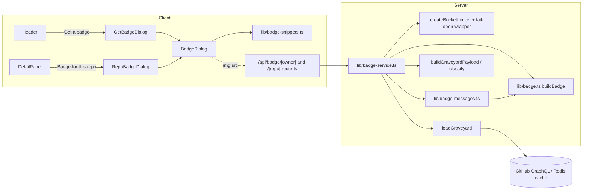
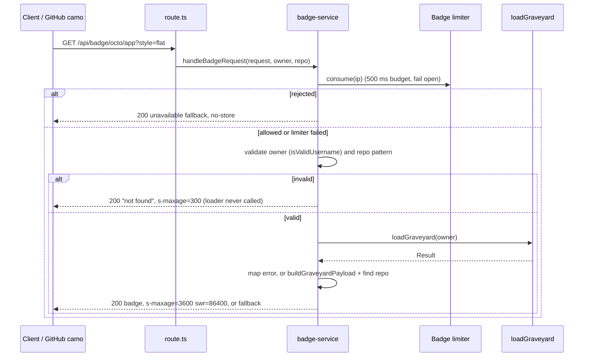

# Design Document: Graveyard Badges

## Overview

Graveyard Badges are embeddable SVG badges for READMEs. Two public, read-only endpoints return them:

- `GET /api/badge/[owner]` returns a Summary_Badge ("3 ghosts \u00B7 1 zombie \u00B7 2 at rest").
- `GET /api/badge/[owner]/[repo]` returns a Repo_Badge ("ghost \u00B7 fading").

The graveyard page gets a "Get a badge" dialog and the detail panel gets a "Badge for this repo" dialog. Both show a live preview, a haunted/flat style toggle, and copyable Markdown and HTML snippets.

The design splits the feature into four layers so the risky part (generating SVG from user-influenced text) is pure and property-testable:

1. **Pure builder** (`lib/badge.ts`): text, tone and style in, SVG string out. No I/O, no `server-only`.
2. **Pure message and snippet logic** (`lib/badge-messages.ts`, `lib/badge-snippets.ts`): counts/state to message and tone, owner/repo/style to URLs and snippets.
3. **Server service** (`lib/badge-service.ts`, `server-only`): rate limit, validation, `loadGraveyard`, `classify`, response headers, and the "never break a README" error mapping. Two thin route files call it.
4. **Client dialogs** (`components/badge/*`): one shared dialog component with two thin wrappers, wired into `Header` and `DetailPanel`.

### Research findings that shaped the design

| Finding | Source | Consequence |
|---|---|---|
| `params` is a `Promise` in route handlers; type it as `{ params: Promise<{ owner: string; repo: string }> }` and `await` it. | `node_modules/next/dist/docs/01-app/03-api-reference/03-file-conventions/route.md`; existing `app/api/graveyard/[owner]/route.ts` | Both badge routes use the same signature. |
| `cacheComponents: true` is set in `next.config.ts`. The segment-config docs folder has no `dynamic`, `revalidate` or `fetchCache` pages, and no existing route exports them. | `next.config.ts`; `.../02-route-segment-config/` listing; grep of `app/**` | Badge routes export **no** segment config. Edge caching is done only through `Cache-Control` headers; the origin-side cache is the existing Redis graveyard cache inside `loadGraveyard`. GET handlers are dynamic by default (v15 change in the `route.md` version history), and these handlers await `params` and read request headers, so they run at request time. No `"use cache"` is used in the routes. |
| `loadGraveyard(owner)` validates, reads the Redis cache, fetches on miss, and returns `Result<GraveyardData, LoadError>`. `LoadError` kinds: `invalid-username`, `not-found`, `rate-limited`, `server-error`. | `lib/graveyard-loader.ts`, `lib/github.ts` | Error mapping is a total switch over those four kinds plus a `catch` for thrown errors. |
| `buildGraveyardPayload(owner, data, nowIso)` already runs `classify(repo, undefined, nowIso)` for every repo and tallies `counts` per state. | `lib/graveyard-payload.ts` | The service reuses it. "No overrides" (Req 1.5, 11.4) holds by construction. No second classification path is written. |
| `createBucketLimiter(store, clock, {bucket, limit, windowMs})` falls back to a per-process window when the store is `null` or throws. It does not time out a hung store. | `lib/ratelimit.ts` | Req 4.4 (fail open on store failure or 500 ms hang) needs a small wrapper in the service: a failure-flagging store wrapper plus `Promise.race` with a 500 ms timer. |
| `decayWord(state, level)` returns the exact words the UI already uses (`healthy/fading/flickering/about to turn`, `fresh/rotting/decayed/skeletal/ancient`, `risen`, `at rest`, `sealed`) and clamps bad levels. | `lib/repoDetails/decayWord.ts`, `lib/estate-view.ts` | Repo messages reuse it; badge wording matches the detail panel. |
| `resolveSiteUrl(raw)` never throws and falls back to `http://localhost:3000`. | `lib/site-meta.ts` | Snippet origin comes from `resolveSiteUrl(process.env.NEXT_PUBLIC_SITE_URL).origin`. The literal `process.env.NEXT_PUBLIC_SITE_URL` must appear in client code so Next inlines it. |
| `isValidUsername` / `normalizeUsername` are pure and shared. | `lib/username.ts` | Owner validation reuses `isValidUsername` unchanged. |
| `ReviveDialog` is the house dialog: portal to `document.body`, `role="dialog" aria-modal`, `aria-labelledby`, window-level capture `keydown` for Escape/Tab (so it wins over `DetailPanel`'s document-level handler), `role="status" aria-live="polite"` region, `navigator.clipboard.writeText` in `try/catch`, read-only textareas after a failed copy, `seance-focus` focus ring, `motion-safe:` transitions. | `components/seance/ReviveDialog.tsx`, `app/globals.css` (`.seance-focus`) | `BadgeDialog` copies this shape and adds what it lacks: return focus to the opener, inert background, and no unconditional transition (Req 9.7). |
| `Header` is a client component that receives `mode` (`"live"` / `"estate"`) and `username`. It has a compact Menu panel (CSS-driven at 768 px) and uses `useIsCompact()` (`false` on server, during hydration, and without `matchMedia`). | `components/ui/Header.tsx`, `components/ui/useIsCompact.ts` | Estate detection is `mode === "estate" \|\| username === ""`. Desktop button vs Menu item is chosen with `useIsCompact()` so only one is in the DOM (Req 7.1/7.2). |
| `DetailPanel` receives `isFixture` (true for estate). Its `PanelContent` has an "Actions" section. | `components/detail/DetailPanel.tsx` | "Badge for this repo" goes in the Actions section, hidden when `isFixture`. |
| `tests/unit/no-hardcoded-hex.test.ts` forbids hex literals in `components/scene` and `components/creatures`; the project rule says components never hardcode hex. | tests, `tech.md` | Dialog components use Tailwind tokens only. The standalone SVG cannot read CSS variables (it is loaded as an ``), so its hex values live in one `BADGE_PALETTE` constant in `lib/badge.ts`, and a unit test asserts every value exists in `app/globals.css`. |
| Vitest projects: `unit` (`tests/**/*.test.ts`, node), `dom` (`tests/**/*.test.tsx`, jsdom). `server-only` is aliased to a no-op. | `vitest.config.ts` | Route tests go in `tests/unit`, dialog tests in `tests/dom`, property tests in `tests/property/*.test.ts`. |

## Architecture



### Request flow



### Key decisions

| Decision | Rationale |
|---|---|
| Limiter runs **before** validation and the loader. | Every badge request is counted (Req 4.2), and invalid-name floods are cheap but still bounded. |
| Badge colours are looked up from a closed `BADGE_PALETTE` by key; the builder never accepts a raw colour string. | Req 6.8: no unvalidated colour or style text can reach the output. Unknown keys fall back to defaults using `Object.hasOwn`, so `"constructor"` or `"__proto__"` do not resolve. |
| `<text>` is emitted **once** per segment (no drop-shadow duplicate) and every text segment has `textLength` with `lengthAdjust="spacingAndGlyphs"`. | Halves the worst-case escaped bytes, keeping the 4 KB bound provable, and keeps text inside its segment even if the viewer's font differs from Verdana metrics. |
| No `url(...)`, gradients, filters, `clipPath`, `<image>`, or `<style>` in badges. | Req 6.3 forbids `url(`; plain rects and paths are enough. Rounded corners use a `<path>` with arc commands. |
| The Haunted ghost icon from the design board is **not** included. | Req 3.4 defines segment width as text width plus 10 px each side. An icon would break that formula. |
| Fallback SVGs never contain owner or repo text. | Req 5.8 allows only fixed messages. Omitting input text makes the escaping requirement trivially safe, and the builder still escapes anyway. |
| Dialog state is unmounted on close (the parent renders the dialog conditionally). | Resets style to haunted on every open (Req 7.7) and clears "Copied" and failure messages (Req 9.9) without extra code. |

### Decision: limiter rejections are never cached by a shared CDN

A shared CDN keys by URL, not by client IP. If the rate-limited "unavailable" badge carried `s-maxage=300`, one throttled client (most likely GitHub's image proxy, camo, which fetches from a small set of IPs) could cause "unavailable" to be cached for that URL for 5 minutes for everyone. Req 4.3 and 5.4 therefore require the limiter-rejection fallback to carry `Cache-Control: no-store`. Every other fallback (invalid names, unknown owner or repo, loader failure, unexpected error) describes the URL rather than the caller, so it keeps `public, s-maxage=300`. The rejected response is still HTTP 200 with a valid grey SVG, so a README never shows a broken image. This adopts the earlier follow-up note about `no-store`; it needs no further action.

## Components and Interfaces

### `lib/badge.ts` (pure, no `server-only`, no React)

```ts
export const SEPARATOR = " \u00B7 ";           // space, U+00B7, space (escape, never a literal)
export const ELLIPSIS = "\u2026";
export const MAX_TEXT_CODE_POINTS = 64;        // 63 + ellipsis
export const MAX_SVG_BYTES = 4096;             // output must be strictly smaller
export const PADDING_PX = 10;                  // per side
export const DEFAULT_CHAR_WIDTH_PX = 7;
export const BADGE_HEIGHT_PX = 20;
export const FONT_SIZE_PX = 11;

export type BadgeStyle = "haunted" | "flat";
export type BadgeTone =
  | "ghost" | "risen" | "zombie" | "tombstone" | "coffin"   // the five states
  | "neutral"                                               // empty summary
  | "fallback";                                             // grey

export interface BadgeParams {
  label: string;
  message: string;
  tone: string;    // validated against BADGE_PALETTE; unknown -> "neutral"
  style: string;   // validated; unknown -> "haunted"
}

export function parseBadgeStyle(raw: string | null | undefined): BadgeStyle;   // "flat" iff raw === "flat"
export function sanitizeBadgeText(s: string): string;   // invalid XML chars and tab/LF/CR -> U+FFFD / space
export function truncateBadgeText(s: string): string;   // by code point: <=64 unchanged, else first 63 + U+2026
export function escapeXml(s: string): string;           // & < > " ' -> &amp; &lt; &gt; &quot; &apos;
export function textWidthPx(s: string): number;         // sum of Width_Table widths, default 7 px per unknown code point
export function segmentWidthPx(s: string): number;      // ceil(textWidthPx(s) + 2 * PADDING_PX)
export function isValidRepoName(s: string): boolean;    // /^[A-Za-z0-9._-]{1,100}$/
export function buildBadge(p: BadgeParams): string;     // the SVG string
export const FALLBACK_NOT_FOUND = "not found";
export const FALLBACK_UNAVAILABLE = "unavailable";
```

**Text pipeline** (applied to label and message independently): `sanitizeBadgeText` -> `truncateBadgeText` -> width computed from the result -> `escapeXml` only when the text is placed in a text node or attribute.

- `sanitizeBadgeText` iterates by code point. Anything outside the XML 1.0 `Char` production (`U+0009 U+000A U+000D U+0020-U+D7FF U+E000-U+FFFD U+10000-U+10FFFF`), including lone surrogates, `U+FFFE` and `U+FFFF`, becomes `U+FFFD`. Tab, LF and CR become a space. Length in code points is preserved, which keeps width monotone.
- `truncateBadgeText` counts code points (`Array.from`), not UTF-16 units, so a surrogate pair is never split.
- **Ellipsis width.** The Width_Table covers printable ASCII `U+0020-U+007E` plus `U+00B7`. The ellipsis is charged `MAX_CHAR_WIDTH_PX = max(all table widths, DEFAULT_CHAR_WIDTH_PX)`. Reason: a 64-character string may end in a wide glyph ("W"), and the same string extended by one character becomes 63 characters plus an ellipsis. If the ellipsis were narrower than that 64th glyph, width would shrink as text grew and break Req 10.1(b). Charging the table maximum guarantees `width(63 chars + ellipsis) >= width(any 64 chars)`.
- Widths are stored as Verdana 11 px advances in a `Record<string, number>` (px, one decimal). The table is derived from published Verdana advance widths (units per em scaled by 11/em). Implementation task: generate it from Verdana metrics and cross-check a sample against the shields.io Verdana table. Any code point not in the table is charged 7 px.

**SVG shape** (height 20, `width` = label segment + message segment):

```xml
<svg xmlns="http://www.w3.org/2000/svg" width="W" height="20" role="img" aria-label="T">
  <title>T</title>
  <path d="...rounded-left label segment..." fill="LABEL_FILL"/>
  <path d="...rounded-right value segment..." fill="TONE_FILL"/>
  <g font-family="Verdana,DejaVu Sans,sans-serif" font-size="11">
    <text x="LX" y="14" textLength="LT" lengthAdjust="spacingAndGlyphs" fill="LABEL_TEXT">label</text>
    <text x="VX" y="14" textLength="VT" lengthAdjust="spacingAndGlyphs" fill="TONE_TEXT">message</text>
  </g>
</svg>
```

`T` is `"<label>: <message>"` after sanitise/truncate, escaped once, and identical in `<title>` and `aria-label` (Req 3.6). In Haunted style the segment backgrounds sit on a `night-sky` base rect (the "night background"); in Flat style the base is omitted and an `ink-600` 1 px outline path separates a light label from a light value.

**Palette** (`BADGE_PALETTE`; every hex value is copied from an `@theme` token in `app/globals.css` and asserted by a unit test):

| Key | Fill | Text on fill | Source token(s) |
|---|---|---|---|
| ghost | `#9fe7ff` | `#05060a` | `ghost-300` / `night-sky` |
| risen | `#f4b860` | `#05060a` | `candle-400` |
| zombie | `#e2555f` | `#05060a` | `crimson-400` |
| tombstone | `#ecead9` | `#05060a` | `moon-pale` |
| coffin | `#4a4f5e` | `#ecead9` | `ink-600` |
| neutral (empty) | `#6b6556` | `#ecead9` | `ink-400` |
| fallback (grey) | `#8d897b` | `#05060a` | `scene-fg-faint` |
| haunted label | `#9b1c31` | `#ecead9` | `crimson-700` / `moon-pale` |
| haunted base | `#05060a` | n/a | `night-sky` |
| flat label | `#e2dccb` | `#1f2330` | `paper-border` / `ink-900` |
| flat outline | `#4a4f5e` | n/a | `ink-600` |

The five state fills are pairwise distinct (Req 2.4), the neutral fill differs from all five (Req 1.7), and the unit test also asserts WCAG contrast of at least 4.5 for every fill/text pair. Final hex choices may change during implementation only if that test still passes. Colour never carries state alone: the message names the state.

### `lib/badge-messages.ts` (pure)

```ts
import type { LifecycleState } from "./lifecycle";

export type BadgeCounts = Record<LifecycleState, number>;

export function summaryMessage(counts: BadgeCounts): string;
export function summaryTone(counts: BadgeCounts): BadgeTone;
export function repoMessage(state: LifecycleState, decayLevel: number | null): string;
export function repoTone(state: LifecycleState): BadgeTone;
```

- `summaryMessage`: parts in the order ghost, risen, zombie, tombstone, coffin. Each non-zero count becomes `"<n> <noun>"`, nouns `ghost/ghosts`, `risen/risen`, `zombie/zombies`, `at rest/at rest`, `sealed/sealed` (singular when n is 1). Parts are joined with `SEPARATOR`. All zero returns `"empty"`. Counts that are not finite non-negative integers are treated as 0.
- `summaryTone`: first non-zero in the order zombie, ghost, risen, tombstone, coffin; `"neutral"` when all are zero.
- `repoMessage`: for `ghost` and `zombie`, `` `${state}${SEPARATOR}${decayWord(state, decayLevel)}` ``; for the other three states, `decayWord(state, null)` alone. It contains no digits, so cached badges never show stale day counts (Req 2.6).
- `repoTone(state)` is the identity mapping onto the five state tones.

### `lib/badge-snippets.ts` (pure, used by the dialogs)

```ts
export type BadgeTarget =
  | { kind: "owner"; owner: string }
  | { kind: "repo"; owner: string; repo: string };

export interface BadgeSnippets {
  imageUrl: string;     // SITE/api/badge/OWNER[/REPO][?style=flat]
  previewUrl: string;   // same path, relative ("/api/badge/..."), so previews work on any deploy
  linkUrl: string;      // SITE/g/OWNER[/REPO], never has ?style
  markdown: string;     // [](linkUrl)
  html: string;         // <a href="linkUrl"></a>
}

export function encodeSegment(s: string): string;
export function buildBadgeSnippets(site: string, target: BadgeTarget, style: BadgeStyle): BadgeSnippets;
```

`encodeSegment` is `encodeURIComponent` plus percent-encoding of `! ' ( ) *`, so one input always yields one path segment and a Markdown URL never contains `)`. `site` is a bare origin (no trailing slash). In `html`, URLs pass through `escapeXml` so `&` and quotes cannot break the attribute. `?style=flat` is appended to image/preview URLs only, and only when the style is `flat`.

### `lib/badge-service.ts` (`import "server-only"`)

```ts
export interface BadgeServiceDeps {
  load?: (owner: string) => Promise<Result<GraveyardData, LoadError>>;   // default: loadGraveyard(owner)
  makeLimiter?: () => Promise<BucketLimiter>;                            // default: createBucketLimiter over Upstash
  now?: () => number;                                                    // default: Date.now
  limiterTimeoutMs?: number;                                             // default: 500
}

export const BADGE_BUCKET = "badge";
export const BADGE_LIMIT = 600;
export const BADGE_WINDOW_MS = 3_600_000;
export const SUCCESS_CACHE_CONTROL = "public, s-maxage=3600, stale-while-revalidate=86400";
export const FALLBACK_CACHE_CONTROL = "public, s-maxage=300";
export const THROTTLED_CACHE_CONTROL = "no-store";   // limiter rejections only

export async function handleBadgeRequest(
  request: Request,
  owner: string,
  repo: string | null,
  deps?: BadgeServiceDeps,
): Promise<Response>;
```

Behaviour, in order. The whole body is inside one `try/catch`; the `catch` returns the "unavailable" fallback, and if even building that throws, a hard-coded minimal SVG constant is returned. The function never throws and never returns a non-200 status.

1. `style = parseBadgeStyle(new URL(request.url).searchParams.get("style"))`.
2. **Limiter.** `makeLimiter` builds `createBucketLimiter(store, deps.now, { bucket: "badge", limit: 600, windowMs: 3_600_000 })` over a store wrapper that sets a `failed` flag when any store call throws, then rethrows (so the limiter keeps its own in-memory fallback). `consume(clientIp(x-forwarded-for))` is raced against a 500 ms timer (cleared afterwards). Outcome: `ok:false` and no store failure -> "unavailable" fallback sent with `THROTTLED_CACHE_CONTROL` (`no-store`), the only response that does not use `FALLBACK_CACHE_CONTROL`; `ok:true`, timeout, throw, or `failed` flag -> continue without limiting (Req 4.4). If Redis is not configured the limiter runs in its in-memory mode; that is a configuration choice, not a store failure.
3. **Validate.** `isValidUsername(owner)` and, for the repo route, `isValidRepoName(repo)`. Failure -> "not found" fallback; `load` is not called (Req 5.5).
4. **Load.** `load(owner)`. Mapping: `not-found` or `invalid-username` -> "not found"; `rate-limited`, `server-error`, or a thrown error -> "unavailable".
5. **Build.** `payload = buildGraveyardPayload(owner, data, new Date(now()).toISOString())` (no overrides). Summary route: `summaryMessage(payload.counts)`, `summaryTone(payload.counts)`. Repo route: find the first entry with `entry.name.toLowerCase() === repo.toLowerCase()`; none -> "not found"; otherwise `repoMessage(entry.state, entry.decay)`, `repoTone(entry.state)`.
6. **Respond.** `buildBadge({ label: "repo graveyard", message, tone, style })` with `SUCCESS_CACHE_CONTROL`. Fallbacks use tone `fallback`, the same style, and `FALLBACK_CACHE_CONTROL`, except the limiter rejection from step 2, which uses `THROTTLED_CACHE_CONTROL`.

Every response (success and fallback) carries `Content-Type: image/svg+xml; charset=utf-8` and `X-Content-Type-Options: nosniff`, set by one `svgResponse(body, cacheControl)` helper. Services write nothing: `load` is the only data access and it is read-only (Req 11.3, 11.6).

### Route files

```ts
// app/api/badge/[owner]/route.ts
import "server-only";
import { handleBadgeRequest } from "@/lib/badge-service";

export async function GET(
  request: Request,
  ctx: { params: Promise<{ owner: string }> },
): Promise<Response> {
  const { owner } = await ctx.params;
  return handleBadgeRequest(request, owner, null);
}
```

`app/api/badge/[owner]/[repo]/route.ts` is identical with `{ owner, repo }`. If `await ctx.params` itself throws, the route wraps it so the response is still the "unavailable" fallback. Neither file exports segment config.

### `components/badge/*` (client)

| File | Responsibility |
|---|---|
| `BadgeDialog.tsx` | Shared modal. Props: `target: BadgeTarget`, `onClose()`, `openerRef?: RefObject<HTMLElement \| null>`. |
| `GetBadgeDialog.tsx` | `<BadgeDialog target={{kind:"owner", owner}} />` |
| `RepoBadgeDialog.tsx` | `<BadgeDialog target={{kind:"repo", owner, repo}} />` |

`BadgeDialog` internals:

- **Site URL:** `resolveSiteUrl(process.env.NEXT_PUBLIC_SITE_URL).origin`, computed once per mount.
- **State:** `style` (`"haunted"` initially), `previewFailed`, `status` (aria-live text), `copied` (`"markdown" | "html" | null`), `copyFailed`. Snippets are derived with `buildBadgeSnippets` on every render, so a style change updates preview and both snippets in the same React commit (Req 7.8).
- **Layout (DOM order = tab order):** heading ("Get a badge" / "Badge for this repo"), Close button, preview (``, or on `onError` a text fallback naming the owner/repo), style fieldset with two native radio inputs (`haunted`, `flat`), Markdown snippet (read-only textarea + Copy button), HTML snippet (read-only textarea + Copy button), `role="status" aria-live="polite"` region. Textareas keep the text visible and selectable whether or not copy works (Req 7.14, 9.5).
- **Preview ``:** keyed by `previewUrl` so a style change retries and clears `previewFailed`. `eslint-disable-next-line @next/next/no-img-element` with a reason (SVG endpoint; `next/image` adds nothing).
- **Modal behaviour:**
  - On mount: remember `openerRef?.current ?? document.activeElement`; set `inert` on every `document.body` child except the dialog's own portal root (recording which ones it changed); focus the first focusable element found by a `querySelector` over the dialog (the Close button).
  - A window-level capture `keydown` handler (same technique as `ReviveDialog`, so it runs before `DetailPanel`'s document handler): Escape -> `preventDefault`, `stopPropagation`, close. Tab -> intercepted only at the edges: Tab on the last focusable moves to the first, Shift+Tab on the first moves to the last, and focus outside the dialog is pulled in. Interior Tab steps are left to the browser, which keeps radio-group arrow/tab behaviour native.
  - On unmount: remove only the `inert` attributes it added, then focus the opener if it is still connected (otherwise the caller's fallback, see below), inside `try/catch`.
  - Backdrop click and the Close button call `onClose`. Because the parent unmounts the dialog, all state (including "Copied") is discarded (Req 9.9).
- **Copy:** `await navigator.clipboard.writeText(text)` in `try/catch`. Success: `copied = which`, `status = "Copied"`, and a 2000 ms timer clears both (timer cleared on unmount). Failure (including `navigator.clipboard` being undefined): `status = "Could not copy. Select the text instead."`, dialog stays open. The status is cleared then re-set in a `requestAnimationFrame`, like `ReviveDialog`, so repeated identical messages are re-announced.
- **Styling:** reuse `ReviveDialog` classes (panel `bg-night-800 border-ghost-300`, backdrop `bg-night-950/80`, `seance-focus` on every control, `font-heading` labels, `font-fact` for snippets). Transitions use only `motion-safe:` utilities, so under `prefers-reduced-motion` the dialog appears and disappears with no animation (Req 9.7).

### Wiring into existing components

**`components/ui/Header.tsx`**

- `const badgeAvailable = mode !== "estate" && username !== ""`.
- State `badgeOpen`, refs `badgeButtonRef` and `badgeMenuItemRef`.
- When `badgeAvailable && !compact`: a **"Get a badge"** button in the right cluster, next to the toggles. Classes follow the existing "Visit" button (`rounded-md border border-candle-400 px-3 py-2 font-ui text-sm ... focus-visible:ring-2 focus-visible:ring-candle-400`) plus `min-h-11`.
- When `badgeAvailable && compact`: a **"Get a badge"** item inside the Menu panel (same classes, full width). It does not close the Menu on activation, so the item stays connected and receives focus back on close. If the opener is gone, focus falls back to `menuButtonRef`.
- `{badgeOpen && <GetBadgeDialog owner={username} openerRef={...} onClose={() => setBadgeOpen(false)} />}`.
- A widening transition (compact to desktop) while the dialog is open keeps the dialog open; its opener ref is re-resolved at close time.

**`components/detail/DetailPanel.tsx`** (`PanelContent`, Actions section)

- `{!isFixture && <button ...>Badge for this repo</button>}` after `<SeanceButton />`, sized smaller than the header button: `h-9 px-2 text-xs` (header button is `min-h-11 text-sm`), same border/focus-ring tokens.
- `{badgeOpen && <RepoBadgeDialog owner={owner} repo={row.name} openerRef={...} onClose={...} />}`.
- Opening the dialog does not change any `DetailPanel` state (Req 8.5). `DetailPanel`'s own Escape handler is bypassed while the dialog is open because the dialog stops propagation at window capture.

## Data Models

No persisted data and no new stores. All types are in-memory.

```ts
// Closed sets, validated at the builder boundary
type BadgeStyle = "haunted" | "flat";
type BadgeTone = "ghost" | "risen" | "zombie" | "tombstone" | "coffin" | "neutral" | "fallback";

// Input to the pure builder (tone/style are strings so hostile values are testable)
interface BadgeParams { label: string; message: string; tone: string; style: string }

// Derived from the existing GraveyardPayload.counts
type BadgeCounts = Record<"ghost" | "risen" | "zombie" | "tombstone" | "coffin", number>;
```

Constants:

| Name | Value | Notes |
|---|---|---|
| Label (all badges) | `"repo graveyard"` | Fixed. |
| `SEPARATOR` | `" \u00B7 "` | Written with the escape in source and tests. |
| Text cap | 64 code points | 63 + `\u2026`. |
| SVG cap | < 4096 bytes (UTF-8) | Asserted by property test; builder has a last-resort guard that returns the minimal fallback SVG if exceeded. |
| Padding / default glyph width | 10 px per side / 7 px | |
| Success `Cache-Control` | `public, s-maxage=3600, stale-while-revalidate=86400` | |
| Fallback `Cache-Control` | `public, s-maxage=300` | All fallbacks except limiter rejection. |
| Throttled fallback `Cache-Control` | `no-store` | Limiter rejection only. |
| Limiter | bucket `badge`, 600 / 3,600,000 ms, timeout 500 ms | |

**Worst-case size budget** (why 4 KB holds): label and message are each at most 64 code points. A string of 64 `'` or `"` escapes to 6 bytes each = 384 bytes. The combined `T` string is at most 130 code points (780 bytes escaped) and appears twice (`<title>`, `aria-label`) = 1,560 bytes; label and message text nodes add at most 2 x 384 = 768 bytes. That is about 2.3 KB of text against roughly 1 KB of fixed markup, below 4,096. Four-byte emoji (256 bytes per 64) are cheaper than the 6-byte entities.

## Correctness Properties

*A property is a characteristic or behavior that should hold true across all valid executions of a system-essentially, a formal statement about what the system should do. Properties serve as the bridge between human-readable specifications and machine-verifiable correctness guarantees.*

Prework reflection: the escaping, size, inertness, and accessible-name criteria all apply to the same `buildBadge` output, but each needs a different check, so they stay separate properties. Per-criterion properties for fallback status/headers (4.3, 5.1-5.5, 6.5) collapse into one response-contract property. Criteria 1.2/1.3/1.4/10.6/10.7 collapse into one message property, and 7.9-7.12/8.3/8.4 into one snippet property.

### Property 1: Output is well-formed XML for any input

*For any* label, message, tone and style strings (including empty, up to 10,000 characters, unicode, control characters, lone surrogates and strings made of `& < > " '`), `buildBadge` returns a string that a strict XML 1.0 well-formedness check accepts, with no unescaped `<`, `>`, `&`, `"` or `'` inside any text node or attribute value.

**Validates: Requirements 3.5, 6.1, 10.1**

### Property 2: Truncation never exceeds 64 and never alters short text

*For any* string `s`, `truncateBadgeText(sanitizeBadgeText(s))` has at most 64 code points; it equals the sanitised input when that has 64 or fewer code points; otherwise it equals the first 63 code points followed by exactly one `\u2026`.

**Validates: Requirements 6.2**

### Property 3: Output is under 4,096 bytes

*For any* label and message (including worst-case strings of 64 or more `'`, `"`, `&`, `<` characters, four-byte emoji, and 10,000-character inputs) and any tone and style, the UTF-8 byte length of `buildBadge(...)` is less than 4,096. The same holds for both fallback badges.

**Validates: Requirements 5.7, 6.4, 10.1**

### Property 4: Output is inert

*For any* label, message, tone and style, the output contains no `<script` (case-insensitive), no `<foreignObject`, no attribute whose name begins with `on`, no `href` or `xlink:href` attribute, no `url(`, no `<image`, no `<style`, no `data:` and no `@font-face`.

**Validates: Requirements 6.3, 6.6, 10.1**

### Property 5: Width is monotone in text length

*For any* string `s` and any single character `c`, the total SVG `width` of a badge whose message is `s + c` is greater than or equal to that of a badge whose message is `s`, all else equal, including when the lengths cross the 64-character truncation point.

**Validates: Requirements 3.4, 10.1**

### Property 6: Segment widths follow the width formula

*For any* string `s`, `segmentWidthPx(s)` equals `ceil(sum of per-code-point widths + 20)` computed independently, where a code point missing from the Width_Table contributes exactly 7, and the badge's `width` attribute equals the sum of its label and message segment widths.

**Validates: Requirements 3.4, 3.5**

### Property 7: Builder is deterministic and substitutes defaults

*For any* parameters, two calls return identical strings; and *for any* `tone` not in the palette, the output equals the output for tone `"neutral"`, and *for any* `style` other than `"haunted"` or `"flat"`, the output equals the output for `"haunted"`, with none of the unrecognised tone or style text appearing in the output.

**Validates: Requirements 6.7, 6.8**

### Property 8: Accessible name is identical and complete

*For any* label, message and style, the `<title>` text equals the `aria-label` value, both equal `"<label>: <message>"` after sanitise and truncate and XML-unescaping, and the root element has `role="img"`.

**Validates: Requirements 3.6**

### Property 9: Summary message lists exactly the non-zero states

*For any* counts record, `summaryMessage` returns `"empty"` when all counts are 0; otherwise it returns the non-zero states in the order ghosts, risen, zombies, at rest, sealed, each as `"<n> <noun>"` with the singular noun exactly when `n === 1`, joined by `" \u00B7 "` (written with the escape), omits every zero state, and never contains the character `\u00C2`. The same separator and absence of `\u00C2` hold for the full SVG.

**Validates: Requirements 1.2, 1.3, 1.4, 10.6, 10.7**

### Property 10: Summary tone follows urgency

*For any* counts record, `summaryTone` returns the first non-zero state in the order zombie, ghost, risen, tombstone, coffin, and `"neutral"` when all are zero.

**Validates: Requirements 1.6, 1.7**

### Property 11: Repo message and tone depend only on state and decay

*For any* state and any decay level (including null, negative, fractional and out-of-range values), `repoMessage` is `"<state> \u00B7 <decayWord>"` for ghost and zombie and the bare state word (`risen`, `at rest`, `sealed`) otherwise, contains no digit, and `repoTone` returns five distinct tones for the five states whose palette fills are pairwise distinct.

**Validates: Requirements 2.2, 2.3, 2.4, 2.6, 10.7**

### Property 12: Style parsing is exact

*For any* string or null `x`, `parseBadgeStyle(x)` is `"flat"` if and only if `x === "flat"` (case-sensitive); every other value, including `""`, `"FLAT"`, `"haunted"`, and strings longer than 32 characters, yields `"haunted"`.

**Validates: Requirements 3.1, 3.3**

### Property 13: Repo-name validation matches the pattern

*For any* string `s`, `isValidRepoName(s)` is true if and only if `s` has 1 to 100 characters, all in `[A-Za-z0-9._-]`; and the service never calls the loader for an owner that fails `isValidUsername` or a repo that fails `isValidRepoName`.

**Validates: Requirements 5.5, 5.6**

### Property 14: Repo lookup is case-insensitive

*For any* list of repos and any re-casing of the name of one of them, the service's repo badge reports that repo's own state; *for any* name that matches no repo case-insensitively, it returns the "not found" fallback.

**Validates: Requirements 2.5**

### Property 15: Summary counts equal an override-free classification tally

*For any* list of `RepoFacts` and instant, the Summary_Badge message equals `summaryMessage` of the tally of `classify(repo, undefined, nowIso).state` over the list, and each Repo_Badge message equals the message for `classify(repo, undefined, nowIso)`.

**Validates: Requirements 1.5, 2.1, 11.4**

### Property 16: Every service response honours the contract

*For any* request scenario (valid or hostile owner and repo, any `style` value, loader result `ok`, `not-found`, `invalid-username`, `rate-limited`, `server-error` or thrown error, limiter allow, deny, throw or hang), `handleBadgeRequest` resolves with status 200, `Content-Type: image/svg+xml; charset=utf-8`, `X-Content-Type-Options: nosniff`, a well-formed SVG body, and `Cache-Control` equal to `public, s-maxage=3600, stale-while-revalidate=86400` for a real badge, exactly `no-store` for a limiter denial (and never containing `s-maxage`), and `public, s-maxage=300` for every other fallback. The fallback message is `"not found"` for invalid names, unknown owners and unknown repos, and `"unavailable"` for limiter denial, rate-limit, server-error and thrown errors.

**Validates: Requirements 4.1, 4.3, 5.1, 5.2, 5.3, 5.4, 5.5, 6.5, 11.6**

### Property 17: Fallback body does not depend on user text

*For any* hostile owner and repo strings that produce a fallback, the response body equals the fixed fallback body for that message and style, and does not contain the owner or repo text.

**Validates: Requirements 5.8**

### Property 18: Snippets are single-segment, correctly styled, and round-trip

*For any* owner and repo strings (including `/`, `?`, `#`, `%`, `(`, `)`, spaces and unicode), `buildBadgeSnippets` produces URLs in which the owner and repo are each exactly one path segment that decodes back to the input, the Markdown equals `[](LINK)` with `IMG` ending in `?style=flat` if and only if the style is flat and `LINK` never containing `style`, and the HTML snippet embeds the same `IMG` and `LINK` values (parsed back, after attribute unescaping).

**Validates: Requirements 7.9, 7.10, 7.11, 7.12, 8.3, 8.4**

## Error Handling

| Condition | Response | Cache-Control |
|---|---|---|
| Owner fails `isValidUsername`; repo empty, over 100 chars, or has a character outside `[A-Za-z0-9._-]` | 200, grey "not found" | `public, s-maxage=300` |
| `loadGraveyard` returns `not-found` or `invalid-username` | 200, grey "not found" | `public, s-maxage=300` |
| Owner loads but repo is not in the graveyard (includes the 300-repo cap) | 200, grey "not found" | `public, s-maxage=300` |
| `loadGraveyard` returns `rate-limited` or `server-error`, or throws | 200, grey "unavailable" | `public, s-maxage=300` |
| Badge limiter denies (over 600 / hour / IP) | 200, grey "unavailable" | `no-store` |
| Limiter store throws, or `consume` takes longer than 500 ms | Badge served normally (fail open) | normal |
| Any unexpected exception in the service | 200, grey "unavailable" | `public, s-maxage=300` |
| `buildBadge` itself throws or exceeds 4,096 bytes (should be impossible) | Hard-coded minimal "unavailable" SVG constant | `public, s-maxage=300` |
| Owner exists with zero repos | 200, Summary_Badge "empty" in the neutral colour | `public, s-maxage=3600, ...` |

Server logging: expected failures (not-found, invalid names) are silent; `rate-limited`, `server-error`, thrown errors and limiter failures are logged with `console.error("[badge] ...")` using the error kind only, never the token or request headers. The loader already logs its own server-errors.

Client: a failed preview image (`onError`) swaps the image for a text line such as "Preview unavailable for octo/app" while both snippets, both Copy buttons and the style toggle stay active. Clipboard failure (rejection or missing `navigator.clipboard`) is announced in the live region and leaves the textareas selectable.

## Testing Strategy

The feature has a large pure core (builder, messages, snippets, name and style validation) that suits property-based testing, a thin server shell tested with mocks, and UI dialogs tested with example-based DOM tests. UI layout, colours and typography are checked by class assertions and the design review, not by property tests.

**Libraries:** Vitest and fast-check (already in the project). No new dependencies. Well-formedness is checked by a small strict XML tokenizer in `tests/helpers/xml.ts` (tags balanced, attributes quoted and unique, only the five entities and numeric references, no raw `<` or `&` in content, characters in the XML 1.0 `Char` range). It is itself unit tested with known-good and known-bad fixtures. Unit tests run in `node`, so `DOMParser` is not assumed.

**Property tests** (`tests/property/badge-*.test.ts`), each with `numRuns >= 100`, each tagged with a comment `// Feature: graveyard-badges, Property N: <title>`, one test per property:

| File | Properties |
|---|---|
| `badge-builder.test.ts` | 1, 2, 3, 4, 5, 6, 7, 8 |
| `badge-messages.test.ts` | 9, 10, 11 |
| `badge-validation.test.ts` | 12, 13 |
| `badge-service.test.ts` | 14, 15, 16, 17 (mocked `load` and limiter; no network; `fetch` stubbed to throw) |
| `badge-snippets.test.ts` | 18 |

Generators: arbitrary strings (`fc.string`, `fc.fullUnicodeString`, plus a generator of `'"&<>` runs, four-byte emoji, control characters and lone surrogates, lengths 0 to 10,000), `fc.record` of five non-negative counts biased toward 0 and 1, `RepoFacts` records built from the shape used in `tests/unit/graveyard-route.test.ts`, and an instant generator that includes future and missing push dates.

**Unit and route tests** (`tests/unit/`):

- `badge-routes.test.ts`: both routes, both styles, against a fixture graveyard: well-formed SVG with label "repo graveyard" and the expected message; exact `Cache-Control`, exact `Content-Type`, `nosniff`. One test per error case (unknown user, unknown repo, invalid name, rate-limited, loader failure) for each route where it applies: status 200, fallback grey fill present, message text, `s-maxage=300` (except the rate-limited case, which asserts `Cache-Control` is exactly `no-store` with no `s-maxage`; the deny-then-allow case also checks that a later allowed request for the same URL returns a normal cacheable response). Limiter configuration (`bucket: "badge"`, 600, 3,600,000, `clientIp` key). Fail-open cases with fake timers: `consume` throws, never resolves, resolves at 499 ms. Both route files call `await ctx.params`. A source scan confirms the route files export nothing except `GET`.
- `badge-palette.test.ts`: every `BADGE_PALETTE` hex appears in `app/globals.css` `@theme`; five state fills pairwise distinct; neutral differs from all five; contrast of each fill/text pair at least 4.5; the fallback fill is the grey fill.
- `badge-separator.test.ts`: messages and full SVGs never contain `\u00C2`; the separator in source files is the `\u00B7` escape (source scan of `lib/badge*.ts` finds no literal U+00B7).
- `badge-source-scan.test.ts`: `lib/badge.ts`, `lib/badge-messages.ts`, `lib/badge-snippets.ts` do not import `server-only`, `react`, `next/*` or any package; `package.json` `dependencies`/`devDependencies` are unchanged against a recorded list.
- `badge-width-table.test.ts`: spot values against known Verdana widths, table max drives the ellipsis width, unknown code point uses 7.

**DOM tests** (`tests/dom/`, jsdom):

- `BadgeDialog.test.tsx` (covers both wrappers): snippets render for each style; style toggle switches preview `src` and snippets in one `act`; haunted is selected again after close and reopen; copy writes the exact snippet to a mocked `navigator.clipboard.writeText` and the live region reads "Copied" then clears after 2,000 ms (fake timers); rejected clipboard shows the failure text and keeps the dialog open; preview `error` event shows the text fallback naming the owner (and repo) while snippets stay; initial focus is on the first focusable element; Tab on last / Shift+Tab on first wrap; Escape, Close and backdrop click each close and return focus to the opener; reopening after any close shows an empty live region; `role="dialog"`, `aria-modal`, accessible name; siblings are `inert` while open and restored on close; every control carries `seance-focus`; no unconditional `transition-*` class (only `motion-safe:`).
- `HeaderBadge.test.tsx`: with `matchMedia` stubbed at 1024 px a real graveyard shows the header button and no Menu item; at 500 px the Menu item exists and the header button does not; with `mode="estate"` both are absent at both widths.
- `DetailPanelBadge.test.tsx`: "Badge for this repo" present for a real repo and absent when `isFixture`; it carries `text-xs h-9` while the header button carries `text-sm min-h-11`; opening and changing style leaves the panel heading and Escape behaviour intact.

**Commands that must pass:** `npx vitest --run`, `npx tsc --noEmit`, `npm run lint`.

**What is not covered by automated tests:** actual rendering of the SVG in browsers and GitHub's image proxy (checked manually once by embedding a deployed badge in a scratch README), and visual quality of the dialogs (covered by the `/design-review` pass).

### Requirements coverage

| Requirement | Where it is satisfied |
|---|---|
| 1, 2 | `badge-messages.ts`, `badge-service.ts`; Properties 9, 10, 11, 14, 15 |
| 3 | `badge.ts`; Properties 6, 7, 8, 12 |
| 4 | `badge-service.ts` limiter wrapper and headers; Property 16, fail-open tests |
| 5 | `badge-service.ts` validation and error map; Properties 13, 16, 17 |
| 6 | `badge.ts` pipeline; Properties 1 to 5, 7 |
| 7, 8, 9 | `BadgeDialog`, `Header`, `DetailPanel`; Property 18, DOM tests |
| 10 | Test files above |
| 11 | No new deps, `badge*.ts` purity, `server-only` only in service and routes; source-scan tests |
