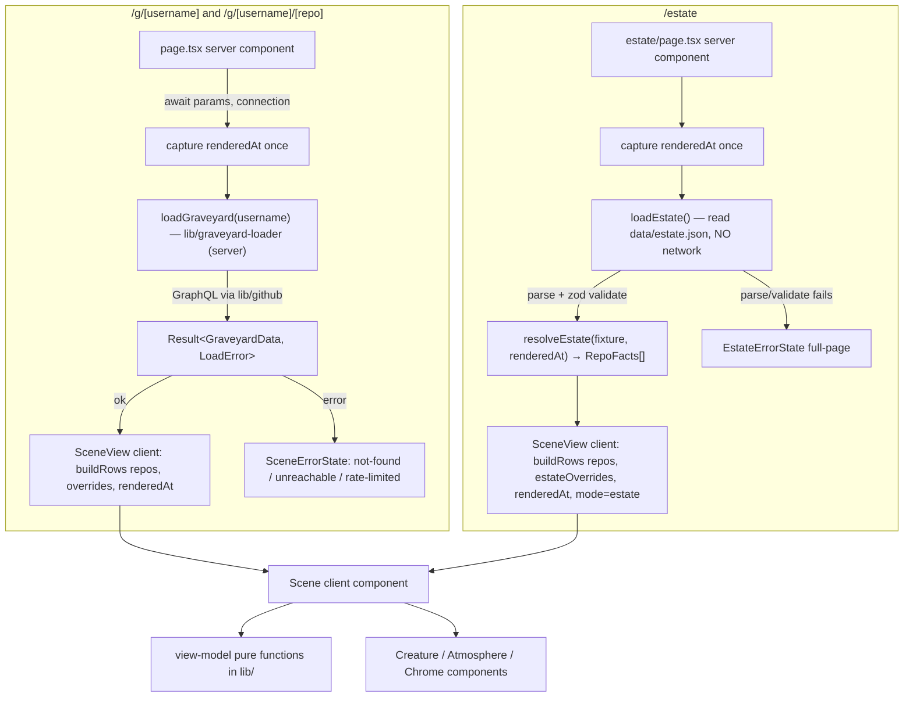
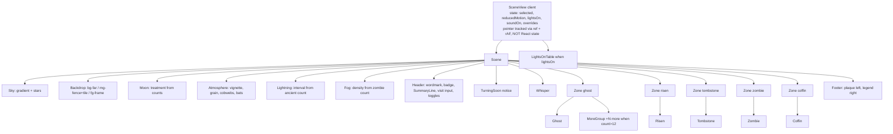
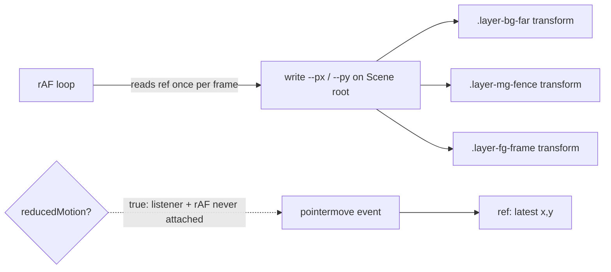

# Design Document

## Overview

The haunted graveyard scene is the signature visual surface of Repo Graveyard. It renders a list of already-classified repositories as a gothic night scene at three routes: a live graveyard (`/g/[username]`), a deep-link variant that pre-selects one creature (`/g/[username]/[repo]`), and the bundled sample (`/estate`). Every spooky effect encodes a real fact — moon color is overall health, fog density is the zombie count, lightning frequency is the number of ancient zombies, ghost decay drives flicker and glow — as mandated by `.kiro/steering/design.md` ("every spooky effect must encode real data").

This feature **consumes** the existing lifecycle engine unchanged. `classify` (`lib/lifecycle.ts`) and the pure view model `buildRows` / `groupByState` / `STATE_ORDER` (`lib/graveyard-view.ts`) already turn `RepoFacts` + overrides + `now` into `GraveyardRow[]`. The scene is a presentation layer on top of that output: it adds **no** new thresholds, re-reads **no** clock inside pure code, and re-uses the server data path (`loadGraveyard` → `buildRows`) that the existing list page already uses. No lifecycle threshold is redefined anywhere in this spec (Req 4.8, 5 — "consumes the lifecycle classification unchanged").

The design splits cleanly into two halves, matching the project's existing seam between a pure core (`lib/`, property-tested) and an I/O shell (server components + client components):

- **Pure view-model functions** in `lib/` back every testable property (image selection, zombie ordering, moon treatment, summary counts, fog density, lightning interval, tombstone treatment, zone capping). They take their inputs (including `now`) as parameters, perform no I/O, and never read the clock — consistent with tech.md and the existing `lib/` modules.
- **React components** under `components/scene/*`, `components/creatures/*`, and `components/ui/*` turn that view model into the rendered scene. Server components fetch and resolve data; a single client `Scene` component owns interactivity (selection, parallax pointer tracking, whisper scheduling, Lights-on toggle).

Sound is explicitly deferred (Req 13): the sound toggle renders its on/off state but loads, decodes, and plays nothing. Moon, fog, and lightning are drawn entirely in code with zero dependency on any audio module.

### Design principles carried from steering

- **Every effect encodes data.** No decoration-only effect. Each atmospheric knob maps to a pure function of the classified repos.
- **Pure core, I/O shell.** All testable logic is a pure function in `lib/`; components stay thin.
- **`now` is injected.** The server captures one `renderedAt` timestamp (exactly as the existing `/g/[username]` page does) and threads it everywhere; pure functions never call `Date.now()`.
- **No hardcoded hex in components.** Colors come from Tailwind v4 `@theme` tokens in `app/globals.css` (design.md palette). Components reference tokens, never literal hex.
- **Reduced motion is first-class.** `prefers-reduced-motion: reduce` disables parallax, idle drift, creature motion, lightning, and whisper fades; decay still reads through image + static opacity.
- **No jumpscares, ever.** Suspense through slowness and darkness; lightning capped for photosensitivity safety.

---

## Architecture

### Data flow by route

All three routes converge on the same `GraveyardRow[]` + `now` contract consumed by a shared client `Scene`. Only the data source differs.



### Route responsibilities

- **`/g/[username]` and `/g/[username]/[repo]`** reuse the existing server path verbatim: the page is a server component that awaits `params`, calls `await connection()` then captures one `renderedAt` (exactly the pattern already in `app/g/[username]/page.tsx`), and calls `loadGraveyard(username)`. On `ok` it hands `repos`, `truncated`, `username`, `renderedAt` (and, for the `[repo]` variant, the raw `repo` path segment) to the client `SceneView`. On error it renders a `SceneErrorState` keyed by `LoadError.kind` (`not-found`, `rate-limited`, `server-error` → "unreachable"), never a partial scene (Req 1.5–1.7). The `invalid-username` error maps to the not-found indication (Req 1.5); `loadGraveyard` already returns `invalid-username` without any network call, satisfying "SHALL NOT issue any GitHub or network API call".
- **`/estate`** is a server component that calls a new `loadEstate()` which reads `data/estate.json` from disk (bundled, no network), parses it, and validates it against the estate zod schema. On success it calls the pure `resolveEstate(fixture, renderedAt)` to turn "days ago" offsets into concrete ISO dates, producing `RepoFacts[]`; on parse/validation failure it renders a **full-page** `EstateErrorState` that replaces the scene entirely (Req 12.8). The estate never calls `loadGraveyard` and issues no GitHub/network request (Req 1.4).

### Deep-link pre-selection (Req 1.2 / 1.3)

The `[repo]` route segment is passed to `SceneView` as `initialRepo`. On first render, `SceneView` resolves the initially selected creature by exact, **case-insensitive** comparison of `initialRepo` against each row's `name` (reusing the `normalizeUsername`-style lowercasing already in `lib/username.ts`, applied to repo names). A match sets that creature as selected on first paint; no match leaves selection empty. This resolution is a pure helper (`selectInitialCreature(rows, initialRepo)`) so it is deterministic and testable, and it runs during render so the selected state is correct on the first paint rather than after an effect.

### Date-stable estate (Req 12.3)

The fixture stores `pushedDaysAgo` and `createdDaysAgo` integer offsets instead of calendar dates. `resolveEstate` converts each offset to an ISO timestamp relative to the injected `now`:

```
resolvedDate(daysAgo, now) = ISO( parseMs(now) − daysAgo × LIFECYCLE_CONFIG.msPerDay )
```

Because `classify` computes `daysQuiet` as `floor((now − base) / msPerDay)` and `resolveEstate` reconstructs `base` as `now − daysAgo × msPerDay`, the resolved `daysQuiet` equals the fixture's `pushedDaysAgo` for any `now` (modulo a benign ±0 floor at exact day boundaries). This makes the resolved state and decay level identical on any calendar day, which is the stability guarantee Req 12.3 requires. `resolveEstate` is pure and takes `now` as a parameter — it never reads the clock itself.

### Server vs client boundary

- **Server components:** the three route pages, `loadEstate` (file read + validate), and the error states (static, no interactivity). These never import client-only modules.
- **Client components:** `SceneView` (the entry client component that owns all interactive state) and everything it renders — `Scene`, creatures, atmosphere, chrome, whispers, Lights-on table. `SceneView` imports `lib/overrides.ts` (client-only) for the live routes exactly as the existing `GraveyardView` does; the estate passes its per-visit overrides in memory and never persists them (Req 12.6, 12.7).

The pure view-model functions in `lib/` are importable from both sides (like `lib/graveyard-view.ts` today): no `server-only`, no React, no I/O.

---

## Components and Interfaces

### Module layout

```
app/
  g/[username]/page.tsx            # exists; reused unchanged for the scene
  g/[username]/[repo]/page.tsx     # new: same loader path + initialRepo
  estate/page.tsx                  # new: loadEstate → resolveEstate → SceneView
components/
  scene/
    SceneView.tsx                  # client entry: owns all interactive state
    Scene.tsx                      # layout + layer order (client)
    Backdrop.tsx                   # 3 parallax plates (client)
    Sky.tsx                        # stars + sky gradient
    Moon.tsx                       # moon treatment from counts
    Atmosphere.tsx                 # vignette, grain, cobwebs, bats, lightning
    Fog.tsx
    Lightning.tsx
    Header.tsx                     # wordmark, badge, summary, visit input, toggles
    SummaryLine.tsx
    TurningSoon.tsx
    Whisper.tsx
    Footer.tsx
    Zone.tsx                       # one zone: places + caps its creatures
    MoreGroup.tsx                  # "+N more" expandable list
    LightsOnTable.tsx
    SceneErrorState.tsx            # not-found / unreachable / rate-limited
    EstateErrorState.tsx           # full-page estate failure
  creatures/
    Creature.tsx                   # shared focusable-button shell + a11y name
    Ghost.tsx                      # decay 0–3 motion variants
    Risen.tsx
    Zombie.tsx                     # decay 0–4 motion variants
    Tombstone.tsx                  # darkness + tilt from daysQuiet
    Coffin.tsx
  ui/
    Toggle.tsx                     # Lights-on + sound toggles (state-only)
data/
  estate.json                      # fixture (days-ago offsets)
lib/
  graveyard-view.ts                # exists; buildRows/groupByState/STATE_ORDER reused
  lifecycle.ts                     # exists; classify + LIFECYCLE_CONFIG consumed, never changed
  scene-view.ts                    # NEW pure: creatureImage, counts, atmosphere knobs, capping
  estate.ts                        # NEW pure: resolveEstate(fixture, now) → RepoFacts[]
  estate-schema.ts                 # NEW: zod schema for data/estate.json
  estate-loader.ts                 # NEW server-only: loadEstate() reads + validates file
tests/
  property/
    scene-view.property.test.ts    # Properties 1–8
  unit/
    estate-fixture.test.ts         # Property 9 (schema conformance)
```

### Component / layer tree

The render order matches `docs/design-canvas/ArtPreview.dc.html` z-index bands (sky 0 → backdrop far → stars → moon → bats → backdrop mid-fence z2 → ghosts z4 → risen z5 → tombstones z4 → crypt/coffins z3 → zombies z6 → fog z7 → fg-frame z8 → lightning/vignette/cobwebs/grain z9 → footer z10 → header z11).



### Key component contracts

**`SceneView`** (client, entry point)

```ts
interface SceneViewProps {
  rows: GraveyardRow[];        // may be recomputed via buildRows on the client for live overrides
  repos: RepoFacts[];          // raw facts, for live-route override reclassification + turning-soon timing
  truncated: boolean;
  username: string | null;     // null on /estate
  renderedAt: string;          // ISO, injected now
  mode: "live" | "estate";
  initialRepo?: string;        // the [repo] segment, for deep-link pre-selection
  estateOverrides?: Record<string, Override>; // estate only, in-memory, never persisted
}
```

`SceneView` owns:
- `selected: string | null` — the single selected creature's repo name. Initialized via `selectInitialCreature(rows, initialRepo)`. Activating a creature or the Turning_Soon_Notice sets it; selecting another clears the previous (Req 9.6, 7.9).
- `reducedMotion: boolean` — from a `prefers-reduced-motion` media-query listener, defaulting to `true` on the server to avoid a motion flash before hydration.
- `lightsOn: boolean` — toggles the Lights-on table (Req 10).

Pointer offset for parallax is deliberately **not** React state. `SceneView`/`Scene` track it with a `ref` and a `requestAnimationFrame` loop that writes normalized offsets to CSS custom properties on the Scene root (`--px`, `--py`); see the Motion and Animation section. This means pointer movement causes no React re-render, and the listener plus rAF loop are only attached when `reducedMotion` is false.
- `soundOn: boolean` — display-only; no audio (Req 13).
- Live-route overrides, read from `lib/overrides.ts` in a mount effect exactly as `GraveyardView` does today (empty on first paint for hydration safety); estate overrides held in memory.

For the **live** routes, `SceneView` recomputes `rows = buildRows(repos, overrides, renderedAt)` during render, reproducing the existing override-aware behavior. For the **estate**, overrides are applied in memory for the visit only.

**`Scene`** (client) consumes `rows` + derived view-model values and lays out the layers. It passes `groupByState(rows)` (existing) to one `Zone` per state in `STATE_ORDER`.

**`Zone`** (client) receives `{ state, rows, now, reducedMotion, selected, onSelect }`. It reads its rectangle from `ZONE_RECTS[state]` and positions creatures evenly across that rect (percentage-based, so it scales with viewport width). It applies capping via `capZone(rows.length, 12)` (pure), orders zombies via `orderZombies(rows)` (pure) so the lowest-decay zombie sits nearest the gate, scales each creature via `creatureScale(rows.length)` (≥0.6, Req 11.6), and renders the matching creature component plus an optional `MoreGroup` when the zone count exceeds 12.

**`Creature`** (client) is the shared shell: a `<button>` with `type="button"`, the accessible name from `creatureAccessibleName(row)` (pure), a `candle-400` focus ring, and hover/focus rotate-toward-pointer (≤8°) + glow. It renders the state-specific child (`Ghost`/`Risen`/`Zombie`/`Tombstone`/`Coffin`) which chooses its image via `creatureImage(state, decayLevel)` and applies its motion variant.

**Error states** are server components. Their copy and layout match `docs/design-canvas/States.dc.html` **exactly** — States.dc.html is the source of truth and supersedes any earlier "The spirits are tired…" draft copy:
- `SceneErrorState({ kind, resetInMinutes? })` renders the matching States.dc.html panel keyed by `LoadError.kind`:
  - `not-found` (and `invalid-username`) → heading "No one by that name rests here" with the italic "We searched every plot for '<name>'. Check the spelling, or walk the Haunted Estate instead." and both a "Try again" and a "Tour the estate" action.
  - `rate-limited` **and** `server-error`/unreachable → heading "The gates are locked for now" with "GitHub needs the spirits to rest. The gates reopen in <N> minutes. The Haunted Estate is always open." When the reset time is known (from GitHub's rate-limit reset headers surfaced on `LoadError`), the `resetInMinutes` countdown is rendered in `crimson-200`; when unknown, the countdown clause is omitted. A `crimson` "Tour the estate" action is shown.
  - Every error panel offers the "Tour the Haunted Estate" action linking to `/estate`, so no state is a dead end (States.dc.html: "each one offers a way forward").
- `EstateErrorState()` renders a **full-page** "the sample estate is unavailable" state that replaces the `/estate` scene entirely, never an inline banner (Req 12.8).

The exact per-panel layout (heading in Cinzel, body in IM Fell English italic, the paper-register loading panel, the empty/old-estate panels) is a visual match verified by the design-review loop against States.dc.html, not by a property test.

---

## Data Models

### Reused domain types (unchanged, from `lib/`)

- `RepoFacts`, `Override`, `OverrideType`, `LifecycleState`, `Classification`, `LIFECYCLE_CONFIG` — from `lib/lifecycle.ts`.
- `GraveyardRow` (`{ name, url, state, daysQuiet, decayLevel }`), `buildRows`, `groupByState`, `STATE_ORDER`, `TRUNCATION_NOTICE` — from `lib/graveyard-view.ts`.
- `GraveyardData`, `LoadError`, `Result` — from `lib/github.ts` (re-exported by the loader).

The scene consumes `GraveyardRow` as its creature model. It needs no new per-row type.

### New pure view-model functions (`lib/scene-view.ts`)

All functions are pure, total, side-effect-free, and take `now` as a parameter where time matters. They are the property-test targets.

```ts
/** Art basename set the map is closed over (Req 4.6 / Property 1). */
export type CreatureBasename =
  | "ghost-0" | "ghost-1" | "ghost-2" | "ghost-3"
  | "zombie-0" | "zombie-1" | "zombie-2" | "zombie-3" | "zombie-4"
  | "risen" | "tomb-arch-fresh" | "coffin";

/**
 * Total map from (state, decayLevel) → art basename. Clamps decayLevel into the
 * valid band for defence, reads only state+decayLevel, never recomputes a
 * threshold, never throws. (Req 4.1–4.8 / Property 1)
 */
export function creatureImage(state: LifecycleState, decayLevel: number | null): CreatureBasename;

/** Per-state counts + total "souls"; non-negative, partition the input. (Req 7.3 / Property 4) */
export interface SummaryCounts {
  souls: number; ghost: number; risen: number;
  zombie: number; tombstone: number; coffin: number;
}
export function summaryCounts(rows: GraveyardRow[]): SummaryCounts;

/** "blood-red" iff (zombie+risen) > (ghost+tombstone), else "pale". (Req 3.2 / Property 3) */
export function moonTreatment(rows: GraveyardRow[]): "blood-red" | "pale";

/**
 * Fog density in [0,100]: 0 iff zombieCount==0, 100 iff zombieCount>=20,
 * strictly between and monotonic non-decreasing for 1..19. (Req 3.3 / Property 5)
 * density = clamp(round(100 × min(zombieCount, 20) / 20), 0, 100) with the
 * endpoints pinned so 1..19 stays strictly interior.
 */
export function fogDensity(zombieCount: number): number;

/**
 * Lightning interval in seconds, or null when ancientCount==0.
 * interval = max(7, 16 − 3 × (ancientCount − 1)). (Req 3.4/3.5 / Property 6)
 */
export function lightningIntervalSeconds(ancientCount: number): number | null;

/** Number of zombie rows at decay level 4 (ancient). */
export function ancientZombieCount(rows: GraveyardRow[]): number;

/**
 * Orders zombie rows so distance-from-gate is monotonic non-decreasing in decay
 * level (newest/lowest decay nearest the gate); ties within a decay level keep
 * input order (pushed-at desc). Stable sort by decayLevel. (Req 5.3/5.4 / Property 2)
 */
export function orderZombies(zombieRows: GraveyardRow[]): GraveyardRow[];

/**
 * Tombstone darkness and tilt, each monotonic non-decreasing in daysQuiet and
 * clamped to safe display ranges. Returns normalized 0..1 factors the component
 * maps to filter brightness and rotation. (Req 5.5 / Property 7)
 */
export interface TombstoneTreatment { darkness: number; tilt: number; }
export function tombstoneTreatment(daysQuiet: number): TombstoneTreatment;

/**
 * Zone capping: rendered = min(count, 12); more = max(0, count − 12).
 * (Req 11.3 / Property 8)
 */
export interface ZoneCap { rendered: number; more: number; }
export function capZone(count: number, cap?: number): ZoneCap; // cap defaults to 12

/** Scales creature display size down to >= 0.6 as zone count grows. (Req 11.6) */
export function creatureScale(zoneCount: number): number;

/**
 * Zone rectangles as viewport percentages, taken from docs/design-canvas/ArtPreview.dc.html.
 * One exported constant is the single source of truth for every zone's bounds;
 * because the values are percentages, zones scale with viewport width (Req 11.1/11.2).
 * Zone.tsx reads the rect for its state and spaces its creatures evenly across it.
 */
export type ZoneName = "ghost" | "risen" | "tombstone" | "zombie" | "coffin";
export interface ZoneRect { left: number; top: number; width: number; height: number; } // percentages
export const ZONE_RECTS: Record<ZoneName, ZoneRect>;
//   ghost     → sky band (upper-middle, spanning most of the width)
//   risen     → left-edge grave (small rect at the lower-left)
//   tombstone → in front of the fence (mid band, inside the fence line)
//   zombie    → foreground outside the fence (lower band across the width)
//   coffin    → the crypt at the mausoleum door (right edge)

/** Accessible name: "name, state, humanized-days-quiet", omitting unavailable fields. (Req 9.1/9.2) */
export function creatureAccessibleName(row: Partial<GraveyardRow>): string;

/** Turning-soon selection: fewest whole days to turn, tie-break latest pushedAt. (Req 7.8) */
export interface TurningSoon { name: string; daysLeft: number; }
export function pickTurningSoon(
  repos: RepoFacts[], rows: GraveyardRow[], now: string
): TurningSoon | null;

/** Deep-link: exact case-insensitive match of initialRepo to a row name. (Req 1.2/1.3) */
export function selectInitialCreature(rows: GraveyardRow[], initialRepo?: string): string | null;

/**
 * Chooses which Creatures may use the expensive SVG/CSS filter effects (ghost
 * decay-0 shroud ripple, ghost decay-3 red/cyan split glitch). Returns a Set of
 * at most 4 repo names, in priority order: the hovered/focused creature first,
 * then the turning-soon ghost, then the selected creature, then remaining rows
 * in deterministic input order until the budget of 4 is reached. Dedupes names
 * and never exceeds 4. (Req 6.9; ties to tech.md's SVG-filter performance rule.)
 */
export interface FilterHeroHints {
  hovered?: string | null;     // repo name currently hovered/focused
  selected?: string | null;    // repo name currently selected
  turningSoon?: string | null; // repo name of the turning-soon ghost
}
export function pickFilterHeroes(rows: GraveyardRow[], hints: FilterHeroHints): Set<string>;

/**
 * Builds the ordered list of Whisper strings strictly from loaded repo data.
 * Each entry is a verifiable fact about a currently loaded repository, e.g.
 * "<name> is still waiting for you…" for the freshest (lowest-decay, most
 * recently pushed) zombie, and "<name> grows cold…" for the turning-soon ghost.
 * Returns an empty list when no qualifying data exists (Req 8.2, 8.3). Pure and
 * deterministic for the same (rows, repos, now); never invents a name or fact.
 * The Whisper component only schedules/display-fades these strings.
 */
export function composeWhispers(rows: GraveyardRow[], repos: RepoFacts[], now: string): string[];

/**
 * Deterministic per-creature animation stagger. Hashes the repo name to a stable
 * fractional-second delay within a bounded range (e.g. [0, 6) seconds) so that
 * no two Creatures in a zone begin their cycle at the same instant and the delay
 * is identical across renders for the same name. Pure, total, never throws. (Req 6.8)
 */
export function animationDelay(name: string): number;
```

Notes:
- `creatureImage` depends only on the state and decay carried by a `GraveyardRow` (which came from `classify`), satisfying "SHALL NOT recompute any lifecycle threshold" (Req 4.8).
- `pickTurningSoon` computes whole days until a ghost crosses `LIFECYCLE_CONFIG.ghostMaxDaysQuiet` (90) using `daysQuiet` and `now`; it reads the threshold from the config, never hardcodes 90, and the 30-day window is a scene-level constant defined in `lib/scene-view.ts` (not a lifecycle threshold).

### Estate fixture model (`data/estate.json`)

The fixture is validated by `estate-schema.ts` (zod). Each entry carries classification-relevant facts with **days-ago offsets** instead of dates, plus pre-written prose for later specs.

```ts
// lib/estate-schema.ts (zod)
const estateRepoSchema = z.object({
  name: z.string().min(1),
  description: z.string().nullable(),
  url: z.string(),
  pushedDaysAgo: z.number().int().nonnegative().nullable(), // null => no push; use createdDaysAgo
  createdDaysAgo: z.number().int().nonnegative(),
  isArchived: z.boolean(),
  isFork: z.boolean(),
  homepageUrl: z.string().nullable(),
  stargazerCount: z.number().int().nonnegative(),
  primaryLanguage: z.string().nullable(),
  openIssueCount: z.number().int().nonnegative(),
  releaseCount: z.number().int().nonnegative(),
  readmeBytes: z.number().int().nonnegative().nullable(),
  lastCommitMessage: z.string().nullable(),
  override: z.object({ type: z.enum(["finished","scrapped","revived"]), setDaysAgo: z.number().int().nonnegative() }).optional(),
  diagnosis: z.string().min(1),   // Req 12.4
  seance: z.string().min(1),      // Req 12.4
});
export const estateSchema = z.object({ username: z.string().min(1), repos: z.array(estateRepoSchema).min(1) });
export type EstateFixture = z.infer<typeof estateSchema>;
```

`resolveEstate(fixture, now)` maps each entry to `RepoFacts` by converting `pushedDaysAgo`/`createdDaysAgo`/`override.setDaysAgo` to ISO timestamps relative to `now`, dropping the prose fields (they belong to later specs), and returns the `RepoFacts[]` plus an in-memory `Record<string, Override>` for any fixture overrides. The fixture must contain at least one repo per state and per ghost decay 0–3 and zombie decay 0–4 (Req 12.2), with invented names only (Req 12.1).

---

## Correctness Properties

*A property is a characteristic or behavior that should hold true across all valid executions of a system — essentially, a formal statement about what the system should do. Properties serve as the bridge between human-readable specifications and machine-verifiable correctness guarantees.*

These properties constrain the pure, testable seams of this feature (the functions in `lib/scene-view.ts` and the estate schema). Purely visual timing, layout, brightness, and performance behaviors are verified by the design-review loop rather than by property tests, and are listed as such in the Testing Strategy. Each property is implemented by a single property-based test with fast-check (minimum 100 iterations).

### Property 1: Creature image matches state and decay

For any `GraveyardRow` produced by `classify`, `creatureImage(state, decayLevel)` returns exactly one basename from `{ghost-0..ghost-3, zombie-0..zombie-4, risen, tomb-arch-fresh, coffin}` — `ghost-N` for ghost decay N (0–3), `zombie-N` for zombie decay N (0–4), `risen`/`tomb-arch-fresh`/`coffin` for the remaining states — and never throws. The map is total and reads only state and decay, recomputing no threshold.

**Validates: Requirements 4.1, 4.2, 4.3, 4.4, 4.5, 4.6, 4.7, 4.8**

### Property 2: Zombie ordering is monotonic by decay near the gate

For any list of zombie rows, `orderZombies` produces an order whose distance from the gate is monotonic non-decreasing in decay level (lowest decay nearest the gate), and rows sharing a decay level keep their input order.

**Validates: Requirements 5.3, 5.4**

### Property 3: Moon treatment follows the health comparison

For any list of rows, `moonTreatment` is `"blood-red"` if and only if `(zombie + risen) > (ghost + tombstone)`, and `"pale"` otherwise.

**Validates: Requirements 3.2**

### Property 4: Summary counts partition the repositories

For any list of rows, every per-state count from `summaryCounts` is non-negative, the per-state counts sum to the total number of rows, and that total equals the `souls` figure.

**Validates: Requirements 7.3, 7.4**

### Property 5: Fog density is monotonic in zombie count

For any zombie count, `fogDensity` returns a value in `[0,100]` that is monotonic non-decreasing in the count, equals 0 iff the count is 0, and equals 100 iff the count is ≥20.

**Validates: Requirements 3.3**

### Property 6: Lightning interval is monotonic and bounded

For any ancient-zombie count ≥1, `lightningIntervalSeconds` equals `max(7, 16 − 3 × (ancientCount − 1))`, so it is monotonic non-increasing and bounded within 7–16 seconds; it returns `null` when the ancient count is 0.

**Validates: Requirements 3.4, 3.5**

### Property 7: Tombstone darkness and tilt are monotonic in daysQuiet

For any pair of tombstone rows, `tombstoneTreatment` yields darkness and tilt that are each monotonic non-decreasing in `daysQuiet`, so a greater `daysQuiet` is rendered at least as dark and at least as tilted.

**Validates: Requirements 5.5**

### Property 8: Zone capping partitions the Creatures

For any zone creature count C, `capZone(C, 12)` returns `rendered = min(C, 12)` and `more = max(0, C − 12)`.

**Validates: Requirements 11.3**

### Property 9: Filter-hero budget is bounded and prioritized

For any rows and hints, `pickFilterHeroes` returns a set of at most 4 repo names, drawn from the input rows, that honors the priority order (hovered first, then turning-soon, then selected, then deterministic fill), and is identical for identical inputs.

**Validates: Requirements 6.9**

### Property 10: Whispers are built only from loaded data

For any rows, repos, and `now`, every string returned by `composeWhispers` is composed from a name or fact present in the input data, and the function returns an empty list when no qualifying data exists.

**Validates: Requirements 8.2, 8.3**

### Property 11: Animation delay is deterministic and bounded

For any repo name, `animationDelay` returns the same fractional-second value on repeated calls and always falls within its documented range, so staggering is deterministic.

**Validates: Requirements 6.8**

### Property 12: Estate fixture conforms to its schema

The bundled `data/estate.json` parses successfully against `estateSchema`, with every entry conforming to the required shape (state/decay-relevant fields, days-ago offsets, and non-empty diagnosis and séance), and the fixture represents all five states, every ghost decay level 0–3, and every zombie decay level 0–4. Unlike the generated-input properties above, this is a schema-conformance unit test over the fixed bundled fixture.

**Validates: Requirements 12.9**

---

## Motion and Animation

Motion splits into three independent mechanisms so each stays cheap and each respects reduced motion on its own terms: **parallax** (CSS custom properties driven by a rAF loop), **idle decay loops** (pure CSS keyframe classes), and **interaction** (Framer Motion for hover/focus/selection only).

### Parallax without React state (Req 2.3, 2.6)

The pointer position is **never** stored in React state, so pointer movement triggers **no** React re-render. Instead:

- `Scene` registers a single `pointermove` listener on the viewport and keeps the latest pointer coordinates in a `ref`.
- A `requestAnimationFrame` loop reads that ref, computes the pointer offset from the viewport center normalized to roughly `[-1, 1]` on each axis, and writes the result to two CSS custom properties on the Scene root element: `--px` and `--py`. The loop coalesces moves to at most one write per frame.
- Each backdrop layer positions itself purely in CSS from those variables:

```css
/* per-layer factor: bg-far < mg-fence < fg-frame (strictly increasing displacement) */
.layer-bg-far  { transform: translate3d(calc(var(--px) * var(--f-far)),  calc(var(--py) * var(--f-far)),  0); }
.layer-mg-fence{ transform: translate3d(calc(var(--px) * var(--f-mid)),  calc(var(--py) * var(--f-mid)),  0); }
.layer-fg-frame{ transform: translate3d(calc(var(--px) * var(--f-fg)),   calc(var(--py) * var(--f-fg)),   0); }
```

The factors satisfy `--f-far < --f-mid < --f-fg`, so for equal pointer offset the displacement of `mg-fence` strictly exceeds `bg-far` and `fg-frame` strictly exceeds `mg-fence` (Req 2.3). A slow looping idle drift is a separate CSS keyframe animation layered onto each plate (additive via a wrapper element), with per-cycle peak displacement ≤50% of that layer's pointer-driven maximum (Req 2.4). All three plates carry a `brightness(≤0.6)` filter so the backdrop stays darker than the creatures (Req 2.5, verified by the design-review loop, not a property test). A missing plate renders nothing for that layer with no broken-image placeholder, and the remaining layers still render (Req 2.2).

When `reducedMotion` is true, the `pointermove` listener and the rAF loop are **not attached at all** (not merely ignored); `--px`/`--py` stay at `0`, idle drift keyframes are disabled, and every plate sits at its centered rest position (Req 2.6).



### Creature decay loops as CSS keyframe classes (Req 6.1–6.7, 6.10)

Every looping decay behavior is a CSS `@keyframes` class defined in `app/globals.css` (durations come from `@theme` motion tokens, never hardcoded). One class per behavior:

| Class | Creature / decay | Behavior | Requirement |
|---|---|---|---|
| `ghost-decay-0` | ghost 0 | slow drifting path + breathing scale (+ shroud ripple filter, hero-gated) | 6.1 |
| `ghost-decay-1` | ghost 1 | drifts the opposite horizontal direction, opacity slowly pulses | 6.2 |
| `ghost-decay-2` | ghost 2 | blinks out and reappears a short distance away with a stutter, interval 3–12s | 6.3 |
| `ghost-decay-3` | ghost 3 | sinks toward the ground + red/cyan split glitch (hero-gated), interval 3–12s | 6.4 |
| `zombie-lurch-0/1/2` | zombie 0–2 | lurch in place, each higher decay a longer cycle duration than the one below | 6.5 |
| `zombie-twitch-3/4` | zombie 3–4 | mostly still with a sudden twitch, interval 3–12s | 6.6 |
| `risen-pulse` | risen | cyan pulse | 6.7 |

Each creature receives a deterministic `animation-delay` from `animationDelay(name)` (pure, hashes the repo name to a stable fractional-second value), so no two creatures in a zone begin their cycle at the same instant and the stagger is identical across renders (Req 6.8). All decay motion uses only `transform` and `opacity`; filter effects (the decay-0 ripple and decay-3 split glitch) are applied to at most 4 on-screen creatures at once via `pickFilterHeroes` (Req 6.9).

When `reducedMotion` is true, the keyframe classes are not applied; decay still reads through the selected image and the same static opacity that would encode that decay level (Req 6.10).

### Interaction via Framer Motion (Req 9.3, 9.6)

Framer Motion drives only the discrete interaction transitions, never the idle decay loops:
- Hover/focus: rotate the creature toward the pointer by ≤8°, raise glow intensity, complete within 200ms, with no positional translation >2px (Req 9.3).
- Selection: the selected creature's emphasis transition when `selected` changes (Req 9.6).

### Filter-hero budget (Req 6.9)

`pickFilterHeroes(rows, { hovered, selected, turningSoon })` returns a Set of ≤4 repo names allowed to mount SVG/CSS filters, in priority order hovered → turning-soon → selected → deterministic fill. This directly implements tech.md's rule that `feTurbulence`/displacement run only on hovered, on-screen, or hero creatures, keeping the ~60fps budget with 100 creatures.

---

## Atmosphere

Every atmospheric effect is drawn in code and encodes a real fact (design.md's one rule). All atmosphere is independent of any audio module or asset (Req 13.4).

- **Moon (Req 3.1, 3.2):** `Moon.tsx` is drawn in code over the backdrop. Its treatment comes from `moonTreatment(rows)`: the blood-red treatment (`bloodmoon-100` fill, crimson glow) iff `(zombie + risen) > (ghost + tombstone)`, else the pale treatment (`moon-100` fill). No threshold is recomputed.
- **Fog (Req 3.3):** `Fog.tsx` sets density from `fogDensity(zombieCount)`, a value in `[0,100]`: 0 iff zombie count is 0, 100 iff ≥20, strictly interior and monotonic non-decreasing for 1–19. Density maps to overlay opacity/blur; the drift is a CSS keyframe disabled under reduced motion.
- **Lightning (Req 3.4, 3.5):** `Lightning.tsx` uses `lightningIntervalSeconds(ancientCount)` = `max(7, 16 − 3 × (ancientCount − 1))` seconds, or `null` (no flashes) when `ancientCount` is 0. Each flash is a brief dim overlay of **≤70% opacity**, at **most one flash per interval**. These bounds are a photosensitivity-safety requirement, not a style choice. Under reduced motion, no flashes render (Req 3.9).
- **Set dressing (Req 3.6, 3.7, 3.8):** a vignette, an SVG-noise film-grain overlay at **7–8% opacity**, cobwebs in both top corners, and 2–5 bats. All set dressing carries a `brightness(≤0.6)` filter so it stays darker and lower-contrast than the creatures (3.8, design-review-verified). Under reduced motion, moon/fog/vignette/grain/cobwebs render as static elements; lightning and bat motion stop (Req 3.9).

Moon, fog, and lightning have **zero** runtime dependency on any audio module or asset (Req 13.4); nothing in this layer loads, decodes, or plays audio (Req 13.3).

---

## Header, Chrome, Whispers, and Accessibility

### Header and chrome (Req 7)

`Header.tsx` renders:
- The wordmark "Repo Graveyard" in UnifrakturMaguntia with the crimson glow from design.md (Req 7.1).
- A "Haunted Estate" badge when `mode === "estate"` (Req 7.2).
- `SummaryLine.tsx`, built from `summaryCounts(rows)`, as one line: total souls then ghosts · risen · zombies · at rest (tombstones) · sealed (coffins), each count paired with its label and separated by " · ". Zero categories render as "0 <label>", never omitted (Req 7.3, 7.4).
- A visit `<input>` accepting a 1–39 char GitHub username; a non-empty submit navigates to that username's scene (Req 7.5). An empty or whitespace-only submit stays on the current scene and shows a "username is required" validation message (Req 7.6).
- A "Lights on" toggle and a sound toggle, each showing its current on/off state (Req 7.7); both are `Toggle.tsx` instances whose boolean state lives in `SceneView`.
- A footer strip with the sample-estate plaque left and the legend/key right, positioned so it never overlaps any creature's rendered bounds (Req 7.10).

`TurningSoon.tsx` uses `pickTurningSoon(repos, rows, now)` — fewest whole days until a ghost crosses the ghost→zombie threshold, tie-broken by latest `pushedAt`. It renders only when at least one ghost has ≤30 whole days left, naming that ghost and a whole-day countdown in the `crimson-700` fill / `crimson-400` border-and-glow treatment (Req 7.8). Activating it selects that ghost's creature (Req 7.9).

### Whispers (Req 8)

`composeWhispers(rows, repos, now)` produces the ordered whisper strings, each derived strictly from loaded repo data; it returns an empty list when nothing qualifies (Req 8.2, 8.3). `Whisper.tsx` is a thin scheduler over that list:
- Shows at most one whisper at a time (Req 8.1), in the IM Fell English italic treatment (Req 8.2).
- Minimum 20s between the start of successive whispers (Req 8.4); each whisper auto-fades over a 1s transition after 8s visible (Req 8.5).
- The region is marked `role="status"` so assistive tech announces it politely (Req 8.6).
- Under reduced motion it toggles visibility instantly with no fade (Req 8.7); when reduced motion is active or the motion toggle disables motion, it stops showing new whispers within 1s and removes any visible one, and the sound toggle has no effect on whispers (Req 8.8).
- If required data is unavailable, that whisper is suppressed and the scene state is left unchanged (Req 8.3).

### Creature accessibility and interaction (Req 9)

Every creature is a focusable `<button type="button">` whose accessible name comes from `creatureAccessibleName(row)` — "name, state, humanized-time-quiet" (e.g. "weather-app, zombie, abandoned 8 months") — omitting only unavailable fields while keeping the rest and remaining a focusable button (Req 9.1, 9.2). State is conveyed in the accessible-name **text**, so it is fully determinable without color or motion (Req 9.5). Every focused creature shows a `candle-400` focus ring ≥2 CSS px thick, visible for the full focus duration (Req 9.4). Hover/focus rotates ≤8° toward the pointer and raises glow within 200ms with no translation >2px (Req 9.3). Mouse click, Enter, or Space marks that creature the single selected creature and clears any previous selection (Req 9.6).

---

## Lights-On View

`LightsOnTable.tsx` renders the same set and count of classified repos as the scene (Req 10.1), in the warm-paper style of step 1 of `docs/design-canvas/LightsOut.dc.html`: paper background `#f6f3ea`, ink text, a tan accent, an IM Fell English headline, repository names in a monospace face, and soft pill state tags (Req 10.2) — all via `@theme` tokens, no hardcoded hex in the component. The `lightsOn` boolean lives in `SceneView`; while true, `SceneView` renders `LightsOnTable` **instead of** the scene so there is no parallax, atmosphere, creature motion, or whisper effect, and the view is steady and non-flickering (Req 10.4).

The table has at least Repository, State, and Last push columns, sorted by Last push descending by default; activating a column header re-sorts by that column (Req 10.3). If classified repos are unavailable when the toggle is activated, the table renders its empty/error state per design.md rather than a broken table (Req 10.5). Activating the toggle again returns to the scene with the same data within the session (Req 10.6).

---

## Scaling

Zones are positioned from the single `ZONE_RECTS` constant (percentages from ArtPreview.dc.html), so one creature or 100+ creatures stay within their zone's bounds and zones never overlap (Req 11.1, 11.2). Within a zone, creatures are spaced evenly across the rect and each is sized by `creatureScale(zoneCount)`, which scales down to no less than 60% of full size as the count grows, so the 12 visible creatures plus the "+N more" group all fit within the zone at a viewport width ≥1280px without overflow (Req 11.6).

Each zone caps visible creatures via `capZone(count, 12)`: it renders `min(count, 12)` creatures and, when `count > 12`, one `MoreGroup` "+N more" with `N = max(0, count − 12)`; at or below 12 no group renders (Req 11.3). Activating a "+N more" group opens a scrollable list with one entry per remaining repository showing its name (Req 11.4); activating it again collapses back to the "+N more" summary while keeping the zone within its boundary (Req 11.5).

---

## Sound Hook Points

Sound is deferred (Req 13). `lib/audio.ts` is reserved per structure.md but is **not** imported by this feature. The sound toggle (`Toggle.tsx` in the header) renders its on/off state and is interactive, but activating it only flips the displayed state — it loads, decodes, and plays no audio (Req 13.1, 13.2). Nothing in this feature loads, decodes, or plays any audio asset (Req 13.3), and the moon/fog/lightning drawing code has zero runtime dependency on any audio module or asset (Req 13.4). The toggle leaves a clean seam for a later audio spec to wire in `lib/audio.ts` without reworking the scene.

---

## Performance

- **Preload the three parallax plates (Req 14.3):** `bg-far`, `mg-fence`, `mg-fence-tile`, and `fg-frame` load via `next/image` with `priority` (or explicit `<link rel="preload">` in the route head) so they are fetched up front.
- **Explicit sizes (Req 14.2):** every piece of art renders through `next/image` with positive integer `width`/`height`, including every creature (Req 4.9).
- **Lazy below-the-fold creatures (Req 14.4):** creature images outside the initial viewport use `next/image` lazy loading (default `loading="lazy"`), only the above-the-fold ones are eager.
- **Fonts via `next/font` with `display: "swap"`:** the five faces — UnifrakturMaguntia (wordmark), Cinzel (headings/labels), IM Fell English (narrative/whispers), Inter (UI), JetBrains Mono (facts/numbers) — are loaded with `next/font` and `display: "swap"` to avoid invisible text while loading.
- **SVG-filter budget:** per `pickFilterHeroes`, at most 4 creatures mount `feTurbulence`/displacement at once (hovered, hero, turning-soon), matching tech.md's performance budget.
- **~60fps at 100 creatures (Req 14.1):** idle motion stays on `transform`/`opacity` CSS keyframes (no layout thrash) and parallax avoids React re-renders. The ~60fps target on a mid-range laptop is verified by the design-review / performance loop, not by a property test.

---

## Error Handling

- **Invalid username (Req 1.5):** `loadGraveyard` returns `invalid-username` with no network call; the route maps it to the not-found indication and issues no GitHub/network request.
- **Unknown user (Req 1.6):** `not-found` renders the "No one by that name rests here" panel (States.dc.html) and never a partial scene.
- **Unreachable / rate-limited (Req 1.7, 4):** `server-error`/unreachable and `rate-limited` both render the "The gates are locked for now" panel, with a reset countdown when GitHub's reset time is known; never a partial scene.
- **Estate fixture failure (Req 12.8):** a parse or zod-validation failure in `loadEstate` renders a full-page `EstateErrorState` that replaces the `/estate` scene entirely — not an inline banner — and renders no partial or empty graveyard.
- **Every error state offers a way forward:** each panel links to `/estate` (Tour the Haunted Estate), and the not-found panel also offers "Try again" (States.dc.html).
- **Reduced motion pre-hydration:** `reducedMotion` defaults to `true` on the server to avoid a motion flash before the media-query listener attaches on mount.
- **Override read failures:** live-route override reads from `lib/overrides.ts` are wrapped in try/catch exactly as `GraveyardView` does today; a storage failure is swallowed and treated as "no overrides" rather than breaking the scene.

---

## Testing Strategy

### Property tests — `tests/property/scene-view.property.test.ts`

Uses **fast-check**, matching the existing suites under `tests/property/`. Each property runs a **minimum of 100 iterations** and is tagged `Feature: haunted-graveyard-scene, Property {n}: {text}`. Arbitraries generate every lifecycle state and the full decay range (ghost 0–3, zombie 0–4). The file holds:

- **Property 1 — `creatureImage`:** for every state + decay the map returns exactly one valid basename and never throws (Req 4).
- **Property 2 — `orderZombies`:** distance from the gate is monotonic non-decreasing in decay level; ties keep input order (Req 5.3/5.4).
- **Property 3 — `moonTreatment`:** blood-red iff `(zombie+risen) > (ghost+tombstone)`, else pale (Req 3.2).
- **Property 4 — `summaryCounts`:** per-state counts are non-negative, partition the input, and sum to `souls` (Req 7.3).
- **Property 5 — `fogDensity`:** monotonic non-decreasing in zombie count, clamped to `[0,100]`, 0 iff count 0, 100 iff ≥20 (Req 3.3).
- **Property 6 — `lightningIntervalSeconds`:** equals `max(7, 16 − 3 × (ancientCount − 1))`, monotonic non-increasing, bounded 7–16, `null` when ancientCount is 0 (Req 3.4/3.5).
- **Property 7 — `tombstoneTreatment`:** darkness and tilt each monotonic non-decreasing in `daysQuiet` (Req 5.5).
- **Property 8 — `capZone`:** rendered = `min(count, 12)`, more = `max(0, count − 12)` across counts below/at/above the cap (Req 11.3).
- **`pickFilterHeroes`:** result size ≤4 for any input; respects priority order (hovered first, then turning-soon, then selected), and is deterministic for the same inputs (Req 6.9).
- **`composeWhispers`:** every returned string is built only from a name/fact present in the input `rows`/`repos` (no invented names); returns `[]` when no qualifying data exists (Req 8.2/8.3).
- **`animationDelay`:** deterministic (equal output for equal name) and always within the documented range (Req 6.8).

### Unit test — `tests/unit/estate-fixture.test.ts`

**Property 9 / Req 12.9 (schema conformance):** parses the bundled `data/estate.json` against `estateSchema`, asserting every entry parses successfully, and that the fixture represents **all five states**, **every ghost decay level 0–3**, and **every zombie decay level 0–4**. This is a conformance test over the fixed bundled fixture, not a generated-input property, so a malformed or incomplete fixture fails the suite before reaching users.

### Supplementary unit tests

Example/edge-case unit tests cover `selectInitialCreature` (case-insensitive match / no match), `pickTurningSoon` tie-breaking, `summaryCounts` on the empty list, and `resolveEstate` date stability (resolved `daysQuiet` equals `pushedDaysAgo` for several `now` values).

### Verified by the design-review / performance loop (not property tests)

- Parallax feel and the strictly-increasing layer displacement feel (Req 2.3 qualitatively; the factor ordering itself is a code invariant).
- Backdrop and set-dressing brightness ≤0.6 (Req 2.5, 3.8).
- ~60fps at ~100 creatures on a mid-range laptop (Req 14.1).
- Exact error-state copy and layout matching `docs/design-canvas/States.dc.html` (Req 1.6/1.7, change 4).
- Zone layout, palette, typography, and copy tone matching `.kiro/steering/design.md` and ArtPreview.dc.html (Req 1.8).
