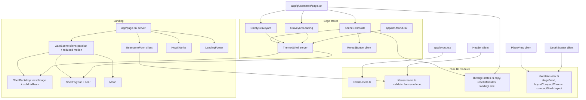

# Design Document

## Overview

Spec 2D gives the first impression and every dead end the same haunted look as the graveyard scene. It adds a full-bleed gate landing page, fixes the layout at every width below 768 px (from 375 px up to 767 px), and themes the edge states. It reuses the existing art, `@theme` tokens, `next/font` faces and pure layout functions. No new image assets are needed, except one exported share image (see Decision A).

Work falls into five areas:

1. **Landing** (`app/page.tsx`): gate backdrop, fog, moon, wordmark, tagline, themed form, Estate link, three-step row, footer.
2. **Metadata** (`app/layout.tsx`, `lib/site-meta.ts`): real title template, description, `metadataBase`, Open Graph and Twitter card, one static share image.
3. **Compact header** (`components/ui/Header.tsx`): single-row header with a Menu disclosure at every width below `MOBILE_BREAKPOINT` (768 px).
4. **Compact place layout** (`PlaceView`, `DepthScatter`, `lib/estate-view.ts`): measured chrome, a pure stage-band function, a pure compact stack layout, and a full-height detail sheet.
5. **Edge states** (`SceneErrorState`, `EmptyGraveyard`, `app/g/[username]/loading.tsx`, `app/not-found.tsx`): one shared themed shell and one shared themed button.

### Findings from the existing code that shape the design

- **Why creatures overlap chrome on phones.** `DepthScatter` has a separate branch below 768 px (`mobilePosition`) that spreads creatures over y fractions 0.08 to 0.92 of the whole plot. That branch ignores `topLimitPx` and `STAGE_BANDS`, so creatures land under the header, title, chips and pager. That branch is retired. The new compact path replaces it for every width below 768 px, including 431 to 767 px, which used to ignore `topLimitPx` and still overlapped chrome. Only widths of 768 px and above keep the existing desktop branches and `STAGE_BANDS` (Req 5.11).
- **Chrome is positioned from a fixed token.** `PlaceView` places the return link and title block at `top: var(--site-header-h)` (7rem), and the return link is absolutely positioned over the centred title at the same `top`. At 375 px they collide.
- **`--site-header-h` is used in more places than PlaceView.** The ritual layer, séance scroll targets and `tests/dom/SceneView.test.tsx` (asserts `placeChrome.style.top === "var(--site-header-h)"`) all read it. The design keeps the variable name and overrides its value on the scene root while compact, so none of those consumers change.
- **`DetailPanel` already has** a focus trap, body scroll lock, Escape handling and opener-focus restore. Only its sub-768 px geometry changes: the 85vh bottom sheet is dropped and the full-height sheet applies at every width below 768 px. `tests/dom/DetailPanel.test.tsx` asserts `max-h-[85vh]` at 375 px; that assertion is updated in place.
- **`SceneErrorState`** folds `server-error` into the rate-limit copy, uses ad hoc button classes and says "Tour the estate". It is restructured, not replaced.
- **Next.js 16 with Cache Components.** `generateMetadata` in `app/g/[username]/page.tsx` returns a plain string title. With a root title template that string would become "Repo Graveyard — x · Repo Graveyard", so it changes to `{ absolute: ... }`, which renders the identical string (Req 3.5).
- **`globals.css` already ships** `.btn2` (iron plaque, 40 px high), `.fog-wisps`, `.fog-wisps-thin`, `scene-idle-drift-2c` and reduced-motion rules that pause them. The landing reuses these classes and does not add keyframes.

### Design decisions

**Decision A. Open Graph image (Req 3.2, 3.3, 3.8).** Verification is limited to vitest, tsc and lint, and `package.json` has no image tooling (no `sharp`, no canvas). Runtime generation (`opengraph-image.tsx`, `next/og`) is excluded by Req 3.3. So the image cannot be built by the allowed tooling and must be exported once by hand.

- **Target file:** `public/og/repo-graveyard-1200x630.jpg`, JPEG, 1200 x 630, at most 300 KB.
- **Source art:** `public/art/place-gate.webp` (1536 x 1024). Scale to width 1200 gives 800 px tall, so crop 630 px of height, keeping the gate and moon in frame. Optionally overlay "Repo Graveyard" in UnifrakturMaguntia with the crimson glow (`--color-crimson-400`). JPEG is chosen because X and LinkedIn do not reliably unfurl WebP.
- **Manual export steps for the user** (documented in a short `public/og/README.md`): open `place-gate.webp` in any editor (Figma, Photoshop, GIMP, Squoosh), set the canvas to 1200 x 630, cover-fit and centre the art, add the wordmark, export as JPEG quality 80 to 85, check the size is under 300 KB, save to the path above, then set `OG_IMAGE_READY = true` in `lib/site-meta.ts`.
- **Fallback so tasks never block.** `lib/site-meta.ts` exports `OG_IMAGE_READY` (default `false`). While false, the metadata points at the existing `/art/place-gate.webp` with no declared width or height. This is a valid absolute URL, so unfurls work on most chat apps, and every code task and test passes. Once the user commits the JPEG and flips the flag, a conditional asset test (see Testing Strategy) starts enforcing the 1200 x 630 and 300 KB limits. Flipping the flag is the only code change.
- **Why not a PowerShell or `System.Drawing` script:** it cannot read WebP without an optional codec, adds an unverified tool outside the allowed set, and would be a one-off. It is not planned.

**Decision B. "Try again" on server-error (Req 7.5).** `SceneErrorState` stays a server component. A new tiny client component, `components/ui/ReloadButton.tsx`, renders a `<button>` styled as a Themed_Button. On click it calls `window.location.reload()`. It takes an optional `onReload?: () => void` prop that defaults to the real reload, so tests can inject a spy (jsdom's `location.reload` cannot be stubbed). `router.refresh()` was rejected: it re-renders server components but may reuse cached route data, and a server error is exactly the case where a real new request is wanted. The not-found panel's "Try again" stays a plain link to `/` (the form is the way to retry a name).

**Decision C. Compact threshold.** The compact threshold is the existing `MOBILE_BREAKPOINT = 768`, not a separate number. `lib/estate-view.ts` exports `COMPACT_MAX_WIDTH_PX = MOBILE_BREAKPOINT - 1` (767), so the two cannot drift. CSS uses Tailwind `max-[767px]:` and `min-[768px]:`. JS uses `matchMedia("(max-width: 767px)")`. Tailwind arbitrary values cannot read the constant, so a source-scan test asserts that the literal `767` in those class names and in the media query equals `COMPACT_MAX_WIDTH_PX`. There is no 431 to 767 px special case any more: the compact place layout, the header Menu disclosure and the DetailPanel full-height sheet all apply to every width below 768 px, and widths below 375 px (320 px minimum on the landing) use the same rules. Desktop (768 px and above) and `STAGE_BANDS` are unchanged.

**Decision D. Compact columns and plot size.** Plaque rows must not overlap and each needs about 50 px. With the 667 px minimum height the stage band is about 260 px, so 12 creatures in two columns cannot fit. The compact path therefore uses four slot rows per page, and the column count grows with width so wide-compact widths (for example 700 px) are not left with two narrow columns and wasted space:

- `compactColumns(sceneWidthPx)` = clamp(floor((sceneW - 2 * SCENE_EDGE_MARGIN_PX + COMPACT_SLOT_GAP_PX) / (COMPACT_COLUMN_MIN_PX + COMPACT_SLOT_GAP_PX)), 2, 4), with `COMPACT_COLUMN_MIN_PX = 160`. This gives 2 columns at 375 to about 540 px, 3 around 540 to 700 px, and 4 near 700 to 767 px.
- `compactPlotSize(sceneWidthPx)` = `min(compactColumns * COMPACT_SLOT_ROWS, PLOT_SIZE)` with `COMPACT_SLOT_ROWS = 4`. That is 8 creatures per page at 375 px (the old fixed 8), then 12 once there are three or more columns. Desktop keeps `PLOT_SIZE = 12`.

Requirement 5 is silent on page size; this is the smallest change that makes Req 5.6 achievable at 667 px height while using the extra width. Alternative if rejected: allow plaques to overlap vertically on very short phones (violates the intent of 5.6, not recommended).

**Decision E. Header menu is CSS-driven, with JS only for state.** A single DOM holds the form and toggles. Below 768 px the panel is `hidden` unless open (`max-[767px]:hidden`). At 768 px and above it is always shown inline via `min-[768px]:flex`. This avoids a hydration flash from a JS-only breakpoint. JS adds open state, Escape, and a `matchMedia` change listener that closes the menu when the viewport widens.

## Architecture



### Compact place layout, top to bottom

```
y = 0     +-----------------------------+  Site_Header (measured, sets --site-header-h)
          | Repo Graveyard  [user]  Menu|
          +-----------------------------+
          | < Return to the gate        |  return link        (in one flow column)
          | Place title + count line    |  title block
          | [chip][chip][chip] -->      |  chips, one row, scroll-x
          +-----------------------------+  <-- band.top  = chips.bottom (measured)
          |                             |
          |  creature stack (2-4 cols)  |  Stage_Band
          |                             |
          +-----------------------------+  <-- band.bottom = barTop - PLAQUE_BELOW_FEET_MAX_PX
          | < Plot 1 of 2 >             |  Bottom_Bar (Pager), fixed to the bottom
y = H     +-----------------------------+
```

The data flow while compact is: measure the top chrome stack and the Bottom_Bar, call `stageBand(...)`, hand the band to `compactStackLayout(...)`, render. When nothing is measured yet (first paint, jsdom), the fallback heights in `COMPACT_CHROME_FALLBACK_PX` are used. Each fallback is at least the real component height, so no creature sits under chrome on first paint (Req 5.7).

## Components and Interfaces

### Pure modules (no I/O, no clock, no DOM)

**`lib/username.ts`** gains one function and keeps `isValidUsername`.

```ts
export type UsernameCheck =
  | { ok: true; username: string }
  | { ok: false; message: typeof EMPTY_MESSAGE | typeof INVALID_MESSAGE };

export const USERNAME_EMPTY_MESSAGE = "A username is required";
export const USERNAME_INVALID_MESSAGE = "That doesn't look like a valid GitHub username";
export function validateUsernameInput(raw: string): UsernameCheck;
```

Both `UsernameForm` and `Header` call it, replacing their two duplicated message constants.

**`lib/site-meta.ts`**

```ts
export const SITE_URL_FALLBACK = "http://localhost:3000";
export const OG_IMAGE_READY = false;            // flip after committing the JPEG
export const OG_IMAGE_ALT: string;              // 1..200 chars, contains "Repo Graveyard"
export function resolveSiteUrl(raw: string | undefined): URL;
export function buildRootMetadata(siteUrl: URL): Metadata;
```

`resolveSiteUrl` returns the origin of `raw` when it parses as an absolute `http:` or `https:` URL, otherwise `new URL(SITE_URL_FALLBACK)`. It never throws. `buildRootMetadata` returns the title template (`default: "Repo Graveyard"`, `template: "%s · Repo Graveyard"`), a description of 50 to 160 characters, `metadataBase`, `openGraph` (`title`, `description`, `type: "website"`, `siteName`, `images`) and `twitter` (`card: "summary_large_image"`, `images`). `images` has exactly one entry, chosen by `OG_IMAGE_READY`. `app/layout.tsx` does `export const metadata = buildRootMetadata(resolveSiteUrl(process.env.NEXT_PUBLIC_SITE_URL))`.

**`lib/edge-states.ts`**

```ts
export type EdgeKind = "not-found" | "rate-limited" | "server-error" | "empty" | "app-not-found";
export interface EdgeCopy { heading: string; body: string }
export function edgeCopy(kind: EdgeKind): EdgeCopy;   // static strings only; no digits
export function emptyGraveyardLine(username: string): string;
export function resetInMinutes(resetAt: string | null, nowIso: string): number | undefined; // ceil, min 1
export const LOADING_NAME_MAX = 39;
export const LOADING_GENERIC = "Digging up this graveyard…";
export function loadingLabel(raw: string | undefined): string;
export function usernameFromPath(pathname: string): string | undefined; // "/g/<seg>[/...]"
```

`resetInMinutes` replaces the private `resetInMinutesFrom` in the graveyard page and changes flooring to rounding up with a minimum of 1, as Req 7.3 requires. `loadingLabel` URL-decodes inside try/catch, truncates by code points (`Array.from`) to 39 and appends "…" only when truncated, and returns `LOADING_GENERIC` for undefined, empty or malformed input.

Copy (all kind, never blaming, no digits):

| Kind | Heading | Body |
|---|---|---|
| not-found | No one by that name rests here | We searched every plot and found no graveyard under that name. Check the spelling, or walk the Haunted Estate instead. |
| rate-limited | The gates are locked for now | GitHub needs the spirits to rest. The Haunted Estate is always open. (Countdown sentence inserted when known.) |
| server-error | The spirits lost the thread | Something went wrong while digging, and it was not your doing. Try again, or walk the Haunted Estate. |
| empty | Nothing buried here yet. | `emptyGraveyardLine(username)` = "{username} has no public repositories to bury. The moon keeps watch anyway." |
| app-not-found | This path leads nowhere | Whatever stood here has crumbled away. Return to the gate and try another way in. |

**`lib/estate-view.ts`** additions (existing exports and `STAGE_BANDS` unchanged):

```ts
export const COMPACT_MAX_WIDTH_PX = MOBILE_BREAKPOINT - 1; // 767
export const COMPACT_SLOT_ROWS = 4;
export const COMPACT_COLUMN_MIN_PX = 160;
export const COMPACT_MAX_COLUMNS = 4;
export const COMPACT_SLOT_GAP_PX = 4;
export function compactColumns(sceneWidthPx: number): number;   // clamp 2..4, see Decision D
export function compactPlotSize(sceneWidthPx: number): number;  // min(columns * COMPACT_SLOT_ROWS, PLOT_SIZE)
export const COMPACT_CREATURE_MIN_PX = 64;
/** Max px a plaque rect extends below its creature's feet: PLAQUE_H * SCATTER_SCALE_MAX / 2. */
export const PLAQUE_BELOW_FEET_MAX_PX: number;
/** Fallback heights, each >= the real rendered height (Req 5.7). */
export const COMPACT_CHROME_FALLBACK_PX: {
  header: number; returnLink: number; titleBlock: number; chips: number; bottomBar: number;
};

export interface StageBandPx { top: number; bottom: number }
export function stageBand(sceneHeightPx: number, topChromeBottomPx: number, bottomBarTopPx: number): StageBandPx;

export interface CompactChromeBoxes {
  header: SceneRect; returnLink: SceneRect; titleBlock: SceneRect; chips: SceneRect; bottomBar: SceneRect;
}
export function layoutCompactChrome(
  viewportW: number, viewportH: number,
  heights: typeof COMPACT_CHROME_FALLBACK_PX,
): CompactChromeBoxes;

export function compactStackLayout(
  placements: readonly ScatterPlacement[],   // scale only is used; scatterLayout stays the seeded source
  sceneWidthPx: number,
  band: StageBandPx,
): ResolvedPlacement[];
```

`stageBand` behavior: coerce non-finite inputs (NaN, infinities) to 0 and the scene height to `max(0, finite height)`; clamp `top` into `[0, H]`; compute `bottom` as `bottomBarTop - PLAQUE_BELOW_FEET_MAX_PX` and clamp it into `[top, H]`. A degenerate band (top at or past bottom) therefore has height 0, never negative, and stays inside the scene.

`layoutCompactChrome` stacks the header, return link, title block and chips from y = 0 in that order, each full width, and anchors the Bottom_Bar to `viewportH - heights.bottomBar`. It is the model the geometry test uses; the CSS flow column in `PlaceView` realises the same order. If the stack does not fit (sum of top heights exceeds `viewportH - bottomBar`), the boxes are still returned in order and the caller falls to the degenerate-band path.

`compactStackLayout` behavior, per placement index `i` of `n`:
- `c = compactColumns(sceneW)` columns (2 at phone widths, up to 4 near 767 px). Column `i mod c`, slot row `j = floor(i / c)`, `k = ceil(n / c)` rows. Columns are equal-width cells across the area inside the edge margins.
- Plaque width is `min(PLAQUE_W * scale, (sceneW - 2 * SCENE_EDGE_MARGIN_PX - (c - 1) * COMPACT_SLOT_GAP_PX) / c)`, so the plaques in a slot row sit side by side without overlap, and long names ellipsize as they already do. At 700 px with 4 columns each cell is about 160 px wide, so plaques keep a readable width instead of stretching.
- Slot pitch must be at least `PLAQUE_H * SCATTER_SCALE_MAX + COMPACT_SLOT_GAP_PX`. The largest allowed creature height is therefore `maxH = max(COMPACT_CREATURE_MIN_PX, bandHeight - (k - 1) * minPitch)`, and each creature height is `min(CREATURE_BASE_SIZE * scale, maxH)`.
- Feet y for slot row `j` is spread evenly from `band.top + maxUsedH` to `band.bottom`. The creature top is therefore at or below `band.top` and the feet at or above `band.bottom`.
- Creature centre x is clamped so the creature box stays at least `SCENE_EDGE_MARGIN_PX` from both edges. Plaque centre x is the column centre, also clamped to the margins.
- The plaque rect uses the same lift rule as `resolvePlacement` (`min(0.125 * h, plaqueH / 2 + CREATURE_PLAQUE_GAP_PX)`). That rule is extracted into one small shared helper so the two paths cannot drift.

Existing `scatterLayout`, `resolvePlacement` and `plaqueRect` are not changed.

### Client and server components

| Component | Kind | Change |
|---|---|---|
| `components/ui/useMedia.ts` | new hook | `useSyncExternalStore` over `matchMedia`; server snapshot is a parameter. Used for reduced motion and compact. |
| `components/ui/ThemedButton.tsx` | new | `<Link>` or `<button>` using `.btn2` plus a `variant` of `iron` or `crimson`; adds `min-h-11 min-w-11` and a `focus-visible` `candle-400` ring. |
| `components/ui/ReloadButton.tsx` | new client | Decision B. |
| `components/scene/ShellBackdrop.tsx` | new client | `next/image` with explicit `width`/`height` (1536 x 1024), `object-cover`, `alt=""`, brightness filter, solid `--color-night-sky` fill always behind, `onError` hides the image. Props: `image` (`place-gate` or `place-ground`), `priority`. |
| `components/scene/ShellFog.tsx` | new | Two layers using the existing `.fog-wisps` and `.fog-wisps-thin` classes. Opacity is a fixed token value: this is set dressing and deliberately does not encode zombie count, so it does not pretend to carry data. |
| `components/scene/ThemedShell.tsx` | new server | Backdrop, fog, `ShellHeader` (wordmark link to `/`), and a centred content slot. Used by all edge states, loading and the app 404. |
| `components/landing/GateScene.tsx` | new client | Wraps the shell layers with pointer parallax. Calls `useParallax(rootRef, { reducedMotion })` and uses three bands capped at 8, 16 and 24 px (all at or below Req 1.5's 24 px). Renders `Moon` top right. Children (the page content) are passed from the server page. |
| `components/landing/UsernameForm.tsx` | edit | Uses `validateUsernameInput`; button "Open the gate" as a crimson Themed_Button; input ref focused on rejection; error cleared in `onChange`; themed dark styling. |
| `components/landing/HowItWorks.tsx` | new | `<ol>` of three `<li>`, each with `next/image` (`ghost-0`, `zombie-0`, `risen`, `alt=""`) and the step text. |
| `components/landing/LandingFooter.tsx` | new | "Built with Kiro", link to `https://github.com/be4glebot/repo-graveyard` (`rel="noopener noreferrer"`), disclosure sentence. Plain text GitHub name only, no logo. |
| `app/page.tsx` | edit | One `h1`, one tagline `p`, then form, Estate link, `HowItWorks`, `LandingFooter`, all on a token gradient scrim. DOM order gives Tab order: input, button, Estate link, footer link. |
| `components/ui/Header.tsx` | edit | Decision E. "Menu" button (`aria-expanded`, `aria-controls`, 44 px target) and a panel holding form and toggles. `max-[767px]:flex-nowrap`; the username badge truncates. Valid submit closes the menu; rejected submit keeps it open. Escape closes and refocuses the button. |
| `components/scene/useHeaderHeightVar.ts` | new hook | `ResizeObserver` on the site-header wrapper; while compact, writes `--site-header-h` (px) on the scene root. When compact the wrapper drops its fixed `min-h` (it moves from an inline style to the classes `min-h-[var(--site-header-h)] max-[767px]:min-h-0`) so the measured value cannot feed back into itself. |
| `components/scene/PlaceView.tsx` | edit | While compact: one flow column (`data-testid="place-chrome"`) holds the return link, `PlaceHeading` and the chips (chips `flex-nowrap overflow-x-auto`); the Pager sits in `data-testid="place-bottom-bar"` fixed to the bottom with safe-area padding; it measures the column bottom and the bar top, passes the band to `DepthScatter`, and pages by `compactPlotSize(sceneW)`. At 768 px and above: current markup, `top: var(--site-header-h)` and `STAGE_BANDS` untouched. |
| `components/scene/DepthScatter.tsx` | edit | New optional `compactBand` prop. When `sceneW <= COMPACT_MAX_WIDTH_PX` and the prop is set, positions come from `compactStackLayout`. The old `mobilePosition` branch (and its helper) is deleted, so no width below 768 px reaches code that ignores `topLimitPx`. At 768 px and above the existing desktop branches run as today. |
| `components/detail/DetailPanel.tsx` | edit | When compact: `inset-0 h-dvh w-full rounded-none overflow-y-auto overscroll-contain`; header row `sticky top-0` with an opaque background; close button `min-h-11 min-w-11`. This applies at every width below 768 px, and the `max-h-[85vh]` bottom sheet is removed. At 768 px and above the 420 px panel is unchanged. Focus trap, scroll lock and opener restore are existing behavior. |
| `components/scene/SceneErrorState.tsx` | edit | Renders inside `ThemedShell`. `not-found` and `invalid-username` use the not-found copy; `rate-limited` the locked copy with the countdown only when `resetInMinutes` is defined; `server-error` its own copy with `ReloadButton`. All actions are `ThemedButton`, label "Tour the Haunted Estate". `role="alert"`. |
| `components/scene/EmptyGraveyard.tsx` | new server | Shell with the `place-ground` backdrop, a full `Moon`, "Nothing buried here yet.", the username line and the Estate button. `role="status"`. |
| `components/scene/GraveyardLoading.tsx` | new | `ThemedShell` plus a `role="status"` line. Initial and fallback text is `LOADING_GENERIC`. A `Suspense`-wrapped client child reads `usePathname()`, runs `usernameFromPath` then `loadingLabel`, and swaps in the named text. No spinner element. |
| `app/g/[username]/loading.tsx` | new | Renders `GraveyardLoading`. |
| `app/g/[username]/page.tsx` | edit | Suspense fallback becomes `GraveyardLoading` (the inner boundary would otherwise shadow `loading.tsx`); empty `repos` renders `EmptyGraveyard`; `resetInMinutes` import from `lib/edge-states`; metadata title becomes `{ absolute: "Repo Graveyard — {username}" }`. |
| `app/not-found.tsx` | new | Shell, `edgeCopy("app-not-found")`, "Return to the gate" (`/`) and "Tour the Haunted Estate" (`/estate`). |
| `app/layout.tsx` | edit | Metadata from `buildRootMetadata`. |
| `.env.example` | edit | `NEXT_PUBLIC_SITE_URL=https://your-deployment.example.com`. |

### Open items the implementer must confirm in the code (not guessed here)

- `moonTreatment([])` in `lib/scene-view.ts`: the empty-graveyard moon should be the pale full moon. If an empty row list does not yield that, add a small `treatment` override prop to `Moon` rather than faking rows.
- The exact `scatterLayout` stage-band code path and `CREATURE_BASE_SIZE`, which `compactStackLayout` reads.
- Whether the existing `Pager` container also holds any "place navigation". In this codebase the return link is the top navigation, so the Bottom_Bar holds the Pager; nothing else moves there.
- The `stubMedia` helper in `tests/dom/DetailPanel.test.tsx`, to extend it for the second media query.

### Implementation slices (about 11 tasks)

1. `lib/username.ts` validator, `lib/site-meta.ts`, `lib/edge-states.ts`, with their property tests.
2. `lib/estate-view.ts`: `stageBand`, `layoutCompactChrome`, `compactColumns`, `compactPlotSize`, `compactStackLayout`, plaque-lift helper, constants (`COMPACT_MAX_WIDTH_PX = MOBILE_BREAKPOINT - 1`), with property tests.
3. Shared UI: `useMedia`, `ThemedButton`, `ReloadButton`, `ShellBackdrop`, `ShellFog`, `ThemedShell`.
4. Landing: `GateScene`, `HowItWorks`, `LandingFooter`, `app/page.tsx`, `UsernameForm`; update `tests/landing-form.test.tsx` in place; add landing copy tests.
5. Metadata: layout, `.env.example`, per-user `{ absolute }` title, `public/og/README.md`, conditional asset test.
6. Header: Menu disclosure and `useHeaderHeightVar`; tests.
7. `PlaceView` and `DepthScatter` compact path (delete `mobilePosition`); update the SceneView test assertion only if the DOM changed.
8. `DetailPanel` compact sheet; update the 85vh assertion in place.
9. Edge states: `SceneErrorState`, `EmptyGraveyard`; update existing error-state tests for new copy.
10. `GraveyardLoading`, `loading.tsx`, page wiring, `app/not-found.tsx`.
11. Cross-cutting: color literal scan, token contrast test, reduced motion checks, geometry test at 375 x 812, then `vitest --run`, `tsc --noEmit`, `npm run lint`.

## Data Models

```ts
// Chrome heights in px. Fallbacks are upper bounds of the real rendered heights.
type CompactChromeHeights = {
  header: number; returnLink: number; titleBlock: number; chips: number; bottomBar: number;
};

// One compact slot after layout; same shape the desktop path already returns.
type ResolvedPlacement = {
  x: number; y: number; creatureHeightPx: number;
  creature: SceneRect; plaque: SceneRect;
};

// SceneRect already exists: { cx, cy, left, right, top, bottom }.
```

No server data models change. The Redis, GitHub and LLM layers are untouched. Environment: one new public variable, `NEXT_PUBLIC_SITE_URL`.

## Correctness Properties

*A property is a characteristic or behavior that should hold true across all valid executions of a system-essentially, a formal statement about what the system should do. Properties serve as the bridge between human-readable specifications and machine-verifiable correctness guarantees.*

Prework reflection: criteria 2.2, 2.3 and 2.4 collapse into one validator property. 3.1 and 3.4 collapse into one metadata property. 5.5 and 5.9 collapse into the two `stageBand` properties. 7.2 and 7.7 collapse into one copy property. 8.1, 8.5 and 8.6 collapse into one loading-label property. Layout, motion, framework status codes and test-inclusion criteria are covered by example tests or by the manual notes, not by properties.

### Property 1: Username validation is total and consistent

*For any* string `raw`, `validateUsernameInput(raw)` returns `ok: true` if and only if `raw.trim()` is non-empty and `isValidUsername(raw.trim())` holds. When `ok` is true the returned `username` equals `raw.trim()` and `decodeURIComponent(encodeURIComponent(username))` equals `username`. When `ok` is false the message is "A username is required" if `raw.trim()` is empty, and "That doesn't look like a valid GitHub username" otherwise.

**Validates: Requirements 2.2, 2.3, 2.4**

### Property 2: Site URL resolution always yields an absolute URL

*For any* string or `undefined` input, `resolveSiteUrl` does not throw and returns a URL with protocol `http:` or `https:` and a non-empty host. When the input is an absolute `http` or `https` URL the result has the same origin as the input. For every other input the result is `http://localhost:3000`.

**Validates: Requirements 3.7**

### Property 3: Root metadata is complete for any site URL

*For any* URL passed to `buildRootMetadata`, the result has a title template, a description whose length is 50 to 160 characters, `metadataBase` equal to the URL, Open Graph `title`, `description`, `type` and `siteName`, a Twitter card of `summary_large_image`, exactly one Open Graph image, and an image alt of 1 to 200 characters that contains "Repo Graveyard". Resolving the image path against `metadataBase` yields an absolute URL.

**Validates: Requirements 3.1, 3.4**

### Property 4: Per-user title text is unchanged

*For any* username, the title produced by the graveyard page's `generateMetadata` has `absolute` equal to `"Repo Graveyard — " + username`.

**Validates: Requirements 3.5**

### Property 5: Reset countdown rounds up and has a minimum of one

*For any* pair of valid instants `resetAt` and `now`, `resetInMinutes` returns an integer of at least 1, and when `resetAt` is later than `now` the value is the smallest integer `m` with `m * 60000 >= resetAt - now` (never less than the true remaining time and less than one minute more). For a `null` or unparseable `resetAt` or `now` it returns `undefined`.

**Validates: Requirements 7.3**

### Property 6: Edge copy is short, kind of voice and date free

*For every* `EdgeKind`, the static heading and body contain no digit characters. The body is one or two sentences and at most 200 characters. The `server-error` heading and body each differ from the `rate-limited` heading and body.

**Validates: Requirements 7.2, 7.5, 7.7**

### Property 7: Empty graveyard line names the owner

*For any* non-empty username, `emptyGraveyardLine(username)` contains the username as a substring.

**Validates: Requirements 7.6**

### Property 8: Loading label is safe, bounded and falls back

*For any* string input, `loadingLabel` does not throw. If the input is undefined, empty or has malformed percent-encoding, the result is "Digging up this graveyard…". Otherwise the result is "Digging up " plus the decoded name plus "'s graveyard…", where the name has at most 39 code points, followed by "…" only when the decoded name was longer than 39 code points. The function never modifies characters inside the kept name, so markup characters are preserved literally for React to escape.

**Validates: Requirements 8.1, 8.5, 8.6**

### Property 9: Stage band is total, non-negative and inside the scene

*For any* numbers `H`, `topChromeBottom` and `bottomBarTop`, including NaN, infinities, negatives and top greater than bottom, `stageBand` returns finite `top` and `bottom` with `0 <= top <= bottom <= max(0, H)` (when `H` is finite) and therefore a non-negative height.

**Validates: Requirements 5.9, 5.10**

### Property 10: Stage band tracks the measured limits

*For any* `H >= 0` and values with `0 <= topChromeBottom <= bottomBarTop <= H`, `stageBand` returns `top = topChromeBottom` and `bottom = clamp(bottomBarTop - PLAQUE_BELOW_FEET_MAX_PX, topChromeBottom, H)`, that is, the band bottom is the bar top minus the max plaque overhang below the feet, clamped into `[top, H]`. Raising `topChromeBottom`, or lowering `bottomBarTop`, never increases the band height.

**Validates: Requirements 5.5, 5.9**

### Property 11: Compact chrome boxes are ordered and disjoint

*For any* viewport width 375 to 767, height 667 to 1024, and heights no larger than `COMPACT_CHROME_FALLBACK_PX` whose top stack plus Bottom_Bar fits in the viewport, `layoutCompactChrome` returns boxes with header above return link above title block above chips, all inside the viewport, and `rectsIntersect` is false for every pair of the five boxes.

**Validates: Requirements 5.1, 5.4**

### Property 12: Compact creatures and plaques stay inside the stage band

*For any* viewport width 375 to 767 and height 667 to 1024, any count `n` from 0 to `compactPlotSize(width)`, and any scales in `[SCATTER_SCALE_MIN, SCATTER_SCALE_MAX]`, with chrome from `layoutCompactChrome` using the fallback heights and the band `stageBand(H, chips.bottom, bottomBar.top)` (whose bottom is `bottomBar.top - PLAQUE_BELOW_FEET_MAX_PX`), every resolved creature rect and plaque rect from `compactStackLayout` has `top >= band.top`, `bottom <= bottomBar.top`, at least `SCENE_EDGE_MARGIN_PX` clearance from the left and right edges, and does not intersect any of the five chrome boxes.

**Validates: Requirements 5.6, 5.7**

## Error Handling

- **Graveyard load failures:** each `LoadError["kind"]` still maps through an exhaustive `switch` with a `never` guard. `not-found` and `invalid-username` share one panel, `rate-limited` and `server-error` now have separate panels.
- **Unknown reset time:** `resetInMinutes` returns `undefined` and the countdown sentence is omitted; the panel still renders.
- **Server error recovery:** "Try again" performs a real reload. If `window` is unavailable (server render) the button still renders; it only touches `window` inside the click handler.
- **Image failure on the landing and shells:** the solid token fill is always rendered behind the image, and `onError` hides the broken image, so text stays legible (Req 1.8).
- **Missing or malformed `NEXT_PUBLIC_SITE_URL`:** falls back to `http://localhost:3000`; the build never throws on metadata.
- **Share image not yet exported:** `OG_IMAGE_READY = false` keeps a valid absolute fallback URL. No task or test fails because the JPEG is absent.
- **Undecodable or oversize username in the loading state:** generic text or truncated text; never throws, never renders markup.
- **No `matchMedia` (SSR, jsdom):** `useMedia` returns its server snapshot, so existing desktop-oriented tests behave as before.
- **Degenerate compact band** (very short viewport or tall chrome): `stageBand` returns a zero-height band inside the scene, `compactStackLayout` still returns a rect for every creature (no throw), and creatures are clamped to the band edge. This case cannot occur at 667 px or taller with the fallback heights.
- **Not-found status (Req 8.8):** the 404 status comes from Next's `app/not-found.tsx` convention. It cannot be verified with vitest and `next build` is excluded, so it is checked by hand after `npm run dev` (request an unknown path and confirm 404). This is the one acceptance criterion that stays unverified by the allowed tooling.

## Testing Strategy

Verification uses only `vitest --run`, `tsc --noEmit` and `npm run lint`. `next build` is not run, and no runtime image generation exists.

**Property-based tests** (fast-check, at least 100 runs each) live in `tests/property/landing-mobile-states.property.test.ts`. One test per property above, each tagged with a comment in the form `Feature: landing-mobile-states, Property N: <title>`. Pure functions only; no DOM.

**Unit and DOM tests** (Testing Library, jsdom, existing style):

- `tests/landing-form.test.tsx`: updated in place. Button name becomes "Open the gate". Add focus-moves-to-input on rejection, value preserved on rejection, message cleared on edit. Test and case counts do not decrease.
- Landing page copy: tagline, one `h1`, three steps in document order, footer `href` and label, disclosure sentence, Estate link `href`, Tab order (input, button, Estate link, footer link), one priority image, image `error` event leaves h1, tagline and form present.
- Header Menu: `aria-expanded` false then true, `aria-controls` matches the panel id, click toggles, Escape closes and focuses the button, controls are inside the panel, valid submit closes, rejected submit keeps it open with the text, a `matchMedia` change event to wide closes it. `Chrome.test.tsx` keeps passing unchanged.
- `useHeaderHeightVar` with a stub `ResizeObserver`: the variable updates on a simulated size change.
- `DetailPanel.test.tsx`: the 375 px assertion changes in place from `max-h-[85vh]` to the full-height classes; add sticky close and 44 px target class checks, and repeat the full-height assertion at 700 px (no `max-h-[85vh]` at any width below 768). The 768 px assertions stay.
- Edge states: copy and links for every kind, `role="alert"` vs `role="status"`, `ReloadButton` calls an injected `onReload`, loading shows the generic text first and `role="status"`, no spinner element (`animate-spin`, `role="progressbar"`), markup-like username renders as text, `not-found` page has both links reachable by Tab. Existing error-state tests are updated for the new capitalised "Tour the Haunted Estate" label and the split server-error copy.
- **Geometry test over widths 375-767 and heights 667-1024:** for each of the four places, at the named example 375 x 812 plus a sweep of widths (375, 430, 431, 600, 700, 767) and heights (667, 812, 1024), use `scatterLayout` for scales, `compactStackLayout` for rects, `layoutCompactChrome` for chrome and `rectsIntersect`. Assert zero chrome pairs intersect and zero creature or plaque rects intersect any chrome box. At 700 px also assert `compactColumns` is greater than 2 and that the rects use more than two distinct column centres.
- **Compact threshold test:** `COMPACT_MAX_WIDTH_PX === MOBILE_BREAKPOINT - 1`; and the source scan asserts the `max-[NNNpx]` / `min-[NNNpx]` classes and `matchMedia` strings in the changed components use `COMPACT_MAX_WIDTH_PX` and `MOBILE_BREAKPOINT` (767 and 768), with no `430` or `431` literal left.
- **`DepthScatter` regression at 431-767 px:** at a 700 px scene width with a `compactBand`, no placement has a creature top above `band.top`; the `mobilePosition` export no longer exists. Note: the compact path does not call `resolvePlacement` or `plaqueRect`, so those two are not exercised here (a small deviation from the wording of Req 9.7; their own existing property tests still cover them).
- **Source scan test:** reads the new and changed component files and fails on any hex, `rgb(a)` or `hsl(a)` literal (Req 2.11, 9.1).
- **Token contrast test:** parses `app/globals.css`, computes the WCAG ratio for the landing text tokens against every scrim stop and the solid fallback, and asserts at least 4.5 (3.0 for the `candle-400` ring).
- **Reduced motion:** with `matchMedia` stubbed to reduce, `GateScene` attaches no pointer listener and adds no animation classes.
- **Conditional share-image test:** if `OG_IMAGE_READY` is false, assert the metadata uses `/art/place-gate.webp`. If true, assert `public/og/repo-graveyard-1200x630.jpg` exists, is at most 300 KB, and its JPEG header reports 1200 x 630.
- **Existing suites:** `STAGE_BANDS` values, `scatterLayout`, `resolvePlacement` and the scene-layout property tests stay green, which demonstrates Req 5.11.

Property-based testing applies here because the stage band, chrome model, compact layout, validator, URL resolver, countdown and label functions are pure with large input spaces. It does not apply to the components, motion, CSS or framework behavior, which use the example tests above.
