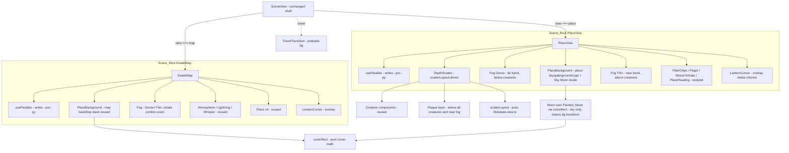

# Design Document: 2C Polish Pass

## Overview

The estate map and its four places already work: `SceneView` owns the interactive state, `EstateMap` and `PlaceView` composite a reused painted stack (`Sky` / `Backdrop` / `Moon` / `Atmosphere`) plus data-encoding effects (`Fog`, `Lightning`, `Whisper`), and the pure view-model (`lib/estate-view.ts`, `lib/scene-view.ts`) carries every piece of domain logic with property tests behind it. This pass is **presentational polish over that working system** — it adds depth, atmosphere, and a finished look, and it is explicitly forbidden from re-inventing the architecture or touching the frozen lifecycle classification.

Seven areas are in scope, and each maps onto the *existing* seam rather than a new one:

1. **Pointer parallax** — a small non-React controller (`useParallax`) attached to the `Scene_Root` of both `EstateMap` and `PlaceView` that writes `--px`/`--py` CSS variables on a `requestAnimationFrame` tick. Layers read those vars through `calc()`; no React re-render fires.
2. **A lights-off lantern cursor** — a new pointer-events-none overlay (`LanternCursor`) that keeps a ~300px warm radial light at full brightness and dims the rest to ~45–55%. Lights-off is the default readable mode.
3. **Per-place painted backgrounds** — a new `PlaceBackground` component drawing `place-sky/gate/ground/crypt` to cover with exact brightness filters and top/bottom gradients, plus a pure `coverRect` cover-math helper so the Sky `Moon`, rendered *inside* the `PlaceBackground` layer against that element's own box, sits exactly over the painted moon and shares its transform during parallax.
4. **Organic seeded placement** — a new pure `scatterLayout(names, rows, seed)` in `lib/estate-view.ts` and a new `DepthScatter` renderer that replaces `DepthRows`' row-flow with absolute scatter + a plaque layer above every creature.
5. **Two drifting fog layers** — `Fog.tsx` extended to render `Fog_Dense` (from `fog-wisps`) and `Fog_Thin` (from `fog-wisps-thin`) via `translateX` on a double-width strip, **reusing the existing `fogDensity` contract unchanged**.
6. **UI polish matching the boards** — shared `@theme` tokens and Tailwind classes (`.btn2` / `.chip2` / `.chip2.on` / `.plq`) wired into `ReturnToGate`, `FilterChips`, `Pager`, and the new plaque.
7. **An animation performance budget** — transform/opacity-only loops, double-width fog strips, ≤12 animated creatures per view (already bounded by `PLOT_SIZE = 12`), and destination-background preloading in `TravelTransition`.

The authoritative sources are the steering design file and the two polish boards; they drive every exact value below:

#[[file:.kiro/steering/design.md]]
#[[file:docs/design-canvas/PolishGate.dc.html]]
#[[file:docs/design-canvas/PolishPlaces.dc.html]]

Two hard constraints frame the whole design. **The fog data contract is frozen**: `fogDensity` in `lib/scene-view.ts` stays the single density function, the `scene-fog` testid stays, and "returns null iff 0 zombies" stays — the existing fog tests (`tests/dom/PlaceView.test.tsx`, `tests/dom/EstateMap.test.tsx`, `tests/property/scene-view.property.test.ts` Property 5) must keep passing (Req 6.7, 8.4). **Preservation is required** (Req 8): no existing component or test is deleted without explicit user approval, and the pass is not complete until every in-scope requirement has automated coverage.

---

## Architecture

### Where each new piece slots in

The two-level navigation (`SceneView` → `EstateMap` | `PlaceView`, with the `TravelTransition` overlay) is unchanged. Polish is added *inside* `EstateMap` and `PlaceView` as new layers and by swapping `DepthRows` → `DepthScatter`, plus two new client-side controllers (`useParallax`, `LanternCursor`) and one new pure function (`scatterLayout`).



### Layer depth order (parallax + stacking)

Both `Scene_Root`s overlay the new pieces into an explicit band stack. Every band has a **distinct** z-index with no ties, from back (least parallax) to front (most). These are the polish-pass scene-root bands; the `SceneView` header/footer chrome already sits at `z-50` and remains above everything here.

| Band | z | Contents | Parallax depth factor | Max offset at `|--px| = 1` |
| --- | --- | --- | --- | --- |
| Background | 0 | `PlaceBackground` (painted cover + gradients, `inset: -3%` bleed), `Sky`/`Backdrop`, **Sky `Moon`** (sky place: positioned by `coverRect` inside this layer, sharing the painting's transform) | `--d: 0.15` (least) | ≈ 8 px |
| Far fog (`Fog_Dense`) | 10 | `Fog_Dense` (behind creatures) | `--d: 0.3` | ≈ 16 px (shares creature-band depth) |
| Creatures | 20 | `DepthScatter` creatures | `--d: 0.3` | ≈ 16 px |
| Near fog (`Fog_Thin`) | 25 | `Fog_Thin` (in front of creatures' feet, below plaques) | `--d: 0.5` (most) | ≈ 26 px |
| Plaques | 30 | plaque layer (above every creature and the near fog) | follows creatures | ≈ 16 px |
| Lantern | 35 | `LanternCursor` (pointer-events-none, below all chrome) | none | — |
| Chrome | 40+ | header, filter chips, pager, place heading (40 and above) | none | — |

The ordering satisfies Req 2.5: background moves least (≈8 px), creatures more (≈16 px), near fog most (≈26 px), and each layer's rendered offset scales by its depth factor, so a farther layer never moves more than a nearer one for identical `--px`/`--py`. The per-layer maxima above are the exact numbers CHANGE-5 pins; the depth ordering background < creatures < near fog holds with them.

The **Sky data moon lives inside the Background band** (z 0, depth `--d: 0.15`) — it is rendered as part of the `PlaceBackground` layer, on the same element with the same transform and the same `--d`, so it tracks the painted moon pixel-for-pixel during parallax. It is **not** a separate z-10 band with its own depth factor (that would let the data moon slide off the painted moon). The map's own decorative `Moon` is unaffected and keeps its existing placement.

The **near fog (`Fog_Thin`) sits explicitly above the creatures (z 25) and below the plaques (z 30)**, while the far fog (`Fog_Dense`, z 10) sits below the creatures (z 20). The **lantern (z 35) sits below all chrome (z 40+)** so it dims only the scene and creatures, never the controls.

### The React / I-O seam is preserved

Every new effect is either (a) a pure function in `lib/estate-view.ts` (`scatterLayout`, `coverRect`) that reads no clock and no DOM, or (b) a client-only controller (`useParallax`, `LanternCursor`) that touches the DOM *imperatively* through refs and `requestAnimationFrame` and never calls `setState` on a per-frame basis. `SceneView` keeps owning `reducedMotion`, `lightsOn`, `view`, `selected`, etc., and threads them down as props — the controllers read those props but do not lift new state up. This keeps `SceneView`'s existing tests and routing untouched.

---

## Components and Interfaces

### `useParallax` (new hook) — `components/scene/useParallax.ts`

A client-only hook that wires pointer parallax onto a `Scene_Root` ref without React state (Req 2.1–2.8).

```ts
interface UseParallaxOptions {
  reducedMotion: boolean;        // from SceneView; disables pointer parallax (Req 2.6)
}
function useParallax(
  rootRef: React.RefObject<HTMLElement | null>,
  options: UseParallaxOptions,
): void;
```

Behavior:

- On mount (and when `reducedMotion` / pointer-capability changes) it attaches a `pointermove` listener to `rootRef.current`.
- `pointermove` does **not** write immediately; it stashes the latest event and, if no frame is pending, calls `requestAnimationFrame(tick)`. Multiple moves before the next frame collapse into one scheduled `tick` (Req 2.2 coalescing).
- `tick` reads `getBoundingClientRect()` of the root, normalizes the pointer to `[-1, 1]` on each axis relative to the root center, clamps, and writes `root.style.setProperty("--px", x)` / `--py` (Req 2.3). No `setState`, so no re-render (Req 2.4).
- When `reducedMotion` is active the listener is **not** attached and no frame is scheduled; `--px`/`--py` keep their last values (Req 2.6).
- Pointer parallax is gated by the media query `(hover: hover) and (pointer: fine)` (via `matchMedia("(hover: hover) and (pointer: fine)")`). When it matches (fine pointer with hover), the pointer listener is attached and parallax runs. When it does **not** match (coarse pointer and/or no-hover, e.g. touch), the pointer listener is not attached and the existing slow idle drift on the backdrop layers (driven by `--motion-idle-drift`) continues to run (Req 2.7). This is the same query the lantern uses to choose lantern vs static vignette, so fine+hover devices get lantern + parallax while coarse/no-hover devices get the static vignette and the idle drift.
- Cleanup removes the listener and cancels any pending frame.

Layers consume the vars purely in CSS by scaling `--px`/`--py` to each band's **pinned maximum offset** (CHANGE 5). Each layer multiplies the normalized pointer value by its own max so the depth ordering background (≈8 px) < creatures (≈16 px) < near fog (≈26 px) holds. For example a background layer gets
`transform: translate3d(calc(var(--px, 0) * 8px), calc(var(--py, 0) * 8px), 0)`
the creatures band uses `* 16px`, and the near-fog band uses `* 26px`. Equivalently each band expresses its offset as `var(--px) * (var(--d) * BASE)` where the shared base yields these maxima (background `--d: 0.15`, creatures/far-fog `--d: 0.3`, near fog `--d: 0.5`). Because only `transform` is animated this stays on the compositor (Req 9.1). `--px`/`--py` default to `0` so SSR/first paint is neutral.

`EstateMap` and `PlaceView` each add `data-scene-root` and a `ref` to their root `div` and call `useParallax(rootRef, { reducedMotion })`. The automated parallax test (Req 2.8) dispatches a `pointermove`, advances one animation frame, and reads `getComputedStyle(root).getPropertyValue("--px")` as a parseable number.

### `LanternCursor` (new component) — `components/scene/LanternCursor.tsx`

A pointer-events-none overlay rendered inside each `Scene_Root` in the **lantern band (z 35), below all chrome** (header, filter chips, pager, place heading at z 40+). Because it sits below the chrome it dims only the scene and creatures; the controls stay fully lit (Req 3.1–3.8).

```ts
interface LanternCursorProps {
  lightsOn: boolean;       // from SceneView; when true render nothing (Req 3.7)
  reducedMotion: boolean;  // disables flicker (Req 3.3/3.5)
}
```

Behavior:

- When `lightsOn` is `true`, renders `null` (Req 3.7).
- Lantern vs vignette is chosen by the media query `(hover: hover) and (pointer: fine)` (via `matchMedia("(hover: hover) and (pointer: fine)")`) — the same query `useParallax` uses. When it does **not** match (coarse pointer and/or no-hover), renders a single static soft vignette (a fixed radial-gradient over the scene) and no pointer-following light (Req 3.6).
- When it **matches** (lights-off, fine pointer with hover): renders a full-cover layer whose background is a **plain radial-gradient** driven by two CSS vars `--lx`/`--ly` (the light center) written imperatively on the overlay element. The gradient goes from a transparent warm centre (inside ~300px ±30px, so the scene reads at full brightness plus a faint warm tint) transitioning to roughly `rgba(0,0,0,0.5)` (about 0.5-alpha black) at the outside, which dims the scene outside the radius to ~45–55% of full brightness (Req 3.1). The ~45–55% outside brightness is achieved **purely by the ~0.5 alpha black of the gradient** — there is **no** `mix-blend-mode`.
- A `pointermove` listener (sharing the same rAF scheduler strategy as `useParallax`) updates `--lx`/`--ly` within a frame, so the light follows within 100ms (Req 3.2).
- On `pointerleave` of the `Scene_Root`, the light centre **eases back to the scene centre**: `--lx`/`--ly` transition smoothly back to `50%`/`50%` (a CSS transition on those vars) rather than being left where the pointer left the scene.
- A `focusin` listener on the `Scene_Root` reads the focused creature's `getBoundingClientRect()` center and writes it to `--lx`/`--ly`, moving the light to the focused creature (Req 3.4).
- Flicker: when `reducedMotion` is inactive, a CSS `@keyframes` animation varies the overlay's `opacity`/brightness by ≤±10% at 2–8Hz (a 125–500ms loop). When `reducedMotion` is active the animation is omitted and the light holds steady (Req 3.3/3.5).
- The overlay always sets `pointer-events: none` so it never intercepts clicks or focus (Req 3.8).

**Reconciliation with `useParallax`:** both controllers only ever write distinct CSS custom properties (`--px`/`--py` vs `--lx`/`--ly`) and never read React state per frame. They each own an independent rAF handle; because the writes are to different properties on different elements there is no contention. (A single shared scheduler is an acceptable alternative but is not required; the separate-handle approach keeps each controller self-contained and independently testable.)

### `PlaceBackground` (new component) — `components/scene/PlaceBackground.tsx`

Draws one place's painted backdrop to cover with the exact brightness filter and legibility gradients, and provides a dark fallback on image-load failure (Req 4.1–4.6, 9).

```ts
interface PlaceBackgroundProps {
  place: PlaceId;          // selects image + brightness
}
```

- Per-place image + brightness (from the boards / steering, Req 4.1–4.4):

  | place | image | brightness |
  | --- | --- | --- |
  | `sky` | `place-sky` | 0.8 |
  | `gate` | `place-gate` | 0.85 |
  | `ground` | `place-ground` | 0.55 |
  | `crypt` | `place-crypt` | 0.7 |

- Rendered as a full-cover layer (`next/image` with `fill` + `object-cover`, or a CSS `background-size: cover` div) with `filter: brightness(<value>)`, and an `inset: -3%` bleed on all sides (matching the boards) so the painted element's box is **106%** of the container on each axis. The bleed element is what the parallax transform moves (background `--d: 0.15`, ≈8 px max offset).
- **Bleed invariant (CHANGE 5):** the `inset: -3%` bleed MUST exceed the background's maximum parallax offset so no painted edge is ever exposed during parallax. At the 360 px-wide viewport floor a `-2%` bleed is only ≈7.2 px per side (2% of 360 px), which is **less** than the ≈8 px maximum background parallax offset, so a painted edge could be exposed. A `-3%` bleed is ≈10.8 px per side at 360 px (3% of 360 px), which **exceeds** the ≈8 px max background offset, so the invariant **bleed > max background offset** now holds even at the 360 px floor (and with far more margin at the typical ≥1280 px width). This ties the `-3%` inset directly to the ≈8 px background maximum.
- A top dark gradient and a bottom dark gradient, each ≥15% of viewport height, keep the header and pager legible (Req 4.5), matching the boards' `linear-gradient(rgba(0,0,0,.5),transparent 30%,transparent 70%,rgba(0,0,0,.7))`.
- All gradient/fill colors are `@theme` tokens (a new `--color-night-cover` family), no hardcoded hex.
- **Fallback:** the component tracks an `onError` flag (when using `next/image`) or renders a solid dark fill token behind the image always; if the image fails, the solid fill (`--color-night-sky`) remains and creatures + header keep rendering without error (Req 4.6). This layer is `pointer-events-none` (Req 7.5).
- **Sky `Moon` lives inside this layer (CHANGE 1):** on the sky place, the data `Moon` is rendered as a child of this same `PlaceBackground` element — same element, same transform, same `--d: 0.15` depth — in the Background band (z 0). It is **not** a separate z-10 band with its own depth factor; sharing the painting's transform is what keeps the data moon locked over the painted moon through parallax. To position it, the component measures its **own** painted box at runtime with a `ResizeObserver` (the `-3%` bleed included, so the observed width/height are the actual 106% painted-element dimensions, **not** the viewport dimensions) and passes those as `viewW`/`viewH` to `coverRect`; the resulting `cx`/`cy`/`diameter` are in this element's coordinate space, so the moon shares the painting's transform. The `ResizeObserver` re-measures on resize.

`EstateMap` keeps its reused `Sky`/`Backdrop` stack for the map view; `PlaceView` renders `PlaceBackground place={place}` in the z-0 Background band in place of (or behind) the reused backdrop so each place reads as its own painted ground, with the Sky data moon nested inside it on the sky place.

### `coverRect` (new pure function) — `lib/estate-view.ts`

Pure cover-math: maps a point given in source-image fractions to on-screen pixels for a container painted `background-size: cover`, and returns a diameter for an element sized as a fraction of the image width (Req 4.7, 4.8).

```ts
interface CoverInput {
  imageW: number;   // intrinsic image width (px)
  imageH: number;   // intrinsic image height (px)
  viewW: number;    // PlaceBackground ELEMENT box width (px), including the -3% bleed
  viewH: number;    // PlaceBackground ELEMENT box height (px), including the -3% bleed
  fx: number;       // point x as fraction of image width  [0..1]
  fy: number;       // point y as fraction of image height [0..1]
  diamFrac: number; // element diameter as fraction of image width
}
interface CoverRect {
  cx: number;       // centre x (px) in the PlaceBackground element's coordinate space
  cy: number;       // centre y (px) in the PlaceBackground element's coordinate space
  diameter: number; // on-screen diameter (px)
}
function coverRect(input: CoverInput): CoverRect;
```

`viewW`/`viewH` are the painted `PlaceBackground` **element's own box**, measured at runtime with a `ResizeObserver` on that element and **including the `inset: -3%` bleed** (so they are the actual painted-element dimensions — 106% of the container on each axis — **not** the viewport dimensions). This matters because the moon is positioned in that element's coordinate space and therefore shares the painting's transform.

Algorithm (standard `cover` fit): `scale = max(viewW / imageW, viewH / imageH)`; the drawn image is `imageW*scale × imageH*scale`, centered, so `offsetX = (viewW - imageW*scale) / 2` (and `offsetY` similarly). Then `cx = offsetX + fx * imageW * scale`, `cy = offsetY + fy * imageH * scale`, `diameter = diamFrac * imageW * scale`. Pure and total (guards against zero/negative dimensions). The Sky `Moon` calls `coverRect({ ..., fx: 0.75, fy: 0.14, diamFrac: 0.065 })` with the observed element box so its center lands within 1% of viewport width of the painted moon (Req 4.7) and its diameter equals 6.5% ±0.5% of the painted image width (Req 4.8). Because `cx`/`cy` are in the `PlaceBackground` element's space and the moon renders inside that element, the two moons stay aligned under the shared transform.

### `Moon` (changed) — `components/scene/Moon.tsx`

Keeps its health-encoding fill (`moonTreatment` + undead-share glow) unchanged. For the Sky place it stops using the fixed `right-[24%] top-[8%] h-[130px] w-[130px]` position and instead accepts an optional placement computed by `coverRect`, positioning the disc at `cx/cy` with `diameter` so it sits over the `Painted_Moon` (Req 4.7–4.9). It is rendered **inside the `PlaceBackground` layer** (Background band, z 0, `--d: 0.15`) on the same element as the painting, so it shares the painting's transform and parallax depth — it is **not** a separate z-10 band with a different depth factor (which would let it slide off the painted moon during parallax). Its `cx`/`cy`/`diameter` come from `coverRect` fed with the `PlaceBackground` element's **own box including the `-3%` bleed** (observed via `ResizeObserver`, re-measured on resize), measured in that element's coordinate space rather than the viewport. On the map it keeps its current position. The colour stays distinct from the painted moon so health is still encoded (Req 4.9).

```ts
interface MoonProps {
  rows: GraveyardRow[];
  className?: string;
  placement?: { cx: number; cy: number; diameter: number }; // sky place only
}
```

### `scatterLayout` (new pure function) — `lib/estate-view.ts`

The single layout function for all four places (Req 5.1–5.7). Pure, deterministic, DOM-free.

```ts
interface ScatterPlacement {
  x: number;         // horizontal position, fraction of plot width [0..1]
  y: number;         // vertical position, fraction of plot height [0..1]
  scale: number;     // 0.7..1.15, strictly front > middle > back
  brightness: number;// strictly front > middle > back
  mirrored: boolean; // ~round(n/3) names mirrored
  row: 0 | 1 | 2;    // 0 = back, rows-1 = front
}
function scatterLayout(
  names: string[],
  rows: number,          // DEPTH_ROWS (3)
  seed: number | string, // per-place seed
): ScatterPlacement[];
```

**Hashing / PRNG (pure, deterministic):** each name is combined with `seed` into a 32-bit hash via `xmur3(seed + "|" + name)`, which seeds a `mulberry32` PRNG. All per-name randomness (jitter within the row band, mirrored coin-flip bias, tombstone tilt) is drawn from that per-name stream, so equal `(names, rows, seed)` always produce field-by-field equal records in the same order with no external state (Req 5.2). Both `xmur3` and `mulberry32` are tiny, well-known pure functions implemented inline — no RNG library, no `Math.random`.

**Row assignment & ordering (Req 5.4–5.6):** names are distributed across `rows` depth bands by index (front band first, matching the boards' "nearest holds the freshest"). Each band is assigned a disjoint `scale` sub-range and a disjoint `brightness` sub-range so that **every** front-row record is strictly greater than **every** middle-row record, which is strictly greater than **every** back-row record, for both `scale` (within 0.7–1.15) and `brightness`. Jitter inside a band stays within its sub-range so the strict cross-band ordering can never be violated.

**Mirroring (Req 5.7):** exactly `round(names.length / 3)` records get `mirrored: true`, chosen deterministically (e.g. by sorting name-hashes and marking the top `round(n/3)`), so the count is exact and stable.

**Empty input:** `scatterLayout([], rows, seed)` returns `[]` (Req 5.3).

**No-plaque-overlap at 1440 & 1280 (Req 5.9):** the `x`/`y` fractions are chosen from a per-row set of column slots jittered within bounds that, when multiplied by the plot pixel width at 1440px and at 1280px and combined with the known plaque rectangle size (from the `.plq` metrics, see Plaque below), guarantee the plaque rectangles never intersect. The design pins a `PLAQUE_W`/`PLAQUE_H` constant (plaque bounding box in px at scale 1) and a minimum slot pitch derived from it; the property test (below) verifies no two plaque rectangles intersect for 1–12 names across varied `names`/`seed`.

A `tombstoneTilt(name, seed)` helper (or a `tilt` field on the record used only by the ground place) derives a deterministic rotation in `[-6, 6]` degrees from the same per-name stream (Req 5.8).

### `DepthScatter` (new component, replaces `DepthRows` usage) — `components/scene/DepthScatter.tsx`

Renders a plot using `scatterLayout` output instead of flex rows (Req 5.1, 5.9–5.14).

```ts
interface DepthScatterProps {
  place: PlaceId;
  plot: GraveyardRow[];
  selectedName: string | null;
  onSelect: (name: string) => void;
  filterHeroes?: Set<string>;
  reducedMotion: boolean;
}
```

- Computes `scatterLayout(plot.map(r => r.name), DEPTH_ROWS, place)` once (memoized on `plot`/`place`).
- **Width branch (Req 5.9 vs 5.10):** reads container width (via a `ResizeObserver` or a CSS container query). At ≥768px it uses the scatter positions. Below 768px it switches to a **two-column staggered layout** — names alternate left/right columns with a vertical stagger — whose column pitch and row pitch are also computed to guarantee no plaque-rectangle overlap. The choice of scatter vs two-column is purely a width check; both consume the same `scatterLayout` record for scale/brightness/mirrored so the data encoding is identical.
- **Creatures layer (z 20, the creature band):** each creature is absolutely positioned at its `x`/`y`, scaled by `scale`, brightness-filtered by `brightness`, and horizontally mirrored (`scaleX(-1)`) when `mirrored`. The `mirrored` flip is applied **only to the creature image** (`scaleX(-1)` on the creature) and **never to the plaque text** — the plaque is never mirrored, so names always read left-to-right regardless of which way the creature faces. Ground tombstones additionally get the seeded tilt (Req 5.8). Creatures keep their existing per-creature motion components.
- **Plaque layer (single layer above all creatures and the near fog, Req 5.11):** a sibling layer rendered *after* the creatures layer, in the plaques band (z 30, above both the creatures at z 20 and the near fog `Fog_Thin` at z 25), holding one `Plaque` per creature positioned at the same `x` just below the creature. The plaque is **never** mirrored even when its creature is. Because it is a separate, higher layer, no creature's rendered area and no fog strip can cover a plaque.
- **Gate wander (Req 5.12–5.14):** when `place === "gate"` and `reducedMotion` is inactive, **fresh** zombies (decay 0) get a horizontal wander animation with displacement 8–24px around their placed `x`, each with a seeded duration 7–12s and a seeded start delay (both drawn from the per-name stream). Decay 1–4 zombies keep their existing lurch/twitch behavior (unchanged creature components). When `reducedMotion` is active, fresh zombies render at their placed `x` with no wander (Req 5.14). All wander is `transform: translateX` only (Req 9.1).

`PlaceView` swaps its `<DepthRows .../>` for `<DepthScatter place={place} ... reducedMotion={reducedMotion} />`. `DepthRows` is **not deleted** (Req 8.2/8.3) — it is left in place until explicit approval, simply no longer rendered by `PlaceView`.

### `Fog` (changed) — `components/scene/Fog.tsx`

Extended to **two separate render sites** so the fog genuinely straddles the creature band, while preserving the density contract exactly (Req 6.1–6.7). The two layers must sit at different z around the creatures (far fog below, near fog above), so `Fog` takes a `layer` prop and the parent slots one instance into each band. This `layer`-prop approach is cleaner than rendering both strips from one node, precisely because the two strips cannot live at the same z.

```ts
interface FogProps {
  zombieCount: number;            // unchanged — mapped through fogDensity
  layer: "dense" | "thin";        // which render site: far (below creatures) vs near (above)
  reducedMotion?: boolean;        // pauses drift (Req 6.5/6.6); defaults false
}
```

- `Fog_Opacity` is derived **only** from the existing `fogDensity(zombieCount)` (no second density function): `opacity = (fogDensity(zombieCount) / 100) * MAX_FOG_OPACITY`. Both layers derive opacity from the **same** `fogDensity(zombieCount)` call — Dense uses `Fog_Opacity`, Thin uses `Fog_Opacity * 0.25`. Each layer keeps the `data-fog-density` attribute and the `opacity <= 0 → return null` early-out, so **both** layers are null iff the zombie count is 0 (Req 6.4, 6.7).
- **Two render sites (CHANGE 2):**
  - `layer="dense"` → **`Fog_Dense`**: keeps the **existing `scene-fog` root element** (same `data-testid="scene-fog"`, same `data-fog-density`, same null-iff-0-zombies early-out), rendered **behind the creatures** (far-fog band, z 10). From `fog-wisps`, opacity = `Fog_Opacity`, drifting one direction on a ~90s loop.
  - `layer="thin"` → **`Fog_Thin`**: a **separate sibling element** with `data-testid="scene-fog-near"`, also returning `null` iff 0 zombies (so it shares the same density gate), rendered **after the creatures layer with a higher z** (near-fog band, z 25) so it is genuinely in front of the creatures' feet and below the plaques. From `fog-wisps-thin`, opacity = `Fog_Opacity * 0.25`, drifting the opposite direction on a ~55s loop. It is **no longer an inner strip inside the `scene-fog` root**.
- **Drift mechanism (Req 9.2):** each strip is a layer **twice the strip width** tiled horizontally; the keyframe animates `transform: translateX(0 → -50%)` (one direction) and `translateX(0 → 50%)` (the other), so the tiling wraps seamlessly. **Not** `background-position` (the boards used `background-position` as a mock shortcut; production uses `translateX` per Req 9.2).
- `reducedMotion` pauses both drifts at a fixed offset (`animation-play-state: paused` or no animation); clearing it resumes them (Req 6.5/6.6).
- **Where it renders:** the parent (`EstateMap` / `PlaceView`) places `Fog_Dense` in the far-fog band (z 10, below creatures) and `Fog_Thin` in the near-fog band (z 25, above creatures, below plaques), so the fog straddles the creature band. `EstateMap` mounts both layers for the estate-wide zombie count. `PlaceView` mounts both layers for the **gate** (as today) and now also for **hallowed ground** (Req 6.1). Sky and crypt render **no** fog (Req 6.1) — crypt's board shows only a thin wisp for mood, but the spec is explicit, so crypt renders none. All fog layers are `pointer-events-none` (Req 7.5).

### UI polish components (restyled, not replaced)

New shared Tailwind classes map the boards' `.btn2` / `.chip2` / `.chip2.on` / `.plq` onto `@theme` tokens, applied to the **existing** components (Req 7.1–7.5):

| Board class | Applied to | Notes |
| --- | --- | --- |
| `.btn2` (Iron_Button) | `ReturnToGate`, `Pager` buttons | bevelled iron plaque, Cinzel uppercase, candle-tan text |
| `.chip2` (inactive Chip) | `FilterChips` (inactive) | bevelled plaque, Cinzel uppercase |
| `.chip2.on` (active Chip) | `FilterChips` (active filter) | crimson active fill + glow, visually distinct |
| `.plq` (Plaque) | new `Plaque` (in `DepthScatter`) | one Cinzel name line + one mono sub-line |

These map to new `@theme` tokens added to `app/globals.css` — e.g. `--color-plaque-bg-top/bottom`, `--color-plaque-border`, `--color-chip-bg-top/bottom`, `--color-chip-on-*`, `--color-iron-*` — derived from the boards' gradients (`#1b1a20→#0d0c11`, border `rgba(230,207,154,.35)`, crimson `#5a0c1a→#30060e` / border `#c22a3e`, text `#e6cf9a` / `#ecead9` / `#a7a392`). No hardcoded hex appears in components (steering rule). Every overlay (fog, lantern, vignette, gradients) sets `pointer-events: none` (Req 7.5), which the existing `PointerEvents.test.tsx` already enforces structurally.

### `Plaque` (new component) — `components/ui/Plaque.tsx`

```ts
interface PlaqueProps {
  name: string;       // Cinzel name line (full name; truncated visually if long)
  sub: string;        // mono sub-line (e.g. "ancient · 4 yr")
  scale?: number;     // optional scale from scatterLayout
}
```

Renders the `.plq` style: a bevelled iron plaque with exactly one Cinzel name line and exactly one monospace sub-line (Req 7.4). Used by `DepthScatter`'s plaque layer. The plaque is **never mirrored**, even when its creature is (CHANGE 4).

- **Fixed max width + ellipsis (CHANGE 4):** the plaque has a **fixed maximum width** equal to `PLAQUE_W` (px at scale 1). Long names are truncated with an ellipsis via CSS `text-overflow: ellipsis`, `overflow: hidden`, `white-space: nowrap` on the name line, so the plaque's rendered width never exceeds its max regardless of name length. The **full** name is still provided in both the `title` attribute and the `aria-label` of the plaque, so it stays available to pointer hover and to assistive technology.
- **`PLAQUE_W` linkage:** `PLAQUE_W` — the layout constant used by the no-overlap property (Req 5.9) — **equals** this fixed max width. Because the rendered plaque can never be wider than `PLAQUE_W` (names ellipsize instead of growing), the no-overlap guarantee computed from `PLAQUE_W` holds for **any** repo name regardless of length. This linkage is also stated in the Data Models constants.

### `TravelTransition` (changed) — `components/scene/TravelTransition.tsx`

Adds destination-background preloading (Req 9.4). Before (or while) the transition animates, it preloads the destination place's `PlaceBackground` image so the painted ground is ready on arrival — either by constructing `new Image(); img.src = <place image>` in an effect at the start of the transition, or by rendering a hidden `next/image` with `priority` for the destination image. The existing travel timing/behavior and `TravelTransition.test.tsx` are otherwise unchanged.

---

## Data Models

### `ScatterPlacement` (new) — the per-name placement record

```ts
interface ScatterPlacement {
  x: number;          // [0..1] fraction of plot width
  y: number;          // [0..1] fraction of plot height
  scale: number;      // [0.7..1.15], strict cross-row ordering
  brightness: number; // strict cross-row ordering
  mirrored: boolean;
  row: 0 | 1 | 2;     // 0 back … rows-1 front
  tilt?: number;      // [-6..6] deg, ground tombstones only
}
```

`scatterLayout(names, rows, seed)` returns `ScatterPlacement[]` with exactly one record per input name, in input order, no additions/omissions/duplicates (Req 5.1).

### Cover-math types (new)

`CoverInput` and `CoverRect` as defined under `coverRect` above — pure value objects, no DOM references.

### Layout constants (new, in `lib/estate-view.ts`)

```ts
export const SCATTER_SCALE_MIN = 0.7;
export const SCATTER_SCALE_MAX = 1.15;
export const TOMBSTONE_TILT_DEG = 6;      // ± range
export const PLAQUE_W = /* px at scale 1 */; // == the Plaque's FIXED MAX WIDTH (CHANGE 4):
                                             // the plaque never renders wider than this (names
                                             // ellipsize), so the no-overlap property (Req 5.9)
                                             // holds for any repo name regardless of length.
export const PLAQUE_H = /* px at scale 1 */;
export const MOBILE_BREAKPOINT = 768;     // scatter vs two-column
export const PAINTED_MOON = { fx: 0.75, fy: 0.14, diamFrac: 0.065 };

// Parallax per-layer maximum offsets at |--px| = 1 (CHANGE 5), depth-ordered
// background < creatures < near fog, consistent with the layer table:
export const PARALLAX_MAX_BG = 8;      // px — background (--d 0.15); < the -3% inset bleed
export const PARALLAX_MAX_CREATURES = 16; // px — creatures / far fog (--d 0.3)
export const PARALLAX_MAX_NEAR_FOG = 26;  // px — near fog Fog_Thin (--d 0.5, most)
```

`PLAQUE_W` is the single source of truth for both the plaque's fixed max render width (CHANGE 4) and the no-overlap property's plaque rectangle width (Req 5.9); they are the same value by construction. The `PARALLAX_MAX_*` maxima are the numbers the layer table and the `translate3d` examples use, and `PARALLAX_MAX_BG` (8 px) is strictly less than the `PlaceBackground` `-3%` inset bleed (CHANGE 5 invariant: bleed > max background offset).

Existing constants reused unchanged: `PLOT_SIZE = 12`, `DEPTH_ROWS = 3`, `TRAVEL_MS`, `TRAVEL_CROSSFADE_MS`, and the existing fog constant `MAX_FOG_OPACITY` in `Fog.tsx`. `fogDensity` / `FOG_FULL_ZOMBIES` stay in `lib/scene-view.ts` and are reused, not duplicated (Req 6.4).

---

## Correctness Properties

*A property is a characteristic or behavior that should hold true across all valid executions of a system — essentially, a formal statement about what the system should do. Properties serve as the bridge between human-readable specifications and machine-verifiable correctness guarantees.*

The four testable invariants restated from the requirements' Correctness Properties section are below. They land in `tests/property/*.property.test.ts` using `fast-check` (`fc.assert(fc.property(...))`, ≥100 runs), except the parallax property which is exercised as a DOM test (jsdom cannot meaningfully host a property over rendered geometry).

### Property 1: Determinism of placement

*For all* `names`, `rows`, and `seed`, `scatterLayout(names, rows, seed)` returns a value field-by-field equal, and in the same order, to a second call with the same inputs; and for empty `names` it returns `[]`.

**Validates: Requirements 5.1, 5.2, 5.3**
**Test:** `tests/property/estate-view.property.test.ts`, tagged `Feature: polish-pass-2c, Property 1: Determinism of placement`. Arbitraries: `fc.array(fc.string())` for `names`, `fc.constant(DEPTH_ROWS)` for `rows`, `fc.oneof(fc.integer(), fc.string())` for `seed`. Asserts deep equality of two calls and `[]` for empty input; also asserts exactly one record per name, in order, and that `scale`/`brightness` obey the strict cross-row ordering and `mirrored` count equals `round(n/3)`.

### Property 2: No plaque overlap at 1440 and 1280

*For all* `names` of length 1–12 and all `seed`, the plaque rectangles produced from `scatterLayout(names, DEPTH_ROWS, seed)` — each sized `PLAQUE_W × PLAQUE_H × scale` and positioned at the record's on-screen `x`/`y` — pairwise share no overlapping area, when the plot is rendered at 1440px width and at 1280px width.

**Validates: Requirements 5.9**
**Test:** `tests/property/estate-view.property.test.ts`, tagged `Feature: polish-pass-2c, Property 2: No plaque overlap`. Arbitraries: `fc.array(fc.string(), { minLength: 1, maxLength: 12 })` for `names`, `fc.integer()` for `seed`, and `fc.constantFrom(1440, 1280)` for the width. Computes each plaque rectangle from the placement and width, then asserts no axis-aligned rectangle intersection for every pair.

### Property 3: Fog opacity encodes zombie count

*For all* zombie counts `n` in `0..10000`, `Fog_Opacity(n) == 0` if and only if `n == 0`, `Fog_Opacity(n) > 0` whenever `n > 0`, and both `Fog_Dense` opacity (`= Fog_Opacity`) and `Fog_Thin` opacity (`= Fog_Opacity * 0.25`) are `0` iff `n == 0`; `Fog_Opacity` is non-decreasing in `n` and bounded to `[0, 1]`. Both layers derive from the **same** `fogDensity(n)` call, so the two render sites (`scene-fog` for Dense, `scene-fog-near` for Thin) share one density gate and are both present iff `n > 0`.

**Validates: Requirements 6.4**

(This property also preserves Property 5 of the scene feature.)

**Test:** `tests/property/scene-view.property.test.ts` (new describe block, alongside the existing `fogDensity` Property 5 which stays untouched), tagged `Feature: polish-pass-2c, Property 3: Fog opacity encodes zombie count`. Arbitrary: `fc.nat({ max: 10000 })`. Asserts the iff-zero, positivity, bound, and monotonicity of `Fog_Opacity` (and its ×0.25 thin derivative) built on the frozen `fogDensity`. The existing `scene-fog` DOM tests still pass (`Fog_Dense` keeps that testid and its null-iff-0 behavior), and the DOM tests additionally assert that `scene-fog-near` (`Fog_Thin`) is likewise absent iff 0 zombies.

### Property 4: Parallax disabled under reduced motion; enabled otherwise

*For all* `pointermove` events dispatched to a `Scene_Root`: when `reducedMotion` is active the `--px`/`--py` values are left unchanged and no rAF update is scheduled; when `reducedMotion` is inactive, after the next animation frame both `--px` and `--py` are parseable numeric values on the `Scene_Root`.

**Validates: Requirements 2.6, 2.8**
**Test:** DOM test `tests/dom/Parallax.test.tsx` (not a property-based test, per the requirements note). Renders `EstateMap`/`PlaceView`, dispatches a `pointermove`, advances one frame with a faked rAF, and asserts: (a) with `reducedMotion={true}` the vars are unchanged and rAF was not called; (b) with `reducedMotion={false}` `getComputedStyle(root).getPropertyValue("--px")`/`--py` parse as finite numbers in `[-1, 1]`.

*(Non-PBT invariant, not asserted as a property but enforced by review and the DOM tests: every looping animation animates only `transform`/`opacity` — Req 9.1.)*

---

## Error Handling

- **Background image load failure (Req 4.6):** `PlaceBackground` always renders a solid dark fallback fill (`--color-night-sky`) beneath the painted image. If the image 404s or fails to decode, the `onError` path keeps the solid fill visible and the place continues to render its creatures, plaques, and header without throwing. No place is ever blank.
- **Fog art failure:** if `fog-wisps`/`fog-wisps-thin` fail to load, the strips degrade to transparent (no background image) — the density contract (and the `scene-fog` presence/absence tests) is unaffected because opacity is driven by `fogDensity`, not by the image.
- **Missing pointer capability / no `matchMedia`:** `useParallax` and `LanternCursor` guard `typeof window`, `matchMedia`, and `requestAnimationFrame`; when unavailable (SSR, old jsdom) they no-op, leaving `--px`/`--py` at their `0` defaults and rendering the static (non-flicker) fallback. This keeps SSR/first paint hydration-stable, matching `SceneView`'s existing `reducedMotion` default of `true` on the server.
- **`scatterLayout` totality:** pure and total — empty `names` yields `[]`, and the hashing/PRNG never throws regardless of name content (including empty strings and unicode), so a surprising repo name can never break layout.
- **`coverRect` totality:** guards zero/negative image or viewport dimensions by falling back to a centered default, so a pre-layout (0×0) container never produces `NaN`/`Infinity` positions.

---

## Testing Strategy

**Dual approach.** Property tests cover the pure, universally-quantified logic; DOM tests cover rendering, pointer behavior, and structural guarantees; existing tests are preserved and must keep passing.

**Property tests (`tests/property/`, fast-check, ≥100 runs each):**
- Property 1 (determinism, record shape, cross-row ordering, mirrored count) and Property 2 (no plaque overlap at 1440/1280) → appended to `tests/property/estate-view.property.test.ts`.
- Property 3 (fog opacity encodes zombie count) → appended to `tests/property/scene-view.property.test.ts` as a **new** describe block; the existing Property 5 `fogDensity` block is left exactly as-is.
- A `coverRect` property (cover-math round-trip: a point at the image's cover-scaled center maps back to the viewport center; diameter scales linearly with image width) is a useful addition in `estate-view.property.test.ts`.
- Each new property block is tagged `Feature: polish-pass-2c, Property N: <title>`.

**DOM tests (`tests/dom/`, @testing-library/react + jsdom):**
- `tests/dom/Parallax.test.tsx` — the pointermove parallax test for Req 2.8 (and the reduced-motion / non-`(hover: hover) and (pointer: fine)` branches, Req 2.6/2.7): dispatch `pointermove`, fake one rAF tick, assert `--px`/`--py` are parseable numbers (enabled under fine+hover) or unchanged (reduced motion / coarse / no-hover), and that each layer's max offset matches the pinned maxima (background ≈8 px, creatures ≈16 px, near fog ≈26 px).
- `tests/dom/LanternCursor.test.tsx` — lights-off under `(hover: hover) and (pointer: fine)` renders the lantern overlay in the lantern band (z 35, below all chrome) with `pointer-events: none` and a plain radial-gradient (transparent warm centre → ~`rgba(0,0,0,0.5)` outside, no `mix-blend-mode`); lights-on renders nothing (Req 3.7); a non-matching query (coarse/no-hover) renders the static vignette (Req 3.6); `focusin` moves the light center (Req 3.4); `pointerleave` eases `--lx`/`--ly` back to 50%/50% (Req 3.2).
- `tests/dom/PlaceBackground.test.tsx` — each place renders its image with the right brightness filter and ≥15%-height top/bottom gradients; the solid fallback stays on image error (Req 4.1–4.6).
- `tests/dom/DepthScatter.test.tsx` — one plaque per creature; the plaque layer is a single layer (z 30) stacked above every creature and above the near fog (Req 5.11); plaques carry a fixed max width, ellipsize long names, and expose the full name via `title` and `aria-label` (CHANGE 4); a mirrored creature flips only the creature image, never the plaque text (CHANGE 4); below 768px the two-column layout is used (Req 5.10); ground tombstones carry a tilt (Req 5.8); gate fresh zombies get wander and decay 1–4 do not (Req 5.12/5.13), and reduced motion drops the wander (Req 5.14).
- `tests/dom/Fog.test.tsx` — the two render sites: `Fog_Dense` keeps the `scene-fog` root (far band, below creatures) and `Fog_Thin` renders as a separate sibling `scene-fog-near` element (near band, above creatures, below plaques) with the Dense/Thin opacities (`Fog_Opacity` and ×0.25) from the same `fogDensity` call; both drift via `translateX` not `background-position` (Req 9.2) and pause under reduced motion (Req 6.5); both `scene-fog` and `scene-fog-near` are present iff zombies > 0; fog renders on map/gate/ground and not on sky/crypt (Req 6.1).
- `tests/dom/UiPolish.test.tsx` — chips carry `.chip2` (inactive) / `.chip2.on` (active crimson, visually distinct) (Req 7.2/7.3); iron buttons carry `.btn2` (Req 7.1); the plaque has exactly one Cinzel name line and one mono sub-line (Req 7.4).

**Preserved tests (must keep passing — Req 6.7, 8.4):**
- `tests/dom/PlaceView.test.tsx` and `tests/dom/EstateMap.test.tsx` fog assertions (`scene-fog` present with zombies, absent on sky, etc.) — the `Fog` change keeps the `scene-fog` root (now the `Fog_Dense` far layer), its testid, and its null-iff-zero behavior unchanged; the new `scene-fog-near` (`Fog_Thin`) is an additional sibling and does not alter the existing `scene-fog` assertions.
- `tests/property/scene-view.property.test.ts` Property 5 (`fogDensity` monotonic & 0-iff-0) — `fogDensity` is unchanged.
- `tests/dom/PointerEvents.test.tsx` — every new overlay (both fog layers, lantern, vignette, gradients) stays `pointer-events-none` and no click-swallowing layer sits at/above the places band.
- `tests/dom/TravelTransition.test.tsx`, `tests/dom/SceneView*.test.tsx`, `tests/dom/Creature.test.tsx` — unchanged behavior.

**Preservation (Req 8):** no existing component or test is deleted. `DepthRows` is retained unrendered until explicit user approval (Req 8.2/8.3). The pass is complete only when every in-scope requirement above has automated coverage (Req 8.1).

**Performance budget (Req 9) — verified by review + the DOM tests above:** every looping animation uses only `transform`/`opacity`; fog drift is `translateX` on a double-width strip; at most `PLOT_SIZE = 12` creatures animate per view; `TravelTransition` preloads the destination `PlaceBackground` image.
