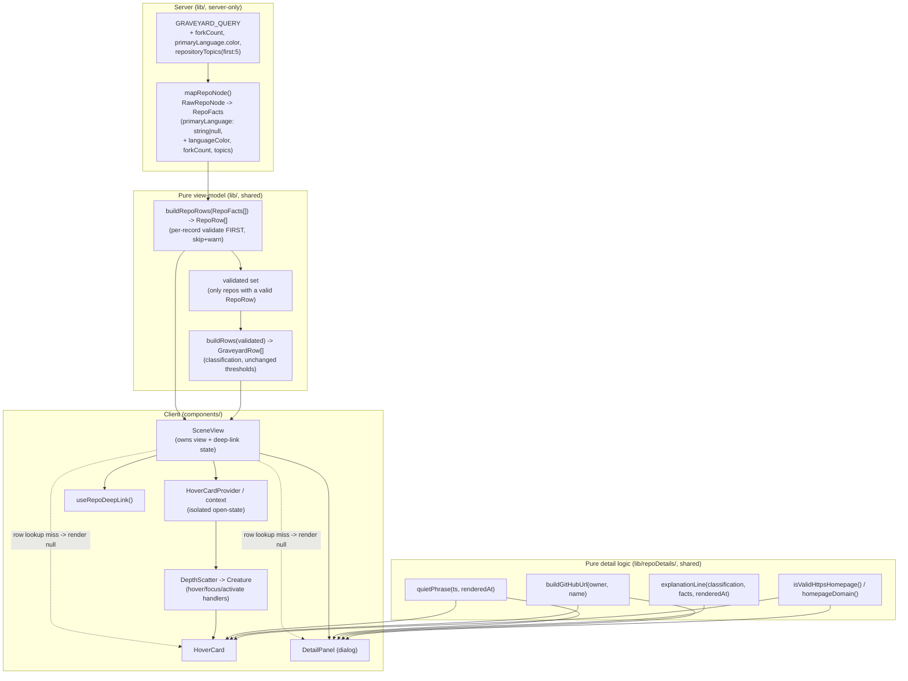
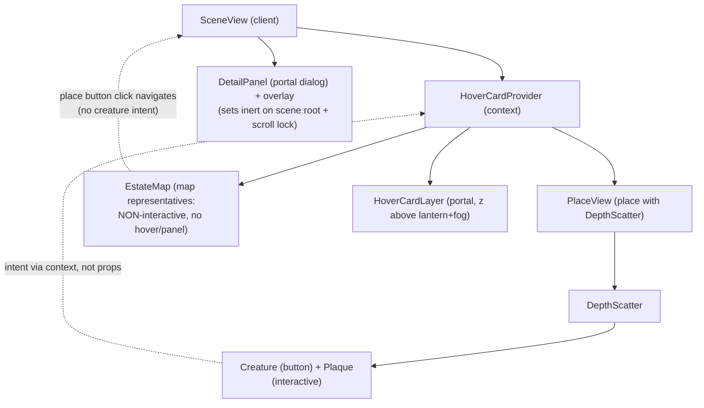

# Design Document

## Overview

Spec 3 layers two inspection surfaces — a lightweight **Hover_Card** and a full **Detail_Panel** — on top of the already-classified scene built in Spec 2/2C, and extends the single graveyard GraphQL query with the few repository fields those surfaces need. The work is additive and presentational over the frozen lifecycle classification (`lib/lifecycle.ts`) and the existing scene (`components/scene/*`). No lifecycle threshold changes and the app stays strictly read-only against GitHub.

**`lib/lifecycle.ts` stays untouched by this spec apart from three additive, classification-irrelevant fields on `RepoFacts`.** The lifecycle module keeps `primaryLanguage: string | null` exactly as today — it is NOT widened — and `classify`/`daysQuiet`/`isFinished` are not edited. The detail surfaces get the language *color* from a new sibling field (`languageColor`) rather than by changing the type `classify` reads.

The design keeps the project's established seam: **pure, clock-free, I/O-free logic lives in `lib/`** (property-tested) and **React owns state and effects in `components/`** (DOM-tested). The new pure logic — duration phrasing, the explanation sentence, the GitHub-URL builder, and the HTTPS homepage validator — goes into a new `lib/repoDetails/` folder so the surfaces import deterministic functions that take `Rendered_At` as a parameter and never read the clock.

### Scope: interactive creatures only (DepthScatter), not estate-map representatives

The Hover_Card and Detail_Panel apply **only to the interactive `Creature` buttons rendered inside a place by `DepthScatter`** (the creatures standing in sky, gate, ground, and crypt). The decorative creature *representatives* drawn on the estate **map** (`components/scene/EstateMap.tsx`) live inside the place navigation buttons and **stay non-interactive**: they get no hover card and no detail panel. The place button's own click/activation (navigate into the place) is unchanged. Only after a visitor travels *into* a place and sees that place's `DepthScatter` creatures do the two surfaces attach. Req 12 ("Sample estate") therefore applies to the **fixture creatures rendered inside an estate-fixture place via DepthScatter**, not to the estate-map representatives — the two are distinct and only the former is interactive.

The hover/panel interaction state is isolated into a dedicated React context so that opening or closing a Hover_Card never re-renders the creature layer (Req 2.13). The Detail_Panel is a modal dialog with a focus trap, Escape/overlay/close handling, and a deep-link controller that extends the existing client-side `?at=` history handling in `SceneView` with a `?repo=` parameter.

This spec ships only the panel's **shell and details**. The séance (Spec 4) and Revive in Kiro (Spec 6) land later; the panel reserves an empty, labelled `Actions_Slot` and renders no placeholder or disabled controls.

Mapped scope:

- **Data layer** (Req 1, 9.6): add `forkCount`, `primaryLanguage.color`, and `repositoryTopics(first: 5)` to `GRAVEYARD_QUERY`, extend `RawRepoNode` and `mapRepoNode`, add three additive fields to `RepoFacts` (`languageColor`, `forkCount`, `topics`) WITHOUT widening `primaryLanguage`, extend the cache zod schema and the estate fixture/resolver, and add a per-record validated `RepoRow` view-model with skip-and-warn semantics. **Validation runs on `RepoFacts` before classification**, so only validated records become creatures.
- **Pure modules** (Req 11): `quietPhrase`, `explanationLine`, `buildGitHubUrl`, `isValidHttpsHomepage` + `homepageDomain`.
- **Hover card** (Req 2, 3, 4, 10): isolated context, dwell/close timing, keyboard tooltip, positioning/flip, content, reduced motion.
- **Detail panel** (Req 5, 6, 7, 10): drawer/bottom-sheet, overlay, dialog semantics, focus trap + return, content, Actions_Slot, reduced motion.
- **Deep-link controller** (Req 8): `?repo=` via `pushState`/`replaceState`/`history.back()`, integrated with `?at=`.
- **Security** (Req 9): plain-text rendering, external-link attributes, HTTPS-only homepage domain, read-only.
- **Sample estate** (Req 12): fixture detection and "Sample repository" note.

## Architecture

### Data flow



### Component tree (additions to the existing scene)



### Key architectural decisions

1. **Validation precedes classification; creatures and rows share one source of truth (Req 1.8).** `buildRepoRows(repos: RepoFacts[]): RepoRow[]` runs **first**, skipping and warning on any invalid record. The set of names that produced a valid `RepoRow` is the single source of truth for which repositories enter the scene: `buildRows` (classification) consumes only that validated set, so a skipped repo disappears from the whole scene — there is never a creature without a matching `RepoRow`, and never a `RepoRow` without a creature. The hover card and detail panel look a row up by creature name; because the two sets are built from the same validated input they always agree. As a defensive guarantee, if a name lookup ever misses, both surfaces render nothing (return `null`) rather than throw.

2. **Isolated hover state (Req 2.13).** A `HoverCardProvider` holds the single "which creature's card is open, and how it was triggered (pointer vs focus)" state and the dwell/close timers. Creatures call stable context callbacks (`onHoverIntent`, `onHoverEnd`, `onFocusIntent`, `onBlur`) that are memoized and never change identity, so the creature layer (`DepthScatter` and its `Creature` children) does not re-render when a card opens or closes. The card itself renders in a sibling `HoverCardLayer` subscribed to the context. This keeps the 100-creature performance budget intact.

3. **Both surfaces render through React portals** so they escape the parallax/stacking transforms of the scene bands. The Hover_Card layer mounts at `z` above the lantern (z 35) and fog (z 10/25) — concretely `z-[60]` — satisfying Req 4.4. The Detail_Panel overlay + dialog mount above everything (`z-[70]`).

4. **Deep-link lives in `SceneView`** next to the existing `?at=` handling. A new `useRepoDeepLink` hook manages the `?repo=` parameter and the open/close history semantics, reusing the same `history.pushState`/`popstate` discipline already in `SceneView` (client-only navigation, no server re-render, `renderedAt` frozen).

5. **`SceneView` gains `selected`-to-panel wiring.** `SceneView` already tracks `selected: string | null` (the activated creature) and renders a `DetailPanel` when a repo is selected and the panel is open. The existing `handleSelect` is the single activation entry point for click/Enter/Space already wired through `Creature` → `DepthScatter` → `PlaceView`.

6. **Open panel makes the rest of the page inert and locks scroll (Req 7 modal semantics).** While the Detail_Panel is open, `SceneView` sets the HTML `inert` attribute on the scene root (everything *except* the panel and its overlay), so the background cannot be focused, clicked, or reached by Tab — reinforcing the dialog focus trap — and removes it on close. It also locks page scroll (set `overflow: hidden` / a fixed-body technique), capturing the prior scroll position, and restores both the attribute and the scroll position on close (and on unmount, so an unexpected teardown never leaves the page frozen or inert).

## Components and Interfaces

### Data layer

**`lib/github.ts`** (extend, server-only)

- `GRAVEYARD_QUERY`: add to each repository node, inside the existing single query and page size (≤6 pages × ≤50 repos, Req 1.2 — unchanged):
  ```graphql
  forkCount
  primaryLanguage { name color }      # add `color` to the existing selection
  repositoryTopics(first: 5) {
    nodes { topic { name } }
  }
  ```
  No new queries and no page-size change.
- `RawRepoNode`: extend the interface (add `color` to the existing language selection, plus the two new node fields):
  ```ts
  primaryLanguage: { name: string; color: string | null } | null;
  forkCount: number;
  repositoryTopics: { nodes: { topic: { name: string } }[] };
  ```
- `mapRepoNode(node)`: keep the existing `primaryLanguage` flattening unchanged and carry the new fields onto `RepoFacts`:
  - `primaryLanguage`: `node.primaryLanguage?.name ?? null` — **unchanged**, still a `string | null` (Req 1.4).
  - `languageColor` (new): `node.primaryLanguage?.color ?? null` — the color is carried in a separate field so `RepoFacts.primaryLanguage` stays a plain string and `lib/lifecycle.ts` is untouched (Req 1.3, 1.4).
  - `forkCount`: `node.forkCount`.
  - `topics`: `node.repositoryTopics.nodes.map(n => n.topic.name).slice(0, 5)` — first 5, original order, rest discarded; empty list when none (Req 1.5, 1.6).

**`lib/lifecycle.ts`** (three additive fields on `RepoFacts`; `primaryLanguage` and all classification code untouched)

`RepoFacts.primaryLanguage` **stays `string | null` exactly as today** — it is NOT widened. Classification (`classify`, `daysQuiet`, and `isFinished` in `lib/finished.ts`) is not edited at all; no `primaryLanguage?.name` rewrites are needed because the field keeps its string shape. The detail surfaces that need the language *color* read a new sibling field instead. `RepoFacts` gains three additive, classification-irrelevant fields:

```ts
export interface RepoFacts {
  // ...existing fields, including:
  primaryLanguage: string | null;   // UNCHANGED (not widened)
  // new additive fields:
  languageColor: string | null;     // new — GitHub language color, or null
  forkCount: number;                 // new
  topics: string[];                  // new, length 0..5
}
```

Thresholds in `LIFECYCLE_CONFIG` are unchanged, and no classification site reads the three new fields. `RepoLanguage` (`{ name: string; color: string | null }`) is a **UI-only** type that lives with the view-model (`lib/repoRow.ts`), not on `RepoFacts`; `RepoRow` composes it from `RepoFacts.primaryLanguage` (name) + `RepoFacts.languageColor` (color).

**`lib/cache.ts`** (extend the zod schema, server-only)

`repoFactsSchema` is extended with the three new fields so cached payloads of the new shape validate and old-shape payloads are treated as a miss (the existing behavior). `primaryLanguage` keeps its string shape:

```ts
primaryLanguage: z.string().nullable(),   // UNCHANGED
languageColor: z.string().nullable(),     // new
forkCount: z.number().int().nonnegative(),// new
topics: z.array(z.string()).max(5),       // new
```

**`lib/estate-schema.ts`** + **`lib/estate.ts`** (extend fixture shape and resolver)

Add to `estateRepoSchema` an optional `languageColor` (`z.string().nullable().optional()`, default `null`), an optional `forkCount` (`z.number().int().nonnegative().optional()`, default 0), and an optional `topics` (`z.array(z.string()).max(5).optional()`, default `[]`). **`primaryLanguage` stays the string form** (`z.string().nullable()`) — unchanged — so `resolveEstate` emits the new additive `RepoFacts` fields without touching the fixture's existing language shape. Fixtures already carry `url`, `description`, `homepageUrl`, dates, stars, and language.

**`lib/repoRow.ts`** (new, pure, shared) — the validated view-model and the pipeline's first stage

```ts
/** UI-only language shape; NOT a field type on RepoFacts. */
export interface RepoLanguage { name: string; color: string | null }

export interface RepoRow {
  name: string;
  description: string | null;
  url: string;                 // GitHub repo URL from GitHub (used only as data source, not for link construction)
  homepageUrl: string | null;
  primaryLanguage: RepoLanguage | null;   // composed from RepoFacts.primaryLanguage + RepoFacts.languageColor
  stargazerCount: number;
  forkCount: number;
  openIssueCount: number;
  topics: string[];            // 0..5
  pushedAt: string | null;
  createdAt: string;
  isArchived: boolean;
  isFork: boolean;
}

/** zod schema enforcing Req 1.3 ranges. */
export const repoRowSchema: z.ZodType<RepoRow>;

/**
 * FIRST stage of the scene pipeline. Validates each repo against
 * `repoRowSchema`. On failure, SKIP only that record, console.warn naming the
 * repo and offending field, never throw for the page, and keep every other
 * valid record (Req 1.8). Runs BEFORE classification; the names that survive
 * here are the only repositories that become creatures.
 */
export function buildRepoRows(repos: RepoFacts[]): RepoRow[];
```

`buildRepoRows` composes each `RepoFacts` into the `RepoRow` shape — notably building `primaryLanguage: facts.primaryLanguage === null ? null : { name: facts.primaryLanguage, color: facts.languageColor }` so the UI gets the `{ name, color }` object while `RepoFacts.primaryLanguage` stays a string. It then runs `repoRowSchema.safeParse`, pushes successes in original order, and for each failure emits `console.warn(\`repo-row skipped: ${repo.name} — ${issuePath}\`)` and drops only that row. It is pure (no clock, no I/O) and total (never throws).

**Pipeline order (Req 1.8).** `buildRepoRows` runs first; its output `RepoRow[]` defines the authoritative set of repository names. `SceneView` then classifies and builds creatures (`buildRows`) from **only** that validated set — a `RepoFacts` record that produced no `RepoRow` never reaches classification, so a skipped repo vanishes from the entire scene and no creature can exist without a matching `RepoRow`. The `RepoRow[]` is threaded into `SceneView` keyed by `name`, so both surfaces read a single validated record; a defensive lookup miss renders nothing (see the component descriptions and Error Handling).

### Pure detail logic (`lib/repoDetails/`, shared, property-tested)

All functions are pure, total, and take `Rendered_At` as a parameter where time is involved (Req 11).

**`lib/repoDetails/quietPhrase.ts`**
```ts
/**
 * Human-readable "quiet for …" phrase from a repo's timestamps relative to
 * renderedAt. Uses pushedAt when present, else createdAt (Req 11.2); returns a
 * fixed fallback ("quiet for an unknown age") when neither is usable (Req 11.3);
 * clamps a negative/future duration to zero (Req 11.4). Pure + total (Req 11.1, 11.8).
 */
export function quietPhrase(
  ts: { pushedAt: string | null; createdAt: string | null },
  renderedAt: string,
): string;
```
Internally reuses the same ISO-parse + `msPerDay` discipline as `lib/lifecycle.ts` (floor to whole days, then compose years/months granularity, e.g. "quiet for 2 years 3 months").

**`lib/repoDetails/explanationLine.ts`**

The explanation states the **real** reason a creature got its state, derived from the **same exported inputs/predicates `lib/lifecycle.ts` already uses to classify** — never a re-derived or independent classification, and never any threshold change. Concretely it reuses:

- `daysQuiet(facts, renderedAt)` from `lib/lifecycle.ts` (and `quietPhrase` for its phrasing) for the quiet duration.
- `isFinished(repo)` from `lib/finished.ts` and its underlying `countSignals(repo): FinishedSignals` to know **which** finished signals fired — the same signals the classifier used: `releaseCount >= 1`, a non-empty `homepageUrl`, `readmeBytes > LIFECYCLE_CONFIG.readmeMinBytes`, a finished commit keyword, and `stargazerCount >= LIFECYCLE_CONFIG.popularStars`.
- `facts.isArchived` and `facts.isFork` directly (the archived/coffin and fork signals the classifier reads).
- the risen `revivedAt` date and the `reviveWindowDays` remaining, for the risen sentence.

```ts
/**
 * One plain-English sentence stating the REAL reason a repo is its creature,
 * derived only from the classification result + the SAME facts/predicates
 * lib/lifecycle.ts used (daysQuiet, isFinished/countSignals, isArchived,
 * isFork, revivedAt) + renderedAt (Req 6.3, 11.5). Reads no clock; pure + total
 * (Req 11.8); re-derives NO classification of its own and changes NO threshold.
 * Examples:
 *   ghost     -> "Last push 12 days ago."
 *   zombie    -> "No commits for 2 years 3 months and no signs it was finished."
 *   risen     -> "Brought back from the dead on 2025-05-01; 9 days to prove it's alive."
 *   tombstone -> "Quiet for 3 years, but it has a README and 2 releases, so it's finished, not abandoned."
 *   coffin    -> "Archived on GitHub."
 */
export function explanationLine(
  input: {
    state: LifecycleState;
    decayLevel: number | null;
    facts: Pick<
      RepoFacts,
      | "pushedAt"
      | "createdAt"
      | "isArchived"
      | "isFork"
      | "releaseCount"
      | "homepageUrl"
      | "readmeBytes"
      | "stargazerCount"
      | "lastCommitMessage"
    >;
    /** ISO date a revived override was set; present only for risen. */
    revivedAt?: string | null;
  },
  renderedAt: string,
): string;
```

For a **tombstone**, the sentence names at least one of the finished facts that `countSignals` found (README, releases, homepage, keyword, or popularity) so the reason is concrete, not generic. Reuses `quietPhrase`/`daysQuiet` for the duration clause so number phrasing stays single-sourced; renders no hard-coded day counts beyond what it computes from data.

**`lib/repoDetails/githubUrl.ts`**
```ts
/**
 * Always https://github.com/{owner}/{name}, built ONLY from owner + name and
 * never from any other field (Req 9.1). Never returns a javascript:/data:/other
 * scheme for any input, including scheme-like or percent-encoded owner/name
 * (Req 11.6). Pure + total (Req 11.8): encodeURIComponent each segment.
 */
export function buildGitHubUrl(owner: string, name: string): string;
```
Implementation builds `https://github.com/` + `encodeURIComponent(owner)` + `/` + `encodeURIComponent(name)`. Because the origin is a literal constant prefix and the segments are percent-encoded, no input can inject a different scheme or escape the origin.

**`lib/repoDetails/homepage.ts`**
```ts
/** Accepts a URL only when its parsed scheme is exactly "https"; never throws (Req 9.2, 11.7). */
export function isValidHttpsHomepage(raw: string | null): boolean;

/**
 * The host portion (registered domain + subdomains) of a valid https homepage,
 * with no scheme/path/query/fragment (Req 9.3). Returns null when invalid.
 */
export function homepageDomain(raw: string | null): string | null;
```
Both use `URL` parsing inside a try/catch (total), checking `url.protocol === "https:"` exactly.

### Hover card (`components/detail/`)

**`HoverCardProvider.tsx`** (client) — isolated interaction state (Req 2.13)
- State: `{ openFor: string | null; trigger: "pointer" | "focus" | null }`.
- Owns the 250 ms dwell timer (Req 2.1), the 150 ms close-grace timer (Req 2.5, 2.6), single-open enforcement (Req 2.4), a "panel open or travel running" suppression flag (Req 2.11, 2.12), and a "suppress reopen on focus-return after panel close" flag (Req 2.10).
- Reads pointer capability once via `matchMedia("(hover: hover) and (pointer: fine)")` — the same query `LanternCursor` uses — to gate pointer-triggered cards entirely on coarse devices (Req 2.9, 5.4).
- Exposes memoized callbacks (stable identity) consumed by creatures: `onPointerEnter(name, anchorEl)`, `onPointerLeave(name)`, `onFocus(name, anchorEl)`, `onBlur(name)`, plus `closeNow()` used by the panel/travel. Context value changes do not propagate to the creature layer because creatures read callbacks, not the open state.

**`HoverCardLayer.tsx`** (client, portal) — the rendered popover
- Subscribes to the provider; renders at most one `HoverCard` (Req 2.4) in a portal at `z-[60]` above lantern + fog (Req 4.4).
- Positioning (Req 4.1–4.3): anchors within 12 px of the plaque/creature rect; flips through the ordered set `below → above → right → left` to stay within the viewport with an 8 px margin; clamps the top-left corner into the viewport when no direction fits.
- **Follows the anchor while open (Req 4.1–4.3 under motion).** Because the creatures sit in parallax bands whose transforms are driven by `useParallax` (`components/scene/useParallax.ts`, which writes `--px`/`--py` on the scene root each `requestAnimationFrame`), the plaque's screen rect moves on pointer parallax, scroll, and resize even though React does not re-render. While a card is open, `HoverCardLayer` re-measures the anchor's `getBoundingClientRect()` and re-runs the full flip/clamp logic on `scroll` (capture), `resize`, and each parallax frame, all **rAF-throttled** (one recompute per frame, coalescing a burst) and hooked into the same per-frame signal `useParallax` emits so the card tracks the plaque within 12 px. If the anchor's rect leaves the viewport entirely, the card closes (there is nothing on-screen left to anchor to). The listeners are attached only while a card is open and torn down on close.
- Keyboard-focus mode (Req 2.3, 3): renders as `role="tooltip"` with an `id` referenced by the creature's `aria-describedby`, contains **no focusable elements** (the "Open on GitHub" link is omitted / inert in focus mode; pointer mode renders the clickable link). Opens within 50 ms, no dwell.
- Reduced motion (Req 10.4): opens without a positional slide (opacity only).

**`HoverCard.tsx`** (presentational content, Req 3)
If the row lookup by creature name misses (no matching `RepoRow`), `HoverCard` renders nothing (returns `null`) instead of throwing — the same defensive guarantee as `DetailPanel`. Otherwise it displays: name (3.1); `Decay_Word` + `Quiet_Phrase` via `quietPhrase` (3.2); description clamped to 2 lines with ellipsis, rendered as plain text (3.3), or "No epitaph was written." when empty/whitespace (3.4); language name + color dot (language color, else one fixed fallback color token) (3.5, 3.6); star count (3.7); "Open on GitHub ↗" `ExternalLink` to `buildGitHubUrl(owner, name)` (3.8) — replaced by the "Sample repository" note on the estate (Req 12.4).

**`Creature.tsx`** (extend — only within `DepthScatter`)
Add optional interaction props wired from `DepthScatter`: `onHoverStart`, `onHoverEnd`, `onFocusStart`, `onBlurEnd`, and `hoverCardId` (for `aria-describedby`). The existing `onClick`/`onKeyDown` already handle click/Enter/Space activation (Req 5.1, 5.2) and raise `onSelect(name)`. These props are threaded from the context's stable callbacks so creatures stay referentially stable. The `Plaque` continues to render under the plaque layer; resting on the plaque maps to the same creature intent (Req 2.1) because `DepthScatter` associates the plaque's `data-name` with the creature.

**Only `DepthScatter`-rendered creatures receive these interaction props.** The decorative creature representatives drawn on the estate map (`components/scene/EstateMap.tsx`) are rendered inside place-navigation buttons and are **not** wired to the hover context — no `onHoverStart`/`onFocusStart`/`onSelect`, no `hoverCardId`, no hover card, and no detail panel. The place button's own click/activation (navigate into the place) is untouched. A visitor only reaches the two inspection surfaces after travelling into a place, where that place's `DepthScatter` renders interactive creatures.

### Detail panel (`components/detail/`)

**`DetailPanel.tsx`** (client, portal dialog, Req 5, 6, 7, 10)
- Props: `{ row: RepoRow | undefined; owner: string; classification: { state; decayLevel }; facts: RepoFacts; renderedAt: string; isFixture: boolean; revivedAt?: string | null; onClose: () => void }`. The `facts` (and `revivedAt`) are passed straight into `explanationLine` so the sentence uses the same inputs the classifier used.
- **Lookup miss renders nothing (Req 1.8 defensive guarantee).** If `row` is `undefined` (the selected name has no matching `RepoRow`), `DetailPanel` returns `null` instead of throwing — no dialog, no overlay, no inert, no scroll lock. In the normal pipeline this never happens because creatures are built only from validated rows, but the guard keeps the surface total.
- **Inert background + scroll lock while open (Req 7 modal semantics).** On open, set the HTML `inert` attribute on the scene root (the element wrapping everything except this panel and its overlay) so the background is unfocusable and unclickable, and lock page scroll by capturing `window.scrollY` and applying an `overflow: hidden` / fixed-body lock. On close — and in the effect cleanup so an unmount is also safe — remove `inert`, release the scroll lock, and restore the captured scroll position.
- Layout (Req 5.5, 5.6): `≥768px` → right-side drawer 420 px wide (clamped to viewport width when narrower); `<768px` → bottom sheet `max-height: 85vh` with scrollable content. Width branch chosen via `matchMedia("(min-width: 768px)")`.
- Overlay (Req 5.7): a dimming layer at 35–50% opacity (a `night` token at e.g. 45%), scene stays visible; clicking it closes.
- Dialog semantics (Req 7.1): `role="dialog"`, `aria-modal="true"`, `aria-labelledby` → the heading id.
- Focus (Req 7.2, 7.3, 7.5, 7.6, 7.7): move focus to the first focusable control within 100 ms of the open animation; trap Tab/Shift+Tab with wrap; Escape or the close control closes within 100 ms; on close return focus to the opening creature, or to a persistent scene element (e.g. the place heading / return control) if that creature is gone.
- Close control (Req 7.4, 7.8): a button with an accessible name ("Close record") and a `candle-400` focus ring.
- Reduced motion (Req 10.3): fade opacity 0→1 within 200 ms, no positional slide.
- No scene mutation on open (Req 5.8): opening does not start a travel transition, change the place, or change the active filter — it only sets `selected` + panel-open; `SceneView` already keeps these independent.

**`DetailPanel` content** (Req 6), styled per `Seance.dc.html` (iron panel `night-800`, parchment/`moon-100` text, Cinzel headings via the existing `@theme` fonts), panel shell + facts only (no séance):
- Name + owner (6.1); creature type + `Decay_Word` as pill badges (6.2); `Explanation_Line` from `explanationLine` (6.3); description as plain text or "No epitaph was written." (6.4, 6.5); up to 5 topic chips, plain text (6.6); star / fork / open-issue counts as non-negative integers (6.7); language name + color dot (6.8); created date and last-push date relative to `renderedAt` (6.9); "Archived" badge when archived (6.10); "Fork" badge when a fork (6.11); "Open on GitHub ↗" primary `ExternalLink` (6.12); homepage `ExternalLink` showing only its domain when valid https (6.13).
- `Actions_Slot` (6.14): `<section aria-label="Actions" data-slot="actions" />` — empty, no text, no controls, may be zero height.

**`ExternalLink.tsx`** (shared, Req 9.4)
Renders `<a target="_blank" rel="noopener noreferrer">` with a trailing "↗" marker and a visually hidden "(opens in a new tab)" span (`sr-only`). Used for both GitHub and homepage links. Never used for fixture repos (Req 12.2).

**`PlainText` rendering (Req 9.5).** Description and topics are rendered as React text children (`{value}`), never via `dangerouslySetInnerHTML`, so HTML-significant characters display literally in both surfaces.

### Deep-link controller

**`lib/repoDetails/deepLink.ts`** (pure helpers)
```ts
/** Find a loaded repo whose name equals `param` case-insensitively, or null (Req 8.2, 8.7). */
export function matchRepoParam(rows: { name: string }[], param: string | null): string | null;

/** Build a search string with repo set/removed while preserving `at` (Req 8.1, 8.4). */
export function withRepoParam(search: string, repo: string | null): string;
```

**`useRepoDeepLink()`** (client hook used in `SceneView`)
- On initial render, read `?repo=`; if it matches a loaded repo case-insensitively, open that panel without pushing history (Req 8.2); if it matches nothing, leave all panels closed (Req 8.7).
- On in-page open, `history.pushState` a new entry setting `?repo=<name>` and preserving `?at=` (Req 8.1). Record that this open pushed an entry.
- On in-page close (Escape / close control / overlay click): if the open pushed an entry, call `history.back()` (Req 8.3); if the open came from a loaded URL that already carried `?repo=` (no push), `history.replaceState` to strip `?repo=` while preserving `?at=` (Req 8.4).
- Extend the existing `popstate` listener in `SceneView` so a browser Back while the panel is open closes the panel and is never a no-op (Req 8.5).
- All of this is client-only history manipulation: no server re-render, `renderedAt`/`rows` stay frozen (Req 8.6).

### Sample estate (Req 12)

`SceneView` already runs in `mode: "live" | "estate"`. Req 12 concerns the **fixture creatures rendered inside an estate-fixture place via `DepthScatter`** — i.e. the interactive creatures a visitor sees after travelling into a place on `/estate` — not the non-interactive estate-map representatives (those never render a hover card or panel at all; CHANGE-5 scope). For those fixture creatures the panel and hover card receive `isFixture = (mode === "estate")`. When true:
- No `GitHub_Link` or `Homepage_Link` is rendered (Req 12.2).
- The panel shows a "Sample repository" note in place of the external links (Req 12.3); the hover card shows the same note where the GitHub link would be (Req 12.4).
- These are rendered in the DOM on `/estate` so a DOM test can assert both the absence of external links and the presence of the note (Req 12.5). The `/estate` route already renders `SceneView` in estate mode (`app/estate/page.tsx`).

## Data Models

### Extended `RepoFacts` (`lib/lifecycle.ts`) — three additive fields, `primaryLanguage` unchanged
```ts
interface RepoFacts {
  name: string;
  description: string | null;
  url: string;
  pushedAt: string | null;
  createdAt: string;
  isArchived: boolean;
  isFork: boolean;
  homepageUrl: string | null;
  stargazerCount: number;
  primaryLanguage: string | null;         // UNCHANGED (not widened)
  languageColor: string | null;           // new — GitHub language color
  forkCount: number;                       // new
  topics: string[];                        // new (0..5)
  openIssueCount: number;
  releaseCount: number;
  readmeBytes: number | null;
  lastCommitMessage: string | null;
}
```

`RepoLanguage` (`{ name: string; color: string | null }`) is a **UI-only** type declared in `lib/repoRow.ts`, not a field type on `RepoFacts`. `RepoRow.primaryLanguage` is composed from `RepoFacts.primaryLanguage` (name) + `RepoFacts.languageColor` (color).

### `RepoRow` view-model + zod schema (`lib/repoRow.ts`)

`RepoRow.primaryLanguage` is the UI `RepoLanguage | null` object, composed in `buildRepoRows` as `facts.primaryLanguage === null ? null : { name: facts.primaryLanguage, color: facts.languageColor }`. The schema validates that composed object; it does not read a language object off `RepoFacts`.
```ts
const repoRowSchema = z.object({
  name: z.string().min(1),
  description: z.string().nullable(),
  url: z.string(),
  homepageUrl: z.string().nullable(),
  primaryLanguage: z
    .object({ name: z.string().min(1).max(255), color: z.string().optional().nullable() })
    .nullable(),                                   // Req 1.3
  stargazerCount: z.number().int().min(0),
  forkCount: z.number().int().min(0).max(2_147_483_647),   // Req 1.3
  openIssueCount: z.number().int().min(0),
  topics: z.array(z.string()).max(5),              // Req 1.3
  pushedAt: z.string().nullable(),
  createdAt: z.string(),
  isArchived: z.boolean(),
  isFork: z.boolean(),
});
```

### Hover context state
```ts
interface HoverState { openFor: string | null; trigger: "pointer" | "focus" | null }
```

## Error Handling

- **Per-record validation before classification (Req 1.8).** `buildRepoRows` validates each repo independently and runs **first**; a failing record (e.g. negative `forkCount`, >5 topics) is skipped with a `console.warn` naming the repo and field, never throwing for the page. Because classification consumes only the validated set, a skipped repo is simply absent from the scene (no creature, no row) and every other valid repo still renders. This mirrors the best-effort pattern already used in `lib/cache.ts` and `lib/overrides.ts` (safeParse, degrade gracefully).
- **Row lookup miss renders nothing (Req 1.8 defensive guarantee).** Both `HoverCard` and `DetailPanel` return `null` when the selected creature name has no matching `RepoRow`, rather than throwing. The normal pipeline makes this unreachable (creatures come from validated rows), but the guard keeps the surfaces total; `DetailPanel` additionally skips applying `inert`/scroll-lock in that case so no state is left dangling.
- **Inert + scroll-lock teardown (Req 7 modal semantics).** `DetailPanel` removes the scene-root `inert` attribute and restores the captured scroll position on close **and** in its effect cleanup, so even an unexpected unmount (route change, filter change removing the panel) can never leave the page frozen, scroll-locked, or inert.
- **Missing fields (Req 1.4, 1.5, 1.7).** `mapRepoNode` maps absent `primaryLanguage`/topics to `null`/`[]` and absent `description`/`homepageUrl` to `null` while keeping the rest of the record.
- **Totality of pure functions (Req 11.8).** `quietPhrase`, `explanationLine`, `buildGitHubUrl`, `isValidHttpsHomepage`, `homepageDomain` never throw and never return `NaN`/`undefined`: all ISO parsing goes through a null-returning parse, URL parsing is wrapped in try/catch, and durations are clamped to ≥ 0.
- **Invalid/absent homepage (Req 9.2).** When `homepageUrl` is absent/empty/non-https, the link element is omitted entirely (no empty anchor).
- **Deep-link miss (Req 8.7).** A `?repo=` that matches no loaded repo leaves every panel closed; no error, no history change.
- **Focus-return fallback (Req 7.7).** If the opening creature is gone on close (e.g. filter/plot changed), focus moves to a persistent scene element so focus is never lost to `document.body`.
- **Read-only guarantee (Req 9.6).** No new OAuth scope and no write/update/delete call is introduced; the only GitHub data path remains the server-side GraphQL query.

## Correctness Properties

*A property is a characteristic or behavior that should hold true across all valid executions of a system — essentially, a formal statement about what the system should do. Properties serve as the bridge between human-readable specifications and machine-verifiable correctness guarantees.*

The testable property-based targets in this spec are the pure modules in `lib/repoDetails/`, the per-record `buildRepoRows` validator and its validation-before-classification pipeline, and the `mapRepoNode` field mapping. The hover/panel interaction, positioning, inert/scroll-lock, and deep-link behaviors are DOM/example tests (they depend on the browser environment and do not vary meaningfully across 100 random inputs); they are covered in the Testing Strategy.

### Property 1: GitHub URL origin is always github.com and never a dangerous scheme
*For any* owner string and repository name string (including values containing `javascript:`, `data:`, other scheme-like prefixes, slashes, whitespace, unicode, or percent-encoded characters), `buildGitHubUrl(owner, name)` returns a URL whose parsed origin is exactly `https://github.com` and whose scheme is exactly `https`.

**Validates: Requirements 9.1, 11.6, 11.8**

### Property 2: Homepage validator accepts only https and never throws
*For any* string or null input, `isValidHttpsHomepage` returns `true` iff the input parses as a URL whose scheme is exactly `https`, and it never throws; and whenever it returns `true`, `homepageDomain` returns a non-empty host containing no scheme, path, query, or fragment, otherwise `null`.

**Validates: Requirements 9.2, 9.3, 11.7, 11.8**

### Property 3: Quiet phrase is total, deterministic, and clamps future timestamps
*For any* `pushedAt`/`createdAt` pair (each a valid ISO string, null, or an unparseable string) and any `renderedAt`, `quietPhrase` returns the same non-empty string for the same inputs, never throws, and never returns `NaN`/`undefined`; when the reference timestamp is after `renderedAt` the phrase is the zero-duration phrase; when `pushedAt` is absent it is computed from `createdAt`; when both are unusable it returns the fixed fallback phrase.

**Validates: Requirements 11.1, 11.2, 11.3, 11.4, 11.8**

### Property 4: Explanation line is total and deterministic
*For any* classification (state + decay level) and facts (the same `RepoFacts` fields the classifier reads) plus any `renderedAt`, `explanationLine` returns the same single non-empty sentence for the same inputs, reads no clock, and never throws or returns `NaN`/`undefined`.

**Validates: Requirements 6.3, 11.5, 11.8**

### Property 5: Tombstone explanation names a real finished signal
*For any* repository classified as a tombstone, `explanationLine` produces a sentence that mentions at least one of the actual finished signals `countSignals` found for that repository (a README, a release/releases, a homepage, a finished commit keyword, or popularity), so the stated reason reflects the real classification inputs and never a generic placeholder.

**Validates: Requirements 6.3, 11.5**

### Property 6: Only validated repos become creatures (no orphans)
*For any* list of `RepoFacts` (a mix of valid and field-violating records), the set of creature names the scene classifies equals exactly the set of `name`s in `buildRepoRows`' output: every rendered creature has a matching `RepoRow` and every `RepoRow` has a creature, so neither surface can look up a name that is absent — and a lookup miss, were one to occur, renders nothing rather than throwing.

**Validates: Requirements 1.8**

### Property 7: Repo-row validation never throws for a page and keeps all valid records
*For any* list of candidate repo records (a mix of valid records and records that violate a field constraint such as a negative `forkCount` or a topics list longer than 5), `buildRepoRows` returns exactly the valid records in their original order, skips every invalid record, and never throws for the page.

**Validates: Requirements 1.3, 1.8**

### Property 8: Node mapping maps language into two fields, caps topics, and preserves forkCount
*For any* raw repository node, `mapRepoNode` maps a missing `primaryLanguage` to `primaryLanguage = null` and `languageColor = null`, and otherwise sets `primaryLanguage = node.primaryLanguage.name` (a string) and `languageColor = node.primaryLanguage.color ?? null`; it maps absent topics to `[]`, retains only the first 5 topics in original order when more are present, and carries `forkCount` unchanged.

**Validates: Requirements 1.4, 1.5, 1.6**

## Testing Strategy

The project uses **Vitest** with two projects — `unit` (`tests/**/*.test.ts`, node env) and `dom` (`tests/**/*.test.tsx`, jsdom env) — plus **fast-check** property tests under `tests/property/`. DOM tests use `@testing-library/react` + `@testing-library/user-event`; `@testing-library/jest-dom` is not installed, so assertions use plain DOM checks (matching the existing `tests/dom/*` pattern). This spec follows the same conventions and adds new tests only; **existing tests must not be deleted without asking.**

Operational note: **`next build` must not be run while the dev server is running** (both use Turbopack and will contend). Run the dev server manually in a separate terminal; verification here uses `vitest --run` and `tsc --noEmit`.

### Property tests (fast-check, `tests/property/`)
One property-based test per correctness property, each tagged and run at ≥ 100 iterations:

- `githubUrl.property.test.ts` — Property 1. Tag: `Feature: repo-details-hover-panel, Property 1: GitHub URL origin is always github.com`. Generators include adversarial owner/name strings (`javascript:`, `data:`, `..`, encoded characters).
- `homepage.property.test.ts` — Property 2.
- `quietPhrase.property.test.ts` — Property 3. Generators include future timestamps, null/absent timestamps, and unparseable strings.
- `explanationLine.property.test.ts` — Property 4 (total + deterministic) and Property 5 (tombstone sentence mentions a real `countSignals` finished signal). Generators build facts spanning every state and, for tombstones, every combination of finished signals.
- `repoRows-no-orphans.property.test.ts` — Property 6. Generators mix valid and field-violating `RepoFacts`; the test asserts the classified creature-name set equals the `buildRepoRows` name set and that a name absent from the rows yields a null-rendering surface.
- `repoRow.property.test.ts` — Property 7. Generators mix valid rows with field-violating rows.
- Extend `tests/property/github-mapping.property.test.ts` for Property 8 (name→`primaryLanguage` string, color→`languageColor`, topics cap, `forkCount`), reusing the local `RawRepoNode` generator.

### DOM / component tests (`tests/dom/`)
- `HoverCard.test.tsx`: dwell open after 250 ms on pointer rest (Req 2.1) and cancel if the pointer leaves before dwell (Req 2.2); single-card-at-a-time when a second creature triggers (Req 2.4); move-pointer-into-card keeps it open so the link is clickable (Req 2.5); close on leave after the 150 ms grace (Req 2.6); keyboard focus opens immediately as `role="tooltip"` referenced by `aria-describedby` with **no focusable children** (Req 2.3, 3); Escape closes (Req 2.8); blur closes (Req 2.7); no reopen when focus returns after the panel closes (Req 2.10); suppressed during travel / while the panel is open and closed when either starts (Req 2.11, 2.12); coarse-pointer never opens on pointer interaction (Req 2.9); content fields and plain-text description/"No epitaph" (Req 3.1–3.8); reduced-motion no-slide (Req 10.4).
- `HoverCardIsolation.test.tsx`: opening/closing a card does not re-render the creature layer — assert a creature render spy is not called on hover changes (Req 2.13).
- `HoverCardPosition.test.tsx`: anchored within 12 px (Req 4.1), flips to stay in-viewport in the ordered directions (Req 4.2), clamps when nothing fits (Req 4.3), renders above lantern + fog (Req 4.4) — using stubbed `getBoundingClientRect`/viewport. Also: while the card is open, moving the anchor via a `scroll` event, a `resize`, or a simulated parallax frame re-runs the flip/clamp so the card still sits within 12 px of the (rAF-throttled) anchor, and moving the anchor fully off-screen closes the card (Req 4.1–4.3 under motion).
- `DetailPanel.test.tsx`: opens on click/Enter/Space (Req 5.1), Space suppresses page scroll (Req 5.2), closes a same-creature hover card as it opens (Req 5.3), coarse tap opens the panel directly without a hover card first (Req 5.4), drawer vs bottom-sheet by width (Req 5.5, 5.6), overlay dims and click-overlay closes (Req 5.7), opening does not start travel / change place / change filter (Req 5.8); full content assertions (Req 6.1–6.14) including the empty `Actions_Slot` landmark with no controls (6.14), and that the explanation sentence names the real reason — e.g. a tombstone's sentence mentions its README/releases (Req 6.3); dialog semantics (Req 7.1), focus-in (7.2), focus trap wrap (7.3), close control accessible name (7.4), Escape + close within 100 ms (7.5), focus return to the opening creature (7.6) and the persistent-element fallback when it is gone (7.7), candle-400 focus ring (7.8); reduced-motion fade (Req 10.3); plain-text description renders HTML literally, not as markup (Req 9.5); external-link attributes `target`/`rel`/↗/sr-only (Req 9.4). Inert + scroll lock: while open the scene root carries the `inert` attribute and loses it on close, and page scroll is locked while open and the prior scroll position is restored on close (and on unmount). Defensive: when the panel is rendered for a name with no matching `RepoRow` it renders nothing and applies no `inert`/scroll lock.
- `RepoDeepLink.test.tsx`: in-page open pushes `?repo=` preserving `?at=` (Req 8.1); load with a case-insensitive matching `?repo=` opens without pushing (Req 8.2); in-page close after a push calls `history.back()` (Req 8.3); loaded-URL open close strips `?repo=` via `replaceState` preserving `?at=` (Req 8.4); Back while open closes and is not a no-op (Req 8.5); a non-matching `?repo=` leaves all panels closed (Req 8.7).
- `CrossPlaceModes.test.tsx`: hover/panel behave identically across places and with lights on/off (Req 10.1, 10.2).
- Extend `tests/dom/SceneView.test.tsx` (or a new `SceneViewEstateDetail.test.tsx`) rendered on the `/estate` data path to assert fixture creatures (inside a place via `DepthScatter`) show the "Sample repository" note and render no external links (Req 12.2–12.5).
- `EstateMapNonInteractive.test.tsx`: the creature representatives on the estate map (`EstateMap.tsx`) are not wired to the hover context — hovering/focusing a representative opens no hover card and activating the place button navigates into the place without opening a detail panel (CHANGE-5 scope).
- `SceneViewPipeline.test.tsx` (or an extension of the SceneView DOM tests): a `RepoFacts` set containing an invalid record renders creatures only for the validated names (the invalid repo has neither a creature nor a row), demonstrating validation precedes classification and there are no orphan creatures (Req 1.8).

### Unit tests (`tests/`)
- `tests/github.test.ts` (extend): `GRAVEYARD_QUERY` includes `forkCount`, `primaryLanguage { name color }`, and `repositoryTopics(first: 5)`, and still issues ≤ 6 pages of ≤ 50 (Req 1.1, 1.2); `mapRepoNode` example cases for the new fields — including that `primaryLanguage` stays the plain name string and the color lands on `languageColor`.
- `tests/repoRow.test.ts`: example skip-and-warn cases alongside the property test, plus that `primaryLanguage` is composed into `{ name, color }` from `RepoFacts.primaryLanguage` + `RepoFacts.languageColor`.
- `tests/explanationLine.test.ts`: example sentences per state asserting the real reason wording (ghost last-push phrasing, zombie "no signs it was finished", risen revive-date + days-remaining, tombstone naming README/releases, coffin "Archived on GitHub").

Both unit and property tests run under `vitest --run`; `tsc --noEmit` type-checks the new modules and the three additive `RepoFacts` fields (`languageColor`, `forkCount`, `topics`) while `RepoFacts.primaryLanguage` stays `string | null`.
