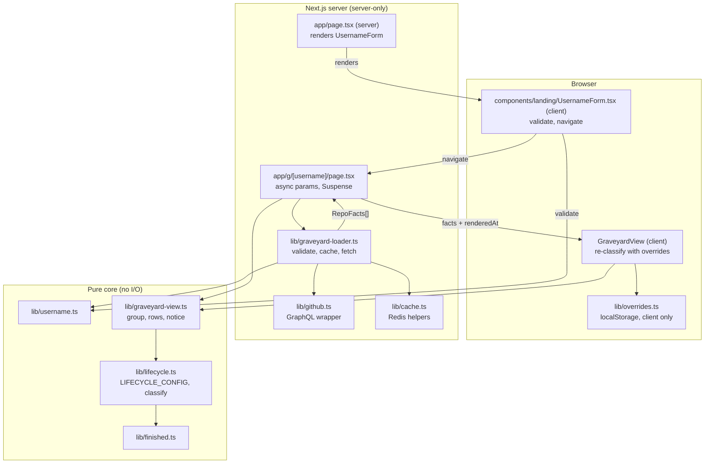
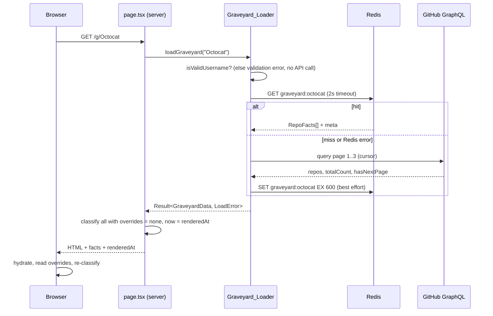

# Design Document

## Overview

This feature delivers the core of Repo Graveyard: given a GitHub username or organization, load its public non-fork repositories in one efficient GraphQL pass, classify each into exactly one lifecycle state (ghost, risen, zombie, tombstone, coffin) with a decay level where applicable, apply per-device overrides from localStorage, and render a grouped list at `/g/[username]`. A minimal landing page at `/` takes the username.

The design splits the feature into two halves with a hard boundary between them:

- **Pure core** (`lib/lifecycle.ts`, `lib/finished.ts`, `lib/username.ts`, `lib/graveyard-view.ts`): plain functions with no I/O. `now` is always a parameter. All thresholds live in one `LIFECYCLE_CONFIG` object. This is where nearly all fast-check property tests live.
- **I/O shell** (`lib/github.ts`, `lib/cache.ts`, `lib/overrides.ts`, route/page components): GitHub GraphQL, Upstash Redis, localStorage, React. Tested with example-based tests and injected fakes.

Key decisions and rationale:

| Decision | Rationale |
|---|---|
| Cache **raw facts**, not classifications (Req 2.1) | Classification depends on `now` and on client-side overrides. Caching classified output would go stale and could not honor overrides. |
| Classify on the server for first paint, **re-classify on the client** with overrides (Req 8.6) | Same pure function runs in both places. The GitHub token never leaves the server; overrides never leave the browser. |
| Redis for caching (via `@upstash/redis`), not `"use cache"` | Steering requires a hosted Redis because in-memory caches do not survive serverless invocations. Redis failures are non-fatal (Req 2.4). |
| Errors as a discriminated union (`Result`), not thrown exceptions, across the loader boundary | Page rendering maps each error kind to a distinct message (Req 8.3, 8.4, 8.7) with exhaustive `switch` checking. |
| Injected GraphQL transport and Redis client | Lets the loader be tested with fakes, including pagination property tests, without network access. |
| Single validator for usernames | Used by loader, page, and landing form, so Req 1.4, 8.8, 9.1 and 9.5 cannot drift apart. |

### Research Summary

- **Next.js 16 with Cache Components** (`cacheComponents: true` in `next.config.ts`): `params` is a `Promise` and must be awaited. Reading request-time data (params, uncached fetches) opts that part of the tree into dynamic rendering, so the page awaits `params` and loads data inside a `<Suspense>` boundary, keeping the page shell static. Source: local docs at `node_modules/next/dist/docs/01-app/03-api-reference/03-file-conventions/page.md`.
- **GitHub GraphQL `repositoryOwner(login:)`** resolves both users and organizations, supports `repositories(first, after, isFork: false, privacy: PUBLIC, ownerAffiliations: OWNER, orderBy: {field: PUSHED_AT, direction: DESC})`, and exposes `totalCount` and `pageInfo { hasNextPage endCursor }`. Per `tech.md`, this keeps the load to at most 3 queries.
- **Rate limits**: GitHub signals limits with 403/429 and the `x-ratelimit-reset` header (epoch seconds), or a GraphQL error with `type: "RATE_LIMITED"`. Requirement 1.6 reads the reset header in both cases.
- **@upstash/redis** is HTTP based, so it works in serverless and edge runtimes. It accepts a per-request abort/timeout via `fetch` options, which is used to enforce the 2 second ceiling in Req 2.4.
- **Clock reads are request-time (dynamic) under Cache Components**: reading `new Date()` during prerender can error, so `renderedAt` is read only after `await params` inside the Suspense child. If the build still flags the clock read, `await connection()` from `next/server` forces that subtree dynamic before the read.

## Architecture



### Request flow for `/g/[username]`



### File layout (per `structure.md`)

```
app/page.tsx                         landing (server page, renders UsernameForm)
components/landing/UsernameForm.tsx  client-only ("use client"): form behavior + navigation
app/g/[username]/page.tsx            server page
lib/username.ts                      pure: isValidUsername, normalizeUsername
lib/lifecycle.ts                     pure: LIFECYCLE_CONFIG, daysQuiet, classify
lib/finished.ts                      pure: signals + isFinished
lib/graveyard-view.ts                pure: group, toRow, truncation notice
lib/github.ts                        server-only: GraphQL query + mapping + errors
lib/cache.ts                         server-only: Redis get/set with timeout
lib/graveyard-loader.ts              server-only: orchestrates validate/cache/fetch
lib/overrides.ts                     client-only: localStorage store
components/graveyard/GraveyardView.tsx   client: re-classify + render
components/graveyard/GraveyardList.tsx   presentational groups and rows
components/graveyard/LoadErrorMessage.tsx  maps LoadError to copy
vitest.config.ts                     jsdom for components, node for pure lib
tests/unit/, tests/property/         Vitest + fast-check
```

`lib/graveyard-loader.ts` is added to the structure in `structure.md` because the loader orchestration does not fit in `github.ts` (GitHub only) or `cache.ts` (Redis only).

## Components and Interfaces

### `lib/username.ts` (pure)

```ts
export const USERNAME_MAX_LENGTH = 39;
// 1-39 chars, alphanumeric or hyphen, no leading/trailing hyphen
export function isValidUsername(input: string): boolean;
export function normalizeUsername(input: string): string; // lowercases
```

Implemented as `length 1..39` plus `/^[A-Za-z0-9](?:[A-Za-z0-9-]*[A-Za-z0-9])?$/`. A single character must be alphanumeric. Consecutive hyphens are allowed by the stated requirement and are therefore accepted. The function does not trim: the landing page decides whether to trim before validating, and tests assert untrimmed whitespace is invalid.

### `lib/lifecycle.ts` (pure)

```ts
export const LIFECYCLE_CONFIG = {
  ghostMaxDaysQuiet: 90,              // days_quiet < 90 => ghost
  ghostDecayBounds: [14, 30, 60],     // level = count of bounds <= days_quiet (0..3)
  zombieDecayBounds: [182, 365, 730, 1095], // level 0..4
  reviveWindowDays: 14,
  readmeMinBytes: 1024,
  manyIssues: 10,
  finishedCommitKeywords: ["v1.0", "release", "final", "done", "ship"],
  unfinishedCommitKeywords: ["wip", "todo", "temp", "fix later"],
  finishedMargin: 2,
  maxRepos: 300,
  pageSize: 100,
  msPerDay: 86_400_000,
} as const;

export type LifecycleState = "ghost" | "risen" | "zombie" | "tombstone" | "coffin";
export type OverrideType = "finished" | "scrapped" | "revived";
export interface Override { type: OverrideType; setAt: string } // ISO 8601

export interface RepoFacts {
  name: string;
  description: string | null;
  url: string;
  pushedAt: string | null;
  createdAt: string;
  isArchived: boolean;
  isFork: boolean;
  homepageUrl: string | null;
  stargazerCount: number;
  primaryLanguage: string | null;
  openIssueCount: number;
  releaseCount: number;
  readmeBytes: number | null;      // null = no README found
  lastCommitMessage: string | null;
}

export interface Classification {
  state: LifecycleState;
  decayLevel: number | null;        // ghost 0-3, zombie 0-4, otherwise null
  daysQuiet: number;                // always >= 0
  clearedOverrides: OverrideType[]; // contains "revived" when it lapsed or was satisfied
}

export function daysQuiet(repo: Pick<RepoFacts, "pushedAt" | "createdAt">, now: string): number;
export function classify(repo: RepoFacts, override: Override | undefined, now: string): Classification;
```

`classify` evaluates the rules in the order given by Requirement 3. Pseudocode:

```
dq = daysQuiet(repo, now)
effective = override
if override?.type == "finished": return tombstone
if override?.type == "scrapped": return coffin
if override?.type == "revived":
    if pushedAfter(repo.pushedAt, override.setAt):  cleared=["revived"]; effective=none   (Rule 3)
    elif daysBetween(override.setAt, now) < reviveWindowDays: return risen              (Rule 4)
    else: cleared=["revived"]; effective=none                                          (Rule 5)
if repo.isArchived: return isFinished(repo) ? tombstone : coffin                       (Rules 6, 7)
if dq < ghostMaxDaysQuiet: return ghost(decay from ghostDecayBounds)                   (Rule 8)
if isFinished(repo): return tombstone                                                  (Rule 9)
return zombie(decay from zombieDecayBounds)                                            (Rule 10)
```

Behavioral decisions where the requirements leave room:

- `pushedAfter(null, ...)` is false. A null `pushedAt` therefore never satisfies Rule 3, but `daysQuiet` still falls back to `createdAt`.
- "Days elapsed since the revive timestamp" uses `floor((now - setAt) / msPerDay)` and is compared with `reviveWindowDays`. A `setAt` in the future yields a negative count, which is `< 14`, so the repo is risen.
- Unparseable date strings are treated as missing: an unparseable `pushedAt` falls back to `createdAt`; an unparseable `createdAt` yields `daysQuiet = 0`. This keeps `classify` total for any input (Req 3.1) and never throws or returns `NaN`. An unparseable `override.setAt` is treated as "not after" and as elapsed >= window, so the revival lapses.
- Decay level is derived by counting bounds that are `<= daysQuiet`, which makes ranges 0-3 and 0-4 hold by construction (Req 4.6).
- Rule order is expressed as one function with early returns. A separate table-driven reference model in the test suite re-derives the answer independently.

### `lib/finished.ts` (pure)

```ts
export interface FinishedSignals { finished: number; unfinished: number }
export function countSignals(repo: RepoFacts): FinishedSignals;
export function isFinished(repo: RepoFacts): boolean; // finished - unfinished >= finishedMargin
```

Signal evaluation:

- Finished: `releaseCount >= 1`; `homepageUrl` non-empty after trim; `readmeBytes > readmeMinBytes`; commit subject (first line of `lastCommitMessage`) contains any finished keyword, case-insensitive. The commit counts as at most one finished signal even if several keywords match.
- Unfinished: commit subject contains any unfinished keyword (at most one signal); `readmeBytes` is `null` or `0`; `openIssueCount >= manyIssues`.
- Returns `finished - unfinished >= 2`.

### `lib/overrides.ts` (client only)

```ts
export type OverrideMap = Record<string, Override>;
export function overridesKey(username: string): string; // `repo-graveyard-overrides:${lowercased}`
export function readOverrides(username: string | null | undefined, storage?: StorageLike): OverrideMap;
export function writeOverride(username: string | null | undefined, repoName: string, override: Override, storage?: StorageLike): void;
```

`StorageLike` is `Pick<Storage, "getItem" | "setItem">`, defaulting to `window.localStorage`, so tests inject fakes. Every access is wrapped in try/catch. Reads parse JSON and validate with a zod schema (`z.record(z.string(), z.object({ type: z.enum([...]), setAt: z.string() }))`); malformed data yields `{}`. A missing/empty username returns `{}` on read and is a no-op on write. The file does not import `server-only` and is never imported from server modules; an ESLint `no-restricted-imports` rule for `lib/overrides` in server modules enforces Req 6.7 mechanically.

### `lib/github.ts` (server only)

```ts
export type GraphqlTransport = <T>(query: string, vars: Record<string, unknown>) => Promise<{ data: T; headers?: Record<string, string> }>;

export const GRAVEYARD_QUERY: string;
export function mapRepoNode(node: RawRepoNode): RepoFacts;   // pure, exported for tests
export async function fetchRepos(login: string, transport: GraphqlTransport): Promise<Result<GraveyardData, LoadError>>;
```

`GRAVEYARD_QUERY` selects `repositoryOwner(login:)` with `repositories(first: $first, after: $after, isFork: false, privacy: PUBLIC, ownerAffiliations: OWNER, orderBy: {field: PUSHED_AT, direction: DESC})` and per node: `name description url pushedAt createdAt isArchived isFork homepageUrl stargazerCount primaryLanguage { name } issues(states: OPEN) { totalCount } releases { totalCount } readmeUpper: object(expression: "HEAD:README.md") { ... on Blob { byteSize } } readmeLower: object(expression: "HEAD:readme.md") { ... on Blob { byteSize } } defaultBranchRef { target { ... on Commit { message } } }`, plus connection-level `totalCount` and `pageInfo { hasNextPage endCursor }`.

Fetch algorithm:

1. Loop pages with `first = min(pageSize, maxRepos - collected)` and the cursor, until `collected == maxRepos` or `hasNextPage` is false. That is at most `ceil(min(total, 300) / 100)` calls.
2. After the loop, `truncated = totalCount > maxRepos || (collected == maxRepos && hasNextPage)`.
3. `mapRepoNode`: `readmeBytes = upper?.byteSize ?? lower?.byteSize ?? null`, so `README.md` wins when both exist. `primaryLanguage` flattens to its name; `lastCommitMessage` is `null` when the repo is empty.
4. Retry policy: on a 5xx, retry that request once. If the retry also returns 5xx, discard everything collected so far and return `server-error` (Req 1.7).
5. Error mapping: `repositoryOwner: null` or an error with `type`/`code` `NOT_FOUND` becomes `not-found`; HTTP 403/429 or error `RATE_LIMITED` becomes `rate-limited` with `resetAt` parsed from `x-ratelimit-reset` (epoch seconds converted to ISO, or `null` if absent); everything else becomes `server-error`.

The production transport wraps `graphql.defaults({ headers: { authorization: `token ${process.env.GITHUB_TOKEN}` } })` from `@octokit/graphql`, and converts `GraphqlResponseError` / `RequestError` into the transport's status/headers shape. `GITHUB_TOKEN` is only read in this module.

### `lib/cache.ts` (server only)

```ts
export const GRAVEYARD_TTL_SECONDS = 600;
export const REDIS_TIMEOUT_MS = 2000;
export function graveyardCacheKey(username: string): string; // `graveyard:${lowercased}`
export interface CacheClient { get(key: string): Promise<unknown>; set(key: string, value: unknown, opts: { ex: number }): Promise<unknown> }
export async function cacheGet(client: CacheClient | null, key: string): Promise<GraveyardData | null>;
export async function cacheSet(client: CacheClient | null, key: string, data: GraveyardData): Promise<void>;
```

Both operations race against a `REDIS_TIMEOUT_MS` timer, catch every error, and never throw: a `get` failure returns `null` (treated as a miss), a `set` failure is swallowed. Cached values are validated with a zod schema on read; invalid or stale-shaped payloads are treated as a miss. The cached payload contains the `RepoFacts[]`, `totalCount`, and `truncated`, never classifications.

### `lib/graveyard-loader.ts` (server only)

```ts
export type LoadError =
  | { kind: "invalid-username" }
  | { kind: "not-found" }
  | { kind: "rate-limited"; resetAt: string | null }
  | { kind: "server-error" };

export interface GraveyardData { repos: RepoFacts[]; totalCount: number; truncated: boolean }
export type Result<T, E> = { ok: true; value: T } | { ok: false; error: E };

export async function loadGraveyard(rawUsername: string, deps?: { cache: CacheClient | null; transport: GraphqlTransport }): Promise<Result<GraveyardData, LoadError>>;
```

Flow: validate (return `invalid-username` before touching deps) → `cacheGet` → on hit return it → on miss `fetchRepos` → on success `cacheSet` (best effort) → return. A Redis outage plus a failed GitHub fetch returns the GitHub error as-is, which the page presents as "could not be retrieved" (Req 2.5). Errors are never cached.

### `lib/graveyard-view.ts` (pure)

```ts
export const STATE_ORDER: LifecycleState[] = ["ghost", "risen", "zombie", "tombstone", "coffin"];
export interface GraveyardRow { name: string; url: string; state: LifecycleState; daysQuiet: number; decayLevel: number | null }
export function buildRows(repos: RepoFacts[], overrides: OverrideMap, now: string): GraveyardRow[];
export function groupByState(rows: GraveyardRow[]): Record<LifecycleState, GraveyardRow[]>;
export const TRUNCATION_NOTICE = "showing the 300 most recently pushed.";
export function truncationNotice(data: { truncated: boolean }): string | null;
```

Overrides are looked up by `repo.name` (the map key from Req 6.2). `groupByState` preserves the input order (pushed-at descending) within each group. `decayLevel` is non-null only for ghost and zombie rows.

### UI components

- `app/page.tsx` (server component): the landing page shell. It is a server component with no client interactivity of its own; it renders the static page copy and mounts the `UsernameForm` client component.
- `components/landing/UsernameForm.tsx` (client component, `"use client"`): holds all form behavior. A labeled text input and a submit button in a `<form>`, so Enter and button activation both submit natively and Tab order is input then button. On submit it trims, then: empty → inline "A username is required" message; invalid → inline "That doesn't look like a valid GitHub username" message; otherwise `router.push(`/g/${encodeURIComponent(username)}`)`. The message is linked to the input with `aria-describedby` and `aria-invalid`, rendered adjacent to the input. Focus ring comes from the shared theme tokens.
- `app/g/[username]/page.tsx` (server): `await params` inside a `<Suspense>`-wrapped async child, calls `loadGraveyard`, captures `renderedAt = new Date().toISOString()` once (the only clock read), and either renders `LoadErrorMessage` or `GraveyardView`. The clock read happens ONLY after `await params` inside the Suspense child, never at module scope and never before awaiting `params`, because reading the clock during prerender can error under Cache Components (a request-time value in a statically prerendered tree). If the build still complains about the dynamic clock read, call `await connection()` from `next/server` before reading the clock to force that subtree to render dynamically.
- `GraveyardView` (client): receives `repos`, `truncated`, `username`, `renderedAt`. Initial state uses empty overrides and `renderedAt`, matching the server HTML so hydration is stable. A `useEffect` on mount reads `readOverrides(username)` and updates state, re-running `buildRows` (Req 8.6).
- `GraveyardList` (presentational): headings per state in `STATE_ORDER`, each row showing name (linked), state, days quiet, and decay level only when non-null. Empty groups are omitted; zero repos renders the empty-state message (Req 8.2). Styling uses theme tokens only, no hardcoded hex.
- `LoadErrorMessage`: exhaustive `switch` on `LoadError.kind`: `not-found` ("username does not exist on GitHub"), `rate-limited` (includes the reset time formatted from `resetAt`, or a generic wait message if `null`), `invalid-username` (format message), `server-error` ("repository data could not be loaded").

## Data Models

```ts
// Raw GraphQL node (before mapping)
interface RawRepoNode {
  name: string; description: string | null; url: string;
  pushedAt: string | null; createdAt: string;
  isArchived: boolean; isFork: boolean;
  homepageUrl: string | null; stargazerCount: number;
  primaryLanguage: { name: string } | null;
  issues: { totalCount: number };
  releases: { totalCount: number };
  readmeUpper: { byteSize: number } | null;
  readmeLower: { byteSize: number } | null;
  defaultBranchRef: { target: { message?: string } | null } | null;
}
```

Domain types (`RepoFacts`, `Override`, `Classification`, `GraveyardData`, `LoadError`, `GraveyardRow`) are defined in the Components section. Storage formats:

| Store | Key | Value | TTL |
|---|---|---|---|
| Redis | `graveyard:{lowercased username}` | JSON `GraveyardData` (raw facts) | 600 s |
| localStorage | `repo-graveyard-overrides:{lowercased username}` | JSON `Record<repoName, { type, setAt }>` | none |

Invariants: at most one override per repo name (map keys); `repos.length <= 300`; every `Classification.daysQuiet >= 0`; `decayLevel` is non-null iff `state` is ghost or zombie.

## Correctness Properties

A property is a characteristic or behavior that should hold true across all valid executions of a system-essentially, a formal statement about what the system should do. Properties serve as the bridge between human-readable specifications and machine-verifiable correctness guarantees.

Reflection on redundancy: the prework identified roughly 30 testable criteria. They were consolidated as follows. Rules 6/7/9/10 (3.8 to 3.12) and the precedence criterion (3.2) are all subsumed by one reference-model equivalence property (Property 6), so they have no separate properties. 3.3 and 3.4 merged into Property 7. 4.2 to 4.6 merged into Property 12. 3.5 and 3.7 merged into Property 9 since both are "cleared and equals no-override". 1.1 and 1.2 merged into Property 2. 5.1 to 5.3 merged into Property 14. 6.1 to 6.3 merged into Property 16. 1.4, 8.8, 9.1 and 9.5 all reduce to the single validator in Property 1. Criteria that are not properties (query text, error mappings, Redis fallbacks, UI messages, structural rules like "no magic numbers" and "client-side only") are covered in the Testing Strategy as example, smoke, or lint checks.

### Property 1: Username validation matches the specification

For any string, `isValidUsername` returns true if and only if the string has length 1 to 39, contains only ASCII letters, digits, and hyphens, and neither starts nor ends with a hyphen. For any string that fails validation, `loadGraveyard` returns `invalid-username` and makes zero transport and zero cache calls.

**Validates: Requirements 1.4, 8.8, 9.1, 9.5**

### Property 2: Pagination respects the cap and query budget

For any owner with N repositories (N from 0 to 1000) served by a fake paginated transport, `fetchRepos` returns exactly `min(N, 300)` repositories in the transport's order, issues exactly `max(1, ceil(min(N, 300) / 100))` queries, and reports `truncated` true if and only if `N > 300`.

**Validates: Requirements 1.1, 1.2, 8.9**

### Property 3: Node mapping prefers README.md

For any raw repository node, `mapRepoNode` sets `readmeBytes` to the `README.md` size when that blob exists, otherwise the `readme.md` size, otherwise `null`; and it preserves every other fetched field (name, dates, flags, counts, language, last commit message).

**Validates: Requirements 1.3**

### Property 4: Cache keys are case-insensitive

For any valid username and any recasing of its letters, `graveyardCacheKey` and `overridesKey` produce identical keys, and each key equals its prefix plus the lowercased username.

**Validates: Requirements 2.1, 6.1**

### Property 5: Classification is total, exclusive, and deterministic

For any repo (including null, missing, unparseable, or future dates), any optional override, and any ISO 8601 `now`, `classify` returns without throwing and the result has exactly one state from the five allowed values, a non-negative integer `daysQuiet`, and identical output when called twice with the same arguments.

**Validates: Requirements 3.1, 3.13, 7.1**

### Property 6: Classification equals the precedence reference model

For any repo, optional override, and `now`, the state returned by `classify` equals the state computed by an independent table-driven reference implementation of the ten ordered rules in Requirement 3 (finished override, scrapped override, revived pushed-after, revived in window, revived lapsed, archived finished, archived unfinished, recent push, finished guess, zombie).

**Validates: Requirements 3.2, 3.8, 3.9, 3.10, 3.11, 3.12**

### Property 7: Terminal overrides always win

For any repo and `now`, a `finished` override yields tombstone and a `scrapped` override yields coffin, regardless of archive status, dates, or finished signals.

**Validates: Requirements 3.3, 3.4, 7.2**

### Property 8: Recent pushes are ghosts

For any non-archived repo with no override whose `pushedAt` is strictly less than 90 days before `now`, `classify` returns ghost.

**Validates: Requirements 3.10, 7.3**

### Property 9: Satisfied or lapsed revivals clear and match the no-override result

For any repo and `now`, if a `revived` override has `pushedAt` after `setAt`, or has 14 or more days elapsed since `setAt` with `pushedAt` not after `setAt`, then `clearedOverrides` contains `"revived"` and the state and decay level equal those from classifying the same repo with no override.

**Validates: Requirements 3.5, 3.7, 7.6, 7.8**

### Property 10: Revival in the window yields risen

For any repo and `now`, if a `revived` override has fewer than 14 days elapsed since `setAt` and `pushedAt` is not after `setAt`, then `classify` returns risen with no decay level and an empty `clearedOverrides`.

**Validates: Requirements 3.6, 7.7**

### Property 11: Days quiet is floored, clamped, and falls back to createdAt

For any `pushedAt`, `createdAt`, and `now`, `daysQuiet` equals `max(0, floor((now - base) / 1 day))` where `base` is `pushedAt` when present and parseable and `createdAt` otherwise; the result is never negative or `NaN`.

**Validates: Requirements 4.1**

### Property 12: Decay level bands, ranges, and presence

For any classified repo, ghosts have a decay level equal to the band for their `daysQuiet` (0 for under 14, 1 for 14 to 29, 2 for 30 to 59, 3 for 60 to 89), zombies have the band level (0 under 182, 1 under 365, 2 under 730, 3 under 1095, 4 otherwise), ghost levels are within 0 to 3, zombie levels are within 0 to 4, and tombstones, coffins, and risen repos have a `null` decay level.

**Validates: Requirements 4.2, 4.3, 4.4, 4.5, 4.6, 7.5**

### Property 13: Decay is monotonic in days quiet

For any non-archived repo with no override, and two values of `daysQuiet` `a <= b` achieved by shifting only `pushedAt` (all else equal), if the repo is not a ghost at `a` then it is not a ghost at `b`, and if both classifications share the same state of ghost or zombie then `decayLevel(b) >= decayLevel(a)`.

**Validates: Requirements 7.4**

### Property 14: Finished detection is exactly the signal difference

For any combination of release count, homepage URL, README size, last commit message, and open issue count, `isFinished` returns true if and only if `(finished signal count - unfinished signal count) >= 2`, where the counts are computed by an independent reference implementation of the signals (commit keywords matched case-insensitively against the first line only).

**Validates: Requirements 5.1, 5.2, 5.3, 7.9**

### Property 15: Adding an unfinished signal never makes a repo finished

For any repo for which `isFinished` is false, modifying it to add an unfinished signal that was not previously present (a matching commit subject, a missing README, or an open issue count at or above the threshold) leaves `isFinished` false.

**Validates: Requirements 7.10**

### Property 16: Override store round trip and replacement

For any username, sequence of `(repoName, override)` writes, and a working in-memory storage, `readOverrides` returns a map in which each repo name maps to the last override written for it, with at most one entry per repo; and writing then reading a single override returns an equal `{ type, setAt }`. For any storage whose methods throw, `readOverrides` returns `{}` and `writeOverride` does not throw.

**Validates: Requirements 6.1, 6.2, 6.3, 6.4, 6.5**

### Property 17: Grouping partitions the classified repos

For any list of repos, overrides, and `now`, `groupByState(buildRows(...))` contains every input repo in exactly one group (the concatenated group sizes equal the input length, no row is duplicated or lost), each row sits in the group matching its state, and order within a group matches input order.

**Validates: Requirements 8.1**

### Property 18: Rows expose the required fields

For any classified repo, the row has the repository name, state, and `daysQuiet`, and has a non-null decay level if and only if the state is ghost or zombie.

**Validates: Requirements 8.5**

## Error Handling

| Condition | Where detected | Result | User-facing handling |
|---|---|---|---|
| Username fails format check | `loadGraveyard` (before any I/O); landing form | `invalid-username` / inline message | Page shows format error (8.8); landing form blocks navigation (9.4, 9.5) |
| `repositoryOwner: null` or `NOT_FOUND` | `fetchRepos` | `not-found` | "username does not exist on GitHub" (8.3) |
| HTTP 403/429 or `RATE_LIMITED` | `fetchRepos` | `rate-limited` with `resetAt` from `x-ratelimit-reset` | Message includes the reset time (8.4) |
| 5xx, retried once, 5xx again | `fetchRepos` | `server-error`, partial data discarded | "could not be loaded" (8.7) |
| Any other GitHub or unexpected error | `fetchRepos` | `server-error` | Same as above |
| Redis connection error, invalid payload, or > 2 s | `cacheGet` / `cacheSet` | Treated as a miss; set failures swallowed | None. The user never sees a Redis error (2.4) |
| Redis down and GitHub fails | `loadGraveyard` | GitHub's error is returned | Rate-limit, not-found, or "could not be loaded" copy (2.5) |
| localStorage unavailable, throws, or holds malformed JSON | `overrides.ts` | `{}` on read; write silently dropped | Classification proceeds with no overrides (6.5) |
| Missing username for override read | `overrides.ts` | `{}` | None (6.6) |
| Null, missing, or unparseable dates | `daysQuiet` | Fallback to `createdAt`, then 0 | Row still renders; never `NaN` |
| Missing `GITHUB_TOKEN` | transport factory | `server-error` | Generic load failure; logged server-side; the token value is never logged |

Design notes: the loader never throws across its boundary for expected failures. Unexpected exceptions inside the page are caught by the segment's `error.tsx`. Errors are never written to the cache, so a transient failure does not persist for 10 minutes.

## Testing Strategy

Tooling: Vitest (`vitest --run`) and fast-check, both already in `package.json`. PBT is appropriate here because the lifecycle engine, finished detector, username validator, override store, pagination logic, and view-model functions are pure or injectable with clear input/output behavior and large input spaces. IO wiring (Redis, GitHub, React, localStorage) uses example-based tests with fakes.

### Test runner configuration (`vitest.config.ts`)

A `vitest.config.ts` at the project root wires up the runner using the already-installed `@vitejs/plugin-react` and `vite-tsconfig-paths` plugins (the latter resolves the `@/` path aliases from `tsconfig.json`). Component tests run in the `jsdom` environment; property and unit tests for pure `lib` code run in the default `node` environment. This split is expressed with `environmentMatchGlobs` (for example, a jsdom glob for `tests/unit/**/*.tsx` component tests with a node default), or equivalently a jsdom default with node overrides for the pure test files. The component tests referenced below use `@testing-library/react` together with `jsdom`, both already installed. `server-only` is also installed so server modules can import it without the test runner failing to resolve the module. These packages are already present, so no `package.json` changes are implied by this config file.

### Property-based tests (`tests/property/`)

- Each correctness property above is implemented by exactly one fast-check property test (`fc.assert(fc.property(...))`). Do not hand-roll a property-testing framework.
- Each runs a minimum of 100 iterations (`{ numRuns: 100 }` or higher).
- Each test carries a tag comment in the format `Feature: repo-lifecycle-classification, Property N: <property title>`.
- Files: `lifecycle.property.test.ts` (Properties 5 to 13), `finished.property.test.ts` (14, 15), `username.property.test.ts` (1, 4), `github.property.test.ts` (2, 3), `overrides.property.test.ts` (16), `graveyard-view.property.test.ts` (17, 18).
- Shared generators in `tests/property/arbitraries.ts`:
  - `arbIso`: `fc.date({ min: 2005-01-01, max: 2100-01-01 })` mapped to ISO strings, including dates after `now` (future pushes) and cases where `pushedAt` is `null`.
  - `arbRepoFacts`: all `RepoFacts` fields, with commit messages mixing the finished and unfinished keywords in random case, plus empty and multi-line messages (keywords only on line 2 must not count).
  - `arbOverride`: `undefined` or `{ type, setAt }` with `setAt` generated both before and after `pushedAt` and around the 14 day boundary.
  - `arbUsername`: valid names plus near-miss strings (leading/trailing hyphen, 40 characters, empty, whitespace, unicode).
- `now` is always passed explicitly so shrinking is deterministic. Boundary values (89/90 days, 13/14 and 29/30 days, 14 days elapsed on a revival, the 181/182 and 1094/1095 zombie bands) are added with `fc.constantFrom` mixed into the day offsets so edges are hit often.
- Property 6 compares against a reference model in `tests/property/reference-lifecycle.ts`, written as an ordered list of `[predicate, state]` pairs rather than the nested branching used in production, so the two implementations do not share structure.
- Property 2 uses a fake paginated transport that honors `first` and `after`, and counts calls.

### Unit and example tests (`tests/unit/`)

- GraphQL query text contains every required field, both README aliases, the ordering, `isFork: false`, `privacy: PUBLIC`, and the pagination fields (1.3).
- Loader: not-found via null owner and via error code (1.5); 403, 429, and `RATE_LIMITED` with and without a reset header (1.6); 5xx then success, and 5xx then 5xx discarding partial pages (1.7).
- Cache: stored value is raw facts under `graveyard:{lowercase}` with `ex: 600` (2.1); hit makes zero transport calls (2.2); miss fetches then stores (2.3); `get` that rejects or hangs past 2 s falls back to GitHub without an error (2.4, using fake timers); Redis failure plus GitHub failure returns the GitHub error (2.5).
- Overrides: missing username on read returns `{}` (6.6); malformed JSON in storage returns `{}`.
- Components (Testing Library, example-based, no snapshots needed for logic): landing form blocks empty and invalid input with the right inline message and navigates on valid input via Enter and via the button (9.2, 9.4, 9.5); tab order reaches input then button (9.3); `GraveyardList` renders the empty-state message (8.2); `LoadErrorMessage` renders the expected copy for each error kind including the reset time (8.3, 8.4, 8.7, 8.8); truncation notice displays the exact text "showing the 300 most recently pushed." (8.9); `GraveyardView` re-classifies after overrides load from storage (8.6).
- Concrete boundary examples for readers of the suite: 89 days is a ghost, 90 days with no signals is a zombie, a 14 day old revival is not risen.

### Static and structural checks

- Thresholds (3.14, 5.4): a unit test imports `LIFECYCLE_CONFIG` and asserts the default values listed in the requirements.
- Server/client boundary (6.7): ESLint `no-restricted-imports` blocks `lib/overrides` from server modules; server modules import `server-only`.
- `tsc --noEmit` and `next build` must pass; the `LoadError` switch uses an exhaustive `never` check.

### Out of scope for this feature

Creature visuals, detail panels, lazy per-repo calls, LLM features, the Haunted Estate, and writing overrides from the UI (the store API exists, but only the read path is wired into the list view here).
