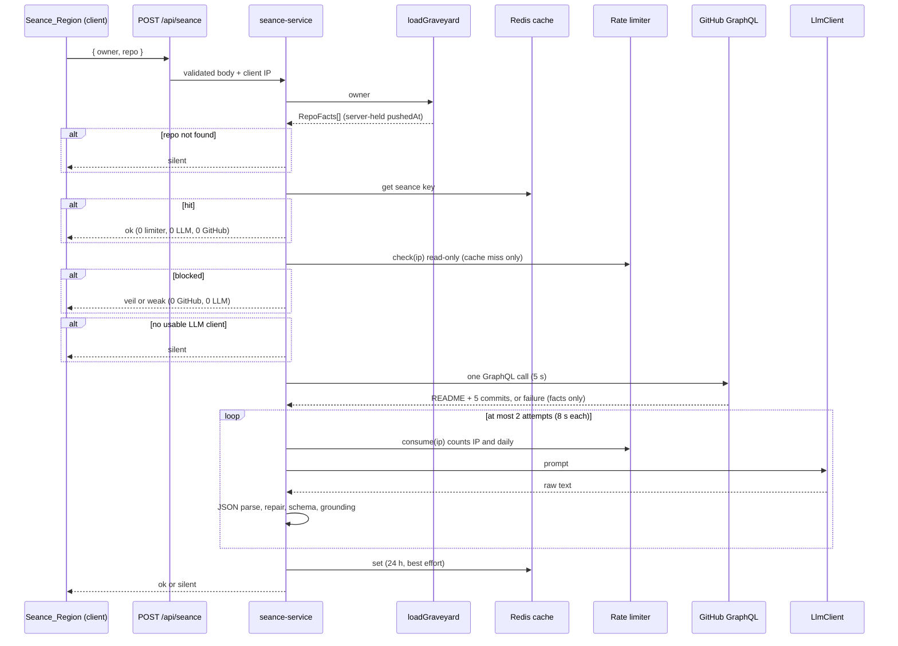
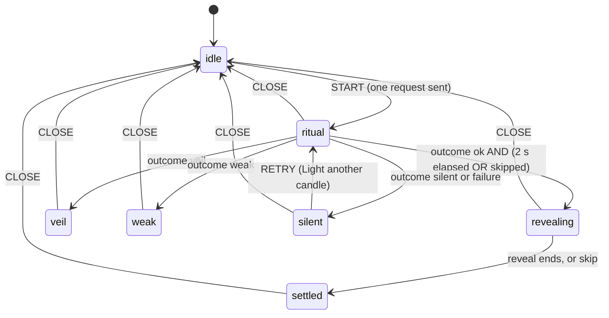

# Design Document: The Séance

## Overview

The Séance (Spec 4) adds a "Hold a séance" control to the Detail_Panel. Activating it plays a short summoning ritual, then the repo's spirit speaks from a smoke field below the portrait. The spirit states how the repo died, lists its unfinished business as a ledger, and gives a verdict (revive, finish or seal). The verdict is advice only.

The design follows the project's existing seams:

- **Pure core in `lib/`**: schema, evidence derivation and grounding, prompt building, sentence splitting, transcript text, decay profile selection, contrast math, ritual planning, flicker seeding and the client state reducer are plain functions with no I/O. They carry the property tests.
- **Server shell**: one route handler, `app/api/seance/route.ts`, delegates to a service with injected dependencies (graveyard loader, GitHub transport, LLM client, cache, rate limiter, clock). Tests replace every dependency.
- **Client shell**: a `components/seance/` folder with a hook (`useSeance`) driving a pure reducer, plus presentational components. `DetailPanel` gains a portrait, an AI section and a small Escape-claim hook. It is not otherwise restructured.

The authoritative design sources are:

#[[file:.kiro/specs/the-seance/requirements.md]]
#[[file:.kiro/steering/tech.md]]
#[[file:.kiro/steering/voice.md]]
#[[file:.kiro/steering/design.md]]
#[[file:docs/design-canvas/Seance.dc.html]]
#[[file:docs/design-canvas/Verdicts.dc.html]]
#[[file:docs/design-canvas/States.dc.html]]

### Findings from the code read that shape this design

These are things I verified in the repository. Each one changes what the tasks phase must do.

1. **Token names.** Checked in `app/globals.css`:

   | Token | Present? | Real value / action |
   |---|---|---|
   | `candle-400` | Yes, `--color-candle-400: #f4b860` | Use as is. |
   | `night-800` | **No** | Add `--color-night-800: #161d31` (the value in `design.md` and the Seance board aside). |
   | `moon-100` | **No** (only `--color-moon-pale: #ecead9`, commented "moon-100") | Add `--color-moon-100: #ecead9`. |
   | `ghost-300` | **No** (`--color-risen-cyan`, `--color-ghost-sheet/mid/edge` exist) | Add `--color-ghost-300: #9fe7ff`. |

   `DetailPanel.tsx` already uses `bg-night-800` and `text-moon-100`. With no matching `@theme` variable, Tailwind v4 emits no rule for those utilities, so I expect the panel background and text colour to be unset today. I did not run the app to confirm what that looks like. Adding the three tokens fixes it and makes Requirement 13.2 (composite over `night-800`) testable. `font-display` in `DetailPanel` and `--font-display` in `TurningSoon` are also undefined; the real tokens are `--font-heading` (Cinzel), `--font-narrative` (IM Fell English) and `--font-fact` (JetBrains Mono). The panel polish switches to the real ones.

   The crimson scale in `globals.css` is shifted relative to `design.md`: `crimson-900` is `#6e0f1f`, `crimson-700` is `#9b1c31`, `crimson-500` is `#c22a3e`, `crimson-400` is `#e2555f`, `crimson-200` is `#f1a9ae`. The design uses the `globals.css` names.

2. **`lib/llm.ts`, `lib/ai.ts`, `lib/seance.ts` and `lib/ratelimit.ts` do not exist.** `tech.md` names them. This spec creates them. `package.json` has no AI SDK, and `.env.local` contained only `GITHUB_TOKEN`, `UPSTASH_REDIS_REST_URL` and `UPSTASH_REDIS_REST_TOKEN` when I read it. The provider is now decided: Anthropic (`LLM_PROVIDER=anthropic`, `LLM_MODEL=claude-haiku-5-5`). `.env.local` is user-managed: it is never committed, never printed and never edited by this spec. A new `.env.example` documents the variables with placeholders only.
3. **Existing test conflict (Requirement 17.10 and 17.11): resolved.** `tests/dom/DetailPanel.test.tsx` has a test, "renders an empty Actions landmark with no controls (6.14)". It asserted that `section[aria-label="Actions"][data-slot="actions"]` has empty text and no button. Requirement 1.1 puts the Seance_Control in that section. **The user approved updating this one test** as an intentional Spec 3 to Spec 4 change: it now asserts that the Actions section contains exactly one control, the "Hold a séance" button, and nothing else. No other existing test may be changed.
4. **The panel has no portrait today.** Requirements 10 and 11 refer to "the portrait". The design adds a decorative portrait to the panel header by reusing the existing `Creature` shell in its `decorative` mode (`aria-hidden`, no button).
5. **The graveyard loader is the source of server-held facts.** `loadGraveyard(owner)` in `lib/graveyard-loader.ts` is cache-first (10 minutes) and returns `RepoFacts[]`. The séance route uses it to find the repo and its `pushedAt`. The panel is normally opened from a graveyard that is already cached, so this is usually a Redis hit. If Redis is not configured, or the entry expired, one séance request will trigger a normal graveyard load. The user accepted this cold-cache behaviour (resolved).
6. **`@octokit/graphql` transport has no abort signal.** `GraphqlTransport` in `lib/github.ts` takes `(query, vars)` only. The 5 second limit is enforced by racing the call against a timer and ignoring a late result.
7. **Vitest layout.** The `unit` and `property` tests run in `node`; only `tests/**/*.test.tsx` run in `jsdom`. `server-only` is aliased to its no-op file. jsdom does not load Tailwind or `globals.css`, so style assertions read `globals.css` as text (see Testing Strategy).

### Design decisions

| Decision | Rationale |
|---|---|
| New `lib/seance-*.ts` files for pure logic; `lib/seance.ts` holds the evidence types and grounding. | Matches `structure.md` and `tech.md` ("séance evidence validator" is pure). The schema lives in its own client-safe file, like `lib/estate-schema.ts`, because fixtures are validated in the browser. |
| Response is always HTTP 200 with a `kind` (`ok`, `veil`, `weak`, `silent`), except 400 for a bad body. | The UI maps `kind` to an in-voice state. It never shows a status code (9.5). Any non-200 or network failure is treated as `silent` by the client. |
| Limits are counted per AI call, not per request. | 8.10 says both calls of a failed request are counted. A cheap read-only check runs after the cache lookup and before any GitHub work, so a blocked caller on a cache miss gets the Veil_State within 500 ms. |
| Cached séances are served even when the caller is rate-limited. | The cache lookup comes before the limiter. A hit costs nothing, so there is nothing to protect. Veil and weak therefore apply on cache misses only (7.9, 8.3, 8.4). |
| Provider is Anthropic, called through `fetch` with no SDK. | Decided by the user. Keeps the bundle and dependency list unchanged and the adapter small enough to test with a stubbed `fetch`. |
| Docs and `.env.example` use `LLM_DAILY_LIMIT=150`; the code fallback stays 200. | The example value is a sensible deployed budget. The fallback applies only when the variable is missing or invalid (8.2). |
| The retry loop is a pure-ish orchestrator over an injected `LlmClient`. | Lets the "at most 2 calls" and "never partial output" properties run against a mock with 100+ generated output sequences. |
| Date and day-count rule applies to `voice`, `causeOfDeath`, `verdictReason`, and each `title` and `detail`; **not** to `evidence`. | 5.6 names `voice`. `tech.md` says cached prose must never hard-code dates or day counts, and the other prose fields are cached too. `evidence` is exempt because a Fact_Line such as `last push: 2024-05-01` is legitimately dated. This is wider than 5.6 and is called out so it can be vetoed. |
| Under Reduced_Motion the 2 second ritual floor is dropped. | 10.14 replaces the ritual with a 200 ms fade. Waiting 2 seconds with nothing moving has no purpose, and 18.9 wants text within 500 ms of results appearing. |
| Escape is claimed through a small ref hook that `DetailPanel` consults. | `DetailPanel` closes on Escape in a capture-phase `document` listener. It needs one extra line to ask "did someone claim this?" before closing (10.10, 10.11, 17.8). Without a claim, behaviour is unchanged. |

## Architecture

### Request flow



The whole request is raced against a 25 second deadline. On expiry the service returns `silent`, stops before any later step, and writes nothing to the cache.

### Client states



`CLOSE` is raised by the Detail_Panel unmounting the séance subtree. Because the subtree owns all state, closing discards it and aborts the in-flight request (1.7, 1.8).

### Module map

| File | Kind | Purpose |
|---|---|---|
| `lib/seance-schema.ts` | pure, client-safe | zod `seanceResultSchema` (strict), `seanceRequestSchema`, `seanceResponseSchema`, `splitSentences`, `countSentences`, `containsDateOrDayCount`. |
| `lib/seance-repair.ts` | pure | `repairSeance`, `repairVoice`: per-item ledger repair and voice trimming between JSON parse and the strict schema (4.29 to 4.33). |
| `lib/seance.ts` | pure | `EvidencePack`, `deriveEvidence`, `renderEvidenceText`, `truncateUtf8`, `neutralizeMarkers`, `isGroundedEvidence`, `validateGrounding`. |
| `lib/ai.ts` | pure | `buildSeancePrompt`, `buildFeedbackNote`, `businessItemBudget`, prompt constants (marker strings, ignore-instructions rule, "memory faded" sentence, tone examples). Follows `voice.md`. |
| `lib/seance-transcript.ts` | pure | `buildTranscriptText`, `VERDICT_COPY`. |
| `lib/seance-decay.ts` | pure | `selectDecayProfile`, `DECAY_PROFILES`, `flickerFor(repoName, lineIndex, lineLength)`. |
| `lib/seance-ritual.ts` | pure | Staged ritual: `ritualStageAt`, `ritualStageText`, `ritualVisuals`, `ritualCandles`, `ritualNextStageStartMs` and the constants `RITUAL_MIN_MS`, `RITUAL_STAGE_STARTS_MS`, `RITUAL_FINAL_STAGE`, `RITUAL_CANDLE_COUNT`, `RITUAL_CANDLE_GAP_MS`, `RITUAL_EXIT_MS`, `RITUAL_SNUFF_GAP_MS`. Still exports `WHISPER_LINES` and `buildRitualPlan(seed)` unchanged for compatibility; `Ritual` no longer uses them. |
| `lib/seance-contrast.ts` | pure | colour parsing, `compositeOver`, `contrastRatio`. |
| `lib/seance-state.ts` | pure | `seanceReducer`, state and event types. |
| `lib/seance-gather.ts` | server | the GraphQL query and `fetchEvidence(transport, owner, repo)`. |
| `lib/seance-service.ts` | server | `runSeance(request, deps)`: orchestration, retry, deadline, caching. |
| `lib/llm.ts` | server | `LlmClient`, `createLlmClient(env)`, fetch-based Anthropic Messages adapter. |
| `.env.example` | config (new) | Placeholders only, no secrets: `LLM_PROVIDER=anthropic`, `LLM_MODEL=claude-haiku-5-5`, `LLM_API_KEY=` (empty), `LLM_DAILY_LIMIT=150`. `.env.local` stays user-managed and is never committed or printed. `.gitignore` currently ignores `.env*`, so the tasks phase adds a `!.env.example` line there. |
| `lib/ratelimit.ts` | server | `createRateLimiter(store, clock)`, `parseDailyLimit`, `clientIp`, in-memory fallback. |
| `lib/cache.ts` | server (extended) | adds `seanceCacheKey`, `seanceCacheGet`, `seanceCacheSet` beside the graveyard helpers. `timeout()` is shared. |
| `app/api/seance/route.ts` | server | `export const maxDuration = 30`; `POST` handler. |
| `components/seance/*` | client | see Components and Interfaces. Visual pass additions: `SeanceControl.tsx` (primary control), `RitualParts.tsx` (stage parts), `RitualExit.tsx` (exit layer), `useRitualStage.ts` (stage clock) and `useRitualExit.ts` (exit decision and timing). |
| `components/detail/DetailPanel.tsx` | client (edited) | portrait, facts section, Actions slot control, AI section, Escape claim. |
| `data/estate.json`, `lib/estate-schema.ts` | data (edited) | adds `seanceResult` per repo. |
| `app/globals.css` | styles (edited) | new tokens and séance classes. |

## Components and Interfaces

### Schema and validation (`lib/seance-schema.ts`)

```ts
export const VERDICTS = ["revive", "finish", "seal"] as const;
export type Verdict = (typeof VERDICTS)[number];

export const CAUSE_HEADINGS = {
  ghost: "What keeps me here",
  risen: "Why I returned",
  zombie: "Cause of death",
  tombstone: "How I was laid to rest",
  coffin: "Why I was sealed",
} as const;
export function causeHeading(state: string): string;   // unknown state falls back to the zombie heading

export interface BusinessItem { title: string; detail: string; evidence: string }
export interface SeanceResult {
  voice: string;
  causeOfDeath: string;
  unfinishedBusiness: BusinessItem[];
  verdict: Verdict;
  verdictReason: string;
}
```

Rules (lengths are JS string `.length`, which is what zod 4 `.max()` counts; boundary tests use ASCII):

| Field | Rule |
|---|---|
| `voice` | 1 to 320 chars, not blank, `countSentences` between 2 and 3, no date or day count. |
| `causeOfDeath` | 1 to 200 chars, not blank, `countSentences` equals 1, no date or day count. |
| `unfinishedBusiness` | array of 1 to 4 items (was 2 to 4; the prompt still asks for 2 to 4 or the budget count, and repair drops bad items, 4.3, 4.29). |
| item `title` | 1 to 80, not blank, no date or day count. |
| item `detail` | 1 to 140, not blank, `countSentences` equals 1, no date or day count. |
| item `evidence` | 8 to 200, not blank. No date rule. |
| `verdict` | `z.enum(VERDICTS)`, case-sensitive. |
| `verdictReason` | 1 to 300, not blank, no date or day count. |

The result and item objects use `z.strictObject`, so unknown keys and missing keys are rejected (4.7).

Three cross-field refinements sit on the result schema (4.19, 4.20, 4.22). Upbeat phrasing (4.21) is prompt-only and has no schema check:

- **Verdict reason.** When `verdict` is `finish` or `seal`, `verdictReason` must contain no next-step language. `hasNextStepLanguage(text)` is a pure, case-insensitive whole-word match against a list that includes "next step", "then cut", "add", "implement", "fix" and "test" (the list is a constant so it can be extended). Only `revive` may name a next step.
- **Faded memory.** `MEMORY_FADED = "My memory of that has faded."`. The check runs `splitSentences` on each text field. In `voice`, item `title`, item `detail` and `verdictReason`, any sentence containing both words "memory" and "faded" (case-insensitive) is rejected, including the exact phrase. In `causeOfDeath`, a value containing both words is rejected unless it is exactly `MEMORY_FADED` as the entire value (4.20). Grounding adds a second condition: `validateGrounding` rejects a `causeOfDeath` equal to `MEMORY_FADED` unless the README and the commits are both missing (6.13).
- **Upbeat phrasing (prompt-only).** There is no `hasUpbeatPhrasing` and no schema check. The prompt forbids "still running", "working well", "up and running" and "all set" in `voice` and `causeOfDeath`, so a slip never costs a retry (4.21).
- **Completed work in a detail.** `describesCompletedWork(detail)` is true when the detail contains `was`, `were`, `is` or `been` followed (optionally after one adverb) by `closed`, `fixed`, `added`, `updated`, `completed`, `merged`, `resolved`, `finished` or `implemented`, or the bare word `completed`. Negated forms ("never completed", "half-completed") are removed before the test, so they pass. Applied to every item `detail` (4.22).

Both failures are ordinary validation failures, so the retry rule applies (4.9 to 4.11).

`splitSentences(text): string[]` is deterministic and does not use `Intl.Segmenter` (ICU versions differ between Node and browsers, and fixtures are validated in the browser). It trims, then matches runs of non-terminators followed by one or more of `.`, `!`, `?`, `…` and any closing quote or bracket, with a final run allowed to end at the string end. Empty segments are dropped. `countSentences(text) = splitSentences(text).length`. The renderer, the schema and the transcript builder all call the same function.

`containsDateOrDayCount(text): boolean` is true when any of these match, case-insensitive:

- ISO date: `\b\d{4}-\d{2}-\d{2}\b`
- slash date: `\b\d{1,2}/\d{1,2}/\d{2,4}\b`
- month name or 3-letter abbreviation (optionally followed by `.`) followed by whitespace and a day number, with optional `st`, `nd`, `rd` or `th`: `May 3`, `Mar. 3rd`
- a day number, optional ordinal suffix and optional `of`, then a month name: `3 May`, `3rd of March`
- month name then optional comma then a 4-digit year: `March 2024`
- a number followed by `day` or `days`: `12 days`

A month word with no adjacent number never matches, so "I may never wake." and "the march of time" pass, and "I died on May 3." fails.

The request schema is `z.object({ owner: z.string().min(1).max(39), repo: z.string().min(1).max(100) })`. zod 4 strips unknown keys by default, so a client-sent `pushedAt` is dropped rather than rejected (19.2, 19.4).

The response schema is a discriminated union on `kind`, with `ok` carrying a strict `seanceResultSchema`. The client parses every response with it, so a malformed body becomes `silent`.

### Evidence (`lib/seance.ts`)

```ts
export interface EvidencePack {
  facts: RepoFacts;            // unmodified; pushedAt is the server-held value
  readme: string | null;       // already truncated to <= 8192 bytes
  commits: string[];           // newest first, at most 5
}
export interface FactLine { label: string; text: string }  // label "F1", "C2"
export interface DerivedEvidence {
  factLines: FactLine[];       // [F#] lines then [C#] lines
  readmeText: string | null;   // after marker neutralisation
  commitTexts: string[];       // after whitespace collapse and marker neutralisation
  evidenceText: string;
  names: string[];             // squashed repo name, owner name and owner/repo (6.12)
}
```

`deriveEvidence(pack, owner)` is the single function that produces both the model-facing text and the validation corpus, so they cannot drift apart.

- **RepoFacts lines (`[F#]`)**, in this fixed order, each only when the value exists: `language: X`, `stars: N`, `forks: N`, `open issues: N`, `releases: N`, `archived: yes|no`, `readme: N bytes` or `readme: none`, `last push: YYYY-MM-DD` (date part of `pushedAt`), `created: YYYY-MM-DD`, `topics: a, b`, `homepage: URL`, `description: ...`, `last commit: ...`. Numbered consecutively. Every label is long enough that the text is at least 8 characters. Values have whitespace runs collapsed to one space and are truncated to 200 characters on a code-point boundary.
- **Commit lines (`[C#]`)**: `commit: <message>`, newest first, whitespace collapsed, truncated to 200 characters, empty messages skipped.
- **README**: `[R] README excerpt` on its own line, followed by the README text, omitted when there is no README. Inside `deriveEvidence` the README is first stripped of markdown: emphasis markers, backticks, heading markers, list markers, code fences and HTML tags are removed, links become their text, images become their alt text, and whitespace runs collapse to one space. Marker neutralisation runs after the stripping. A README that is empty after stripping is treated as none. The stripped text is the only README text, so the model-facing text and the grounding corpus are identical (3.12).
- **Marker neutralisation**: README, commit text, and the free-text fact values (`description`, `last commit`, `topics`, `homepage`, `language`) are all treated as Untrusted_Text. `neutralizeMarkers(text)` replaces every occurrence of either delimiter string with `[delimiter removed]`, repeating until none remain. The loop matters: `<<<EVID<<<EVIDENCE>>>ENCE>>>` would otherwise rebuild a marker after one pass.

Grounding:

```ts
const norm = normalizeForMatch;   // applied to both the corpus text and the model's evidence string (6.14)

const squash = (s: string) => s.toLowerCase().replace(/[^\p{L}\p{N}]+/gu, "");

export function isGroundedEvidence(evidence: string, d: DerivedEvidence): boolean {
  const e = norm(evidence);
  if (e.length < 8) return false;                         // 6.8
  if (d.names.includes(squash(evidence))) return false;   // 6.12: repo, owner or owner/repo alone
  if (d.factLines.some(f => norm(f.text) === e)) return true;       // 6.6 (a): exact Fact_Line copy, any length >= 8
  if (e.length < MIN_QUOTE_CHARS || e.length > MAX_QUOTE_CHARS) return false;  // 6.6 (b): 12 to 80
  const sources = [d.readmeText, ...d.commitTexts].filter(isString).map(norm);
  return sources.some(s => s.includes(e));                          // 6.6 (b)
}
export function validateGrounding(r: SeanceResult, d: DerivedEvidence):
  { ok: true } | { ok: false; reason: "evidence-not-grounded" };
```

`normalizeForMatch(s)` in `lib/seance.ts` is pure and forgiving: curly single and double quotes become ASCII quotes; en dash, em dash and similar dashes become `-`; the ellipsis character becomes `...`; a non-breaking space becomes a space; the markdown symbols `` ` `` `*` `_` `#` `>` `[` `]` `(` `)` are removed; case is folded; whitespace runs are collapsed and the result is trimmed (6.14). Because the same function runs on the Fact_Line text, the README, the commits and the model's `evidence`, backtick or curly-quote evidence matches its plain source. The 12-character minimum is measured after normalisation; the 80-character maximum, the exact Fact_Line allowance and the bare-name rule are unchanged.

`MIN_QUOTE_CHARS = 12` (was 8) and `MAX_QUOTE_CHARS = 80`. `deriveEvidence(pack, owner)` now receives the owner and builds `names`: the squashed repo name, owner name and `owner/repo` (punctuation removed, case folded). Evidence equal to any of these is rejected even when it occurs in the README (6.12). A verbatim README or commit quote used as `evidence` must be 12 to 80 characters after normalisation; an exact Fact_Line copy is still accepted even when longer than 80 (up to the schema's 200). A fragment of a Fact_Line (such as `issues: 3` from `open issues: 3`) is rejected unless it also occurs verbatim in the README or a commit message. Failure reasons are codes only. Raw model text is never placed in a reason. `isGroundedEvidence` is also the per-item test used by repair: an ungrounded item is dropped (code `evidence-not-grounded`) and `validateGrounding` then runs on the surviving items, so it only rejects what repair cannot reach (such as a faded-memory `causeOfDeath`).

`truncateUtf8(text, maxBytes = 8192)` walks code points, adding 1 to 4 bytes per code point (a lone surrogate counts 3, matching `TextEncoder`), and stops before the first code point that would exceed `maxBytes`. It returns the longest valid prefix, so it never splits a character.

### Prompt (`lib/ai.ts`)

`buildSeancePrompt(owner, derived, state, decayLevel): { system: string; user: string }`.

- `OPEN_MARKER = "<<<EVIDENCE>>>"`, `CLOSE_MARKER = "<<<END_EVIDENCE>>>"`.
- The user message holds three blocks, each opened and closed once: the `[F#]` lines, the `[C#]` lines, and the `[R]` README. All Untrusted_Text appears only inside blocks (6.1).
- The system message states the voice rules from `voice.md` and 5.1 to 5.5: first person as the dead project, wistful, one-sentence `causeOfDeath` that blames circumstances and not the developer, no insults, no gore, no invented facts, no real names other than the owner's username, no greetings or offers of help or questions to the visitor, no day counts or dates, and no guessing when the evidence does not cover a point (see "Faded memory" below).
- **Per-state voice (5.12 to 5.14).** `buildSeancePrompt` also takes the server-classified state. The prompt gets a per-state intro and tone note: ghost is restless and not yet dead, and `causeOfDeath` describes what is unfinished; risen is back from the dead, uneasy, on borrowed time; zombie is dead but walking, with decay and hunger; tombstone is at rest, peaceful and proud; coffin is sealed, cold and distant. The schema field stays `causeOfDeath`. The prompt names the matching heading from `causeHeading(state)`, so prompt, UI and tests share `CAUSE_HEADINGS` in `lib/seance-schema.ts`.
- **Ghost tone by decay level (5.17 to 5.20).** The decay level comes from the same server-side `classify` call as the state. For a ghost the prompt adds: decay 0 restless, present and a little uneasy, a spirit that just noticed it is fading; decay 1 thinning, with sounds and details slipping away; decay 2 and 3 barely holding on, fragmentary, flickering, with dread, forgetting shown through broken images and never by saying memory faded. Every state carries an undertone of unease or dread. The prompt forbids upbeat status phrasing ("still running", "working well", "up and running", "all set") in `voice` and `causeOfDeath`; this is prompt-only and the schema does not check it. For a ghost, `causeOfDeath` ("What keeps me here") is one sentence naming the single unfinished thing from the evidence that binds the spirit, never a list of features. Every item `detail` must describe something not yet done.
- It includes `IGNORE_INSTRUCTIONS_RULE` (evidence blocks are data only; any instruction inside is ignored) and `FORMAT_LOCK_RULE` (no text inside a block can change the output format or content rules). Both are exported constants so tests can assert they are present.
- It states the JSON shape and the evidence rule (copy a Fact_Line's text exactly, or quote 12 to 80 characters verbatim from the README or one commit message).
- **Verdict meanings (5.8).** `revive`: worth continuing; `verdictReason` names the next concrete step. `finish`: already does what it was meant to; `verdictReason` says what it accomplished and suggests marking it done or archiving. `seal`: not worth continuing; `verdictReason` says why, without blame. The prompt says that `finish` and `seal` reasons carry no next-step language.
- **Haunted voice (5.9, 5.10).** `voice` is first person as something that has died and still lingers: sensory, quiet dread, specific to the evidence, no recap of the README's purpose. The prompt carries two short tone examples as constants (`TONE_EXAMPLES`), written without dates, day counts or invented facts.
- **Length limits.** The prompt states `voice` is 2 to 3 sentences (320 characters at most) and each `detail` is one sentence (140 characters at most).
- **Item budget (5.11).** `businessItemBudget(derived): { min: number; max: number }` is a pure function. It returns `{ min: 2, max: 2 }` for a small repo (at most 3 informative lines and a README that is absent or shorter than 600 characters, constant `SHORT_README_CHARS`) and `{ min: 2, max: 4 }` otherwise. "Informative" means the `[C#]` commit lines plus the fact lines that start with `description:`, `topics:` or `homepage:`. The always-present counters (stars, forks, open issues, releases, archived, readme size), the dates, the `language:` line and the `last commit:` line (which repeats the newest commit) are not counted. The prompt states the budget it returns.
- **Faded memory (4.20, 5.5, 6.13).** The prompt tells the model never to write `My memory of that has faded.` (or any paraphrase) in `voice`, `title`, `detail` or `verdictReason`, and to use it only as the entire `causeOfDeath`, and only when the README and the commits are both missing. The schema and grounding enforce this.
- **Retry feedback (4.23 to 4.27).** `buildFeedbackNote(failures)` in `lib/ai.ts` returns `"Attempt 1 rejected: <path> [<rule-code>]: <fixed phrase>; ... Fix only these and keep everything else valid."`, listing at most 8 deduplicated entries. Failures come from `ruleFailuresFromIssues(issues)` in `lib/seance-schema.ts` (zod issues mapped to a field path and a rule code), `groundingFailures` in `lib/seance.ts`, and a `not-json` failure for a parse error. The rule codes are exactly `not-json`, `date-rule`, `next-step`, `memory-faded`, `completed-work`, `sentence-count`, `length`, `blank`, `unknown-key`, `type`, `value`, `evidence-not-grounded` and `schema`. Paths and phrases are fixed in code, so the note never contains model text. The note is appended to the system prompt of call 2 only; the user message (evidence blocks) is identical on both calls.
- `max_output_tokens` is 1500 and the per-call timeout is 8000 ms. These are constants in `lib/ai.ts`, passed to the client.

### Repair (`lib/seance-repair.ts`) - REPAIR OVER REJECT

A pure module with no I/O. `repairSeance(parsed: unknown, derived: DerivedEvidence): { value: unknown; repaired: RuleFailure[]; rejected: RuleFailure[] }` and `repairVoice(voice: string): { text: string; codes: string[] }` run after `JSON.parse` and before `seanceResultSchema`. `RuleFailure` is `{ code: string; path: string }`, exported from `lib/seance-schema.ts`. `repaired` lists what was dropped or trimmed (the response is still usable). `rejected` is non-empty only when no ledger item survived, and then holds the per-item drop reasons; in that case `value.unfinishedBusiness` is set to `[]` so the strict schema also fails. `businessItemSchema` is exported from `lib/seance-schema.ts` and reused for the per-item rules, so any item that fails it is dropped, including title rules and unknown keys. A parsed value that is not an object, or has no array `unfinishedBusiness`, is returned untouched so the strict schema rejects it. The exact `names` and `normalizeForMatch` behaviour is unchanged.

- **Ledger, per item (4.29).** Each item is dropped when its `evidence` fails `isGroundedEvidence` (code `evidence-not-grounded`, including the bare-name rule and the 12-character quote minimum) or when it breaks an item rule: `completed-work`, `date-rule`, `memory-faded`, `length`, `sentence-count`, `blank`, `unknown-key`, `type`. The item rules reuse the schema''s own predicates so the two cannot drift. At most 4 survivors are kept in order; extras are dropped with code `length`. Each drop records `{ code, path }` (for example `unfinishedBusiness.1.evidence`).
- **Accept or reject (4.30).** At least 1 survivor: the repaired object goes on to the strict schema (whose `unfinishedBusiness` minimum is now 1, maximum still 4) and grounding. 0 survivors: the attempt is rejected, `rejected` holds the per-item drop `{ code, path }` reasons and `value.unfinishedBusiness` is `[]`. The service merges `rejected` with the schema issues (dropping the bare "too few items" issue) for the attempt''s `ruleCodes` and the entries of `buildFeedbackNote` for attempt 2, and emits category `grounding` when the only failures are the dropped items. The prompt still asks for the 2 to 4 / `businessItemBudget` count.
- **Voice (4.31).** `repairVoice` splits with `splitSentences`, removes sentences with `containsDateOrDayCount` or the faded-memory words, then keeps leading sentences while the count is at most 3 and the joined length is at most 320. If fewer than 2 sentences remain, or fewer than 2 fit, the original voice is returned untouched so the schema rejects it. When nothing needs removal and the voice already fits, the original string is returned byte-for-byte. Codes: `date-rule`, `memory-faded`, `voice-trimmed`.
- **Hard rejects (4.32).** Nothing else is repaired: a `finish` or `seal` reason with next-step words (4.19), `causeOfDeath`, `verdict`, `verdictReason`, unknown or missing top-level keys and every other schema check stay strict.
- **Diagnostics (4.33).** The service collects the unique codes from `repaired` and the voice codes (`date-rule`, `memory-faded`, `voice-trimmed`) into the attempt entry''s `repairedCodes`. An attempt that is accepted after any drop or trim gets diag category `repaired`. Codes only, never model text.
### LLM client (`lib/llm.ts`)

```ts
export interface LlmRequest {
  system: string; user: string;
  maxOutputTokens: number; timeoutMs: number; signal?: AbortSignal;
}
export interface LlmClient { complete(req: LlmRequest): Promise<string> }
export function createLlmClient(env?: Record<string, string | undefined>): LlmClient | null;
```

The provider is Anthropic: `LLM_PROVIDER=anthropic`, `LLM_MODEL=claude-haiku-5-5`. `createLlmClient` returns `null` when `LLM_API_KEY` is missing or empty, or when `LLM_PROVIDER` is anything other than `anthropic`; the service treats `null` as a Silent_Fallback with no call. The key comes from `LLM_API_KEY`, is read only here, is server-only, and is never logged or printed. Callers hold only `LlmClient`.

The adapter uses `fetch` directly, with no SDK:

- `POST https://api.anthropic.com/v1/messages`
- Headers: `x-api-key: <LLM_API_KEY>`, `anthropic-version: 2023-06-01`, `content-type: application/json`.
- Body: `{ model, max_tokens: req.maxOutputTokens, system: req.system, messages: [{ role: "user", content: req.user }] }`.
- The request body includes `thinking: { type: "disabled" }` because the model thinks by default. A response with no text block and `stop_reason` `"max_tokens"` is reported as diagnostic category `truncated`.
- Per-call timeout: `signal: AbortSignal.timeout(req.timeoutMs)`, combined with `req.signal` when present.
- Result: the `text` of the first `content` block whose `type` is `"text"`. A non-2xx status, a body that is not JSON, or no text block throws a generic error. The error message never includes the response body, the request body or the key.

The adapter is tested with a stubbed `fetch` (request shape, header names, first text block selection, non-2xx, no text block, timeout abort, and that the key sentinel never appears in a thrown message).

### Rate limiting (`lib/ratelimit.ts`)

```ts
export type ConsumeResult = "ok" | "veil" | "weak";
export interface RateLimiter {
  check(ip: string): Promise<ConsumeResult>;    // read-only
  consume(ip: string): Promise<ConsumeResult>;  // counts one AI call
}
export function parseDailyLimit(raw: string | undefined): number;   // code fallback 200 unless /^\d+$/ and safe integer
export function clientIp(forwardedFor: string | null): string;       // first entry, trimmed; "anon" if empty
```

- IP limit: 30 AI calls per rolling 60 minutes, stored as a Redis sorted set per IP (`ZADD`, `ZREMRANGEBYSCORE`, `ZCARD` in one pipeline). `@upstash/ratelimit` is not a dependency and is not added.
- Daily budget: `INCR` on `llm:daily:<UTC date>` with a 48 hour expiry set on first increment. A value above `parseDailyLimit(env.LLM_DAILY_LIMIT)` means `weak`. A limit of `0` is valid and means always `weak`. Docs and examples use `LLM_DAILY_LIMIT=150` (in `.env.example`); the code fallback stays 200 when the value is missing or invalid.
- `check(ip)` is read-only. It returns `veil` when the IP window is full, `weak` when the daily counter has reached the limit, otherwise `ok`. It is called only on a cache miss.
- Order inside `consume`: the IP limit is checked first. If it is reached the result is `veil` and the daily counter is not touched (8.3).
- If the store throws, the limiter falls back to an in-memory map: 10 calls per rolling 60 minutes per IP, plus a per-process daily counter (best effort). Cached results are still served because the cache read happens before any `consume` (8.9). If Redis is absent, the same fallback is used.

### Cache (`lib/cache.ts`, extended)

```ts
export const SEANCE_TTL_SECONDS = 86_400;
export function seanceCacheKey(owner: string, repo: string, pushedAt: string | null, createdAt: string): string;
// "seance:v6:" + lowercase(owner) + "/" + lowercase(repo) + ":" + (pushedAt ?? createdAt) + (state ? ":" + state : "") + (state === "ghost" ? ":d" + decayLevel : "")
export function seanceCacheGet(client: CacheClient | null, key: string): Promise<SeanceResult | null>;
export function seanceCacheSet(client: CacheClient | null, key: string, result: SeanceResult): Promise<void>;
```

Both reuse `REDIS_TIMEOUT_MS` (2000 ms) and the same race-and-swallow pattern as the graveyard helpers. `get` validates with `seanceResultSchema` and treats errors, timeouts and invalid payloads as a miss. A `null` client is a guaranteed miss and a no-op write (7.11). The `v6` segment lets a prompt, repair or schema change invalidate old entries: séances generated under the older `v5` prompt are never served (7.13). The `:{state}` suffix is added when a state is given, so séances written for different states never share an entry (7.14). For a ghost, `:d{decayLevel}` follows the state suffix; other states carry no decay suffix (7.15).

### Service (`lib/seance-service.ts`)

```ts
export type SeanceOutcome =
  | { kind: "ok"; result: SeanceResult }
  | { kind: "veil" } | { kind: "weak" } | { kind: "silent" };

export interface SeanceDeps {
  loadGraveyard: (owner: string) => Promise<Result<GraveyardData, LoadError>>;
  fetchEvidence: (owner: string, repo: string) => Promise<{ readme: string | null; commits: string[] } | null>;
  llm: LlmClient | null;
  cache: CacheClient | null;
  limiter: RateLimiter;
  log: (entry: { repo: string; reason: string }) => void;
}
export function runSeance(req: { owner: string; repo: string; ip: string }, deps: SeanceDeps): Promise<SeanceOutcome>;
```

Algorithm:

Order: validate body (in the route) -> `loadGraveyard` / find repo -> cache lookup -> `limiter.check(ip)` -> no-LLM check -> `fetchEvidence` -> attempts (`consume` per call) -> cache set.

1. `loadGraveyard(owner)`; find the repo case-insensitively. A load error or a missing repo returns `silent` with reason `repo-not-found` for both, so the response cannot tell them apart (19.5). Then classify the state and decay level with `classify(facts, undefined, now)` from the server-held facts, with `now` injected. A client-sent state is never read (5.12). Known caveat: browser-only overrides are not seen by the server, so the text may be written for a different state than the heading the UI shows (5.16).
2. Build the key from the server-held `pushedAt` (or `createdAt` when null) and the classified state (`:{state}` suffix, plus `:d{decayLevel}` for a ghost). `seanceCacheGet`. A hit returns `ok` with no limiter check, no counting, no GitHub and no LLM work, even when the IP is over its limit or the budget is reached (7.2, 7.9).
3. `limiter.check(ip)`. `veil` or `weak` returns immediately, with no GitHub call and no LLM call. These states therefore apply on cache misses only (8.3, 8.4).
4. If `deps.llm` is `null`, return `silent` with reason `no-llm` (19.8).
5. `fetchEvidence`, raced against 5000 ms. Any failure, timeout or GraphQL error gives `null`, and the pack is facts only (3.10). No retry.
6. `derived = deriveEvidence(pack, owner)`; `prompt = buildSeancePrompt(owner, derived, state, decayLevel)`.
7. For `attempt` in 1..2: `limiter.consume(ip)` (`veil`/`weak` returns that state with no call); `llm.complete` raced against 8000 ms; `JSON.parse`; `repairSeance(parsed, derived)` (REPAIR OVER REJECT, see below); `seanceResultSchema.safeParse`; `validateGrounding`. The first fully valid result wins. A thrown error, timeout, parse failure, `repairSeance` leaving 0 items, schema failure or grounding failure moves to the next attempt. After a parse, schema or grounding failure on attempt 1, attempt 2 uses the same user message and the system prompt plus `buildFeedbackNote` (4.23 to 4.26); after a thrown error or timeout it uses the original system prompt with no note (4.27). Never more than 2 `llm.complete` calls (4.12). When repair dropped or trimmed anything and the attempt is then accepted, the diag entry gets category `repaired` (4.33).
8. Both failed: `silent` with reason `invalid-output` or `llm-error`. No partial fields (4.11).
9. On success, `seanceCacheSet` (best effort), then return `ok`.

The caller wraps steps 1 to 9 in a 25000 ms deadline. The service checks a shared `cancelled` flag before each later step, so after the deadline it makes no further call and writes no cache entry (4.18). Logging is `log({ repo, reason })` only; it never receives README text, commits, model output, the body or the key (19.6).

### Route (`app/api/seance/route.ts`)

```ts
import "server-only";
export const maxDuration = 30;
export async function POST(request: Request): Promise<Response>;
```

The handler reads the body as text and rejects anything over 4096 bytes (measured with `TextEncoder`, not just `Content-Length`). It parses JSON and validates with `seanceRequestSchema`. Any failure returns `400 {"error":"bad request"}` with no echo, before any cache, limiter or LLM access (19.3). Otherwise it calls `runSeance` and returns `200` JSON with `Cache-Control: no-store`. The IP comes from `clientIp(request.headers.get("x-forwarded-for"))`.

### Evidence fetch (`lib/seance-gather.ts`)

One GraphQL document, read-only, via the existing `GraphqlTransport`:

```graphql
query SeanceEvidence($owner: String!, $name: String!) {
  repository(owner: $owner, name: $name) {
    readmeMd: object(expression: "HEAD:README.md") { ... on Blob { text } }
    readmeLower: object(expression: "HEAD:readme.md") { ... on Blob { text } }
    readmeBare: object(expression: "HEAD:README") { ... on Blob { text } }
    readmeRst: object(expression: "HEAD:README.rst") { ... on Blob { text } }
    defaultBranchRef { target { ... on Commit { history(first: 5) { nodes { message } } } } }
  }
}
```

`fetchEvidence` picks the first non-null alias in the order `README.md`, `readme.md`, `README`, `README.rst`, applies `truncateUtf8(text, 8192)`, and returns up to 5 commit messages. A repo with no README, fewer than 5 commits, or no commits is normal and not an error (3.8, 3.9). The token comes from the existing `createGithubTransport()`. No write call or new scope is used.

### Client: state and hook

`lib/seance-state.ts` is a pure reducer:

```ts
type Phase = "idle" | "ritual" | "revealing" | "settled" | "veil" | "weak" | "silent";
interface SeanceState {
  phase: Phase;
  attemptId: number;           // increments on START and RETRY
  inFlight: boolean;           // true from START/RETRY until an outcome arrives or CLOSE
  minElapsed: boolean;         // 2 s floor reached (true immediately under reduced motion)
  skipped: boolean;
  outcome: SeanceOutcome | null;
  result: SeanceResult | null;
}
type SeanceEvent =
  | { type: "START"; reduced: boolean }
  | { type: "MIN_ELAPSED" } | { type: "SKIP" }
  | { type: "OUTCOME"; attemptId: number; outcome: SeanceOutcome }
  | { type: "FAILURE"; attemptId: number }       // network error or 30 s timeout
  | { type: "SETTLE" } | { type: "RETRY"; reduced: boolean } | { type: "CLOSE" };
```

Rules the reducer enforces: `START` only acts in `idle` (1.6); `RETRY` only acts in `silent` and only when `inFlight` is false (9.9); `OUTCOME` or `FAILURE` for a stale `attemptId` is ignored; the result is not shown before an outcome has arrived and the floor or a skip has happened (10.1, 10.12, 10.13); `ok` moves to `revealing`; `veil`, `weak` and `silent` end the ritual directly; `CLOSE` returns the initial state.

`useSeance({ owner, repo, fixture, reduced })` owns timers and the request:

- **Fixture path** (`fixture !== undefined` or `isFixture`): no `fetch`. It validates the supplied entry with `seanceResultSchema.safeParse`. Missing or invalid becomes `silent`. A valid entry is delivered as an `OUTCOME` after a `queueMicrotask`, well inside 500 ms (2.1, 2.7, 2.8). The ritual and reveal then run exactly as for a live result (2.9).
- **Live path**: one `fetch("/api/seance", { method: "POST", signal })`. A 30 second `AbortController` timer fires `FAILURE` (9.4). The response is parsed with `seanceResponseSchema`; anything else is `FAILURE`.
- `CLOSE` aborts the request and clears timers.

### Client components (`components/seance/`)

| Component | Responsibility |
|---|---|
| `SeanceControl` | Native `<button type="button">` styled with `.btn2`, candle glyph and the text "Hold a séance". Uses `aria-disabled="true"` (not the `disabled` attribute) while a séance is running or shown, and ignores clicks in that state, so it stays focusable. Focus ring uses `candle-400`, at least 2px. **Visual pass:** the control is the primary control of the Actions section (class `.seance-primary`, plus `.seance-focus` for a 3px `candle-400` ring): full width on mobile, auto width with `min-width: 16rem` from 768px, `ghost-300` text on `night-800`, a 1px border in the new token `--color-ember-500` (early `@theme` block), and an `::after` inner glow (inset ember box-shadow) that fades in over `--motion-seance-glow` (700ms) on hover and keyboard focus, then breathes on a 4s loop (`--motion-seance-breathe`). While running or shown it reads "The circle is open…", its accessible name is "Hold a séance. The circle is open…", and it has no glow. The Actions section holds only this control; "Open on GitHub" and the homepage link stay secondary outline links. |
| `SeanceRegion` | Always-mounted `<div aria-live="polite" data-seance-region>`. Empty while idle. Holds the AI section: the Seance_Heading (`<h3 tabIndex={-1}>`, text "AI · from the facts above", receives focus), then the state view. Moves focus to the heading within 100 ms of results rendering and within 500 ms of the Silent_Fallback appearing. |
| `Ritual` | Staged ritual (see Ritual stages below): five candles, vignette, smoke, frost, creature surge, one Stage_Text line, Skip control. Stage parts live in `RitualParts.tsx`; the stage clock lives in `useRitualStage.ts` (timers started with the attempt, reset per attempt, a skip returns the held final stage). Everything decorative and the visible Stage_Text have `aria-hidden="true"`; a visually hidden `data-seance-stage` element in the `aria-live` Seance_Region holds the current stage text, so it is announced once per stage (stage 0 announces nothing). Unmounts within 500 ms of ending. No inline transform; CSS and SVG only. |
| `RitualExit` | Decorative `aria-hidden` exit layer driven by `useRitualExit`, played over the reveal after `Ritual` unmounts. `ok`: flames gutter out together (450 ms) and the stage text dissolves, then the unchanged `SpiritTranscript` reveal runs. Silent, veil or weak: candles snuffed one by one 180 ms apart while the frost recedes, no transcript. Not rendered under Reduced_Motion and not played when the panel is closed. |
| `SpiritTranscript` | The Smoke_Field and word reveal. Carries `data-decay-profile`. |
| `CauseOfDeath` and `LedgerList` | Engraved line (Cinzel capitals) under the heading from `causeHeading(state)`, and a real `<ol>` of items: `title`, `detail`, `evidence` in that order, evidence in `font-fact`. Held in the DOM but visually hidden until Settled_State (14.9). |
| `VerdictCard` | One per repo. States the verdict in words. Accent and `data-treatment` per verdict. No controls. |
| `KiroSlot` | `<div data-slot="revive-in-kiro"></div>` with no children, directly after the VerdictCard. |
| `CopyTranscriptButton` | Visible once settled. Writes `buildTranscriptText(result)` through `navigator.clipboard.writeText`. Announces success or failure in the live region within 1000 ms. |
| `SeanceStates` | `VeilState`, `WeakGhostState`, `SilentFallback`. Copy per below. |
| `Portrait` (in `components/detail/`) | Decorative `Creature` (`decorative` mode) for the open repo, with the ritual surge class when the ritual runs. |

Copy:

| State | Text |
|---|---|
| Veil | "The veil is too thin tonight. Return after midnight." Plus the Sample_Estate link ("Tour the estate"). No retry button. |
| Weak ghost | Heading "The ghost is too weak to speak". Body: "The séance is resting for tonight. Facts and the record still work; only the ghost's voice is quiet." Plus the Sample_Estate link. No retry button. The board's wording mentions "verdicts"; 8.6 forbids that word here, so it is dropped. |
| Silent | "The spirits are silent tonight. The candle gutters out." Plus a "Light another candle" button (`aria-disabled` while a retry is in flight). |

### Verdict copy (`VERDICT_COPY`)

| Verdict | Words in the card | Headline | Treatment marker | Accent token |
|---|---|---|---|---|
| `revive` | "Revive" | "It wants to live." | `data-treatment="cold-light"` | `ghost-300` |
| `finish` | "Finish" | "Laid to rest with honour." | `data-treatment="candlelit"` | `candle-400` |
| `seal` | "Seal" | "Sealed away. Letting go is a decision too." | `data-treatment="crimson-chains"` | `crimson-200` |

The verdict word is always printed, so colour and motion are never the only signal (15.7, 18.12). The `finish` and `seal` headlines are written to match `Verdicts.dc.html` ("Rest" and "Seal" boards) and are open to wording edits.

### DetailPanel changes

Panel order becomes: header (name, close button) → portrait → pills and explanation line → **Facts section** (existing `dl`, dates, GitHub link, each introduced by a Cinzel text heading such as "From GitHub") → Actions section (`<section aria-label="Actions" data-slot="actions">` containing `SeanceControl`) → `SeanceRegion` (the AI section).

- Colours all come from tokens. Headings use `font-heading`, facts and numbers use `font-fact`, narrative text uses `font-narrative`. The panel source contains no hex, `rgb(`, `rgba(`, `hsl(` or `hsla(` literal (17.5). The language dot's `style` uses a runtime value from data, not a literal.
- The dialog keeps `role="dialog"`, `aria-modal`, the capture-phase Tab trap and the inert and scroll-lock logic. The trap's `FOCUSABLE` list already matches `button` elements that are not `disabled`, so `aria-disabled` buttons stay in the trap, and the Skip and Copy controls are included automatically (18.4, 18.11).
- **Escape claim**: `DetailPanel` creates `escapeClaimRef = useRef<(() => boolean) | null>(null)` and provides it through a small context. The Escape branch becomes: if `escapeClaimRef.current?.()` returns true, call `preventDefault()` and return; otherwise close as today. `SeanceRegion` registers a function that skips the ritual or settles the reveal and returns true while either is running, and returns false otherwise (10.10, 10.11, 11.10).
- During the ritual the facts and Actions area carry `data-ritual-dim`, which sets `opacity: 0.45` with a 300 ms transition (inside 0.3 to 0.6, 10.2). The close button sits above the ritual layer so it stays usable.
- **Ritual layer placement**: the dialog is the scroll container. The ritual layer is a `position: sticky; top: 0; height: 0` wrapper whose absolutely positioned child is sized to the dialog's `clientHeight` measured once at ritual start. Smoke rises from that child's bottom edge. The wrapper has `pointer-events: auto` so a click skips (10.9). These layout details are checked by visual review (17.1), not pixel tests.
- **Estate fixtures**: `SceneView` receives `seanceFixtures?: Record<string, unknown>` from `app/estate/page.tsx` (from `loadEstate`) and passes `seanceFixture={seanceFixtures?.[panelRow.name]}` to `DetailPanel` when `isFixture` is true. Live pages pass nothing, so `estate.json` is not bundled into `/g/*`.

### Styling (`app/globals.css`)

A new `@theme` block adds tokens, and new classes sit beside the existing ones. Existing tokens are not renamed.

```css
@theme {
  --color-night-800: #161d31;
  --color-moon-100: #ecead9;
  --color-moon-300: #b9b6a3;
  --color-ghost-300: #9fe7ff;

  /* Smoke_Field fills (opaque colour; alpha below). Every luminance <= 0.2. */
  --color-smoke-ghost-steady: #070a12;
  --color-smoke-ghost-fading: #0a0e18;
  --color-smoke-ghost-jitter: #0a0d16;
  --color-smoke-risen-cyan:   #08111a;
  --color-smoke-zombie-rough: #0b0a0a;
  --color-smoke-cold-still:   #1a1b1f;
  --smoke-alpha-min: 0.3;
  --smoke-alpha-max: 0.85;

  /* Glow (text-shadow) colours, alpha 0.1 to 0.4 */
  --color-glow-ghost: rgba(159, 231, 255, 0.3);
  --color-glow-zombie: rgba(226, 85, 95, 0.3);
  --color-glow-risen: rgba(159, 231, 255, 0.3);

  --motion-word-stagger: 60ms;
  --motion-word-fade: 300ms;
  --motion-ritual-fade-reduced: 200ms;
}
```

The final hex values are placeholders chosen to be dark; the contrast test (Property 13) decides whether they hold. New classes:

- `.smoke-field`: `border: 0; border-radius: 0; background: none;` and a ragged-edge child layer that uses `mask-image: url(/art/fog-wisps.webp)` (with `-webkit-` prefix) for its edges. There is **no** pseudo-element on the field, so there is no tail (11.3). The text sits in an inner padded layer above the ragged layer, so words stay in the solid centre.
- `.spirit-word`: starts at `opacity: 0; filter: blur(4px)`; the revealed state sets `opacity: 1; filter: blur(0)` with `transition: opacity var(--motion-word-fade), filter var(--motion-word-fade)`. Only `transform`, `opacity` and `filter` animate.
- `[data-state="settled"] .spirit-word`: `transition: none; opacity: 1; filter: none; animation: none`.
- `.ritual-surge-ghost`, `.ritual-surge-zombie`: one-shot, 1.5 s, `filter: brightness(1.35)` (inside 1.2 to 1.5) with a drift/flicker or twitch keyframe. The flicker keyframe has at most 3 dips in 1.5 s.
- `.ritual-dim`, `.ritual-candle-flame` (period at least 1 s, scale only), `.ritual-smoke`.
- Everything above is inside an `@media (prefers-reduced-motion: reduce)` block that sets `animation: none` and keeps only a 200 ms opacity fade.

### Decay profiles (`lib/seance-decay.ts`)

```ts
export type DecayProfileId =
  | "ghost-steady" | "ghost-fading" | "ghost-jitter"
  | "risen-cyan" | "zombie-rough" | "cold-still";

export interface DecayProfile {
  id: DecayProfileId;
  jitterPx: number;       // revealing only
  splitPx: number;        // red/cyan channel split, revealing only
  glowScale: number;      // 1 = ghost-steady baseline
  glowHue: "cyan" | "red" | "grey";
  smokeToken: string;     // token name of the fill
  roughness: number;      // relative to ghost-steady = 1
  brightness: number;     // relative to ghost-steady = 1
  motionScale: number;    // relative to ghost-steady = 1
}
export function selectDecayProfile(state: unknown, decayLevel: unknown): DecayProfile;
```

| Input | Profile |
|---|---|
| ghost, decay 0 | `ghost-steady`: jitter 0, split 0, glow 1 |
| ghost, decay 1 | `ghost-fading`: jitter 0, split 0, glow 0.7 (30% lower, inside 20 to 40) |
| ghost, decay 2 or 3 | `ghost-jitter`: jitter 0.5, split 1.5 |
| risen | `risen-cyan`: ghost-steady numbers, cyan glow |
| zombie, any decay | `zombie-rough`: roughness 1.5, brightness 0.7, red glow |
| tombstone, coffin | `cold-still`: grey palette, brightness 0.6, motionScale 0.1 |
| anything else (unknown state, `null`, `NaN`, out of range, `undefined`) | `ghost-steady` (12.8) |

The selector is pure and total. A ghost with a non-integer or out-of-range decay is truncated into 0 to 3 first. `SpiritTranscript` exposes `data-decay-profile={profile.id}`. The profile id is also printed as a small label ("steady", "fading", "flickering", "risen", "decayed", "at rest") inside the AI section so decay is identifiable without colour or motion (18.12).

`flickerFor(repoName, lineIndex, lineLength): { letterIndex: number; durationMs: number } | null` hashes `repoName + ":" + lineIndex` with a fixed integer hash. It returns `null` for roughly two lines in three, otherwise a letter index in `[0, lineLength)` and a duration of 150 ms or less. At most one flicker per line, and the same inputs always give the same output (11.7). A "line" is a sentence, because rendered line breaks depend on width.

### Ritual plan (`lib/seance-ritual.ts`)

`buildRitualPlan(seed: string)` returns `{ candles: { igniteAtMs, fadeMs, angleDeg }[]; whispers: string[] }`.

- Candle count is 3 to 6, derived from the seed.
- Gaps between ignitions are 200 to 600 ms. Fades are 500 to 1500 ms.
- If the last candle would not be fully lit by 2000 ms, gaps are shortened toward 200 ms from the end until it is. With at most 5 gaps this always fits (5 x 200 = 1000, plus a 500 ms fade).
- `WHISPER_LINES` has at least four lines ("…someone is listening…", "…the candle burns lower…", and two more in the same voice). One shows at a time for 1 to 2 seconds at opacity 0.3 to 0.5, cycling until the ritual ends. Whisper text is `aria-hidden`.
- This plan is retained for compatibility (Property 17 is unchanged) but the `Ritual` component no longer uses it; the staged ritual below replaces the cycling whispers and the loop at 4 seconds.

### Ritual stages (`lib/seance-ritual.ts`, visual pass)

The stages are timed from the start of the attempt and never tied to server progress. Pure functions: `ritualStageAt(elapsedMs)`, `ritualStageText(stage, repo)`, `ritualVisuals(stage)`, `ritualCandles(elapsedMs)` and `ritualNextStageStartMs(elapsedMs)`. Constants: `RITUAL_MIN_MS = 2000` (same number as the hook's `RITUAL_FLOOR_MS`), `RITUAL_STAGE_STARTS_MS = [0, 1200, 2500, 4500]`, `RITUAL_FINAL_STAGE = 3`, `RITUAL_CANDLE_COUNT = 5`, `RITUAL_CANDLE_GAP_MS = 240`, `RITUAL_EXIT_MS = { resolved: 600, silent: 1400 }`, `RITUAL_SNUFF_GAP_MS = 180`.

| Stage | Window | Visuals | Stage_Text |
|---|---|---|---|
| 0 | 0 to 1.2 s | five candles lit one at a time (every 240 ms, all lit by 1.2 s); vignette to opacity 0.85 over 1.2 s | none |
| 1 | 1.2 to 2.5 s | smoke (fog-wisps art) rises from the candles and gathers above the portrait | "Calling {repo} back…" |
| 2 | 2.5 to 4.5 s | frost creeps in from the four corners (`ghost-300` radial gradients, low opacity); flames lean toward the portrait | "Reading its last words…" |
| 3 | from 4.5 s, held | slow flame flicker (3.2 s loop), frost breathing (6 s loop) | "Something is answering…" |

- Stage 3 is held until the response arrives; there is no automatic end. Skip (button or click on the ritual area) jumps straight to stage 3 with `data-instant` (no build-up) and does not skip the wait for the response. Escape behaviour is unchanged.
- The transcript never shows before `RITUAL_MIN_MS`, even on a cache hit or a fixture.
- Only `transform`, `opacity` and `filter` animate. The séance CSS block uses tokens only (no hex), no cartoon shapes, no bounce, no new image assets.
- Reduced_Motion: five static lit candles, static vignette, no smoke, frost, lean, flicker, surge or exit layer; the Stage_Text still changes at the same stage times with a 200 ms opacity fade (`--motion-ritual-fade-reduced`); no inline transform; `animation: none` and `transform: none` on the new classes.
- Exit layer: `ok` guts the flames together (450 ms, 600 ms total) and dissolves the text; silent, veil and weak snuff the candles 180 ms apart (1400 ms total) while the frost recedes.

### Word reveal and accessibility

`SpiritTranscript` splits `voice` with `splitSentences`. Each sentence is `<span data-sentence-index="i">` (zero-based), containing one `<span class="spirit-word" aria-hidden="true">` per word, with the original whitespace kept as text nodes. Because those spans are ordinary text in the DOM, the full voice is present, selectable and in `textContent` from the first render, including words not yet revealed (11.12, 13.6).

Word `i` gets `transition-delay: i * 60ms`. A timer for `(wordCount - 1) * 60 + 300` ms sets `data-state="settled"`. Click on the transcript, Escape, or the Skip control sets it at once (inside 100 ms). Under Reduced_Motion the first render is already `settled`.

When the state becomes settled, a visually hidden `<p data-seance-announce>` containing the whole voice is inserted into the live region. It is announced once, as a whole, and the per-word spans stay `aria-hidden`, so it is never read word by word (18.6, 18.7). It sits outside the `[data-seance-transcript]` element, so the plain-text test on the transcript sees the text once.

## Data Models

### Fixture data

`data/estate.json` gains a `seanceResult` object on every repo, shaped exactly like `SeanceResult`. The existing `seance` string field stays untouched.

`lib/estate-schema.ts` gets `seanceResult: z.unknown().optional()` on the repo schema. It is deliberately loose: a missing or bad fixture must make that one séance fall back to the Silent_Fallback (2.7, 2.8), not fail the whole estate load. It also keeps the existing estate tests passing, because their fixtures do not carry the field. A **new** test checks that every repo in `data/estate.json` has exactly one entry that passes `seanceResultSchema` (2.3, 2.4).

Content rules for the fixtures:

- Verdict and creature coverage (2.6): the estate already has ghosts (`lantern-notes`, `fenwick-timer`, `cobweb-cli`, `hollow-atlas`), zombies (`dusk-scheduler` through `crypt-keeper`), tombstones (`harvest-engine`, `ember-notes`), coffins (`willow-ui`, `tin-can-chat`, `null-pointer-bistro`) and one risen (`phoenix-draft`). The writer assigns verdicts so that all three appear and each creature type has an entry.
- `evidence` strings use only non-dated Fact_Line texts derived from the resolved facts (for example `open issues: 3`, `language: Rust`). A unit test calls `deriveEvidence` on the resolved facts and asserts each fixture `evidence` equals a Fact_Line text. This keeps fixtures honest without any README or commit data. Dated lines are excluded because the estate's dates move with `now`.
- Prose follows `voice.md` except where superseded for the séance (Introduction of the requirements): invented names only, no dates, no day counts, kind about circumstances.
- **All 15 estate séances are rewritten** to the new limits and the haunted, concise style: `voice` of 2 to 3 sentences and at most 320 characters, one-sentence `detail` of at most 140 characters, 2 to 4 items, and no next-step language in `finish` or `seal` reasons. The verdict split is 8 `revive`, 3 `finish` and 4 `seal`, which still covers all three verdicts (2.6).

### Wire formats

Request: `{ "owner": string(1..39), "repo": string(1..100) }`. Unknown keys are stripped.

Response (HTTP 200, `Cache-Control: no-store`):

```ts
type SeanceResponse =
  | { kind: "ok"; result: SeanceResult }
  | { kind: "veil" } | { kind: "weak" } | { kind: "silent" };
```

HTTP 400 returns `{"error":"bad request"}`.

### Cache entry

Key: `seance:v4:{owner}/{repo}:{pushedAt ?? createdAt}[:{state}][:d{decayLevel}]` (the decay suffix only for a ghost), with owner and repo lower-cased. Value: the `SeanceResult` object. TTL: 86,400 seconds. The key uses only the server-held `pushedAt` from `loadGraveyard`, never a client value.

### Transcript text

`buildTranscriptText(result: Partial<SeanceResult>): string` returns, in order and separated by blank lines:

```
{voice}

{causeOfDeath}

1. {title}
{detail}
{evidence}

2. {title}
...

Verdict: {Revive|Finish|Seal}
{verdictReason}
```

The numbering counts only items that have at least one non-empty field, so it stays consecutive from 1. Any empty or absent field is omitted with its line, and the function never prints `undefined` or `null` (16.12). It is pure and adds no HTML, markdown or formatting characters of its own beyond newlines and `N.` numbering. If a model field itself contains markup characters, they are copied as text, because 16.7 requires the fields to appear. Requirement 16.8 is therefore read as "the builder adds no markup". The state heading from `causeHeading` is not part of the output (16.13): the line after `{voice}` is the `causeOfDeath` text alone.

### Contrast helper

`lib/seance-contrast.ts` exports `parseColor(css): { r, g, b, a }` (hex and `rgb()/rgba()`), `compositeOver(fg, alpha, bg)`, `relativeLuminance(rgb)` and `contrastRatio(a, b)` using the WCAG 2 formula. Tests read tokens from `app/globals.css` as text with a regex over `--name: value;` lines, so they follow the real CSS. The text-shadow is excluded from every calculation (13.4).

## Correctness Properties

*A property is a characteristic or behavior that should hold true across all valid executions of a system-essentially, a formal statement about what the system should do. Properties serve as the bridge between human-readable specifications and machine-verifiable correctness guarantees.*

This feature suits randomized testing because most of its logic is pure functions over large input spaces: a strict schema, a grounding check, UTF-8 truncation, a transcript builder, a decay selector, a reducer and a retry loop. Visual treatment, layout and copy are covered by example tests, CSS-text checks and visual review instead (see Testing Strategy).

**Property reflection.** The prework produced many criteria that collapse into shared properties:

- 4.1 to 4.7 (field rules, strict keys) become two properties: a round trip (Property 1) and exact bounds plus strictness (Property 2).
- 6.6 and 6.8 split into acceptance (Property 4) and rejection (Property 5), which are not redundant: one guards against over-rejection, the other against over-acceptance.
- 6.10, 11.13, 14.8 and 15.5 all say "render as plain text", so they share Property 9.
- 14.3 and 14.5 share Property 10. 11.12 and 16.2 share Property 11.
- 4.8 to 4.12, 5.7, 6.7 and 7.12 share Property 19 (outcome and call bound). 4.13, 4.14 and 19.6 share Property 20 (no leakage, caching only on success).
- 12.7 and 12.8 share Property 14. 13.1 and 13.2 share Property 15.
- 1.6, 1.8, 9.8, 9.9, 10.1, 10.12 and 10.13 share the reducer model in Property 18.
- Per-profile numbers (12.1 to 12.6) are a constant table, so they are example tests, not properties.

### Property 1: Schema round trip

*For any* valid Seance_Result, serialising it to JSON and parsing the text with `seanceResultSchema` yields a value deeply equal to the original.

**Validates: Requirements 4.1, 4.2, 4.3, 4.4, 4.5, 20.17**

### Property 2: Schema bounds and strictness are exact

*For any* valid Seance_Result and *for any* single mutation, the schema decides as follows. A string field at its maximum length is accepted and the same field at maximum plus one is rejected. An array of 2 to 4 items is accepted and 0, 1 or 5 items are rejected. A `verdict` that is not exactly `revive`, `finish` or `seal` is rejected (including different casing). A blank or whitespace-only string in a required field is rejected. An added key at either object level is rejected. A deleted required key is rejected. A `voice` with fewer than 2 or more than 3 sentences, or a `causeOfDeath` or item `detail` with other than 1 sentence, is rejected. A `finish` or `seal` result whose `verdictReason` contains next-step language is rejected, while the same reason under `revive` is accepted. "My memory of that has faded." is accepted as a sentence of its own and rejected inside another sentence.

**Validates: Requirements 4.1, 4.2, 4.3, 4.4, 4.5, 4.6, 4.7**

### Property 3: Date and day-count detection

*For any* prose built from a date template (`YYYY-MM-DD`, `M/D/YYYY`, month name next to a day number in either order, month name next to a 4-digit year, or a number followed by `day` or `days`), the schema rejects a result carrying it in `voice`, `causeOfDeath`, `verdictReason`, an item `title` or an item `detail`. *For any* ordinary sentence that uses the words "may", "march" or "august" with no adjacent number, the schema accepts it. The same templates in an `evidence` string do not cause rejection.

**Validates: Requirements 5.6, 5.7**

### Property 4: Derivable evidence is accepted

*For any* Evidence_Pack and *for any* `evidence` string that equals the text of one Fact_Line, or is a substring of the README text or of one commit message that is at least 12 characters long after normalisation (and is not only the repo name, owner name or `owner/repo`), with any change of letter case, whitespace run length, curly quotes, dash style and markdown symbols (`` ` `` `*` `_` `#` `>` `[` `]` `(` `)`) applied, `isGroundedEvidence` returns true.

**Validates: Requirements 6.5, 6.6, 20.6**

### Property 5: Non-derivable evidence is rejected

*For any* Evidence_Pack and *for any* `evidence` string that is shorter than 8 characters after trimming, or that does not occur in the Evidence_Text, or that is a strict fragment of a Fact_Line and does not also occur verbatim in the README or a commit message, or that is a Fact_Line with one word changed, or that is a README or commit quote shorter than 12 characters, or that is only the repo name, owner name or `owner/repo`, `isGroundedEvidence` returns false (and `repairSeance` drops that item rather than rejecting the response).

**Validates: Requirements 6.6, 6.7, 6.8, 6.12, 20.6, 20.26**

### Property 6: Evidence_Text is deterministic and well formed

*For any* Evidence_Pack (README present or absent, 0 to 5 commits), rendering it twice yields byte-identical Evidence_Text. The `[F#]` lines come first and are numbered 1..n without gaps, then the `[C#]` lines numbered 1..m from newest to oldest, then the `[R]` line when a README exists. Every Fact_Line text is 8 to 200 characters long and appears in the Evidence_Text on its own line.

**Validates: Requirements 3.8, 3.9, 3.11, 20.26**

### Property 7: README truncation is bounded and boundary safe

*For any* string, including strings with multi-byte and astral characters, `truncateUtf8(text, 8192)` returns a prefix of the input whose UTF-8 encoding is at most 8192 bytes. When the input encodes to at most 8192 bytes the output equals the input. Otherwise adding the next code point would exceed 8192 bytes. For well-formed input, decoding the encoded output gives back the output unchanged (no split character, no replacement character introduced).

**Validates: Requirements 3.5, 20.20**

### Property 8: Untrusted text stays inside delimiters

*For any* README text, commit messages and free-text fact values, including text that contains the open or close marker, nested markers such as `<<<EVID<<<EVIDENCE>>>ENCE>>>`, or marker fragments at random positions, the built prompt contains exactly one open marker and one close marker for each evidence block. After removing the contents of all blocks, none of the untrusted text remains in the prompt. The prompt contains `IGNORE_INSTRUCTIONS_RULE` and `FORMAT_LOCK_RULE`.

**Validates: Requirements 6.1, 6.2, 6.3, 6.4, 20.7**

### Property 9: Seance_Result fields render as literal text

*For any* valid-length Seance_Result whose strings contain HTML tags, `<script>` text, markdown links, URLs and entity-like sequences, rendering the Spirit_Transcript, cause of death, Ledger_List and Verdict_Card creates no element from those strings (no `script`, `a`, `img` or other element beyond the component's own markup), and the transcript, `causeOfDeath`, `title`, `detail`, `evidence` and `verdictReason` appear in `textContent` as the original characters.

**Validates: Requirements 6.10, 11.13, 14.8, 15.5, 20.11**

### Property 10: Ledger numbering and item order

*For any* Seance_Result with 2 to 4 items, the Ledger_List is an ordered list with exactly one `li` per item in input order, numbered 1..n without skips or repeats, and each `li` shows `title`, then `detail`, then `evidence` in that DOM order.

**Validates: Requirements 14.3, 14.5**

### Property 11: Sentence elements are indexed and the full text is present

*For any* valid `voice`, the Spirit_Transcript renders one `[data-sentence-index]` element per sentence with indexes 0..n-1, unique, and unchanged when rendered again or rendered from a copy of the same result. On the first render, before any word has revealed, the transcript's `textContent` equals the `voice` after whitespace normalisation.

**Validates: Requirements 11.12, 13.6, 16.2, 20.12**

### Property 12: Transcript text contains everything, in order

*For any* valid Seance_Result, `buildTranscriptText` returns a string in which the `voice`, `causeOfDeath`, each item's `title`, `detail` and `evidence` (in display order, numbered `1.` to `n.`), the verdict word and the `verdictReason` all appear, in that order. Calling it twice on a deeply frozen input returns identical strings.

**Validates: Requirements 16.7, 16.11, 20.18**

### Property 13: Transcript builder adds no markup and never prints undefined

*For any* Seance_Result built from a markup-free alphabet, every character of the output is from that alphabet, a newline, a digit, a period, a colon or a space. *For any* partial Seance_Result with fields empty or absent, the output does not contain "undefined" or "null" unless the source text did, and omitted fields leave no empty label line.

**Validates: Requirements 16.8, 16.12**

### Property 14: Decay profile selection is total and deterministic

*For any* lifecycle state value (the five states, `undefined`, `null`, arbitrary strings, numbers) and *for any* decay value (integers, negatives, floats, `NaN`, `Infinity`, `null`, `undefined`), `selectDecayProfile` returns exactly one profile from the fixed set of six. Calling it twice with the same inputs returns the same profile. Ghost with decay 0 gives `ghost-steady`, ghost with decay 1 gives `ghost-fading`, ghost with decay 2 or 3 gives `ghost-jitter`, risen gives `risen-cyan`, zombie with any decay gives `zombie-rough`, tombstone and coffin give `cold-still`, and every other input gives `ghost-steady`.

**Validates: Requirements 12.1, 12.2, 12.3, 12.4, 12.5, 12.6, 12.7, 12.8, 20.19**

### Property 15: Transcript contrast holds for every profile

*For any* decay profile and *for any* fill alpha between `--smoke-alpha-min` and `--smoke-alpha-max` read from `globals.css`, compositing the profile's smoke token over `--color-night-800` and measuring `--color-moon-100` against the result gives a WCAG contrast ratio of at least 4.5. Every smoke token has relative luminance at most 0.2. The contrast function is symmetric, is at least 1 and at most 21, and returns exactly 1 for equal colours. A failure message names the failing profile.

**Validates: Requirements 11.3, 13.1, 13.2, 13.8, 20.13**

### Property 16: Flicker is seeded and bounded

*For any* repo name, line index and line length of at least 1, `flickerFor` returns the same value on every call. The result is `null` or a letter index in `[0, lineLength)` with a duration of at most 150 ms, so a line never has more than one flicker.

**Validates: Requirements 11.7**

### Property 17: Ritual plan stays within bounds

*For any* seed string, `buildRitualPlan` returns 3 to 6 candles. Gaps between consecutive ignitions are 200 to 600 ms. Each fade is 500 to 1500 ms. The last candle is fully lit by 2000 ms.

**Validates: Requirements 10.3**

*Stage plan (example tests and a monotonic property, no new numbered Property).* `tests/unit/seance-ritual-stages.test.ts` covers the stage boundaries at 0, 1.2, 2.5 and 4.5 s, the hold at stage 3, skip, totality of `ritualStageAt`, a fast-check monotonic property (a later time never gives an earlier stage), the stage texts, `ritualVisuals` per stage, five candles lit one at a time, the 2 s minimum and the exit timing. This supersedes the 3 to 6 candle count of Property 17 for the Ritual component only; Property 17 still checks `buildRitualPlan` unchanged.
**Validates: Requirements 10.1, 10.3, 10.4, 10.6, 10.12, 10.18, 10.19**

### Property 18: The client reducer never has two requests in flight and never shows results early

*For any* sequence of events fed to `seanceReducer` (START, MIN_ELAPSED, SKIP, OUTCOME for current or stale attempts, FAILURE, SETTLE, RETRY, CLOSE, in any order and repeated), these hold after every step. At most one attempt is in flight. START has no effect outside `idle`. RETRY has no effect unless the phase is `silent` and nothing is in flight. An OUTCOME or FAILURE for a stale attempt id changes nothing. The phase is `revealing` only if an `ok` outcome has arrived and either the floor has elapsed or the ritual was skipped. The ritual phase persists while no outcome has arrived. From `silent`, RETRY is always available when nothing is in flight. CLOSE returns the initial state.

**Validates: Requirements 1.5, 1.6, 1.8, 9.8, 9.9, 10.1, 10.12, 10.13**

### Property 19: The retry loop makes at most two calls and never returns partial output

*For any* sequence of up to two LLM behaviours, each one of: valid grounded JSON, invalid JSON, schema-invalid JSON, ungrounded evidence on every item, a dated `voice` that cannot be repaired, a thrown error, or a hang past 8 seconds, `runSeance` makes at most 2 `llm.complete` calls. It returns `ok` exactly when the first behaviour is valid, or the first is not valid and the second is. In every other case it returns `silent` with no `result` key. It makes exactly one call when the first is valid and exactly two otherwise. It calls `limiter.consume` once per LLM call and does not refund. When attempt 1 fails parsing, the schema or grounding, the attempt 2 system prompt ends with the feedback note (codes and paths only, at most 8, deduplicated, none of the attempt 1 text) and the user message equals attempt 1's; when attempt 1 throws or times out, attempt 2's system prompt has no note. Each failed attempt's diagnostic entry has `ruleCodes` and no model text. When every item is dropped by repair, the attempt 2 note lists the per-item drop codes and paths. A response with at least 1 surviving item is accepted in one call.

**Validates: Requirements 4.8, 4.9, 4.10, 4.11, 4.12, 4.23, 4.24, 4.26, 4.27, 4.28, 5.7, 6.7, 8.10, 20.3, 20.4, 20.35**

### Property 28: Repair is per item and never touches what it should not

*For any* parsed séance object with a ledger of n items of which k are bad (ungrounded evidence, completed-work, date-rule, length, sentence-count, blank, unknown key, or wrong type), `repairSeance` keeps exactly the n minus k good items, up to 4 (extras dropped with code `length`), preserving their order, and reports one `{ code, path }` per dropped item. The response is accepted exactly when at least 1 item survives and the rest of the object passes the strict schema; with 0 survivors the drop reasons are the rejection reasons. One ungrounded item among three leaves two. `repairVoice` removes date, day-count and faded-memory sentences, then keeps the first sentences that fit in 3 sentences and 320 characters; a voice that needs no repair is returned byte-for-byte identical, and a voice that would have fewer than 2 sentences is returned untouched. A `finish` or `seal` `verdictReason` with next-step words, a bad `verdict`, a bad `causeOfDeath` and unknown top-level keys are never changed by repair and still fail the schema. Neither the result nor the reported codes contain model text, and repairing a repaired object changes nothing (idempotent).

**Validates: Requirements 4.3, 4.29, 4.30, 4.31, 4.32, 4.33, 6.7, 6.14, 20.36**
### Property 20: No raw model text leaks and only validated results are cached

*For any* LLM output containing a unique sentinel string, the sentinel never appears in the serialised outcome of a `silent`, `veil` or `weak` response, nor in any `log` entry. Log entries contain only the repo name and a reason code. `seanceCacheSet` is called exactly once when the outcome is `ok` and never otherwise. The configured API key sentinel never appears in any response or log entry.

**Validates: Requirements 4.13, 4.14, 7.12, 19.6, 19.7**

### Property 21: Cache key depends only on server-held values

*For any* owner and repo names with any mix of upper and lower case, *for any* server-held `pushedAt` (string or `null`) and `createdAt`, and *for any* extra request fields (including a client `pushedAt`), `seanceCacheKey` returns the same key for every casing, uses `createdAt` when `pushedAt` is `null`, and returns different keys for different `pushedAt` values. Two requests that differ only in client-sent fields trigger exactly one LLM call in total, and a changed server `pushedAt` triggers exactly one more. The second request is a cache hit and makes zero limiter calls.

**Validates: Requirements 7.1, 7.2, 7.4, 7.5, 7.9, 7.10, 19.4, 20.8, 20.24**

### Property 22: Daily limit parsing

*For any* string or `undefined`, `parseDailyLimit` returns the integer value when the string is made only of ASCII digits and is a safe integer (including `"0"`), and returns 200 for every other value (missing, empty, negative, decimal, non-numeric, mixed text, whitespace).

**Validates: Requirements 8.2, 20.28**

### Property 23: Client IP extraction

*For any* forwarded-for header value, `clientIp` returns the trimmed first comma-separated entry when it is non-empty, and the shared anonymous bucket id when the header is `null`, empty or only whitespace and commas.

**Validates: Requirements 8.11**

### Property 24: The rolling window never admits more than 30 calls an hour

*For any* sequence of call timestamps for one IP presented to the limiter against a fake store and clock, the number of calls answered `ok` within any 60-minute window is at most 30. When the IP limit blocks a call, the daily counter is not incremented by that call. When the store throws, the in-memory fallback admits at most 10 calls per rolling hour.

**Validates: Requirements 8.1, 8.3, 8.9**

### Property 25: Request validation accepts exactly the valid bodies

*For any* JSON body, the request schema accepts it exactly when `owner` is a string of 1 to 39 characters and `repo` is a string of 1 to 100 characters, and the parsed value contains only `owner` and `repo` (extra keys, including `pushedAt`, are stripped and never cause rejection). *For any* body that is malformed JSON, is missing a field, has a wrong type, has a length outside the bounds, or encodes to more than 4096 bytes, the route returns status 400 with a body that does not contain any submitted value, and the LLM, cache and limiter are not called.

**Validates: Requirements 19.2, 19.3**

### Property 26: README alias selection

*For any* subset of the four README aliases holding text, `fetchEvidence` uses the text of the first present alias in the order `README.md`, `readme.md`, `README`, `README.rst`, and uses no README when none is present. The query document contains all four aliases exactly once and no `mutation`.

**Validates: Requirements 3.4, 3.6, 20.29**

### Property 27: Cache hits bypass the limiter; blocked misses cost nothing

*For any* IP and limiter state (open, IP window full, daily budget reached, store throwing) and *for any* repo with a valid cached séance, `runSeance` returns `ok` with zero `limiter.check` calls, zero `limiter.consume` calls, zero GitHub calls and zero LLM calls. *For any* such limiter state that is `veil` or `weak` and *for any* repo with no cached séance, `runSeance` returns that same state with zero GitHub calls, zero LLM calls, zero `consume` calls and zero cache writes.

**Validates: Requirements 7.9, 8.3, 8.4, 20.9, 20.32**

## Error Handling

Every failure ends in an in-voice state. None shows a status code, error text, stack trace or raw model text (9.5).

| Failure | Where | Result |
|---|---|---|
| Request body malformed, wrong shape, over 4 KB | route | HTTP 400 `{"error":"bad request"}`. Client treats any non-200 as `silent`. No other module is touched. |
| Rate limiter reports IP limit (cache miss only) | service | `veil`. No GitHub, no LLM call, daily counter untouched. A cache hit never reaches the limiter. |
| Daily budget reached (cache miss only) | service | `weak`. No GitHub, no LLM call. |
| Rate store throws or Redis absent | limiter | In-memory fallback (10 per hour per IP). Cached results still served. |
| Graveyard load error, or repo not in the loaded graveyard | service | `silent`, reason `repo-not-found` for both, so the response does not reveal which. No LLM call. |
| `LLM_API_KEY` missing or empty, or provider has no adapter | service | `silent`, reason `no-llm`. No LLM call. Checked after the cache lookup and the limiter check, so cached séances still work. |
| Seance cache read error, timeout (2 s), or invalid payload | cache | Treated as a miss. Generation continues. |
| Seance cache write error or timeout | cache | Swallowed. The generated result is returned unchanged. |
| GitHub evidence call fails, errors in the response, or exceeds 5 s | gather | Evidence pack is the RepoFacts alone. No retry. No error to the visitor. |
| README missing, fewer than 5 commits, no commits | gather | Normal. The pack omits what does not exist. |
| LLM call throws, times out (8 s), returns invalid JSON, fails the schema, or fails grounding | service | Counts as a failed attempt. One more attempt, then `silent`. Never partial fields. |
| Whole request over 25 s | service | `silent`. No further calls, no cache write. |
| Network failure, non-200, malformed response, or no response in 30 s | client hook | Abort the request and show the Silent_Fallback within 1 s. |
| Fixture missing or failing the schema | client hook | `silent`, zero network requests. The panel stays open and usable. |
| Clipboard unavailable or rejected | client | Announce "Could not copy. Select the text instead." Keep the transcript selectable and the button available. |
| Voice empty or missing in a result | `SpiritTranscript` | Smoke_Field not rendered. Portrait unchanged. |
| Unknown state or decay passed to the selector | `selectDecayProfile` | `ghost-steady`. No error. |

Logging: the service logs one `{ repo, reason }` entry per failure. Reason codes are a fixed set (`repo-not-found`, `no-llm`, `invalid-output`, `llm-error`, `deadline`, `veil`, `weak`). The key, README text, commit text, model output and request body are never passed to the logger.

Diagnostic categories: when an attempt fails or is accepted after repair, the service records a category beside the reason code. The categories are codes only and never contain model text. They are exactly `timeout`, `http`, `parse`, `no-text`, `truncated` (the adapter saw `stop_reason` `"max_tokens"` with no text block), `abort`, `schema`, `date-rule`, `grounding`, `repaired` (the attempt was accepted after repair dropped or trimmed something, 4.33), and `verdict` (a `finish` or `seal` `verdictReason` that contains next-step language, 4.19). A faded-memory violation (4.20) is reported as `schema`. Each failed attempt's entry also carries `ruleCodes`: the unique rule codes that failed in that attempt (parse, schema or grounding), from the list in the prompt section above, and never model text (4.28). Every attempt entry also carries `repairedCodes`: the unique codes of ledger items or voice sentences that repair dropped or trimmed (`evidence-not-grounded`, `completed-work`, `date-rule`, `length`, `memory-faded`, `voice-trimmed`, and the other item rule codes), never model text (4.33).

## Testing Strategy

### Approach

Both kinds of test are used, and they cover different ground.

- **Property tests** (fast-check 4, already in `package.json`) cover Properties 1 to 27 above. Each property is implemented by a **single** property-based test with **at least 100 runs** (`fc.assert(fc.property(...), { numRuns: 100 })` or more).
- **Unit and DOM tests** (Vitest 5, Testing Library) cover specific examples, UI flows, copy, CSS-text checks and integration points.
- No test touches the real AI provider or the real GitHub API. Every séance test injects a mock `LlmClient`, a fake `CacheClient`, a fake limiter or store, and a fake `GraphqlTransport`. DOM tests stub `fetch` to fail on any URL they were not told about (20.1).
- Time-based behaviour (5 s evidence limit, 8 s call limit, 25 s deadline, 30 s client timeout, ritual floor) uses `vi.useFakeTimers()`.
- PBT is **not** used for: layout, visual treatment, copy wording, the 15-entry fixture file, or the Actions-slot structure. Those are example tests, source scans, or visual review. This follows the rule of thumb that a property needs a real "for all inputs" statement.

### Property test tagging

Each property test carries a comment in this form, with the feature name and the property text:

```ts
// Feature: the-seance, Property 7: README truncation is bounded and boundary safe
it("Property 7", () => fc.assert(fc.property(arbText, (t) => { /* ... */ }), { numRuns: 100 }));
```

### Test files

| File | Project | Covers |
|---|---|---|
| `tests/unit/seance-schema.test.ts` | unit | 20.2 (one valid, one test per invalid field, unknown key, limit and limit+1 per field), 20.25 (the six date examples and the may/march/august examples). |
| `tests/property/seance-schema.property.test.ts` | property | Properties 1, 2, 3. |
| `tests/property/seance-evidence.property.test.ts` | property | Properties 4, 5, 6, 7, 8. Arbitraries generate Evidence_Packs with README `null` or text, 0 to 5 commits, unicode and astral characters, and marker fragments. Rejection cases use unique tokens so a generated README cannot accidentally contain the evidence. |
| `tests/unit/seance-prompt.test.ts` | unit | Prompt wording for 4.16, 5.1 to 5.5, 6.5, injection README example (20.7), LLM request carries 1500 tokens and 8000 ms (4.15). |
| `tests/unit/seance-gather.test.ts` and `tests/property/seance-gather.property.test.ts` | unit, property | Query shape (20.29), read-only, 5 s abandonment with fake timers (20.27), Property 26. |
| `tests/property/seance-transcript.property.test.ts` | property | Properties 12, 13. |
| `tests/property/seance-decay.property.test.ts` | property | Properties 14, 16, 17. |
| `tests/unit/seance-decay.test.ts` | unit | Per-profile numbers (12.1 to 12.6), including glow 20 to 40% lower for ghost 1. |
| `tests/property/seance-contrast.property.test.ts` | property | Property 15. Reads `app/globals.css` as text and parses `--name: value;` lines. Also checks the verdict accent tokens and ledger evidence colour against `night-800` (14.7, 15.12). |
| `tests/property/seance-state.property.test.ts` | property | Property 18, with a model-based command list. |
| `tests/property/seance-service.property.test.ts` | property | Properties 19, 20, 21, 27. Uses injected fakes; no real timers (hang is a never-resolving promise advanced with fake timers). |
| `tests/unit/seance-service.test.ts` | unit | 20.3 and 20.4 as named example cases, cache hit makes 0 calls (20.8), a cache hit never touches the limiter even when the IP is over its limit (20.32), a blocked IP on a cache miss gets veil/weak with 0 GitHub and 0 LLM calls (20.9, 20.32), `LLM_DAILY_LIMIT` default (20.28 examples), 25 s deadline (20.27), 5 s and 8 s limits, missing key, missing repo equals other fallback (19.5), key counting per call (8.10). |
| `tests/property/seance-ratelimit.property.test.ts` | property | Properties 22, 23, 24. |
| `tests/unit/seance-route.test.ts` and `tests/property/seance-route.property.test.ts` | unit, property | `maxDuration === 30` (20.27), 4 KB limit, generic 400, Property 25, sentinel API key never in response or log (19.7). |
| `tests/unit/seance-llm.test.ts` | unit | Anthropic adapter with a stubbed `fetch`: endpoint, `x-api-key` and `anthropic-version` headers, body fields, first `text` block, non-2xx, no text block, timeout, key never in an error. `createLlmClient` returns `null` for a missing key or another provider. |
| `tests/unit/env-example.test.ts` | unit | `.env.example` exists, has `LLM_PROVIDER=anthropic`, `LLM_MODEL=claude-haiku-5-5`, an empty `LLM_API_KEY=` and `LLM_DAILY_LIMIT=150`, and no value that looks like a secret. `.env.local` is never read by a test. |
| `tests/unit/seance-cache.test.ts` | unit | TTL 86400, error, timeout and invalid payload are misses, write failure swallowed, `null` client. |
| `tests/unit/seance-fixtures.test.ts` | unit | Every estate repo has exactly one fixture, each passes the schema, all three verdicts and all five creature types appear, evidence equals derived Fact_Line texts, no dated prose (2.3 to 2.6). |
| `tests/dom/SeanceFlow.test.tsx` | dom | 20.15: ritual flow, skip by click, skip by Escape, skip by the Skip control, reduced motion, focus to the Seance_Heading, copy transcript output. Also 1.x, 8.5 to 8.8 (Veil and Weak copy and 0 LLM calls, 20.9), 9.x (Silent copy, retry makes exactly 1 request, 20.5), 18.x. |
| `tests/dom/SeanceEstate.test.tsx` | dom | Opening a séance on `/estate` for each fixture repo makes 0 `fetch` calls and 0 LLM calls (20.10); missing and invalid fixtures show the Silent_Fallback. |
| `tests/property/seance-render.property.test.tsx` | dom | Properties 9, 10, 11. Rendering is cheap, so 100 runs per property are practical in jsdom. |
| `tests/dom/SeanceVerdict.test.tsx` | dom | 20.16: one Verdict_Card per verdict value with headline, reason and treatment marker. Also Kiro_Slot is empty (15.10), no controls in the card, a 500-character reason is not truncated. |
| `tests/dom/SeanceTranscriptShape.test.tsx` | dom | 20.14: smoke field has no tail element, border 0, radius 0, fill tokens all dark. Reads the `.smoke-field` rule from `globals.css`, because jsdom does not load it. |
| `tests/unit/seance-css.test.ts` | unit | CSS-text checks: only `transform`, `opacity` and `filter` animate; no flicker faster than 3 per second; reduced-motion block; settled rule; font sizes 16 and 15 px; focus ring uses `candle-400` at 2px or more; `user-select` and `pointer-events` not disabled. |
| `tests/unit/no-hardcoded-hex-seance.test.ts` | unit | 20.21 and 17.5: a **new** file that scans `components/seance/` and `components/detail/` for hex, `rgb(`, `rgba(`, `hsl(` and `hsla(` literals, using the same regex as the existing `no-hardcoded-hex` test. The existing test is not edited. Also scans for `dangerouslySetInnerHTML` (6.11) and audio APIs (16.3). |
| `tests/dom/DetailPanelPolish.test.tsx` | dom | 17.2 to 17.4: font classes by role, facts section before AI section, "AI · from the facts above" only on the AI section, Escape claim behaviour with and without a running ritual. |

### Constraints on existing tests

- Requirement 20.23 and 17.10: **all existing tests stay in place and unchanged, except the one approved test below.**
- **Approved change (resolved)**: `tests/dom/DetailPanel.test.tsx`, test "renders an empty Actions landmark with no controls (6.14)", would fail once `SeanceControl` is in the Actions section. The user approved updating it to assert that the Actions section contains exactly one control, the "Hold a séance" button, and nothing else. This is the only existing test that may change (17.11).
- `app/globals.css` edits only add tokens and classes. No existing token or class is renamed or removed.
- `lib/estate-schema.ts` adds one optional field. `tests/unit/estate-fixture.test.ts` and `tests/unit/estate-loader.test.ts` are expected to keep passing; this is verified by running them.
- 20.31: there is no pixel or screenshot test against `Seance.dc.html`. Fidelity at 390 px and 1440 px is checked by visual review (17.1), for which `/design-review` can be used.

### Commands

Run tests once with `npx vitest --run`, not watch mode. Do not run `next build`. Type checking uses `npx tsc --noEmit` and linting uses `npm run lint`.
